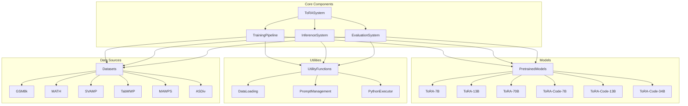
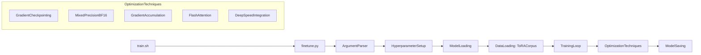
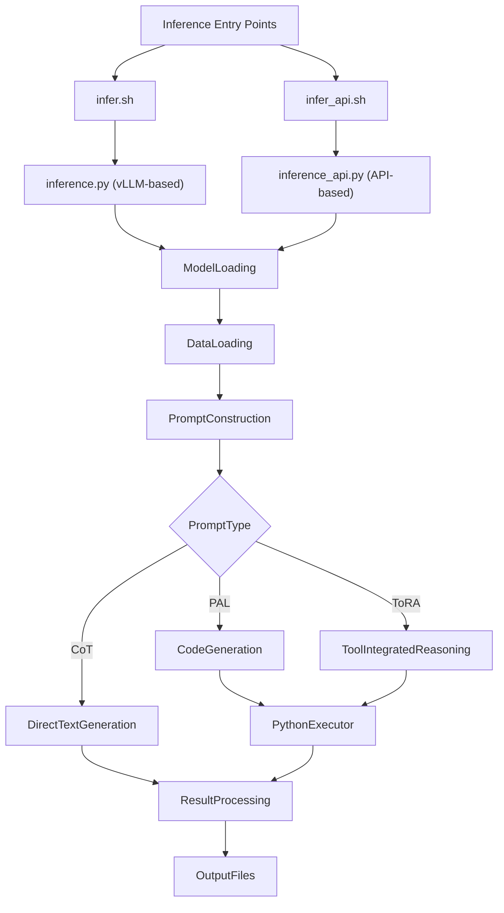
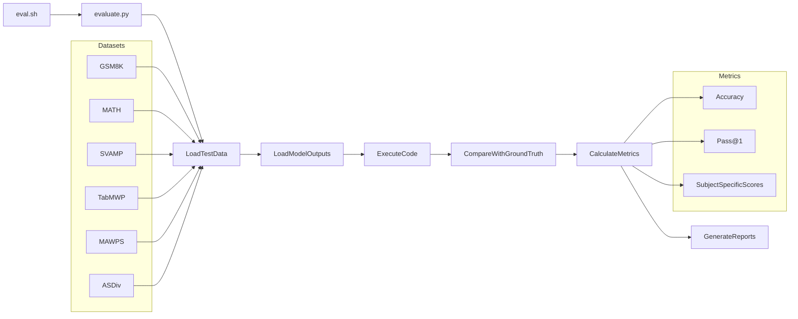
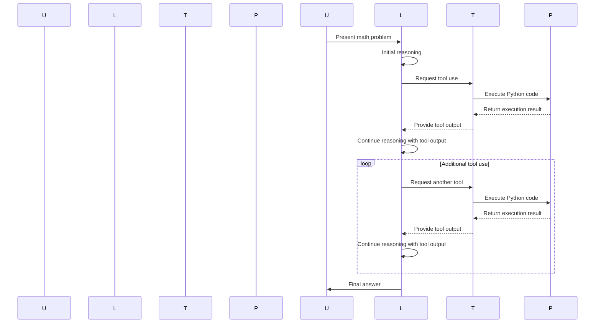
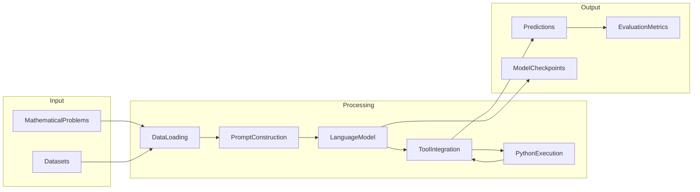
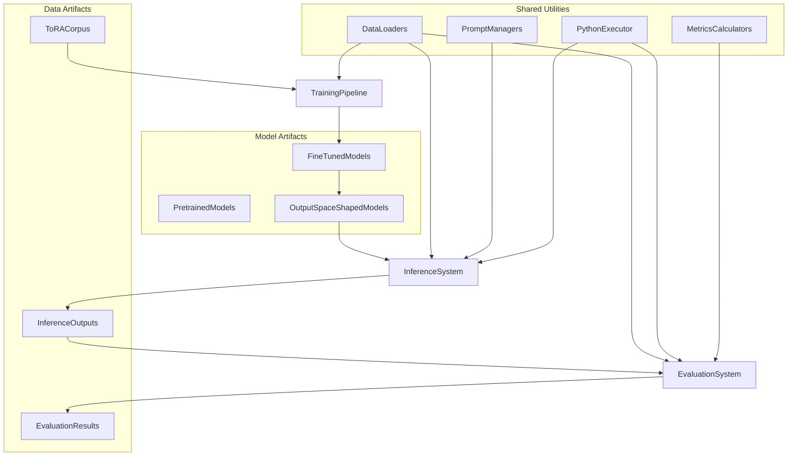

<!-- source: DeepWiki mcp.deepwiki.com · repo microsoft/ToRA · page 2 Core Components · fetched 2026-10-26 -->

# Core Components

Relevant source files

The following files were used as context for generating this wiki page:

- [README.md](README.md)
- [docs/index.html](docs/index.html)
- [src/requirements.txt](src/requirements.txt)
- [src/train/llama2_flash_attn_monkey_patch.py](src/train/llama2_flash_attn_monkey_patch.py)

This document describes the main architectural components of the ToRA system - a tool-integrated reasoning agent for mathematical problem solving. It provides an overview of the system's primary subsystems and how they interact. For details on specific components, see the pages for [Training Pipeline](#2.1), [Inference System](#2.2), [Evaluation System](#2.3), and [Tool-Integrated Reasoning](#2.4).

## System Architecture Overview

The ToRA system consists of three primary components - the Training Pipeline, Inference System, and Evaluation System - which work together to enable the training, deployment, and assessment of tool-integrated reasoning models.

Each core component fulfills a distinct role in the system:

1. **Training Pipeline**: Handles model fine-tuning using the ToRA-Corpus dataset and output space shaping techniques
2. **Inference System**: Provides mechanisms for model deployment and inference using both batch processing and API-based approaches
3. **Evaluation System**: Assesses model performance on mathematical reasoning tasks across various datasets

These components are supported by shared utilities like data loading modules, prompt management, and the Python code executor, which is central to ToRA's tool-integrated reasoning approach.

Sources: [README.md:49-51]()

## Training Pipeline

The Training Pipeline is responsible for fine-tuning pre-trained language models using the ToRA-Corpus dataset and applying output space shaping techniques to improve model performance.

The training process begins with the `train.sh` script, which configures model hyperparameters based on the model size and prepares the environment for training. The pipeline uses several advanced optimization techniques:

| Optimization Technique | Purpose |
|------------------------|---------|
| Gradient Checkpointing | Reduces memory usage by recomputing intermediate activations during the backward pass |
| Mixed Precision (BF16) | Accelerates training by using lower precision arithmetic where appropriate |
| Gradient Accumulation | Enables effective training with larger batch sizes by accumulating gradients over multiple forward/backward passes |
| Flash Attention | Optimizes attention computation for better performance |
| DeepSpeed Integration | Provides distributed training capabilities with optimization for large models |

The Flash Attention optimization is implemented through a custom monkey patch for LLaMA models in [src/train/llama2_flash_attn_monkey_patch.py](), which replaces the standard attention mechanism with an optimized version.

Sources: [README.md:79-85](), [src/train/llama2_flash_attn_monkey_patch.py:135-144]()

## Inference System

The Inference System provides mechanisms for deploying ToRA models and using them to solve mathematical problems. It supports both batch inference using vLLM and interactive API-based inference.

The inference system provides three main types of prompting approaches:

1. **Chain-of-Thought (CoT)**: Generates step-by-step natural language reasoning
2. **Program-Aided Learning (PAL)**: Solves problems by generating and executing Python code
3. **Tool-Integrated Reasoning (ToRA)**: Combines natural language reasoning with interactive tool use

When using the PAL or ToRA approaches, the system leverages the Python Executor to run generated code and feed the results back to the language model. This integration of natural language reasoning with computational tools is a key innovation of the ToRA system.

Sources: [README.md:104-108]()

## Evaluation System

The Evaluation System assesses the performance of ToRA models on mathematical reasoning tasks. It processes model outputs, verifies answers, and calculates accuracy metrics across various datasets.

The evaluation process begins with the `eval.sh` script, which calls `evaluate.py` to load test data and model outputs. If code execution is requested, the system executes the generated code before comparing predictions with ground truth. The evaluation system calculates various metrics including overall accuracy, pass@1 rate, and subject-specific scores for different mathematical domains.

The grading logic is based on the Hendrycks' MATH grading system and has been manually verified to minimize false positives and false negatives.

Sources: [README.md:113-136]()

## Tool-Integrated Reasoning Process

The Tool-Integrated Reasoning process is the core innovation of ToRA. It enables the model to interleave natural language reasoning with programmatic tool use for solving complex mathematical problems.

This sequence diagram illustrates the interaction pattern in ToRA:

1. The user presents a mathematical problem to the language model
2. The model performs initial reasoning in natural language
3. When computational steps are needed, the model requests tool use
4. The ToolManager invokes the PythonExecutor to run the code
5. The execution results are returned to the model
6. The model continues its reasoning with the new information
7. The process repeats as needed until the model reaches a final answer

This approach allows ToRA to combine the analytical reasoning capabilities of language models with the computational precision of programmatic tools.

Sources: [README.md:71-77]()

## Data Flow in ToRA System

The ToRA system processes data through several stages, from input mathematical problems to final predictions and evaluation metrics.

This diagram shows how data flows through the ToRA system:

1. Mathematical problems from various datasets are loaded and preprocessed
2. Prompts are constructed based on the selected reasoning approach
3. The language model generates initial reasoning and/or code
4. When using tool integration, the generated code is executed
5. The execution results inform further reasoning
6. The final predictions are produced and evaluated
7. During training, model checkpoints are saved for future use

This data flow enables ToRA to process complex mathematical problems through a combination of natural language reasoning and computational tool use.

Sources: [README.md:49-52]()

## Key Dependencies and Requirements

The ToRA system relies on several key libraries and dependencies to enable its functionality:

| Dependency | Purpose |
|------------|---------|
| PyTorch | Deep learning framework |
| Transformers | Hugging Face library for transformer models |
| vLLM | Inference acceleration for LLMs |
| DeepSpeed | Distributed training optimization |
| Flash Attention | Optimized attention implementation |
| SymPy | Symbolic mathematics library |
| CVXPY | Convex optimization library |

The full list of requirements can be found in [src/requirements.txt]().

Sources: [src/requirements.txt:1-35]()

## Integration Between Components

The three core components of ToRA - Training Pipeline, Inference System, and Evaluation System - are integrated through shared models, utilities, and data formats:

This diagram illustrates how the components share resources and how data and models flow between them. The training pipeline produces fine-tuned models, which are used by the inference system to generate outputs. These outputs are then assessed by the evaluation system. All components share common utilities like data loaders and the Python executor.

Sources: [README.md:49-52](), [README.md:104-108](), [README.md:113-136]()

---

