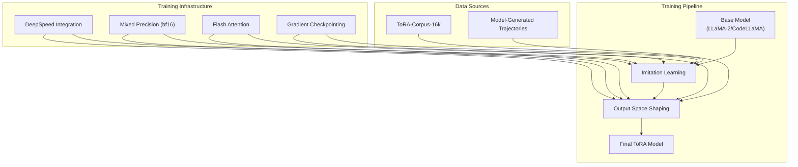
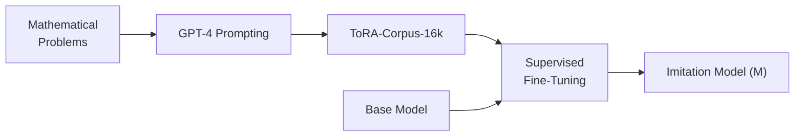
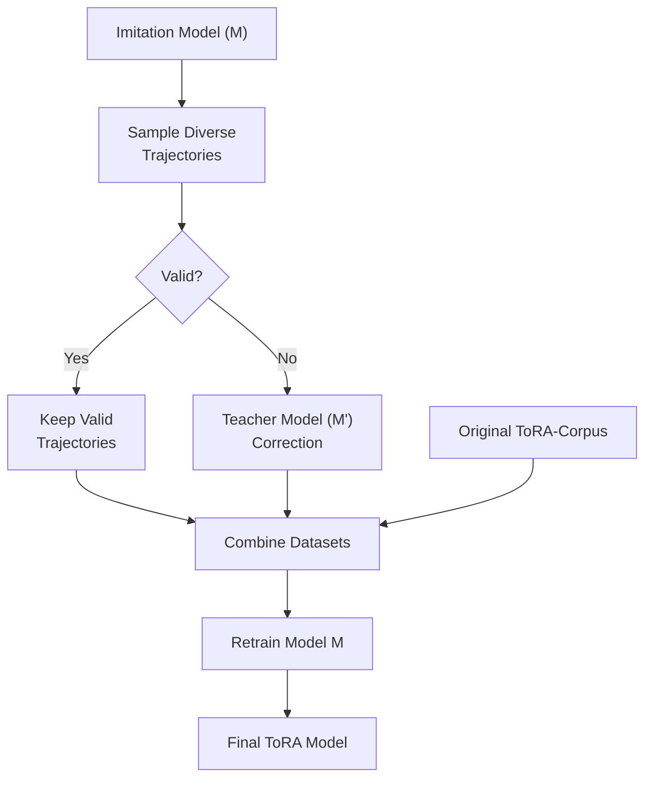
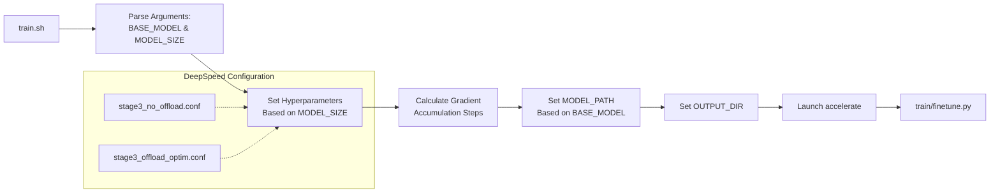
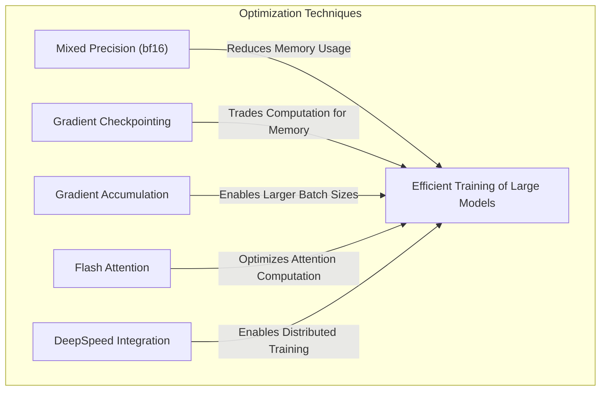
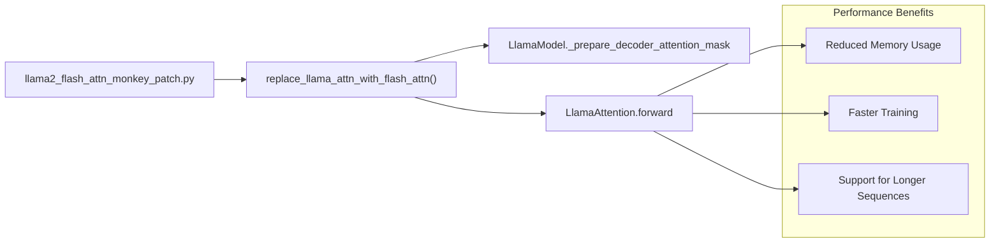
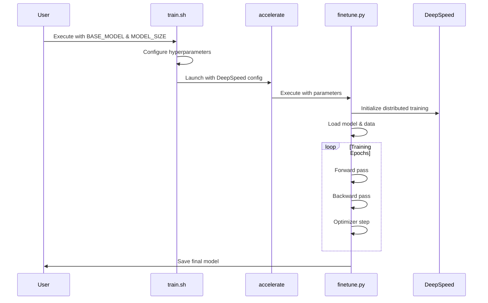
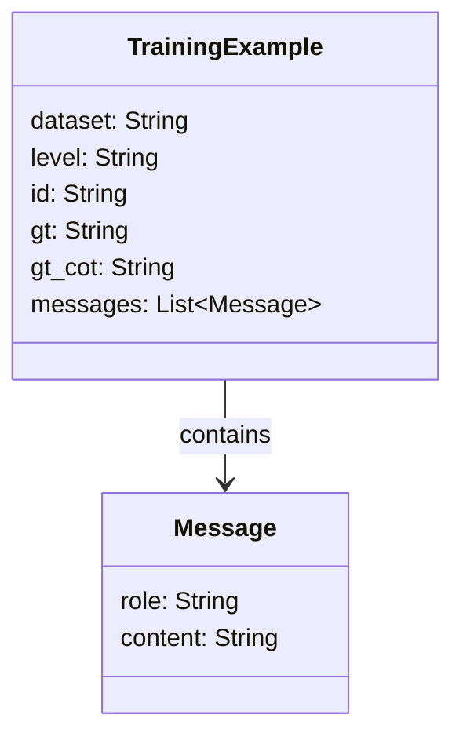

<!-- source: DeepWiki mcp.deepwiki.com · repo microsoft/ToRA · page 2.1 Training Pipeline · fetched 2026-10-26 -->

# Training Pipeline

Relevant source files

The following files were used as context for generating this wiki page:

- [README.md](README.md)
- [data/tora/examples.jsonl](data/tora/examples.jsonl)
- [docs/index.html](docs/index.html)
- [src/requirements.txt](src/requirements.txt)
- [src/scripts/train.sh](src/scripts/train.sh)
- [src/train/llama2_flash_attn_monkey_patch.py](src/train/llama2_flash_attn_monkey_patch.py)

The ToRA Training Pipeline is a comprehensive system for fine-tuning large language models (LLMs) to perform tool-integrated mathematical reasoning. This document explains the architecture, process flow, and key components of the training pipeline used to create the ToRA family of models. For information about inference and evaluation, see the [Inference System](#2.2) and [Evaluation System](#2.3) pages respectively.

## Overview

The ToRA training pipeline consists of two main phases: Imitation Learning and Output Space Shaping. The pipeline is designed to efficiently train models of various sizes (7B to 70B parameters) using distributed training techniques and optimization methods to handle the computational demands of large model training.

Sources: [README.md:79-86](), [src/scripts/train.sh:2-78]()

## Training Methodology

The ToRA training methodology involves a two-step process designed to maximize the model's ability to use computational tools while maintaining natural language reasoning capabilities.

### Imitation Learning

The first stage of training involves fine-tuning a base model on the ToRA-Corpus, a dataset containing approximately 16k high-quality examples of tool-integrated reasoning for mathematical problems. This dataset was created by prompting GPT-4 to generate interactive tool-use trajectories for problems from GSM8k and MATH datasets.

Sources: [README.md:67-78](), [data/tora/examples.jsonl:1-31]()

### Output Space Shaping

The second stage involves enriching the model's reasoning capabilities through a process called output space shaping:

1. The imitation model (M) samples diverse tool-use trajectories
2. Valid trajectories are retained
3. Invalid trajectories are corrected using a teacher model (M')
4. The model is retrained on the union of valid trajectories, corrected ones, and the initial ToRA-Corpus

This process significantly improves reasoning performance, enabling models to achieve over 50% accuracy on the competition-level MATH dataset.

Sources: [README.md:79-86]()

## Technical Implementation

### Configuration Based on Model Size

The training pipeline automatically configures hyperparameters based on the model size to optimize for both performance and resource utilization.

| Model Size | Learning Rate | Batch Size/GPU | Optimizer Offload | Total Batch Size |
|------------|---------------|----------------|-------------------|------------------|
| 7B/13B     | 2e-5          | 16             | No                | 128              |
| 34B        | 1e-5          | 8              | Yes               | 128              |
| 70B        | 1e-5          | 4              | Yes               | 128              |

Sources: [src/scripts/train.sh:8-24]()

### Training Infrastructure Setup

The training script sets up the necessary environment for distributed training, including CUDA device configuration and gradient accumulation calculation to maintain a consistent total batch size across different model scales.

Sources: [src/scripts/train.sh:36-48](), [src/requirements.txt:1-35]()

### Optimization Techniques

The training pipeline incorporates several optimization techniques to efficiently train large language models:

1. **Mixed Precision Training**: Uses bf16 format to reduce memory usage while maintaining numerical stability
2. **Gradient Checkpointing**: Reduces memory requirements by recomputing intermediate activations during backpropagation
3. **Gradient Accumulation**: Enables effective training with larger batch sizes by accumulating gradients across multiple forward and backward passes
4. **Flash Attention**: Optimizes the attention mechanism for better performance and reduced memory usage
5. **DeepSpeed Integration**: Provides optimization for distributed training across multiple GPUs

Sources: [src/scripts/train.sh:51-78](), [src/train/llama2_flash_attn_monkey_patch.py:1-241]()

### Flash Attention Implementation

The training pipeline uses a custom implementation of Flash Attention specifically optimized for LLaMA-based models. This implementation patches the native attention mechanism to enable faster and more memory-efficient computation of attention scores.

Sources: [src/train/llama2_flash_attn_monkey_patch.py:135-144]()

## Training Launch Process

The training pipeline is launched using accelerate, which manages the distributed training environment. The launch command specifies configurations for mixed precision, deepspeed integration, and model training parameters.

Sources: [src/scripts/train.sh:51-78]()

## Data Processing

The training pipeline works with the ToRA-Corpus dataset, which contains examples of tool-integrated reasoning for mathematical problems. Each example in the dataset includes:

1. A mathematical problem (user message)
2. A solution using Python code for computation (assistant message)
3. Metadata including the problem difficulty level and ground truth answer

The dataset format is designed to train the model to interleave natural language reasoning with program-based tool use, combining the advantages of language reasoning with computational tools.

Sources: [data/tora/examples.jsonl:1-31]()

## Model Configuration

The ToRA models are built on either LLaMA-2 or CodeLLaMA base models, with the latter showing better performance for mathematical reasoning tasks due to enhanced code capabilities. The training pipeline supports models of various sizes, including 7B, 13B, 34B, and 70B parameters.

| Model | Base Model | Size | GSM8k Accuracy | MATH Accuracy |
|-------|------------|------|----------------|---------------|
| ToRA-7B | LLaMA-2 | 7B | 68.8% | 40.1% |
| ToRA-Code-7B | CodeLLaMA | 7B | 72.6% | 44.6% |
| ToRA-13B | LLaMA-2 | 13B | 72.7% | 43.0% |
| ToRA-Code-13B | CodeLLaMA | 13B | 75.8% | 48.1% |
| ToRA-Code-34B | CodeLLaMA | 34B | 80.7% | 51.0% |
| ToRA-70B | LLaMA-2 | 70B | 84.3% | 49.7% |

Sources: [README.md:53-66]()

## Summary

The ToRA Training Pipeline represents a sophisticated approach to training large language models for mathematical reasoning with tool integration. By combining imitation learning with output space shaping, the pipeline enables models to leverage both natural language reasoning and computational tools, resulting in state-of-the-art performance on mathematical reasoning benchmarks.

The technical implementation addresses the challenges of training large models through distributed training, optimization techniques, and careful configuration based on model size. This approach has enabled ToRA-Code-34B to be the first open-source model to achieve over 50% accuracy on the MATH dataset, demonstrating the effectiveness of the training methodology.

---

