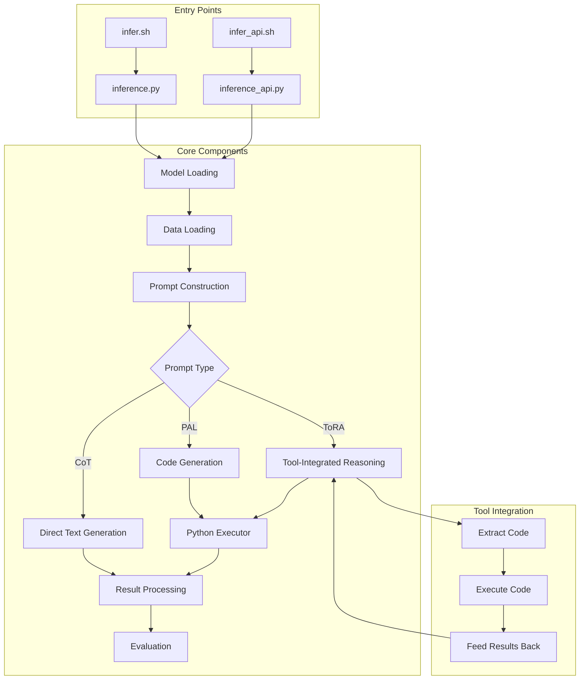
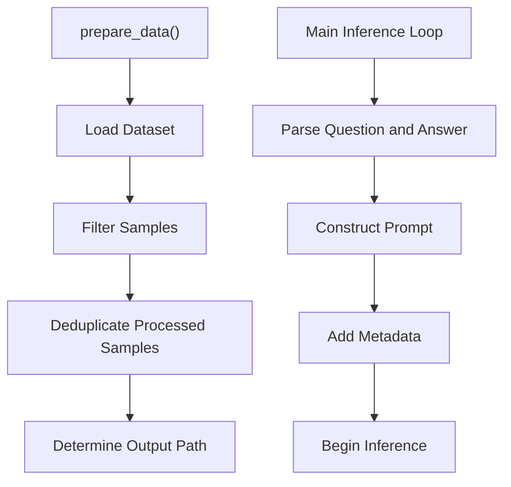
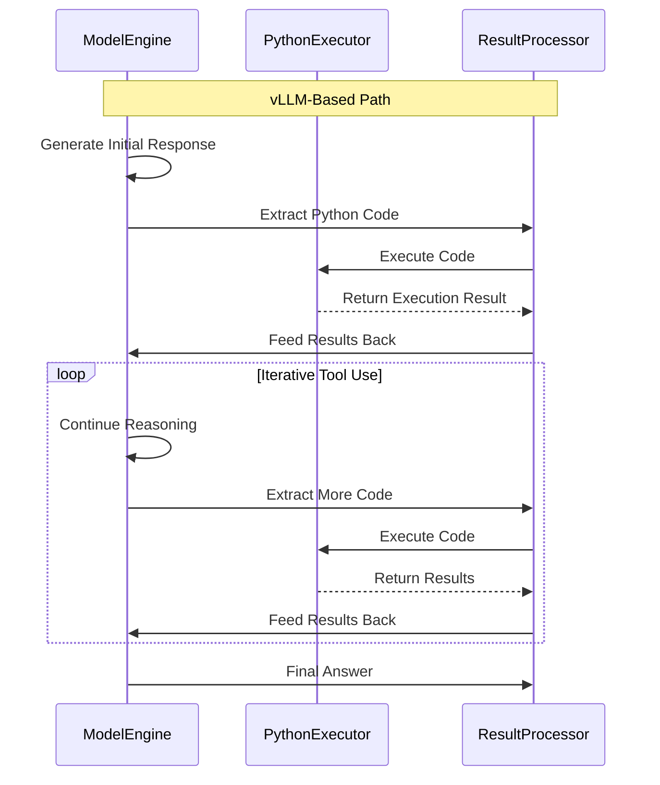
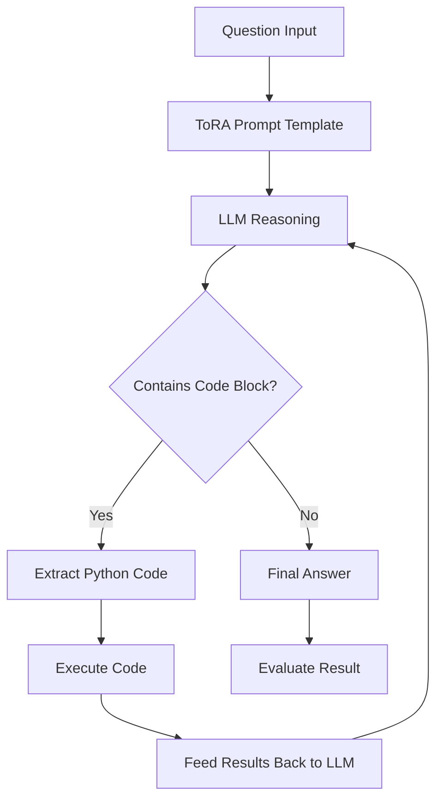
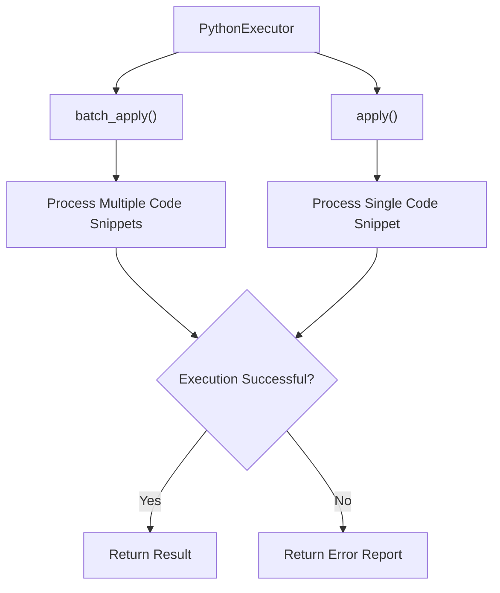
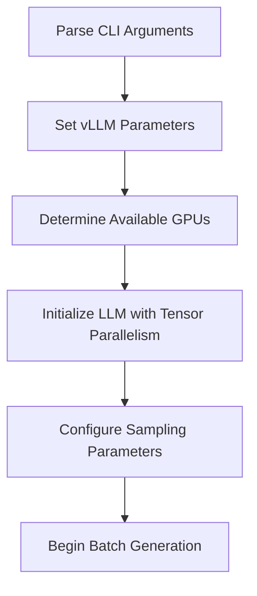
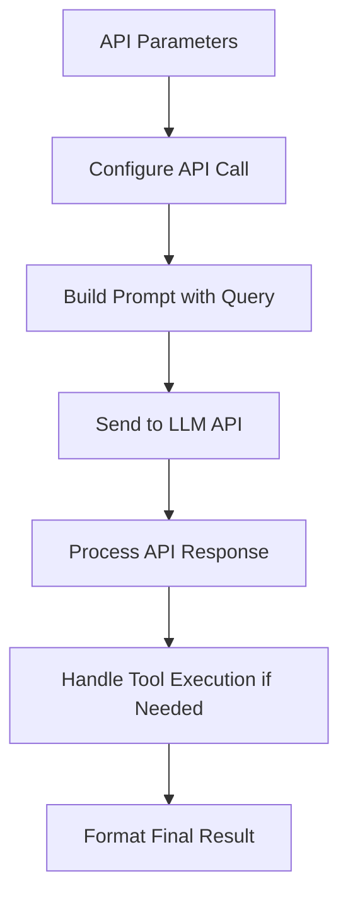

<!-- source: DeepWiki mcp.deepwiki.com · repo microsoft/ToRA · page 2.2 Inference System · fetched 2026-10-26 -->

# Inference System

<details>
<summary>Relevant source files</summary>

The following files were used as context for generating this wiki page:

- [README.md](README.md)
- [src/infer/inference.py](src/infer/inference.py)
- [src/infer/inference_api.py](src/infer/inference_api.py)
- [src/requirements.txt](src/requirements.txt)
- [src/scripts/infer.sh](src/scripts/infer.sh)
- [src/scripts/infer_api.sh](src/scripts/infer_api.sh)
- [src/train/llama2_flash_attn_monkey_patch.py](src/train/llama2_flash_attn_monkey_patch.py)

</details>


## Purpose and Scope

The Inference System is the component of ToRA responsible for generating mathematical reasoning outputs from pre-trained ToRA models. It provides both batch inference capabilities using vLLM and API-based inference for interactive usage. This system supports multiple prompting strategies, including Chain-of-Thought (CoT), Program-Aided Learning (PAL), and Tool-integrated Reasoning (ToRA's signature approach).

For information about training the models, see [Training Pipeline](#2.1). For details on how ToRA's tool integration works, see [Tool-Integrated Reasoning](#2.4).

## System Architecture Overview

The Inference System provides two primary pathways for running inference with ToRA models: a vLLM-based pipeline for efficient batch inference and an API-based pipeline for flexible integration with external services.



Sources: [src/infer/inference.py](), [src/infer/inference_api.py](), [src/scripts/infer.sh](), [src/scripts/infer_api.sh]()

## Entry Points

The ToRA Inference System is accessed through two main entry points, each catering to different use cases.

### vLLM-Based Inference

The vLLM-based inference pipeline is optimized for batch processing and leverages the vLLM library for efficient inference with large language models.


The vLLM pipeline is configured through `infer.sh`, where users can specify:
- Model path
- Dataset
- Prompt type (CoT, PAL, or ToRA)
- Generation parameters (temperature, top-p, etc.)
- Sampling configurations

Sources: [src/scripts/infer.sh](), [src/infer/inference.py:20-46](), [src/infer/inference.py:90-106]()

### API-Based Inference

The API-based inference pipeline provides integration with external language model APIs (e.g., OpenAI's APIs).


The API-based pipeline is useful for:
- Accessing models not available locally
- Integrating with cloud-based LLM services
- Comparing proprietary models with ToRA models

Sources: [src/scripts/infer_api.sh](), [src/infer/inference_api.py:27-47](), [src/infer/inference_api.py:109-203]()

## Inference Flow

### Data Processing and Prompt Construction

The inference system begins by loading and processing the input data, which consists of mathematical problems from various datasets.



Key steps in data preparation:
1. Load the specified dataset
2. Optionally sample a subset of the data
3. Deduplicate already processed samples
4. Prepare output file paths for results

Sources: [src/infer/inference.py:44-87](), [src/infer/inference_api.py:110-127]()

### Model Inference and Tool Integration

The core of the inference system is the interaction between the language model and external tools, particularly for the ToRA prompt type.



For ToRA-style prompts, the system supports up to 4 rounds of tool usage by default, with the model dynamically deciding when to use tools versus when to provide a final answer.

Sources: [src/infer/inference.py:133-197](), [src/infer/inference_api.py:50-105]()

## Prompt Types and Execution

The inference system supports three main prompting strategies, each with different execution patterns:

### Chain-of-Thought (CoT)

CoT prompts encourage the model to explain its reasoning step by step before arriving at a final answer. This is a purely language-based approach without tool usage.


Sources: [src/infer/inference.py:135-136]()

### Program-Aided Learning (PAL)

PAL prompts the model to generate executable Python code to solve the problem, extracts and executes this code, and then uses the code's output as the answer.


Sources: [src/infer/inference.py:93-97](), [src/infer/inference_api.py:112-115]()

### Tool-Integrated Reasoning (ToRA)

ToRA combines natural language reasoning with code execution in an iterative process, allowing the model to use tools as needed throughout its reasoning.



The tool integration process allows ToRA to leverage computational tools for complex mathematical operations while maintaining the flexibility of natural language reasoning.

Sources: [src/infer/inference.py:175-182](), [src/infer/inference_api.py:130-138]()

## Key Components

### Python Executor

The Python Executor is responsible for safely running generated Python code and capturing its output.



The executor has two modes:
1. For PAL: Executes code and extracts the value from `solution()`
2. For ToRA: Executes code and captures stdout for the answer

It handles errors gracefully, providing informative error messages that can be fed back to the model.

Sources: [src/infer/inference.py:93-97](), [src/infer/inference.py:184-196]()

### Result Processing and Evaluation

After generating responses, the system processes the results and evaluates the model's performance.


The system evaluates model outputs by:
1. Extracting the final answer from the generated text
2. Comparing the answer with the ground truth using specialized math equality checking
3. Calculating accuracy metrics by problem type and dataset

Sources: [src/infer/inference.py:207-232](), [src/infer/inference_api.py:166-202]()

## Implementation Details

### vLLM Configuration

The vLLM-based inference leverages tensor parallelism for efficient model loading and inference across multiple GPUs.



Key vLLM configuration options:
- Tensor parallelism across available GPUs
- Sampling parameters (temperature, top-p)
- Maximum token length
- Stop tokens for different prompt types

Sources: [src/infer/inference.py:99-106](), [src/infer/inference.py:151-157]()

### API-Based Implementation

The API-based inference provides similar functionality but interfaces with external LLM APIs.



The API implementation supports:
- Multiple LLM service providers
- Configurable generation parameters
- Error handling for API failures
- Progress tracking for long-running jobs

Sources: [src/infer/inference_api.py:50-105](), [src/infer/inference_api.py:143-151]()

## Using the Inference System

### Basic Usage

To use the ToRA Inference System for mathematical problem-solving, follow these steps:

1. Configure the inference parameters in the script:
   ```bash
   # Edit src/scripts/infer.sh
   MODEL_NAME_OR_PATH="llm-agents/tora-code-34b-v1.0"
   DATA_NAME="math"
   SPLIT="test"
   PROMPT_TYPE="tora"
   ```

2. Run the inference script:
   ```bash
   bash scripts/infer.sh
   ```

3. View results in the generated output files:
   ```
   outputs/llm-agents/model-name/dataset/test_prompt-type_samples_seed_...
   ```

Sources: [src/scripts/infer.sh:1-30]()

### Advanced Configuration

The inference system provides numerous configuration options:

| Parameter | Description | Example Values |
|-----------|-------------|----------------|
| `model_name_or_path` | Path to local model or HF model ID | `llm-agents/tora-code-34b-v1.0` |
| `data_name` | Dataset to use | `math`, `gsm8k`, `svamp` |
| `prompt_type` | Type of prompting strategy | `cot`, `pal`, `tora` |
| `temperature` | Sampling temperature | `0` (deterministic), `0.7` (creative) |
| `n_sampling` | Number of samples to generate | `1`, `5` (for self-consistency) |
| `top_p` | Nucleus sampling parameter | `1.0` |
| `max_tokens_per_call` | Maximum tokens to generate | `1024` |

Sources: [src/infer/inference.py:21-40](), [src/infer/inference_api.py:27-46]()

## Conclusion

The ToRA Inference System provides a flexible and powerful framework for mathematical problem-solving using large language models with tool integration. It supports both batch processing through vLLM and API-based inference, accommodating a wide range of use cases and deployment scenarios.

The system's support for multiple prompting strategies—CoT, PAL, and ToRA—allows users to leverage different approaches to mathematical reasoning, from pure language-based reasoning to tool-integrated approaches that combine the strengths of language models and computational tools.

---

