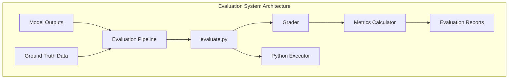
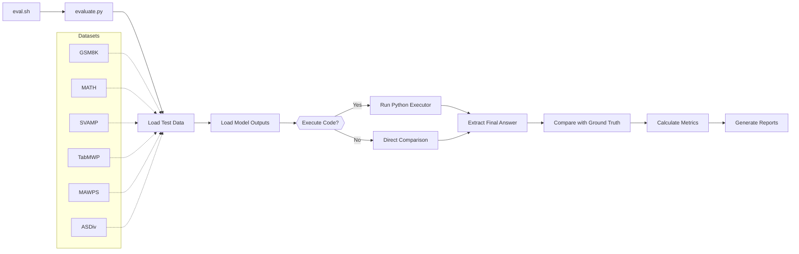
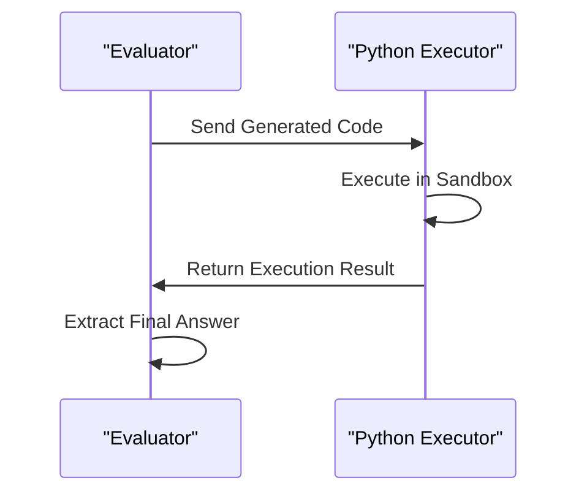
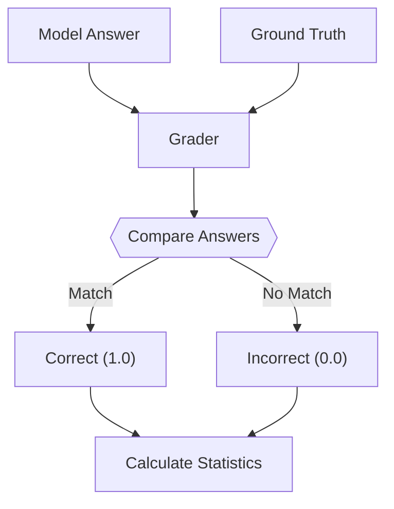
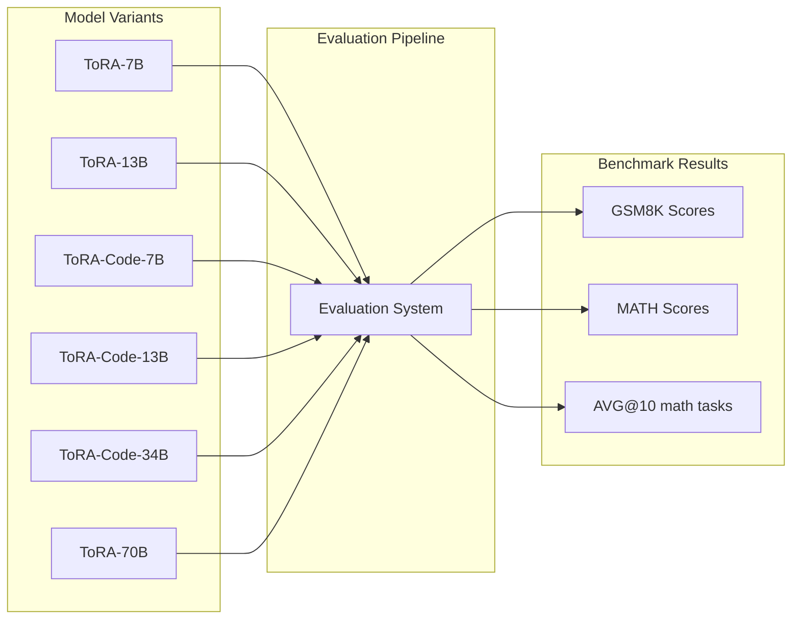

<!-- source: DeepWiki mcp.deepwiki.com · repo microsoft/ToRA · page 2.3 Evaluation System · fetched 2026-10-26 -->

# Evaluation System

<details>
<summary>Relevant source files</summary>

The following files were used as context for generating this wiki page:

- [.gitignore](.gitignore)
- [README.md](README.md)
- [src/requirements.txt](src/requirements.txt)
- [src/scripts/eval.sh](src/scripts/eval.sh)
- [src/train/llama2_flash_attn_monkey_patch.py](src/train/llama2_flash_attn_monkey_patch.py)

</details>


The ToRA Evaluation System is a comprehensive framework for assessing the performance of ToRA models on mathematical reasoning tasks. This document explains how the evaluation pipeline works, including the components, process flow, metrics, and usage. For information about the inference system that generates the outputs being evaluated, see [Inference System](#2.2).

## Overview

The evaluation system takes model-generated outputs, compares them with ground truth answers, and produces performance metrics. It supports different prompting techniques (Chain-of-Thought, Program-Aided Learning, and Tool-integrated Reasoning) and can execute Python code generated by models before evaluation.



Sources: [README.md:113-126](), [src/scripts/eval.sh]()

## Evaluation Process

The evaluation pipeline follows a systematic process to evaluate the model outputs against ground truth data.



Sources: [README.md:113-126](), [src/scripts/eval.sh]()

### Data Loading

The evaluation system supports various mathematical datasets:

| Dataset | Description | Type |
|---------|-------------|------|
| GSM8K | Grade School Math Word Problems | Word problems |
| MATH | Complex High School Competition Problems | Multi-subject mathematics |
| SVAMP | Simple Variations of Math Problems | Elementary word problems |
| TabMWP | Tabular Math Word Problems | Word problems with tables |
| MAWPS | Math Word Problems | Elementary arithmetic |
| ASDiv | Arithmetic with Diverse Problem Types | Diverse arithmetic |

The system loads both the test data from these datasets and the model-generated outputs for evaluation.

Sources: [README.md:66-70]()

### Code Execution

For outputs generated using a code-based approach (PAL or ToRA), the evaluation system can execute the generated Python code to obtain the final answer. This is particularly important for Tool-integrated Reasoning where the model generates executable code as part of its reasoning process.

The execution is performed through the Python Executor component, which provides a safe environment for running the generated code and extracting the final answer.



Sources: [README.md:113-126]()

### Answer Grading

The evaluation system uses a dedicated grader to assess the accuracy of predicted answers. This grading logic is based on the Hendrycks' MATH grading system and is designed to minimize false positives and false negatives.



Sources: [README.md:113-126]()

## Evaluation Metrics

The evaluation system calculates several metrics to assess model performance:

1. **Accuracy**: The percentage of correctly answered problems.
2. **Pass@1**: The accuracy when the model has only one attempt to solve the problem.
3. **Subject-specific scores**: For datasets like MATH, performance is broken down by mathematical subjects:
   - Algebra
   - Counting & Probability
   - Geometry
   - Intermediate Algebra
   - Number Theory
   - Prealgebra
   - Precalculus

These metrics provide a comprehensive view of the model's mathematical reasoning capabilities across different problem types and difficulty levels.

Sources: [README.md:52-66]()

## Usage

### Command Line Interface

The evaluation system can be used via a simple command-line interface. The basic command structure is:

```
python -m eval.evaluate \
    --data_name <dataset_name> \
    --prompt_type <prompt_type> \
    --file_path <path_to_model_outputs> \
    [--execute]
```

Where:
- `data_name`: The name of the dataset (e.g., "math", "gsm8k")
- `prompt_type`: The prompting technique used (e.g., "tora", "cot", "pal")
- `file_path`: Path to the file containing model outputs
- `--execute`: Optional flag to execute code in the model outputs

Example:
```
python -m eval.evaluate \
    --data_name "math" \
    --prompt_type "tora" \
    --file_path "outputs/llm-agents/tora-code-34b-v1.0/math/test_tora_-1_seed0_t0.0_s0_e5000.jsonl" \
    --execute
```

Sources: [src/scripts/eval.sh](), [README.md:120-125]()

### Evaluation Script

For convenience, the repository provides a shell script `eval.sh` that can be used to run the evaluation with common parameters:

```
bash scripts/eval.sh
```

This script runs the evaluation on the MATH dataset using ToRA outputs and executes the generated code.

Sources: [src/scripts/eval.sh]()

## Output Reports

After evaluation, the system generates a comprehensive report including:

1. **Overall Accuracy**: The percentage of correctly answered problems across the entire dataset.
2. **Subject-specific Scores**: Breakdown of performance by mathematical subjects.
3. **Error Analysis**: Information about timeout samples and empty responses.

Example output:
```
Num samples: 5000
Num scores: 5000
Timeout samples: 0
Empty samples: 2
Mean score: [51.0]
Type scores: {'Algebra': 67.3, 'Counting & Probability': 42.2, 'Geometry': 26.1, 'Intermediate Algebra': 40.0, 'Number Theory': 59.3, 'Prealgebra': 63.8, 'Precalculus': 34.2}
```

This report provides insights into the model's strengths and weaknesses across different mathematical domains.

Sources: [README.md:129-136]()

## Integration with Model Comparison

The evaluation system facilitates model comparison by standardizing the evaluation process across different model variants and sizes. This allows for consistent benchmarking and performance tracking.



Sources: [README.md:52-66]()

## Related Components

The evaluation system works in conjunction with other components of the ToRA framework:

1. **Inference System**: Generates the outputs that are evaluated by the evaluation system. See [Inference System](#2.2) for details.
2. **Python Executor**: Executes the generated code in a safe environment. See [Python Executor](#5.1) for details.
3. **Tool-Integrated Reasoning**: The core concept of combining natural language reasoning with tool use. See [Tool-Integrated Reasoning](#2.4) for details.

The evaluation system plays a crucial role in validating the effectiveness of the Tool-integrated Reasoning approach and tracking the performance improvements across different model variants and prompting techniques.

Sources: [README.md:69-77]()

---

