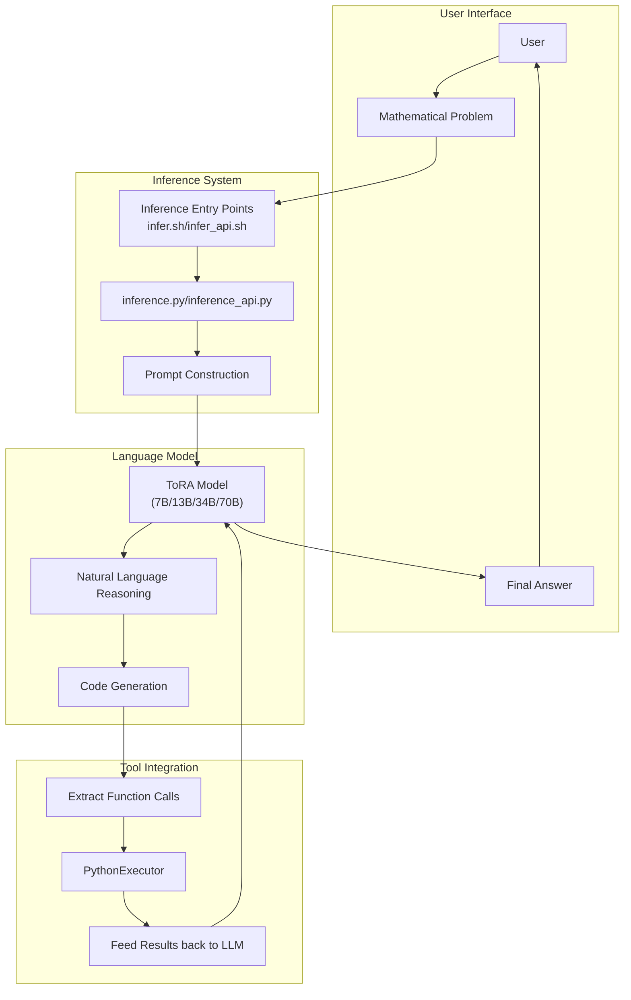
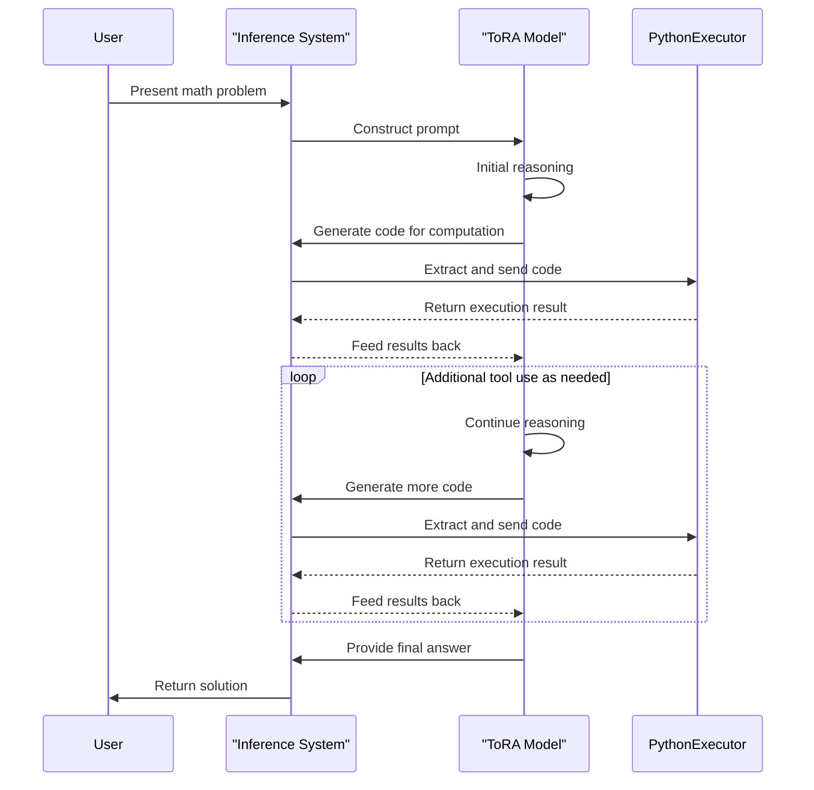
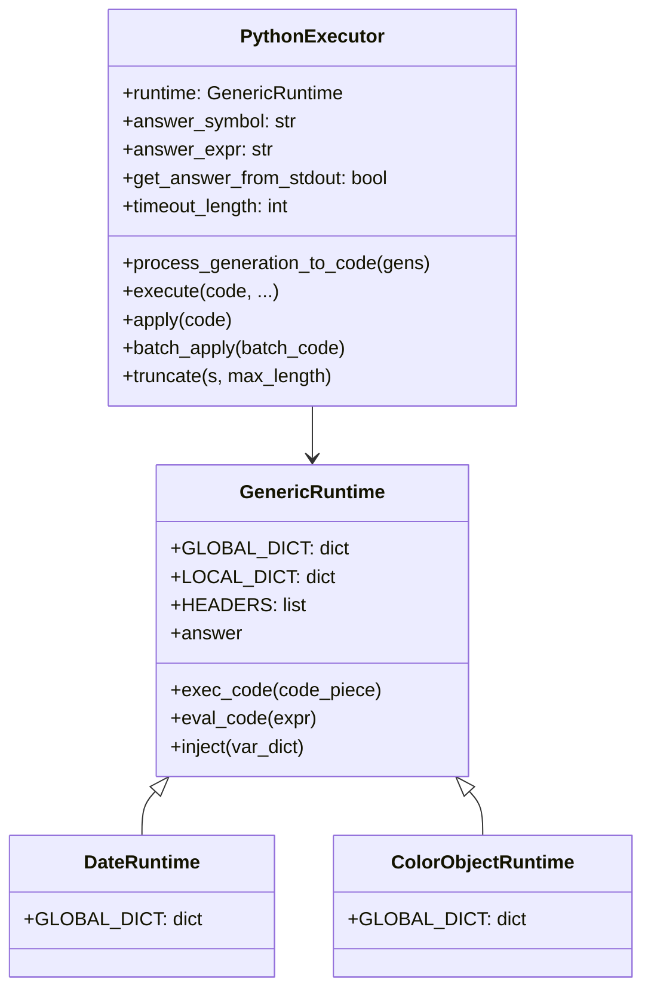
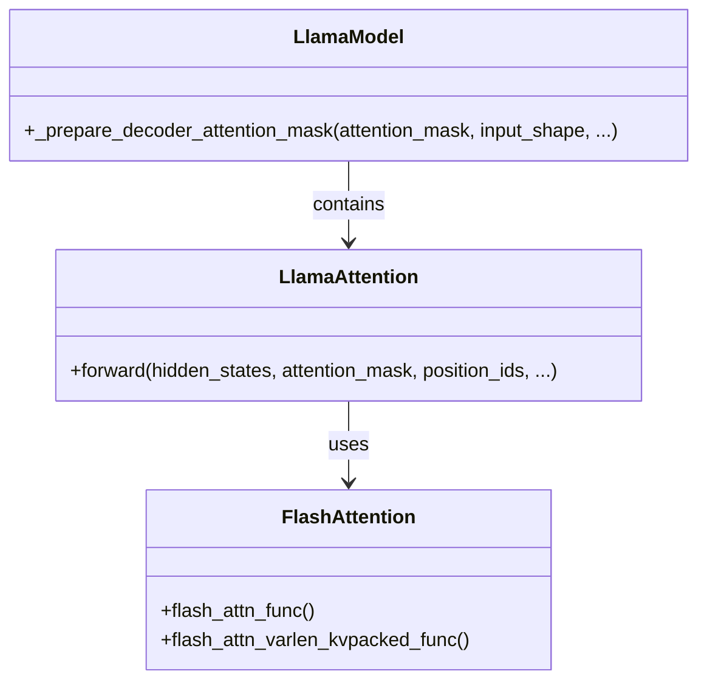
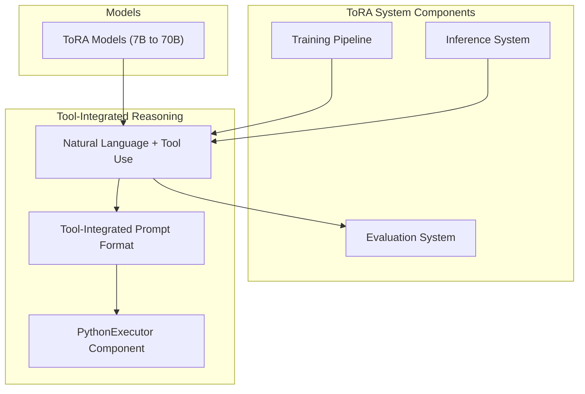

<!-- source: DeepWiki mcp.deepwiki.com · repo microsoft/ToRA · page 2.4 Tool-Integrated Reasoning · fetched 2026-10-26 -->

# Tool-Integrated Reasoning

<details>
<summary>Relevant source files</summary>

The following files were used as context for generating this wiki page:

- [README.md](README.md)
- [docs/index.html](docs/index.html)
- [src/requirements.txt](src/requirements.txt)
- [src/train/llama2_flash_attn_monkey_patch.py](src/train/llama2_flash_attn_monkey_patch.py)
- [src/utils/python_executor.py](src/utils/python_executor.py)

</details>


## Purpose and Overview

Tool-Integrated Reasoning is the core methodology in ToRA (Tool-integrated Reasoning Agent) that enables language models to combine natural language reasoning with the use of external tools, specifically Python code execution, to solve complex mathematical problems. This approach allows the system to leverage both the semantic understanding and reasoning capabilities of language models and the computational precision of programmatic tools.

For information about the broader ToRA system, see [Core Components](#2).

Sources: [README.md](), [docs/index.html]()

## Core Concepts

Tool-Integrated Reasoning is built around the concept of interleaving natural language reasoning with code-based tool use. Rather than relying solely on the language model's ability to perform calculations or solely on programmatic approaches, Tool-Integrated Reasoning creates a synergy between these two approaches.

Key principles include:
- Natural language reasoning for semantic understanding, planning, and abstract thinking
- Program-based tool use for precise calculations, symbolic operations, and algorithm execution
- Iterative interaction between reasoning and tool use
- Single or multiple rounds of tool interactions depending on problem complexity

The combination of these principles enables ToRA to solve complex mathematical problems more effectively than models that use only language reasoning (Chain-of-Thought) or only programmatic approaches (Program-Aided Learning).

Sources: [README.md](), [docs/index.html]()

## Architecture

### Tool-Integrated Reasoning System Architecture



The Tool-Integrated Reasoning architecture consists of several key components:

1. **Inference System**: Processes mathematical problems through entry points (`infer.sh`, `infer_api.sh`) and constructs appropriate prompts for the language model.

2. **Language Model**: A ToRA model (available in 7B, 13B, 34B, and 70B parameters) that generates both natural language reasoning and Python code.

3. **Tool Integration**: Handles the extraction of function calls from the model's output, executes them using the `PythonExecutor`, and feeds the results back to the language model.

4. **PythonExecutor**: A specialized component that safely executes Python code generated by the model and returns the execution results.

Sources: [README.md](), Tool-Integrated Reasoning Process diagram, Inference System Architecture diagram

## The Tool-Integrated Reasoning Process



The process of solving a problem using Tool-Integrated Reasoning typically follows these steps:

1. The user presents a mathematical problem to the system.
2. The Inference System constructs a prompt for the ToRA model.
3. The model performs initial reasoning about the problem.
4. When computation is needed, the model generates Python code.
5. The Inference System extracts this code and sends it to the `PythonExecutor`.
6. The `PythonExecutor` runs the code and returns the results.
7. The results are fed back to the model, which continues its reasoning.
8. Steps 4-7 may repeat multiple times for complex problems.
9. Finally, the model provides a complete solution to the problem.

Sources: [README.md](), Tool-Integrated Reasoning Process diagram

## Implementation Details

### Python Executor Component

The core component that enables tool use in ToRA is the `PythonExecutor`, which is responsible for safely executing Python code generated by the language model.



The `PythonExecutor` class provides the following key methods:

- `process_generation_to_code(gens)`: Prepares generated text for execution
- `execute(code, ...)`: Static method that executes code within a runtime environment
- `apply(code)`: Executes a single piece of code
- `batch_apply(batch_code)`: Executes multiple pieces of code in parallel
- `truncate(s, max_length)`: Truncates long outputs

The `GenericRuntime` class and its specialized subclasses provide controlled environments for executing code:

- `GenericRuntime`: Base class for code execution environments
- `DateRuntime`: Specialized for date/time calculations
- `ColorObjectRuntime`: Specialized for handling custom dictionary structures

The executor uses multiprocessing for parallel execution and includes timeout mechanisms to prevent infinite loops or excessive resource consumption.

Sources: [utils/python_executor.py]()

### Integration with Flash Attention

For optimal performance, ToRA uses Flash Attention to accelerate transformer operations. This is implemented through a monkey patching mechanism that replaces the standard attention mechanism in the LLaMA model with a more efficient implementation.



The flash attention integration improves both training and inference speed, which is crucial for operating large language models effectively.

Sources: [src/train/llama2_flash_attn_monkey_patch.py]()

## Example of Tool-Integrated Reasoning

Below is an example of how Tool-Integrated Reasoning works in practice:

```
Problem: What is the sum of the first 10 prime numbers?

[ToRA Model's Response]
Let me solve this step by step.

First, I need to find the first 10 prime numbers. I'll use Python to help with this:

```python
def is_prime(n):
    if n <= 1:
        return False
    if n <= 3:
        return True
    if n % 2 == 0 or n % 3 == 0:
        return False
    i = 5
    while i * i <= n:
        if n % i == 0 or n % (i + 2) == 0:
            return False
        i += 6
    return True

primes = []
num = 2
while len(primes) < 10:
    if is_prime(num):
        primes.append(num)
    num += 1

print(f"First 10 prime numbers: {primes}")
print(f"Sum: {sum(primes)}")
```

[Python Executor Output]
First 10 prime numbers: [2, 3, 5, 7, 11, 13, 17, 19, 23, 29]
Sum: 129

Now I can see that the first 10 prime numbers are 2, 3, 5, 7, 11, 13, 17, 19, 23, and 29.
The sum of these numbers is 129.

Therefore, the sum of the first 10 prime numbers is 129.
```

This example demonstrates how the model interleaves natural language reasoning with Python code execution to solve the problem effectively. The model formulates an approach in natural language, implements it in Python code, receives the execution results, and incorporates them into its final reasoning to provide the answer.

Sources: [README.md](), [docs/index.html]()

## Performance and Advantages

Tool-Integrated Reasoning provides several key advantages that have enabled ToRA models to achieve state-of-the-art performance:

| Advantage | Description |
|-----------|-------------|
| Precision | Python execution provides exact calculations, avoiding arithmetic errors common in pure language models |
| Flexibility | Combines the planning and abstract reasoning of language models with the computational precision of code |
| Efficiency | Allows complex calculations to be offloaded to code, reducing token usage for number manipulation |
| Scalability | More effective at handling problems with large numbers or many computational steps |
| Visualization | Code can generate plots or intermediate results that help in problem solving |
| Algorithm Use | Enables use of well-established algorithms for specialized mathematical tasks |

According to benchmark results, ToRA models significantly outperform other open-source models on mathematical reasoning tasks. ToRA-Code-34B achieves 51.0% accuracy on the challenging MATH dataset, outperforming GPT-4's Chain-of-Thought result (42.5%) and approaching GPT-4's Program-Aided Learning result (51.8%). ToRA-70B achieves 84.3% accuracy on GSM8k, surpassing ChatGPT (80.8%).

Sources: [README.md](), [docs/index.html]()

## Integration with ToRA System

Tool-Integrated Reasoning is a core component of the ToRA system, working alongside the training pipeline, inference system, and evaluation system.



During training, models learn the Tool-Integrated Reasoning format through a specially curated dataset. During inference, this format is used to solve new mathematical problems by interleaving reasoning with code execution. The evaluation system then assesses the correctness of the solutions.

Sources: [README.md](), High-Level ToRA System Components diagram

## Conclusion

Tool-Integrated Reasoning is the innovative methodology at the heart of the ToRA system. By combining the semantic understanding and planning capabilities of language models with the computational precision of Python code execution, it enables significantly improved performance on mathematical reasoning tasks. The implementation, centered around the `PythonExecutor` component, allows for safe and efficient execution of code generated by the language model. This approach has proven highly effective, enabling ToRA models to achieve state-of-the-art results on challenging mathematical benchmarks.

Sources: [README.md](), [docs/index.html]()

---

