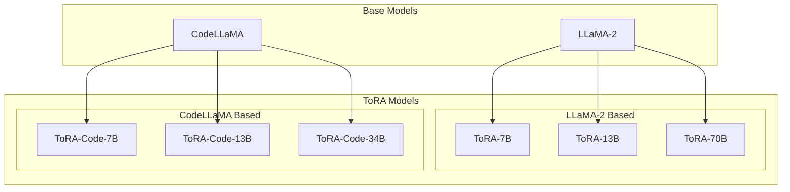
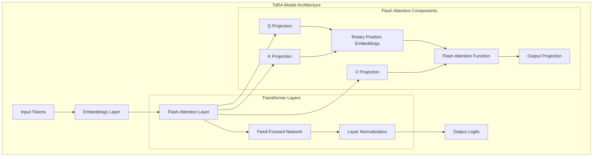
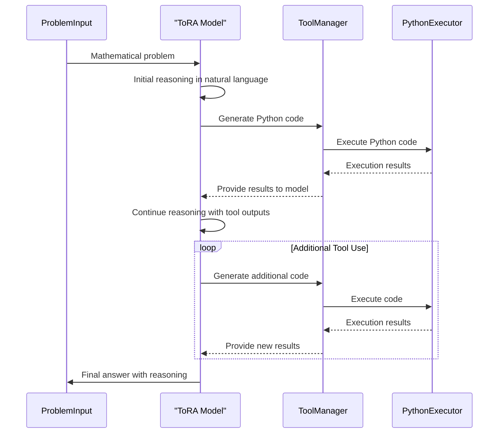

<!-- source: DeepWiki mcp.deepwiki.com · repo microsoft/ToRA · page 3 Models · fetched 2026-10-26 -->

# Models

Relevant source files

The following files were used as context for generating this wiki page:

- [README.md](README.md)
- [docs/index.html](docs/index.html)
- [src/requirements.txt](src/requirements.txt)
- [src/train/llama2_flash_attn_monkey_patch.py](src/train/llama2_flash_attn_monkey_patch.py)

This page provides an overview of the ToRA model family, their architecture, and their performance on mathematical reasoning tasks. For information about training these models, see [Training Pipeline](#2.1). For inference information, see [Inference System](#2.2).

## Overview

ToRA (Tool-integrated Reasoning Agent) comprises a series of large language models specifically fine-tuned for mathematical reasoning using a tool-integrated approach. The models are designed to solve complex mathematical problems by interleaving natural language reasoning with programmatic tool use, primarily through Python code execution.

The model family includes multiple sizes and variants based on either LLaMA-2 or CodeLLaMA as the base architecture. All ToRA models are optimized to leverage external tools, particularly Python libraries for computation, to enhance their mathematical problem-solving capabilities.

Sources: [README.md:54-67]()

## Model Variants

The ToRA model family consists of two main series with multiple parameter sizes:

### ToRA Series (LLaMA-2 Based)

These models are fine-tuned from LLaMA-2 base models:

1. **ToRA-7B**: 7 billion parameter model fine-tuned from LLaMA-2-7B
2. **ToRA-13B**: 13 billion parameter model fine-tuned from LLaMA-2-13B 
3. **ToRA-70B**: 70 billion parameter model fine-tuned from LLaMA-2-70B

### ToRA-Code Series (CodeLLaMA Based)

These models are fine-tuned from CodeLLaMA base models, which have enhanced coding capabilities:

1. **ToRA-Code-7B**: 7 billion parameter model fine-tuned from CodeLLaMA-7B
2. **ToRA-Code-13B**: 13 billion parameter model fine-tuned from CodeLLaMA-13B
3. **ToRA-Code-34B**: 34 billion parameter model fine-tuned from CodeLLaMA-34B

All models can be accessed through Hugging Face at the organization `llm-agents`: [https://huggingface.co/llm-agents](https://huggingface.co/llm-agents).

Sources: [README.md:54-67](), [docs/index.html:133-140]()

## Model Architecture

ToRA models preserve the fundamental architecture of their base models (LLaMA-2 or CodeLLaMA) while incorporating optimizations for improved performance, particularly for mathematical reasoning tasks.

### Flash Attention Integration

A key optimization in ToRA is the integration of Flash Attention, which significantly improves both training and inference speed, particularly for larger models. The implementation modifies the standard attention mechanism in LLaMA models to use Flash Attention:

The Flash Attention implementation in ToRA:
- Applies rotary position embeddings to queries and keys
- Uses optimized CUDA kernels for attention computation
- Handles key-value caching for efficient autoregressive generation
- Provides support for both padded and unpadded inputs

Note: Flash Attention is particularly important for the larger models (34B and 70B) as it enables efficient training and inference on current hardware.

Sources: [src/train/llama2_flash_attn_monkey_patch.py:1-145]()

## Performance and Benchmarks

ToRA models demonstrate strong performance on mathematical reasoning benchmarks, with larger models and CodeLLaMA-based variants generally achieving better results.

The table below shows the performance of ToRA models on key mathematical reasoning datasets:

| Model | Parameter Size | GSM8k | MATH | AVG@10 math tasks |
|-------|---------------|-------|------|-------------------|
| ToRA-7B | 7B | 68.8% | 40.1% | 62.4% |
| ToRA-Code-7B | 7B | 72.6% | 44.6% | 66.5% |
| ToRA-13B | 13B | 72.7% | 43.0% | 65.9% |
| ToRA-Code-13B | 13B | 75.8% | 48.1% | 71.3% |
| ToRA-Code-34B | 34B | 80.7% | 51.0% | 74.8% |
| ToRA-70B | 70B | 84.3% | 49.7% | 76.9% |

When using self-consistency (generating multiple solutions and taking a majority vote), performance improves further:

| Model | Parameters | GSM8k with SC (k=50) | MATH with SC (k=50) |
|-------|------------|----------------------|---------------------|
| ToRA-Code-7B | 7B | 76.8% | 52.5% |
| ToRA-Code-13B | 13B | 80.4% | 55.1% |
| ToRA-Code-34B | 34B | 85.1% | 60.0% |
| ToRA-70B | 70B | 88.3% | 56.9% |

Notably, ToRA-Code-34B is the first open-source model to exceed 50% accuracy on the competition-level MATH dataset, outperforming GPT-4's chain-of-thought results.

Sources: [README.md:54-67](), [README.md:68-70]()

## Model Integration with Tool-Based Reasoning

ToRA models are designed to integrate reasoning with external tools. The diagram below illustrates how models interact with the Python executor to solve mathematical problems:

This tool-integrated reasoning approach alternates between natural language reasoning and programmatic tool use, allowing the model to leverage both its internal knowledge and external computational capabilities.

Sources: [README.md:71-77](), [README.md:78-85]()

## Hardware Requirements

The hardware requirements for ToRA models vary by model size:

### Training Requirements

- **7B/13B models**: Can be trained with LR=2e-5, batch size 16, without parameter offloading
- **34B models**: Require LR=1e-5, batch size 8, with optimizer offloading
- **70B models**: Require LR=1e-5, batch size 4, with optimizer offloading

### Inference Requirements

- **Flash Attention**: Optimally runs on A100 or H100 GPUs
- **Memory Requirements**:
  - 7B models: ~14GB VRAM
  - 13B models: ~26GB VRAM
  - 34B models: ~68GB VRAM
  - 70B models: ~140GB VRAM (often requiring multi-GPU setups)

Note: The vLLM library is used for optimized inference, which reduces memory requirements through PagedAttention.

Sources: [src/requirements.txt:1-35](), [src/train/llama2_flash_attn_monkey_patch.py:136-141]()

## Package Dependencies

To use ToRA models, the following key dependencies are required:

- transformers (version 4.31.0)
- flash_attn (version 2.3.6)
- vllm (version 0.1.4)
- accelerate (version 0.21.0)
- deepspeed (version 0.11.0)
- peft
- bitsandbytes (for quantization)

For a complete list of dependencies, refer to the requirements.txt file.

Sources: [src/requirements.txt:1-35]()

---

