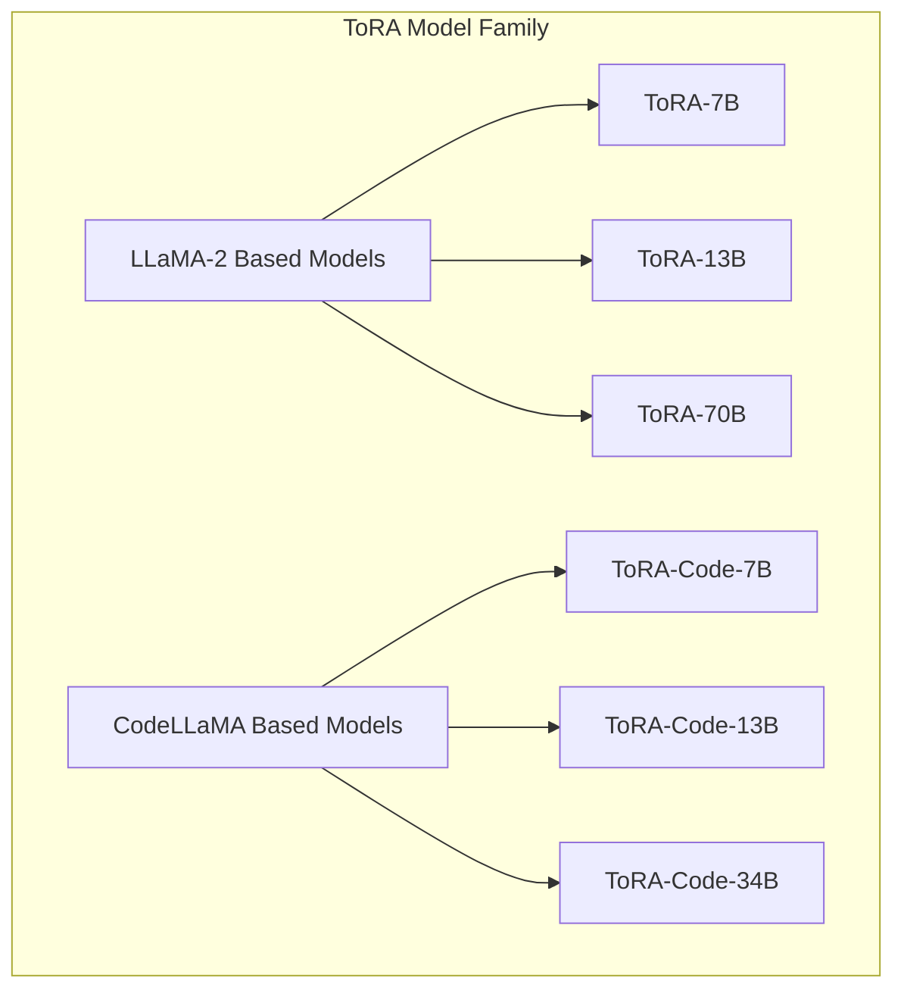
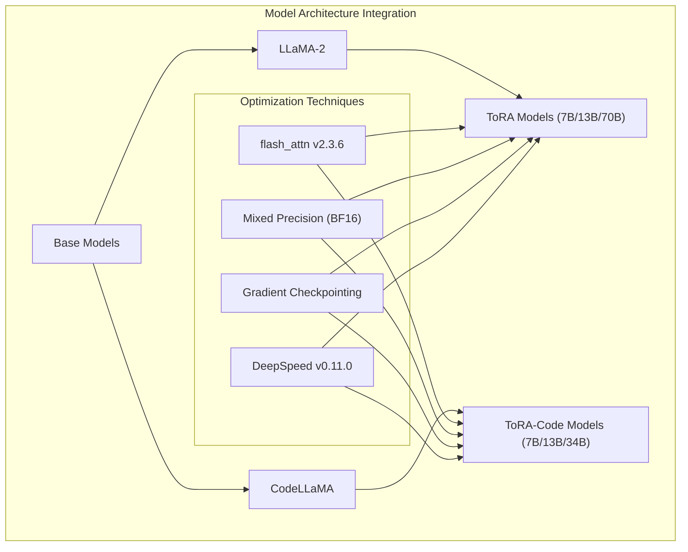

<!-- source: DeepWiki mcp.deepwiki.com · repo microsoft/ToRA · page 3.1 Available Models and Checkpoints · fetched 2026-10-26 -->

# Available Models and Checkpoints

<details>
<summary>Relevant source files</summary>

The following files were used as context for generating this wiki page:

- [README.md](README.md)
- [docs/index.html](docs/index.html)
- [src/requirements.txt](src/requirements.txt)
- [src/train/llama2_flash_attn_monkey_patch.py](src/train/llama2_flash_attn_monkey_patch.py)

</details>


This document provides comprehensive information about the pre-trained ToRA models available in the repository, their specifications, performance metrics, and how to access and use them. For details about model architecture, see [Model Architecture](#3.3). For in-depth performance analysis, see [Performance and Benchmarks](#3.2).

## ToRA Model Family Overview

The ToRA model family consists of language models specifically designed for mathematical reasoning with integrated tool use capabilities. These models are available in different parameter sizes and are based on two different foundational architectures.



Sources: [README.md:52-69]()

## Available Model Variants

ToRA models are built on two different base architectures:

1. **LLaMA-2 Based Models**:
   - **ToRA-7B**: 7 billion parameter model
   - **ToRA-13B**: 13 billion parameter model
   - **ToRA-70B**: 70 billion parameter model

2. **CodeLLaMA Based Models**:
   - **ToRA-Code-7B**: 7 billion parameter model
   - **ToRA-Code-13B**: 13 billion parameter model
   - **ToRA-Code-34B**: 34 billion parameter model

CodeLLaMA-based models generally demonstrate better performance on mathematical reasoning tasks compared to their LLaMA-2-based counterparts of the same size, due to enhanced code generation capabilities.

Sources: [README.md:52-69]()

## Model Performance

The table below presents the accuracy of ToRA models on key mathematical reasoning benchmarks:

| Model | Size | GSM8k | MATH | AVG@10 math tasks |
|---|---|---|---|---|
| GPT-4 | - | 92.0% | 42.5% | 78.3% |
| GPT-4 (PAL) | - | 94.2% | 51.8% | 86.4% |
| ToRA-7B | 7B | 68.8% | 40.1% | 62.4% |
| ToRA-Code-7B | 7B | 72.6% | 44.6% | 66.5% | 
| ToRA-Code-7B + self-consistency (k=50) | 7B | 76.8% | 52.5% | - |
| ToRA-13B | 13B | 72.7% | 43.0% | 65.9% |
| ToRA-Code-13B | 13B | 75.8% | 48.1% | 71.3% |
| ToRA-Code-13B + self-consistency (k=50) | 13B | 80.4% | 55.1% | - |
| ToRA-Code-34B | 34B | 80.7% | 51.0% | 74.8% |
| ToRA-Code-34B + self-consistency (k=50) | 34B | 85.1% | 60.0% | - |
| ToRA-70B | 70B | 84.3% | 49.7% | 76.9% |
| ToRA-70B + self-consistency (k=50) | 70B | 88.3% | 56.9% | - |

**Key Highlights**:
- **ToRA-Code-34B** is the first open-source model to achieve over 50% accuracy on the competition-level MATH dataset, significantly outperforming GPT-4's CoT result (51.0% vs. 42.5%)
- **ToRA-70B** achieves 84.3% on GSM8k, outperforming ChatGPT
- Self-consistency with k=50 samples significantly improves performance across all models

The AVG@10 math tasks column represents average performance across 10 mathematical reasoning datasets: GSM8k, MATH, GSM-Hard, SVAMP, TabMWP, ASDiv, SingleEQ, SingleOP, AddSub, and MultiArith.

Sources: [README.md:53-66](), [README.md:68-70]()

## Technical Implementation Details

ToRA models are built upon transformer-based architectures with several optimizations for training and inference:



Key implementation features:
- **Flash Attention**: Implemented via the `flash_attn` library (version 2.3.6) with custom implementation for LLaMA models in [src/train/llama2_flash_attn_monkey_patch.py]()
- **Mixed Precision Training**: BF16 format used for faster training and memory efficiency
- **vLLM Integration**: Version 0.1.4 is used for accelerated inference
- **DeepSpeed**: Version 0.11.0 for distributed training of large models

Sources: [src/requirements.txt:1-35](), [src/train/llama2_flash_attn_monkey_patch.py:1-242]()

## Model Checkpoints and Access

All ToRA models are available on Hugging Face under the llm-agents organization:

| Model | HuggingFace Link | Base Model | Parameters |
|-------|------------------|------------|------------|
| ToRA-7B | [llm-agents/tora-7b-v1.0](https://huggingface.co/llm-agents/tora-7b-v1.0) | LLaMA-2 | 7B |
| ToRA-13B | [llm-agents/tora-13b-v1.0](https://huggingface.co/llm-agents/tora-13b-v1.0) | LLaMA-2 | 13B |
| ToRA-70B | [llm-agents/tora-70b-v1.0](https://huggingface.co/llm-agents/tora-70b-v1.0) | LLaMA-2 | 70B |
| ToRA-Code-7B | [llm-agents/tora-code-7b-v1.0](https://huggingface.co/llm-agents/tora-code-7b-v1.0) | CodeLLaMA | 7B |
| ToRA-Code-13B | [llm-agents/tora-code-13b-v1.0](https://huggingface.co/llm-agents/tora-code-13b-v1.0) | CodeLLaMA | 13B |
| ToRA-Code-34B | [llm-agents/tora-code-34b-v1.0](https://huggingface.co/llm-agents/tora-code-34b-v1.0) | CodeLLaMA | 34B |

The model outputs from ToRA-Code-34B and ToRA-70B on various datasets are also available in the repository's `src/outputs/llm-agents/` directory for reference and evaluation.

Sources: [README.md:46-47](), [README.md:57-66](), [README.md:111-112]()

## Using the Models

### Loading Models with Transformers

ToRA models are compatible with the Hugging Face Transformers library and can be loaded like standard LLaMA models:

```python
from transformers import AutoModelForCausalLM, AutoTokenizer
import torch

model_name = "llm-agents/tora-7b-v1.0"
tokenizer = AutoTokenizer.from_pretrained(model_name)
model = AutoModelForCausalLM.from_pretrained(
    model_name,
    torch_dtype=torch.bfloat16,
    device_map="auto"
)
```

### Inference with Repository Scripts

The repository provides scripts for running inference with ToRA models:

```sh
# Edit src/scripts/infer.sh to set MODEL_NAME_OR_PATH
bash scripts/infer.sh
```

This uses vLLM (version 0.1.4) for efficient, accelerated inference.

### Self-Consistency Inference

For higher accuracy, ToRA models can be run with self-consistency sampling:

```sh
python -m inference \
    --model_name_or_path llm-agents/tora-code-34b-v1.0 \
    --data_path data/math/test.jsonl \
    --prompt_type tora \
    --temperature 0.7 \
    --n_samples 50 \
    --execute
```

Sources: [README.md:103-109](), [README.md:119-125]()

## Hardware Requirements

Hardware requirements vary based on model size:

| Model | Minimum GPU Memory | Recommended Configuration |
|---|---|---|
| ToRA-7B / ToRA-Code-7B | 16GB | 1 × A100-40GB |
| ToRA-13B / ToRA-Code-13B | 30GB | 1 × A100-80GB |
| ToRA-Code-34B | 70GB | 2 × A100-80GB |
| ToRA-70B | 140GB | 4 × A100-80GB |

For inference with limited GPU memory, models can be loaded with quantization techniques (supported by libraries like `bitsandbytes`), though this may impact model performance.

Sources: [README.md:88-101](), [src/requirements.txt:1-35]()

## Environment Setup

The repository provides a script to set up the environment for using ToRA models:

```sh
git clone https://github.com/microsoft/ToRA.git && cd ToRA/src
conda create -n tora python=3.10
conda activate tora
pip install packaging==22.0
pip install torch==2.0.1 --index-url https://download.pytorch.org/whl/cu118
pip install -r requirements.txt
```

Key dependencies include:
- torch 2.0.1
- transformers 4.31.0
- flash_attn 2.3.6
- vllm 0.1.4
- deepspeed 0.11.0

Sources: [README.md:94-101](), [src/requirements.txt:1-35]()

## Model Evaluation

The repository includes a grading system to evaluate model outputs:

```sh
python -m eval.evaluate \
    --data_name "math" \
    --prompt_type "tora" \
    --file_path "outputs/llm-agents/tora-code-34b-v1.0/math/test_tora_-1_seed0_t0.0_s0_e5000.jsonl" \
    --execute
```

This will output accuracy scores overall and by subject category:

```
Num samples: 5000
Num scores: 5000
Timeout samples: 0
Empty samples: 2
Mean score: [51.0]
Type scores: {'Algebra': 67.3, 'Counting & Probability': 42.2, 'Geometry': 26.1, 'Intermediate Algebra': 40.0, 'Number Theory': 59.3, 'Prealgebra': 63.8, 'Precalculus': 34.2}
```

Sources: [README.md:119-136]()

## Conclusion

ToRA models represent state-of-the-art open-source models for mathematical reasoning with tool use capabilities. The larger variants, especially ToRA-Code-34B and ToRA-70B, achieve performance competitive with or exceeding proprietary models in specific mathematical reasoning tasks. ToRA-Code-34B is notably the first open-source model to achieve over 50% accuracy on the MATH dataset, representing a significant advancement in the field of mathematical reasoning.

---

