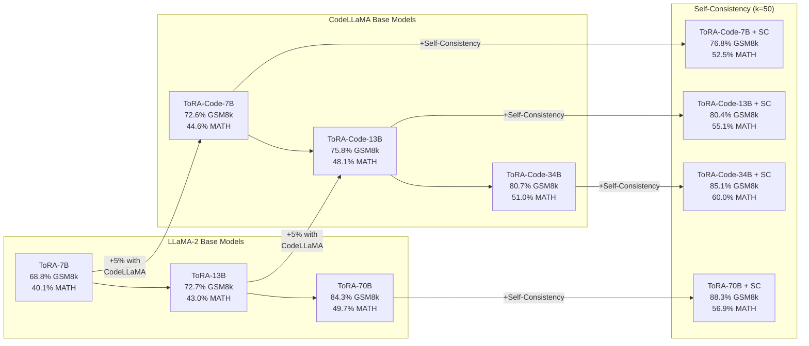
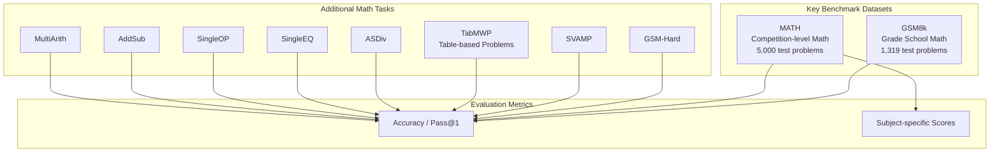
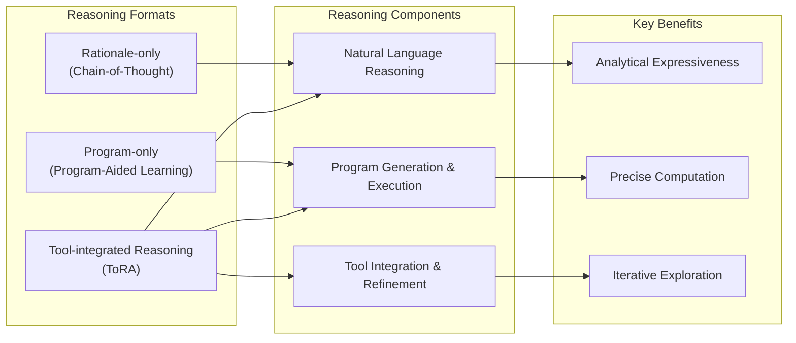
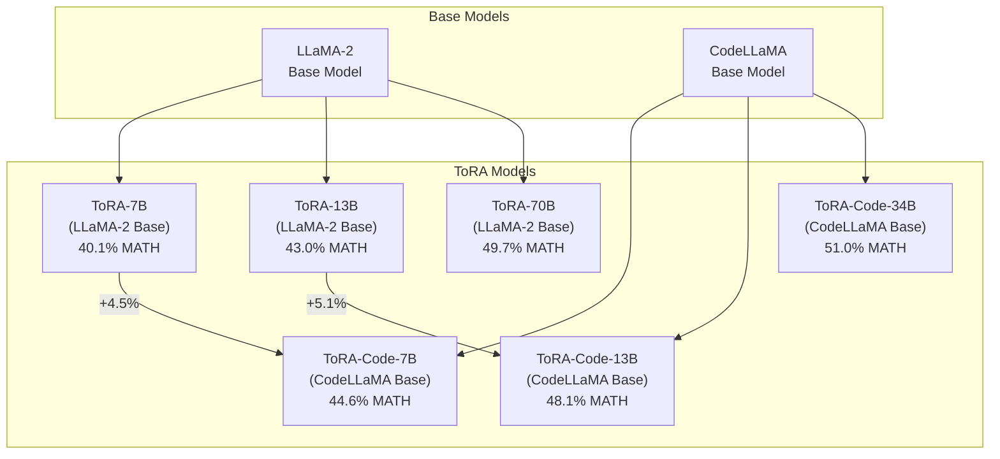
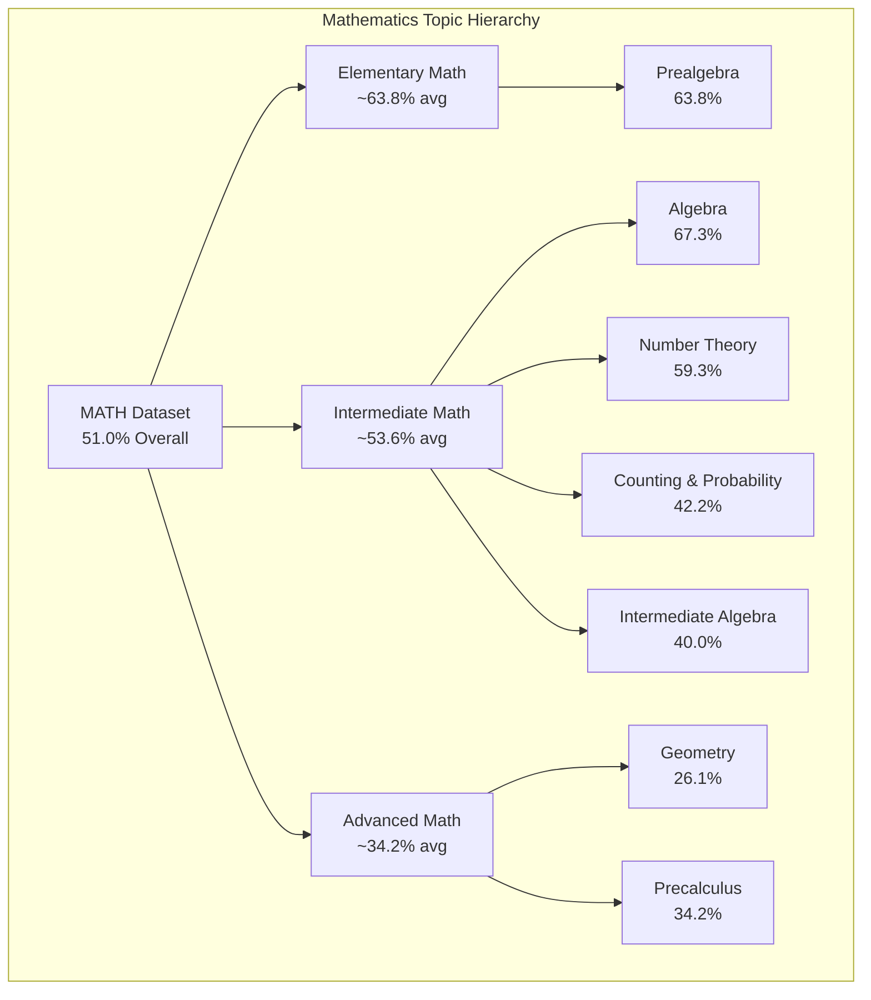
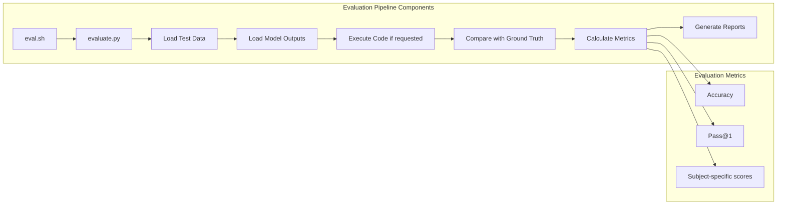

<!-- source: DeepWiki mcp.deepwiki.com · repo microsoft/ToRA · page 3.2 Performance and Benchmarks · fetched 2026-10-26 -->

# Performance and Benchmarks

Relevant source files

The following files were used as context for generating this wiki page:

- [README.md](README.md)
- [docs/index.html](docs/index.html)
- [src/outputs/llm-agents/tora-70b-v1.0/gsm8k/test_tora_-1_seed0_t0.0_s0_e1319.metrics](src/outputs/llm-agents/tora-70b-v1.0/gsm8k/test_tora_-1_seed0_t0.0_s0_e1319.metrics)
- [src/outputs/llm-agents/tora-code-34b-v1.0/math/test_tora_-1_seed0_t0.0_s0_e5000.metrics](src/outputs/llm-agents/tora-code-34b-v1.0/math/test_tora_-1_seed0_t0.0_s0_e5000.metrics)
- [src/requirements.txt](src/requirements.txt)
- [src/train/llama2_flash_attn_monkey_patch.py](src/train/llama2_flash_attn_monkey_patch.py)

This document provides a comprehensive overview of the performance metrics and benchmarks for the ToRA family of models on mathematical reasoning tasks. It details comparative performance across model sizes, architectures, and reasoning formats, along with benchmark dataset descriptions and analysis of factors affecting performance.

For information about the model architecture, see [Model Architecture](#3.3).

## Model Performance Overview

ToRA models have been evaluated on a variety of mathematical reasoning benchmarks, demonstrating significant improvements over prior state-of-the-art models. The table below summarizes the performance of ToRA variants across key benchmark datasets.

| Model | Size | GSM8k | MATH | AVG@10 math tasks |
|-------|------|-------|------|-------------------|
| GPT-4 | - | 92.0 | 42.5 | 78.3 |
| GPT-4 (PAL) | - | 94.2 | 51.8 | 86.4 |
| ToRA-7B | 7B | 68.8 | 40.1 | 62.4 |
| ToRA-Code-7B | 7B | 72.6 | 44.6 | 66.5 | 
| ToRA-Code-7B + self-consistency (k=50) | 7B | 76.8 | 52.5 | - |
| ToRA-13B | 13B | 72.7 | 43.0 | 65.9 |
| ToRA-Code-13B | 13B | 75.8 | 48.1 | 71.3 |
| ToRA-Code-13B + self-consistency (k=50) | 13B | 80.4 | 55.1 | - |
| ToRA-Code-34B | 34B | 80.7 | 51.0 | 74.8 |
| ToRA-Code-34B + self-consistency (k=50) | 34B | 85.1 | 60.0 | - |
| ToRA-70B | 70B | 84.3 | 49.7 | 76.9 |
| ToRA-70B + self-consistency (k=50) | 70B | 88.3 | 56.9 | - |

Sources: [README.md:53-67]()

The AVG@10 math tasks column represents the average performance across 10 diverse mathematical reasoning datasets: GSM8k, MATH, GSM-Hard, SVAMP, TabMWP, ASDiv, SingleEQ, SingleOP, AddSub, and MultiArith.

### Performance Progression Across Model Sizes

Sources: [README.md:53-67]()

### Key Performance Highlights

1. **ToRA-Code-34B** is the first open-source model to exceed 50% accuracy on the MATH dataset (51.0%), significantly outperforming GPT-4's Chain of Thought (CoT) result (42.5%).

2. **ToRA-70B** achieves 84.3% accuracy on GSM8k, surpassing ChatGPT (80.8%) and approaching GPT-4 (92.0%).

3. **Self-consistency** sampling (with k=50) provides substantial improvements across all model sizes, with ToRA-Code-34B reaching 60.0% on MATH and ToRA-70B reaching 88.3% on GSM8k.

4. **CodeLLaMA-based models** (ToRA-Code) consistently outperform their LLaMA-2-based counterparts by approximately 5% on average, demonstrating the value of improved code capabilities for mathematical problem-solving.

Sources: [README.md:67-70](), [docs/index.html:324-346]()

## Benchmark Datasets

ToRA models are evaluated on multiple mathematical reasoning datasets of varying complexity. Here's an overview of the primary benchmarks:

Sources: [README.md:71]()

### GSM8k

GSM8k (Grade School Math 8k) consists of high-quality grade school math word problems that require multi-step reasoning. The test set contains 1,319 problems. This dataset is widely used as a standard benchmark for mathematical reasoning capabilities of language models.

### MATH

The MATH dataset contains 5,000 test problems at the level of mathematics competitions (including the AMC and AIME). Problems are organized by subject and difficulty level, with the following subject areas:

| Subject | Topic Performance (ToRA-Code-34B) |
|---------|----------------------------------|
| Algebra | 67.3% |
| Counting & Probability | 42.2% |
| Geometry | 26.1% |
| Intermediate Algebra | 40.0% |
| Number Theory | 59.3% |
| Prealgebra | 63.8% |
| Precalculus | 34.2% |

Sources: [src/outputs/llm-agents/tora-code-34b-v1.0/math/test_tora_-1_seed0_t0.0_s0_e5000.metrics:5-6]()

## Performance Analysis

### Performance by Reasoning Format

ToRA's performance can be attributed to its tool-integrated reasoning approach, which combines natural language reasoning with programmatic tool usage. Comparative analysis shows the advantages of this approach over alternatives:

Sources: [docs/index.html:350-359]()

### Impact of Output Space Shaping

Output space shaping has been shown to significantly improve ToRA's performance. This technique involves:

1. Using the imitation model to perform diverse self-sampling of tool-use trajectories
2. Retaining valid trajectories and correcting invalid ones
3. Fine-tuning the model on this enhanced set of examples

This approach improves the model's ability to generate valid tool interactions and provides more diverse reasoning paths, leading to better overall performance.

Sources: [docs/index.html:298-313]()

### Performance by Base Model

The choice of base model significantly impacts performance, with CodeLLaMA-based models outperforming their LLaMA-2 counterparts:

Sources: [docs/index.html:324-346]()

The performance gap between ToRA and ToRA-Code models demonstrates that improving the base model's code capabilities directly enhances mathematical problem-solving ability. This is consistent with the tool-integrated reasoning approach, which relies heavily on code generation and execution.

### Performance by Mathematical Topic

ToRA models show varying performance across different mathematical topics. ToRA-Code-34B demonstrates the following performance pattern on the MATH dataset:

Sources: [src/outputs/llm-agents/tora-code-34b-v1.0/math/test_tora_-1_seed0_t0.0_s0_e5000.metrics:6]()

The performance analysis reveals:

1. **Strongest performance** in algebraic topics (67.3%) and prealgebra (63.8%)
2. **Moderate performance** in number theory (59.3%) and counting & probability (42.2%)
3. **Weakest performance** in geometry (26.1%) and precalculus (34.2%)

This suggests that ToRA models excel in domains with clear computational patterns but struggle more with topics that require spatial reasoning or complex symbolic manipulation.

## Inference Efficiency

### Tool Interaction Analysis

ToRA models are designed to use tools efficiently during inference. Analysis shows:

- Average of 1.02 tool interaction rounds per problem
- Single-round interaction for most problems
- Minimal overhead compared to standard inference

This demonstrates that the tool-integrated approach provides substantial performance benefits without significantly increasing inference complexity or latency.

Sources: [docs/index.html:324-346]()

### Optimization for Inference Speed

ToRA leverages several optimizations to maintain efficient inference:

1. **Flash Attention** implementation for faster attention computation ([src/train/llama2_flash_attn_monkey_patch.py]())
2. **vLLM-based inference** for increased throughput
3. **Parallelized code execution** when using self-consistency sampling

Sources: [src/train/llama2_flash_attn_monkey_patch.py:1-145]()

## Comparison with Closed-Source Models

ToRA models have been benchmarked against leading closed-source models like GPT-4 and ChatGPT:

| Model | GSM8k | MATH |
|-------|-------|------|
| GPT-4 | 92.0 | 42.5 |
| GPT-4 (PAL) | 94.2 | 51.8 |
| ChatGPT | 80.8 | 35.5 |
| ChatGPT (PAL) | 78.6 | 38.7 |
| ToRA-Code-34B | 80.7 | 51.0 |
| ToRA-70B | 84.3 | 49.7 |

Sources: [README.md:53-67]()

Key comparative findings:

1. **ToRA-70B** outperforms ChatGPT on both GSM8k (84.3% vs. 80.8%) and MATH (49.7% vs. 35.5%)
2. **ToRA-Code-34B** surpasses GPT-4's Chain-of-Thought result on MATH (51.0% vs. 42.5%)
3. **ToRA-Code-34B + self-consistency** achieves the highest open-source model performance on MATH at 60.0%, exceeding even GPT-4 with PAL (51.8%)

Sources: [docs/index.html:324-346](), [README.md:67-70]()

## Evaluation Pipeline

ToRA models are evaluated using a standardized pipeline:

Sources: [README.md:112-136]()

The evaluation process includes:
1. Loading test data from the appropriate benchmark dataset
2. Loading model outputs (which may be stored in `/src/outputs/llm-agents/`)
3. Executing generated code if needed
4. Comparing predicted answers with ground truth using grading logic based on the Hendrycks' MATH grading system
5. Calculating and reporting performance metrics

---

