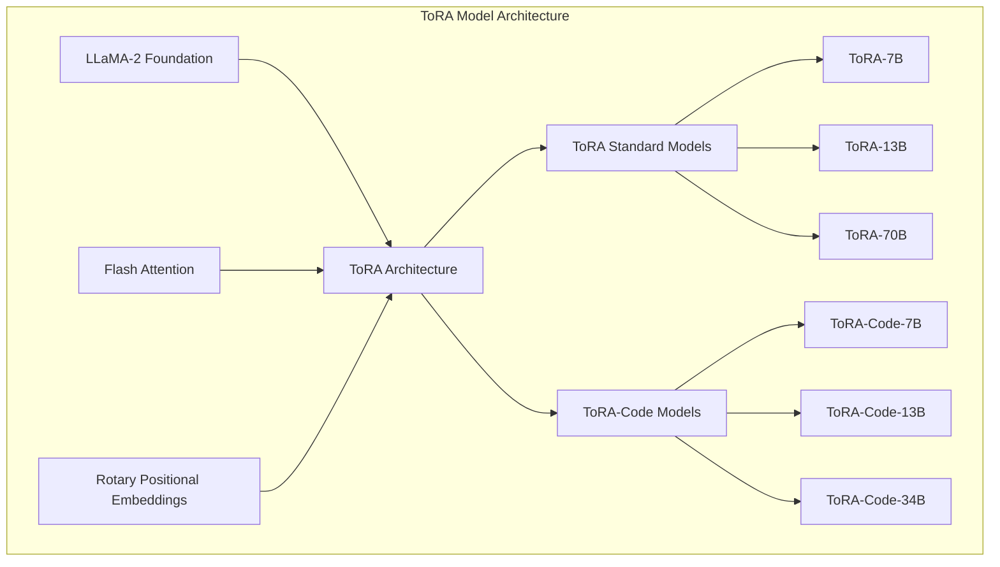
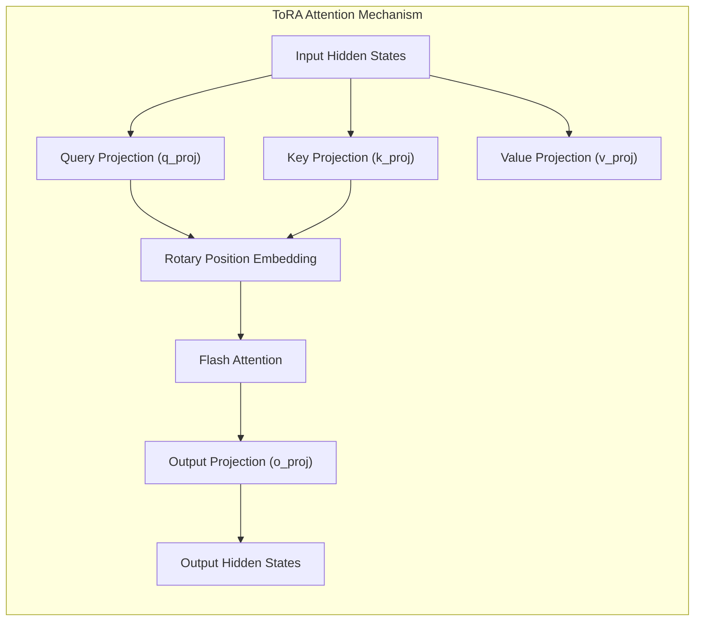
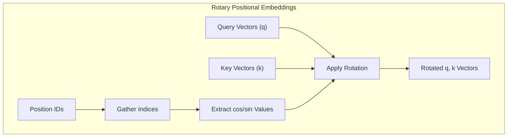
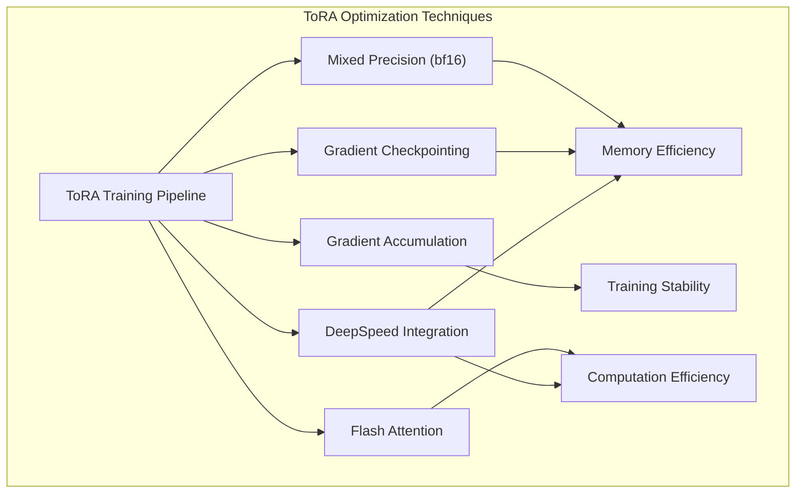
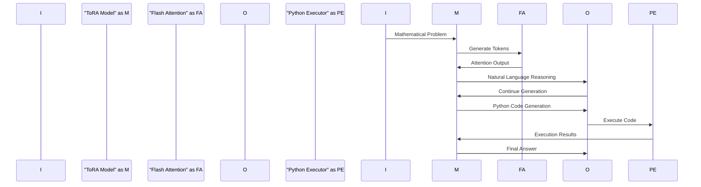

<!-- source: DeepWiki mcp.deepwiki.com · repo microsoft/ToRA · page 3.3 Model Architecture · fetched 2026-10-26 -->

# Model Architecture

Relevant source files

The following files were used as context for generating this wiki page:

- [README.md](README.md)
- [src/requirements.txt](src/requirements.txt)
- [src/train/llama2_flash_attn_monkey_patch.py](src/train/llama2_flash_attn_monkey_patch.py)

This document describes the architecture of ToRA models, including their foundation, key components, and the optimizations employed. For information about available model variants and checkpoints, see [Available Models and Checkpoints](#3.1). For performance benchmarks, see [Performance and Benchmarks](#3.2).

## Base Architecture Overview

ToRA models are built upon the LLaMA-2 architecture, with specific optimizations for mathematical reasoning tasks. The models come in various sizes (7B, 13B, 34B, and 70B parameters) and variants (standard ToRA and ToRA-Code).

Sources: [README.md:50-71](https://github.com/microsoft/ToRA/blob/main/README.md), [src/requirements.txt:6-9]()

## Attention Mechanism

ToRA uses an optimized attention mechanism based on Flash Attention to improve training and inference efficiency. The standard LLaMA attention is replaced with Flash Attention using a monkey patch, which enables faster processing of attention computations.

The implementation includes several optimizations:
- Flash Attention for efficient attention computation
- Support for causal attention masks
- Handling of key-value caching for efficient inference
- Specialized padding handling for variable sequence lengths

Sources: [src/train/llama2_flash_attn_monkey_patch.py:1-145]()

## Rotary Positional Embeddings

ToRA uses Rotary Positional Embeddings (RoPE) for encoding positional information. This approach applies a rotation to the query and key vectors in the attention mechanism based on their positions, allowing the model to better understand relative positions in the input.

Sources: [src/train/llama2_flash_attn_monkey_patch.py:21-32]()

## Model Size Variants and Configuration

ToRA is available in multiple sizes, with hyperparameters optimized for each variant:

| Model Size | Learning Rate | Batch Size | Optimizer Offload | Key Capabilities |
|------------|---------------|------------|-------------------|------------------|
| 7B         | 2e-5          | 16         | No                | Base mathematical reasoning |
| 13B        | 2e-5          | 16         | No                | Enhanced reasoning capabilities |
| 34B        | 1e-5          | 8          | Yes               | Advanced reasoning, competitive with GPT-4 CoT |
| 70B        | 1e-5          | 4          | Yes               | State-of-the-art reasoning among open models |

The hyperparameters are configured based on model size to balance training efficiency and model performance.

Sources: [README.md:14-16](), [README.md:53-66]()

## Code vs. Standard Variants

ToRA comes in two main variants:

1. **Standard ToRA**: Focused on general mathematical reasoning with natural language
2. **ToRA-Code**: Specialized for tool-integrated reasoning with enhanced code generation capabilities

The ToRA-Code variants typically outperform their standard counterparts on mathematical reasoning tasks, especially when combined with techniques like self-consistency.

Sources: [README.md:53-66]()

## Optimization Techniques

ToRA employs several optimization techniques to enable efficient training and inference of large language models:

### Mixed Precision Training

ToRA uses bfloat16 (bf16) mixed precision training to reduce memory usage and accelerate computations while maintaining numerical stability better than float16.

### Gradient Checkpointing

Gradient checkpointing is used to reduce memory usage during training by recomputing intermediate activations during the backward pass instead of storing them.

### Flash Attention

Flash attention is a memory-efficient attention implementation that reduces the memory complexity of attention from O(n²) to O(n), where n is the sequence length.

### DeepSpeed Integration

ToRA leverages DeepSpeed for distributed training, enabling efficient scaling across multiple GPUs using techniques like optimizer state partitioning and ZeRO optimizer stages.

Sources: [src/requirements.txt:4-6](), [src/train/llama2_flash_attn_monkey_patch.py:135-144]()

## Hardware Requirements

Flash attention in ToRA is optimized for NVIDIA A100 or H100 GPUs. As noted in the code comments, Flash attention with head dimensions greater than 64 in backward pass requires compute capability 8.0 or higher (A100/H100 GPUs).

Sources: [src/train/llama2_flash_attn_monkey_patch.py:136-141]()

## Integration with Tool-Based Reasoning

The ToRA architecture is designed to support tool-integrated reasoning for mathematical problem solving. The model is trained to seamlessly combine natural language reasoning with code execution, enabling it to leverage external tools like computation libraries and symbolic solvers.

This architectural design allows the model to interleave natural language reasoning with programmatic tool use, combining the analytical capabilities of language models with the computational precision of external tools.

Sources: [README.md:71-77]()

---

