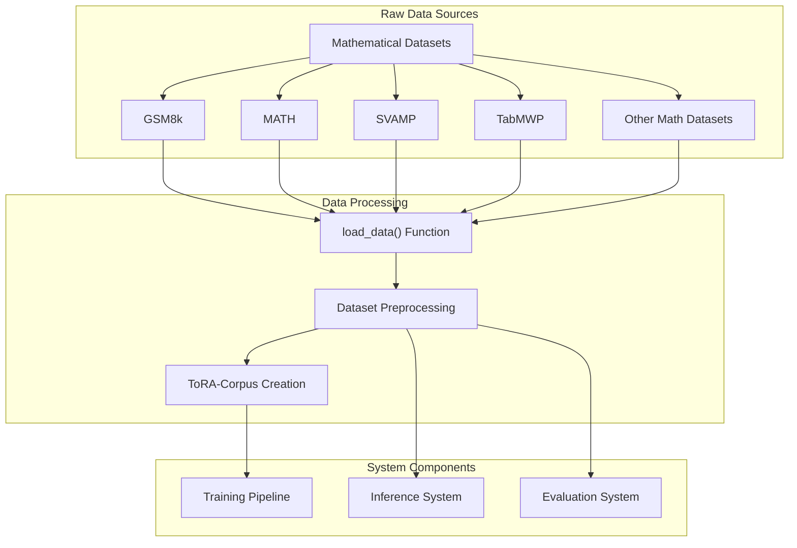
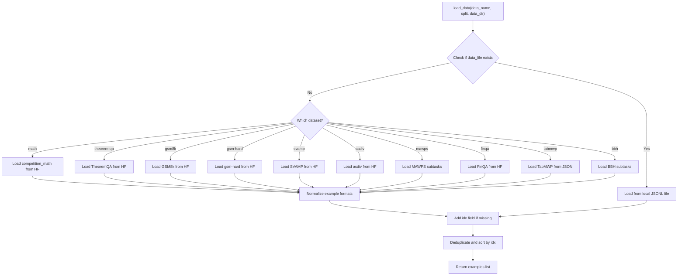
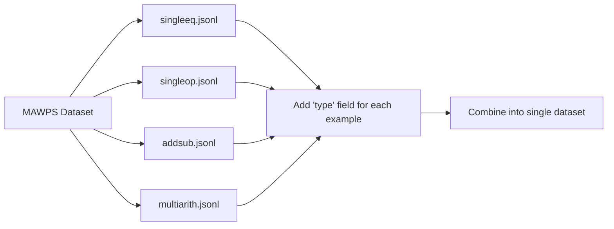
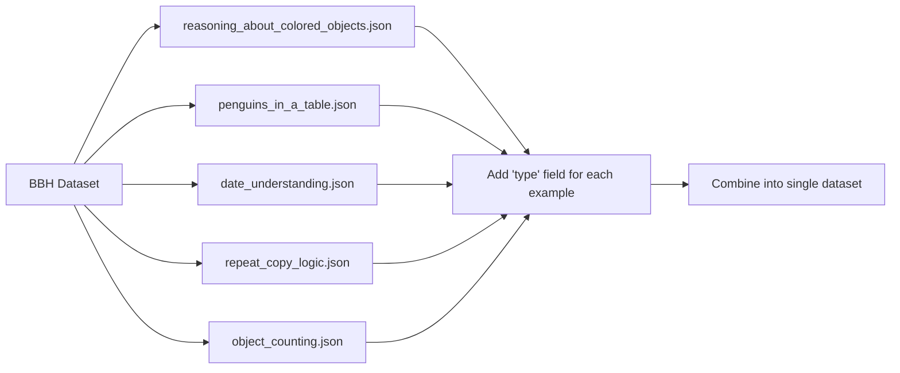
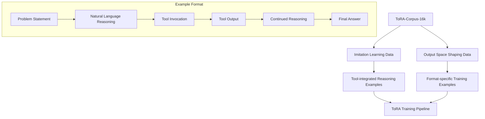
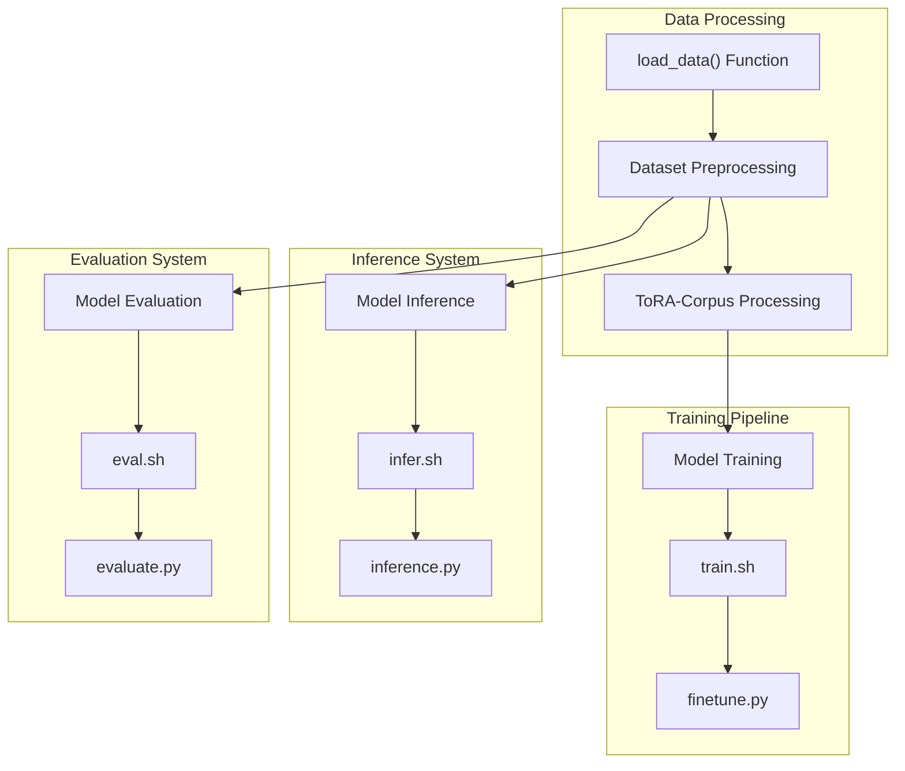
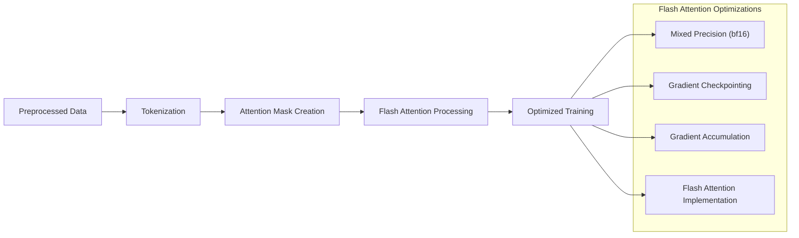

<!-- source: DeepWiki mcp.deepwiki.com · repo microsoft/ToRA · page 4 Data Processing · fetched 2026-10-26 -->

# Data Processing

<details>
<summary>Relevant source files</summary>

The following files were used as context for generating this wiki page:

- [README.md](README.md)
- [src/requirements.txt](src/requirements.txt)
- [src/train/llama2_flash_attn_monkey_patch.py](src/train/llama2_flash_attn_monkey_patch.py)
- [src/utils/data_loader.py](src/utils/data_loader.py)

</details>


This document provides a comprehensive overview of the data processing components in the ToRA system. It covers the supported datasets, data loading mechanisms, and preprocessing steps used in training ToRA models and evaluating their performance on mathematical reasoning tasks. For information about the training pipeline that uses this data, see [Training Pipeline](#2.1). For information about the evaluation system that consumes processed data, see [Evaluation System](#2.3).

## Data Flow in ToRA System

The data processing components play a central role in the ToRA system, serving as the bridge between raw mathematical datasets and the training, inference, and evaluation pipelines. The following diagram illustrates how data flows through the system:



Sources: [src/utils/data_loader.py:1-71](), [README.md:43-67]()

## Supported Datasets

ToRA leverages various mathematical reasoning datasets for training and evaluation. The system supports the following datasets, each serving different aspects of mathematical reasoning:

| Dataset | Description | Category | Example Count |
|---------|-------------|----------|--------------|
| GSM8k | Grade school math word problems | Arithmetic | ~8.5K |
| MATH | Competition-level mathematics problems | Advanced Math | 5K |
| GSM-Hard | Challenging subset of GSM8k-style problems | Arithmetic | Subset |
| SVAMP | Elementary math word problems with variations | Arithmetic | ~1K |
| TabMWP | Tabular math word problems | Tabular Math | ~1K (sampled) |
| ASDiv | Diverse arithmetic word problems | Arithmetic | Varies |
| MAWPS | Collection of math word problem subsets | Arithmetic | Varies |
| SingleEQ | Single-equation problems (MAWPS subset) | Arithmetic | Subset |
| SingleOP | Single-operation problems (MAWPS subset) | Arithmetic | Subset |
| AddSub | Addition-subtraction problems (MAWPS subset) | Arithmetic | Subset |
| MultiArith | Multi-step arithmetic problems (MAWPS subset) | Arithmetic | Subset |
| FinQA | Financial reasoning questions | Finance | ~1K (sampled) |
| BBH | Big-Bench Hard tasks (selective subset) | Reasoning | Subset |
| TheoremQA | Theorem-based questions | Mathematical Proofs | Varies |

According to the README, ToRA achieves competitive performance across 10 mathematical tasks, including GSM8k, MATH, GSM-Hard, SVAMP, TabMWP, ASDiv, SingleEQ, SingleOP, AddSub, and MultiArith.

Sources: [src/utils/data_loader.py:7-71](), [README.md:43-67]()

## Dataset Loading and Preprocessing

The ToRA system employs a unified approach to dataset loading through the `load_data` function in `utils/data_loader.py`. This function serves as the primary interface for accessing all supported datasets.



Sources: [src/utils/data_loader.py:7-71]()

### Data Loading Process

The data loading process follows these steps:

1. **Check for cached data**: The system first checks if the dataset has already been loaded and cached as a JSONL file in the specified data directory.

2. **Load from source if needed**: If a cached version is not available, the system loads the dataset from its original source, which could be:
   - Hugging Face datasets library
   - Local JSON files
   - Custom data sources

3. **Normalize data format**: All loaded datasets have their keys converted to lowercase to ensure consistency.

4. **Add index**: Each example is assigned a unique index if not already present.

5. **Sort and deduplicate**: Examples are sorted by their index to ensure consistent ordering.

The following code snippet illustrates this process:

```python
def load_data(data_name, split, data_dir='./data'):
    data_file = f"{data_dir}/{data_name}/{split}.jsonl"
    if os.path.exists(data_file):
        examples = list(load_jsonl(data_file))
    else:
        # Dataset-specific loading logic
        # ...
        
        examples = list(dataset)
        examples = [lower_keys(example) for example in examples]
        dataset = Dataset.from_list(examples)
        os.makedirs(f"{data_dir}/{data_name}", exist_ok=True)
        dataset.to_json(data_file)

    # add 'idx' in the first column
    if 'idx' not in examples[0]:
        examples = [{'idx': i, **example} for i, example in enumerate(examples)]

    # dedeplicate & sort
    examples = sorted(examples, key=lambda x: x['idx'])
    return examples
```

Sources: [src/utils/data_loader.py:7-71]()

## Dataset-Specific Processing

Different datasets require specific processing steps:

### MAWPS Processing

MAWPS consists of four subtasks (SingleEQ, SingleOP, AddSub, and MultiArith), which are loaded separately and then combined:



Sources: [src/utils/data_loader.py:27-35]()

### BBH Processing

Big-Bench Hard (BBH) tasks are selectively loaded, focusing on reasoning tasks:



Sources: [src/utils/data_loader.py:46-55]()

## ToRA-Corpus Dataset

The ToRA-Corpus is a specialized dataset used for training ToRA models. According to the README, the ToRA training pipeline involves two main components:

1. **Imitation Learning**: Training on demonstrations of tool-integrated reasoning.
2. **Output Space Shaping**: Training on specific formats to improve model capabilities.



Sources: [README.md:79-86]()

### Data Example Structure

Based on the repository information, a typical example in the ToRA-Corpus would contain:

1. A mathematical problem statement
2. Natural language reasoning steps
3. Tool invocation (Python code)
4. Tool output results
5. Further reasoning incorporating tool outputs
6. Final answer

This structure aligns with the tool-integrated reasoning approach described in the ToRA paper, where the model alternates between natural language reasoning and Python code execution.

Note: As mentioned in the README, the ToRA-Corpus-16k dataset is currently undergoing internal review for open-sourcing. The repository provides example data in the `data/tora/` directory that follows this structure.

Sources: [README.md:138-141]()

## Data Requirements

The ToRA system has specific data-related requirements as indicated by the dependencies listed in `requirements.txt`:

- **Data Libraries**: The system relies on libraries like `datasets`, `sentencepiece`, and `jsonlines` for data loading and processing.
- **Mathematical Processing**: Libraries such as `sympy` are used for symbolic mathematics.
- **Execution Environment**: `func-timeout`, `timeout-decorator`, and `pebble` are used to manage code execution timeouts when running Python code for tool-integrated reasoning.

Sources: [src/requirements.txt:1-35]()

## Integration with Other Components

The data processing component integrates with other parts of the ToRA system in specific ways:



Sources: [README.md:87-125]()

## Flash Attention Optimization

To optimize training on large mathematical datasets, ToRA employs Flash Attention, which is particularly important for handling long mathematical problems efficiently. This optimization is applied during the model training phase but is prepared during data preprocessing:



Sources: [src/train/llama2_flash_attn_monkey_patch.py:1-241]()

## Summary

The data processing component of ToRA handles the loading, preprocessing, and management of various mathematical datasets. It provides a unified interface through the `load_data` function, supports multiple dataset formats, and prepares data for the training, inference, and evaluation pipelines. The ToRA-Corpus dataset, specifically designed for training tool-integrated reasoning capabilities, plays a crucial role in the system's performance on mathematical reasoning tasks.

The data processing pipeline is optimized for handling mathematical content, with special attention to normalization, indexing, and efficient training through Flash Attention optimization.

---

