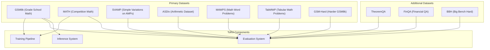
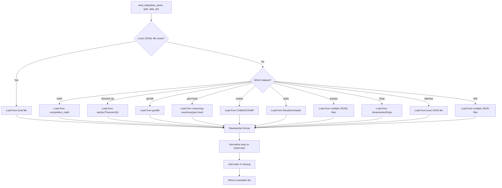
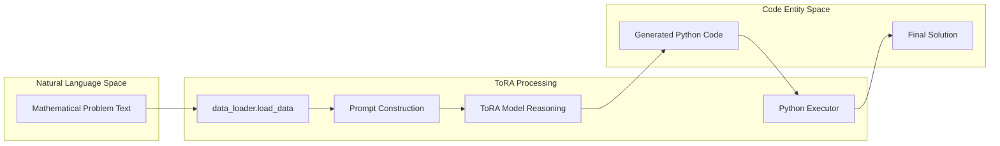

<!-- source: DeepWiki mcp.deepwiki.com · repo microsoft/ToRA · page 4.1 Supported Datasets · fetched 2026-10-26 -->

# Supported Datasets

<details>
<summary>Relevant source files</summary>

The following files were used as context for generating this wiki page:

- [src/data/asdiv/test.jsonl](src/data/asdiv/test.jsonl)
- [src/data/gsm-hard/test.jsonl](src/data/gsm-hard/test.jsonl)
- [src/data/gsm8k/test.jsonl](src/data/gsm8k/test.jsonl)
- [src/data/math/test.jsonl](src/data/math/test.jsonl)
- [src/data/mawps/test.jsonl](src/data/mawps/test.jsonl)
- [src/data/svamp/test.jsonl](src/data/svamp/test.jsonl)
- [src/data/tabmwp/test.jsonl](src/data/tabmwp/test.jsonl)
- [src/utils/data_loader.py](src/utils/data_loader.py)

</details>


This page documents the various mathematical reasoning datasets supported by the ToRA system. These datasets serve as inputs for training, evaluation, and inference within the ToRA framework. For information about how these datasets are loaded and processed, see [Dataset Loading and Preprocessing](#4.2).

## Overview of Supported Datasets

ToRA supports a diverse collection of mathematical reasoning datasets, each with different characteristics and complexity levels. These datasets provide the foundation for training ToRA's mathematical reasoning capabilities and serve as benchmarks for evaluating performance.



Sources: [src/utils/data_loader.py:1-71]()

## Core Mathematical Datasets

### GSM8k (Grade School Math 8K)

GSM8k is a dataset of grade school math word problems that test basic mathematical operations and problem-solving skills. It has become a standard benchmark for evaluating mathematical reasoning capabilities in language models.

**Format Example:**
```json
{
  "question": "Janet's ducks lay 16 eggs per day. She eats three for breakfast every morning and bakes muffins for her friends every day with four. She sells the remainder at the farmers' market daily for $2 per fresh duck egg. How much in dollars does she make every day at the farmers' market?",
  "answer": "Janet sells 16 - 3 - 4 = 9 duck eggs a day.\nShe makes 9 * 2 = $18 every day at the farmer's market.\n#### 18",
  "idx": 0
}
```

Sources: [src/data/gsm8k/test.jsonl:1-10](), [src/utils/data_loader.py:16-17]()

### MATH (Competition Math)

The MATH dataset contains more advanced mathematical problems spanning various topics including algebra, geometry, calculus, and more. These problems are on the level of mathematics competitions and require deeper mathematical understanding.

**Format Example:**
```json
{
  "problem": "How many vertical asymptotes does the graph of $y=\\frac{2}{x^2+x-6}$ have?",
  "level": "Level 3",
  "type": "Algebra",
  "solution": "The denominator of the rational function factors into $x^2+x-6=(x-2)(x+3)$. Since the numerator is always nonzero, there is a vertical asymptote whenever the denominator is $0$, which occurs for $x = 2$ and $x = -3$.  Therefore, the graph has $\\boxed{2}$ vertical asymptotes.",
  "idx": 0
}
```

Sources: [src/data/math/test.jsonl:1-10](), [src/utils/data_loader.py:12-13]()

### SVAMP (Simple Variations on Arithmetic Math word Problems)

SVAMP contains simple variations on arithmetic math word problems designed to test a model's robustness to structural changes in problem statements.

**Format Example:**
```json
{
  "Answer": 145.0,
  "Question": "How big is each group of bananas?",
  "Equation": "( 290.0 / 2.0 )",
  "Body": "There are 87 oranges and 290 bananas in Philip's collection. If the bananas are organized into 2 groups and oranges are organized into 93 groups",
  "Type": "Common-Division",
  "ID": "chal-777",
  "idx": 0
}
```

Sources: [src/data/svamp/test.jsonl:1-10](), [src/utils/data_loader.py:20-23]()

### ASDIV (Arthur's Subset of Division Problems)

ASDIV is an arithmetic dataset focused on elementary school-level arithmetic operations with a particular emphasis on division problems.

**Format Example:**
```json
{
  "body": "Seven red apples and two green apples are in the basket.",
  "question": "How many apples are in the basket?",
  "solution_type": "Addition",
  "answer": "9 (apples)",
  "formula": "7+2=9",
  "idx": 0
}
```

Sources: [src/data/asdiv/test.jsonl:1-10](), [src/utils/data_loader.py:24-26]()

### MAWPS (Math Word Problems)

MAWPS consists of several subsets of math word problems, each focusing on different types of mathematical operations: single equation, single operation, addition-subtraction, and multi-step arithmetic.

**Format Example:**
```json
{
  "input": "Joan found 70 seashells on the beach. she gave Sam some of her seashells. She has 27 seashell left. How many seashells did she give to Sam?",
  "target": 43.0,
  "type": "singleeq",
  "idx": 0
}
```

Sources: [src/data/mawps/test.jsonl:1-10](), [src/utils/data_loader.py:27-35]()

### TabMWP (Tabular Math Word Problems)

TabMWP contains math word problems that reference tabular data, requiring the model to understand both the problem text and the accompanying table to solve the problem.

**Format Example:**
```json
{
  "question": "Ryan wants to buy 5 pounds of dried pear. How much will he spend?",
  "answer": "34.35",
  "unit": "$",
  "table": "banana chips | $6.95/pound\nraisins | $5.49/pound\ndried mango | $6.32/pound\ndried pineapple | $2.22/pound\ndried apple | $6.89/pound\ndried pear | $6.87/pound",
  "solution": "Find the cost of the dried pear. Multiply the price per pound by the number of pounds.\n\n$6.87 × 5 = $34.35\n\nHe will spend $34.35.",
  "idx": 0
}
```

Sources: [src/data/tabmwp/test.jsonl:1-10](), [src/utils/data_loader.py:39-45]()

### GSM-Hard (Harder GSM8k)

GSM-Hard contains more challenging versions of the GSM8k problems, designed to test the limits of mathematical reasoning capabilities.

**Format Example:**
```json
{
  "input": "Janet's ducks lay 16 eggs per day. She eats three for breakfast every morning and bakes muffins for her friends every day with 4933828. She sells the remainder at the farmers' market daily for $2 per fresh duck egg. How much in dollars does she make every day at the farmers' market?",
  "code": "def solution():\n    \"\"\"Janet's ducks lay 16 eggs per day. She eats three for breakfast every morning and bakes muffins for her friends every day with four. She sells the remainder at the farmers' market daily for $2 per fresh duck egg. How much in dollars does she make every day at the farmers' market?\"\"\"\n    eggs_per_day = 16\n    eggs_eaten = 3\n    eggs_baked = 4933828\n    eggs_sold = eggs_per_day - eggs_eaten - eggs_baked\n    price_per_egg = 2\n    money_made = eggs_sold * price_per_egg\n    result = money_made\n    return result",
  "target": -9867630.0,
  "idx": 0
}
```

Sources: [src/data/gsm-hard/test.jsonl:1-10](), [src/utils/data_loader.py:18-19]()

## Additional Supported Datasets

### TheoremQA

TheoremQA focuses on theoretical mathematics problems, testing a model's understanding of mathematical theorems and principles.

Sources: [src/utils/data_loader.py:14-15]()

### FinQA (Financial Question Answering)

FinQA contains finance-related mathematical problems that require understanding of financial concepts and calculations.

Sources: [src/utils/data_loader.py:36-38]()

### BBH (Big Bench Hard)

BBH includes a subset of the Big Bench Hard benchmark focusing on various reasoning tasks:
- Reasoning about colored objects
- Understanding data in tables
- Date understanding
- Logical reasoning
- Object counting

Sources: [src/utils/data_loader.py:46-55]()

## Dataset Loading Mechanism

ToRA uses a unified data loading system implemented in `load_data` function that handles different dataset formats and sources. This function can load data either from local JSONL files or from HuggingFace's datasets library.



Sources: [src/utils/data_loader.py:7-71]()

## Dataset Usage in ToRA

The datasets serve different purposes within the ToRA system:

| Dataset | Training | Evaluation | Inference | Special Characteristics |
|---------|----------|------------|-----------|-------------------------|
| GSM8k   | ✓        | ✓          | ✓         | Primary benchmark for math reasoning |
| MATH    | ✓        | ✓          | ✓         | Advanced mathematical problems |
| SVAMP   | -        | ✓          | ✓         | Tests robustness to problem variations |
| ASDiv   | -        | ✓          | ✓         | Focuses on elementary arithmetic |
| MAWPS   | -        | ✓          | ✓         | Multiple math word problem subtypes |
| TabMWP  | -        | ✓          | ✓         | Requires understanding tabular data |
| GSM-Hard| -        | ✓          | ✓         | Stress-testing math capabilities |
| TheoremQA| -       | ✓          | ✓         | Tests theoretical math understanding |
| FinQA   | -        | ✓          | ✓         | Financial domain math problems |
| BBH     | -        | ✓          | ✓         | Tests various reasoning capabilities |

Sources: [src/utils/data_loader.py:1-71]()

## Dataset Examples in Natural Language and Code

Below is a diagram illustrating how mathematical problems from these datasets flow through the ToRA system, from natural language representation to code execution:



Sources: [src/utils/data_loader.py:1-71]()

---

