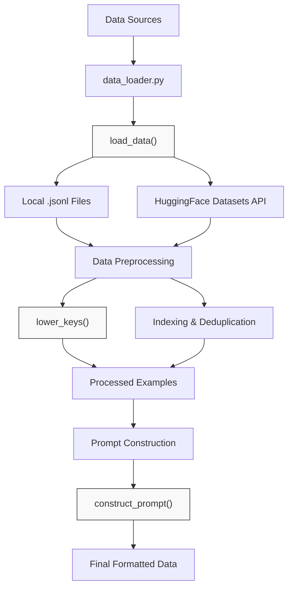
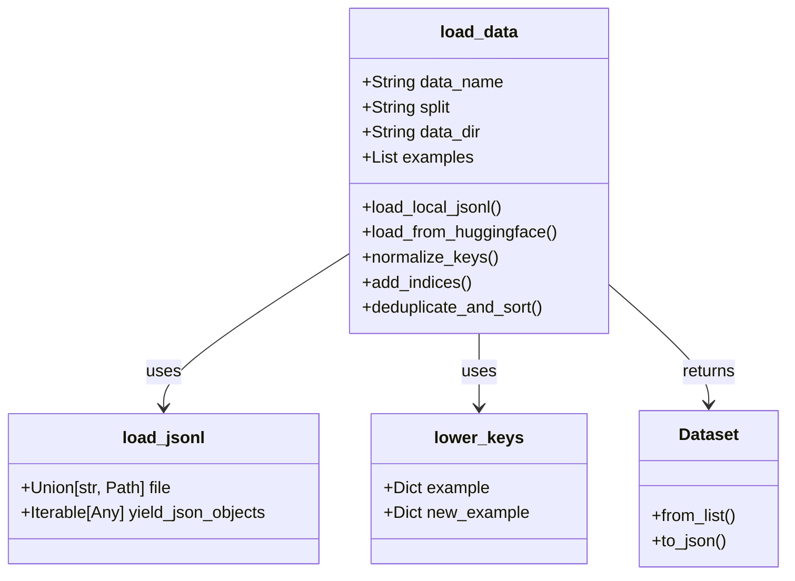
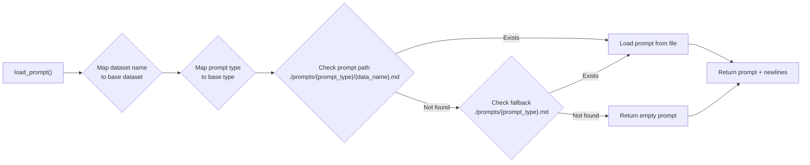
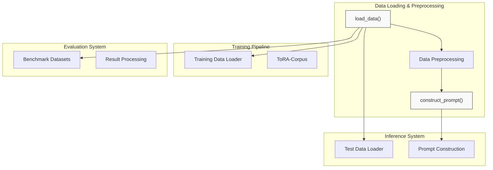

<!-- source: DeepWiki mcp.deepwiki.com · repo microsoft/ToRA · page 4.2 Dataset Loading and Preprocessing · fetched 2026-10-26 -->

# Dataset Loading and Preprocessing

<details>
<summary>Relevant source files</summary>

The following files were used as context for generating this wiki page:

- [src/utils/data_loader.py](src/utils/data_loader.py)
- [src/utils/utils.py](src/utils/utils.py)

</details>


This page documents the dataset loading and preprocessing pipeline in the ToRA system, explaining how mathematical reasoning datasets are loaded, transformed, and prepared for use in training, inference, and evaluation processes. For information about the specific datasets supported by ToRA, see [Supported Datasets](#4.1).

## Overview

The ToRA system provides a flexible framework for handling various mathematical reasoning datasets through a set of utility functions and data loaders. The dataset loading and preprocessing components ensure that data from different sources is consistently formatted and ready for model consumption.



Sources: [src/utils/data_loader.py:7-71](), [src/utils/utils.py:39-47](), [src/utils/utils.py:68-97]()

## Data Loading Framework

### The `load_data` Function

The central component of ToRA's data loading system is the `load_data` function in `data_loader.py`. This function serves as a unified interface for loading various mathematical reasoning datasets.



Sources: [src/utils/data_loader.py:7-71](), [src/utils/utils.py:18-25](), [src/utils/utils.py:39-47]()

### Loading Process

The data loading process follows these steps:

1. Check if a local JSONL file exists at the specified path
2. If local file exists, load data using the `load_jsonl` utility
3. If not, load the dataset using the appropriate method:
   - Direct loading via Hugging Face `load_dataset` for supported datasets
   - Custom loading for specialized datasets (e.g., MAWPS, TabMWP, BBH)
4. Process the loaded examples (lowercase keys, add indices)
5. Deduplicate and sort examples by index

| Dataset | Loading Method | Notes |
|---------|---------------|-------|
| math | HuggingFace (competition_math) | Main split |
| theorem-qa | HuggingFace (wenhu/TheoremQA) | |
| gsm8k | HuggingFace (gsm8k) | |
| gsm-hard | HuggingFace (reasoning-machines/gsm-hard) | Train split only |
| svamp | HuggingFace (ChilleD/SVAMP) | Combined train and test splits |
| asdiv | HuggingFace (EleutherAI/asdiv) | Validation split, filters multi-answer examples |
| mawps | Custom loader | Combines four sub-tasks: singleeq, singleop, addsub, multiarith |
| finqa | HuggingFace (dreamerdeo/finqa) | Random sample of 1000 examples |
| tabmwp | Custom JSON loader | Random sample of 1000 examples |
| bbh | Custom JSON loader | Combines multiple reasoning tasks |

Sources: [src/utils/data_loader.py:7-57]()

## Data Preprocessing

After loading the raw data, ToRA applies several preprocessing steps to ensure consistency and usability:

### Key Normalization

All dictionary keys are normalized to lowercase using the `lower_keys` utility function:

```
function lower_keys(example):
  - Create new_example dictionary
  - For each key-value pair in example:
    - If key is not lowercase, convert it to lowercase
    - Add the (potentially converted) key and original value to new_example
  - Return new_example
```

Sources: [src/utils/utils.py:39-47]()

### Indexing and Deduplication

ToRA ensures that each example has a unique identifier:

1. If 'idx' field is not present, add sequential indices to examples
2. Sort examples by their indices to maintain deterministic ordering
3. Deduplicate examples to avoid redundancy

Sources: [src/utils/data_loader.py:66-70]()

## Prompt Construction

A key part of preprocessing is constructing appropriate prompts for different models and reasoning tasks. ToRA includes utilities for building prompts based on dataset type and prompting strategy.

### Prompt Loading

The `load_prompt` function retrieves prompt templates from markdown files:



Sources: [src/utils/utils.py:50-66]()

### Prompt Types

ToRA supports several prompt construction strategies through the `construct_prompt` function:

| Prompt Type | Format | Purpose |
|-------------|--------|---------|
| tora | Template + "Question: {question}\n\nSolution:" | Tool-integrated reasoning |
| direct/cot | Template + "Question: {question}\nAnswer:" | Direct answer or chain-of-thought |
| pal | Template + "Question: {question}" | Program-aided learning |
| wizard_zs | Instruction format with step-by-step thinking | Zero-shot prompting |
| platypus_fs | Instruction format with template | Few-shot prompting |
| train_prompt_format | Conversational: "\<\|user\|\>\n{question}\n\<\|assistant\|\>\n" | Training format |

Sources: [src/utils/utils.py:68-97]()

## Integration with ToRA System

The dataset loading and preprocessing components integrate with the broader ToRA system as follows:



Sources: [src/utils/data_loader.py:7-71](), [src/utils/utils.py:68-97]()

## Practical Example: Dataset Loading Workflow

Below is a typical workflow for loading and processing a dataset in the ToRA system:

1. Call `load_data` with dataset name, split, and data directory
2. The function checks if a cached JSONL file exists:
   - If yes, load directly from the file
   - If no, load via Hugging Face or custom loaders
3. Apply key normalization with `lower_keys`
4. Add indices if missing and deduplicate examples
5. Use `construct_prompt` to format examples according to the desired prompt type
6. Pass the processed examples to the model for training, inference, or evaluation

### Loading GSM8K Example

```
# Workflow example (pseudocode):
examples = load_data("gsm8k", "test", "./data")
for example in examples:
    prompt = construct_prompt(args, example)
    # Pass to model for inference or evaluation
```

Sources: [src/utils/data_loader.py:11-14](), [src/utils/utils.py:68-97]()

## Utility Functions

In addition to the core loading and preprocessing functions, ToRA includes several utility functions for data manipulation:

| Function | Purpose | Location |
|----------|---------|----------|
| `load_jsonl` | Load data from JSONL files | `utils.py` |
| `save_jsonl` | Save data to JSONL files | `utils.py` |
| `lower_keys` | Normalize dictionary keys to lowercase | `utils.py` |
| `load_prompt` | Load prompt templates from markdown files | `utils.py` |
| `construct_prompt` | Build prompts based on dataset and strategy | `utils.py` |
| `show_sample` | Display example data in a readable format | `utils.py` |

Sources: [src/utils/utils.py:18-127]()

## Summary

The dataset loading and preprocessing pipeline in ToRA provides a flexible and extensible framework for handling mathematical reasoning datasets from various sources. The system supports multiple dataset formats and prompting strategies, making it adaptable to different training, inference, and evaluation needs.

Key components include:
- Unified data loading interface via `load_data`
- Support for local files and Hugging Face datasets
- Consistent preprocessing steps for normalization and indexing
- Flexible prompt construction for different reasoning strategies

For details on specific datasets used in ToRA, see [Supported Datasets](#4.1). For information about the ToRA-Corpus used for training, see [ToRA-Corpus](#4.3).

---

