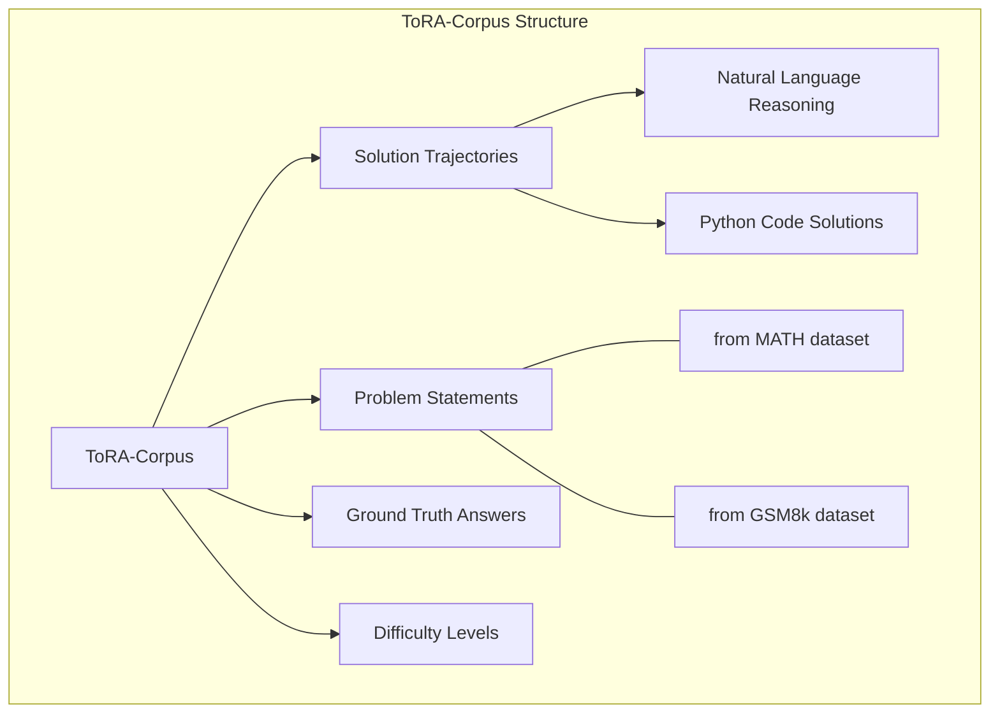
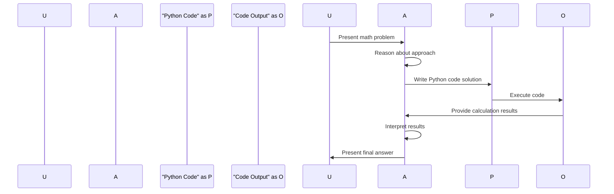
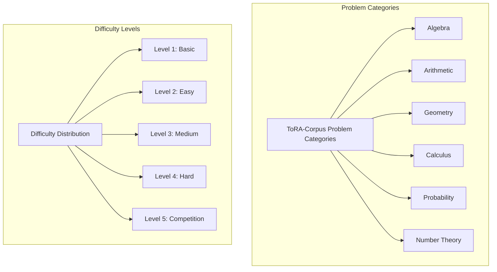
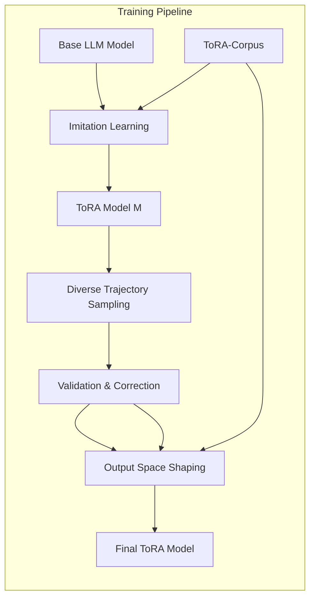
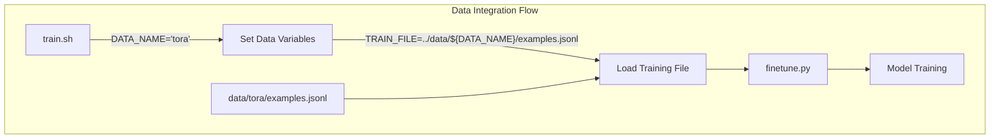
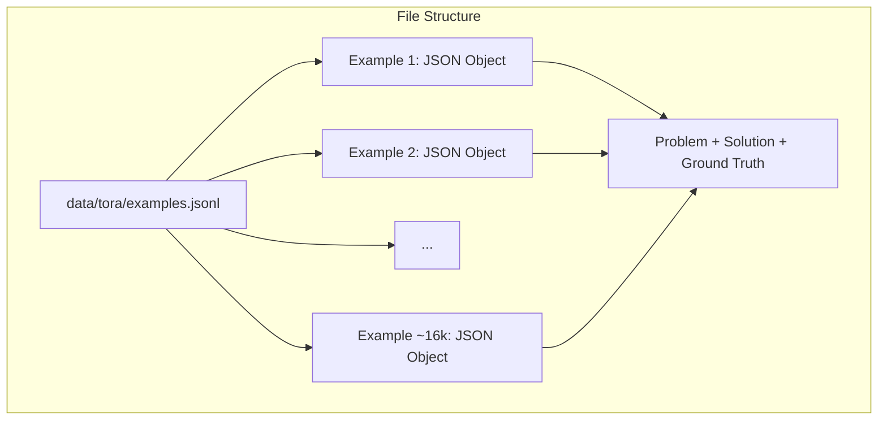

<!-- source: DeepWiki mcp.deepwiki.com · repo microsoft/ToRA · page 4.3 ToRA-Corpus · fetched 2026-10-26 -->

# ToRA-Corpus

<details>
<summary>Relevant source files</summary>

The following files were used as context for generating this wiki page:

- [data/tora/examples.jsonl](data/tora/examples.jsonl)
- [docs/index.html](docs/index.html)
- [src/scripts/train.sh](src/scripts/train.sh)

</details>


The ToRA-Corpus is a specialized dataset designed for training Tool-integrated Reasoning Agents (ToRA) to solve mathematical reasoning problems. It consists of tool-integrated reasoning trajectories that combine natural language explanations with Python code execution for mathematical problem-solving. This page documents the structure, composition, and usage of the ToRA-Corpus within the ToRA system. For information about dataset loading and preprocessing in general, see [Dataset Loading and Preprocessing](#4.2).

## Overview

ToRA-Corpus is a collection of approximately 16,000 annotated examples created using GPT-4 to generate high-quality interactive tool-use trajectories for mathematical problems from GSM8k and MATH datasets. The corpus uniquely combines natural language rationales with program-based tool usage, providing a foundation for imitation learning to train models that can effectively reason about mathematical problems using both natural language and code execution.



Sources: [docs/index.html:264-278](), [data/tora/examples.jsonl:1-31]()

## Data Format and Structure

Each entry in the ToRA-Corpus is a JSON object with the following fields:

| Field | Description |
|-------|-------------|
| `dataset` | Source dataset identifier (typically "tora-corpus-math") |
| `level` | Difficulty level (e.g., "Level 1" to "Level 5") |
| `id` | Unique identifier for the problem (e.g., "math-train-1149-0") |
| `gt` | Ground truth answer |
| `gt_cot` | Ground truth chain-of-thought explanation |
| `messages` | A list of conversational messages containing the problem and solution |

The `messages` field follows a conversational format:
1. A `user` message containing the mathematical problem
2. An `assistant` message containing a tool-integrated solution that interleaves natural language reasoning with Python code

### Example Entry

```
{
  "dataset": "tora-corpus-math",
  "level": "Level 3",
  "id": "math-train-1459-0",
  "gt": "21",
  "gt_cot": "We have the system of equations: ...[detailed explanation]...",
  "messages": [
    {
      "role": "user",
      "content": "The sum of two numbers $x$ and $y$ is 399, and the value of the fraction $\\frac{x}{y}$ is 0.9. What is the value of $y - x$?"
    },
    {
      "role": "assistant",
      "content": "Let's write a function to solve the system of equations:\n\n```python\nfrom sympy import symbols, Eq, solve\n\ndef find_difference():\n    \"\"\"The sum of two numbers $x$ and $y$ is 399, and the value of the fraction $\\frac{x}{y}$ is 0.9. What is the value of $y - x$?\"\"\"\n    x, y = symbols('x y')\n\n    # Define the equations\n    eq1 = Eq(x + y, 399)\n    eq2 = Eq(x/y, 0.9)\n\n    # Solve the system of equations\n    solution = solve((eq1,eq2), (x, y))\n\n    # Calculate the difference\n    difference = solution[y] - solution[x]\n\n    return difference\n\nresult = find_difference()\nprint(result)\n```\n```output\n21.0000000000000\n```\nThe value of $y - x$ is $\\boxed{21}$."
    }
  ]
}
```

Sources: [data/tora/examples.jsonl:2]()

## Tool-Integrated Reasoning Format

The ToRA-Corpus follows a specific format that interleaves natural language reasoning with programmatic tool use. This format allows models to learn how to decompose problems, plan solutions, and use Python code as a tool to perform calculations or symbolic manipulations.



Sources: [docs/index.html:256-262](), [data/tora/examples.jsonl:1-31]()

## Dataset Composition

The ToRA-Corpus includes problems from multiple mathematical domains at varying difficulty levels:



Sources: [data/tora/examples.jsonl:1-31]()

## Usage in Training Pipeline

The ToRA-Corpus is a crucial component in the training pipeline of ToRA models. It is used in a two-step training process:

1. **Imitation Learning**: The corpus is used to fine-tune a base model (M) to imitate the tool-integrated reasoning patterns demonstrated in the dataset.

2. **Output Space Shaping**: After initial fine-tuning, the model samples diverse tool-use trajectories that are validated, corrected if needed, and combined with the original corpus for continued training.



Sources: [docs/index.html:291-311](), [src/scripts/train.sh:36-47]()

## Integration with Training System

The ToRA-Corpus is integrated with the training system via file paths and command-line parameters:



Sources: [src/scripts/train.sh:38-48](), [src/scripts/train.sh:58-77]()

## Dataset Files and Storage

The ToRA-Corpus is stored in a JSONL (JSON Lines) file where each line contains a single example in JSON format:



Sources: [src/scripts/train.sh:46](), [data/tora/examples.jsonl:1-31]()

## Unique Features

The ToRA-Corpus differs from other mathematical reasoning datasets in several important ways:

| Feature | ToRA-Corpus | Other Datasets |
|---------|-------------|----------------|
| Reasoning Style | Interleaves natural language with code | Typically only one format (code or natural language) |
| Tool Integration | Explicit tool usage via Python code | Usually no tool integration |
| Problem Source | MATH and GSM8k | Various sources |
| Annotation Method | Generated by GPT-4 | Typically human-authored |
| Presentation Format | Conversational | Often non-conversational |

Sources: [docs/index.html:264-278]()

## Conclusion

The ToRA-Corpus is a foundational element of the ToRA system, providing the training data necessary to teach models how to combine natural language reasoning with programmatic tool use. The corpus demonstrates the power of interleaving rationales with code execution, enabling models to tackle complex mathematical problems by leveraging both symbolic reasoning capabilities and computational precision.

---

