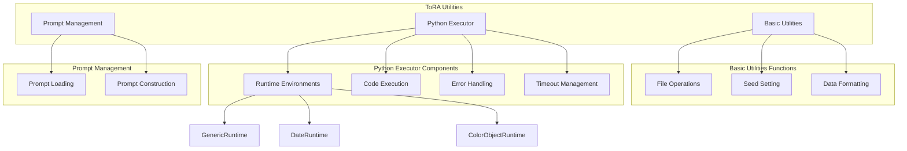
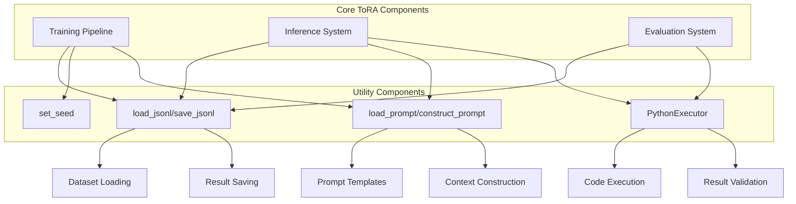
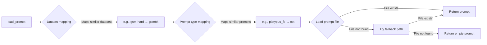
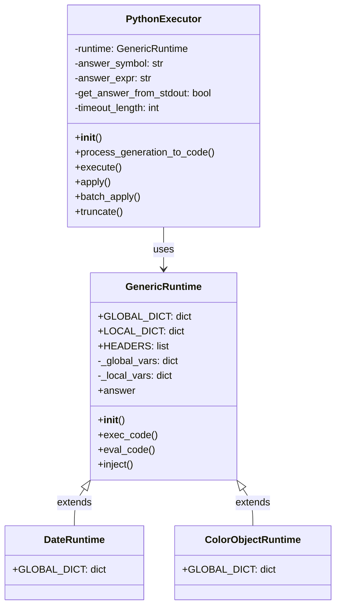
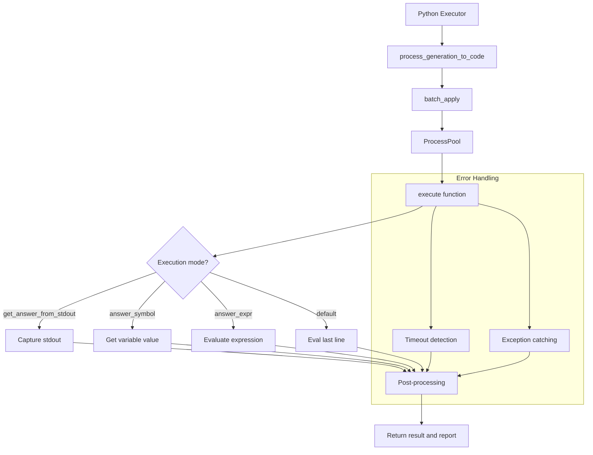
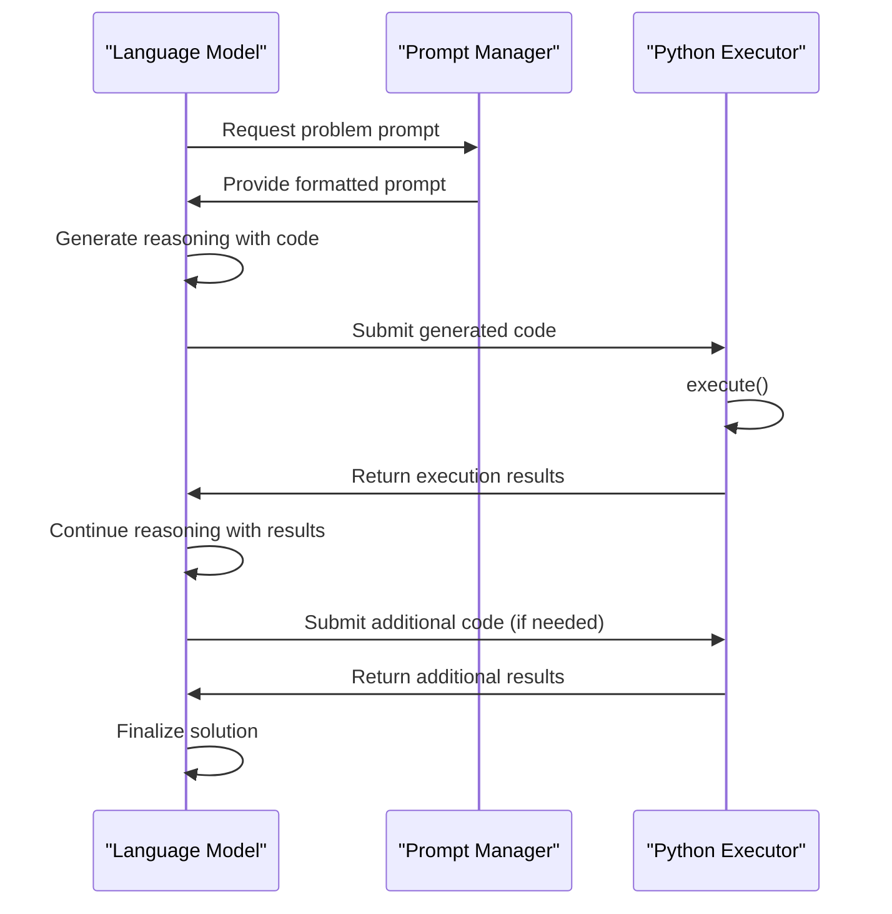

<!-- source: DeepWiki mcp.deepwiki.com · repo microsoft/ToRA · page 5 Utilities · fetched 2026-10-26 -->

# Utilities

<details>
<summary>Relevant source files</summary>

The following files were used as context for generating this wiki page:

- [src/utils/python_executor.py](src/utils/python_executor.py)
- [src/utils/utils.py](src/utils/utils.py)

</details>


## Purpose and Scope

The ToRA Utilities module provides essential support functions that underpin the core operations of the ToRA system. These utilities facilitate data handling, prompt management, and most notably, the execution of Python code generated by ToRA models. This page details the utility components that enable ToRA's sophisticated mathematical reasoning capabilities through tool-integrated reasoning.

For information about how these utilities are used in training, see [Training Pipeline](#2.1). For details on their application in model inference, see [Inference System](#2.2). For a deep dive into tool-integrated reasoning, see [Tool-Integrated Reasoning](#2.4).

## Utilities Overview

The Utilities module consists of several key components that support various operations across the ToRA system:



Sources: [src/utils/utils.py](), [src/utils/python_executor.py]()

## Integration with ToRA Components

The utility functions serve as connective tissue between different components of the ToRA system:



Sources: [src/utils/utils.py](), [src/utils/python_executor.py]()

## Basic Utilities

### File Operations

ToRA includes utilities for handling JSONL files, which are commonly used for storing datasets and model outputs:

| Function | Purpose | Key Implementation Details |
|----------|---------|----------------------------|
| `load_jsonl` | Loads JSONL files line by line | Uses generator pattern for memory efficiency |
| `save_jsonl` | Saves data to JSONL format | Automatically creates directories if needed |

Example implementation for loading JSONL files:

```
load_jsonl(file: Union[str, Path]) -> Iterable[Any]
```

Sources: [src/utils/utils.py:18-25]()

### Seed Setting

For reproducibility across experiments, ToRA provides a seed-setting utility:

```
set_seed(seed: int = 42) -> None
```

This function sets random seeds for Python's `random` module, NumPy, and the Python hash seed.

Sources: [src/utils/utils.py:11-15]()

### Data Manipulation Utilities

ToRA includes utilities for manipulating data structures:

| Function | Purpose |
|----------|---------|
| `lower_keys` | Converts dictionary keys to lowercase |
| `show_sample` | Displays sample data in a readable format |

Sources: [src/utils/utils.py:39-128]()

## Prompt Management

Prompt management is critical for ToRA's ability to handle various mathematical reasoning tasks. The utilities provide functions for loading and constructing prompts based on dataset types and prompting strategies.

### Prompt Loading

The `load_prompt` function handles prompt template retrieval:



Sources: [src/utils/utils.py:50-66]()

### Prompt Construction

The `construct_prompt` function builds complete prompts for various prompting strategies:

| Prompt Type | Format | Use Case |
|-------------|--------|----------|
| `tora` | Includes demo prompt + context | Tool-integrated reasoning |
| `direct` / `cot` | Question + Answer format | Direct answer or chain-of-thought |
| `pal` | Program-aided format | Program-aided learning |
| `wizard_zs` / `platypus_fs` | Instruction-following format | Zero-shot/few-shot learning |

Sources: [src/utils/utils.py:68-97]()

## Python Executor

The Python Executor is a critical component that enables ToRA's tool-integrated reasoning by safely executing Python code generated by language models. It provides a sandboxed environment for code execution with timeout protection.

### Architecture



Sources: [src/utils/python_executor.py:20-61](), [src/utils/python_executor.py:63-172]()

### Runtime Environments

The Python Executor provides several runtime environments to support different execution contexts:

| Runtime | Purpose | Special Features |
|---------|---------|-----------------|
| `GenericRuntime` | Base runtime for code execution | Provides basic code execution and variable tracking |
| `DateRuntime` | Specialized for date calculations | Pre-imports datetime modules |
| `ColorObjectRuntime` | Handles custom dictionary behavior | Implements custom iteration behavior |

Each runtime environment maintains its own global and local variable dictionaries, allowing for isolated execution contexts.

Sources: [src/utils/python_executor.py:20-61]()

### Code Execution Process

The code execution process in ToRA follows a carefully managed pipeline to ensure safety and reliability:



Sources: [src/utils/python_executor.py:82-114](), [src/utils/python_executor.py:125-172]()

### Safety Features

The Python Executor implements several safety features to prevent harmful code execution:

1. **Input and OS Command Blocking**: Code containing `input()` or `os.system()` calls is rejected
2. **Timeout Protection**: Code execution is limited by timeout to prevent infinite loops
3. **Exception Handling**: All exceptions are caught and reported without crashing the system
4. **Result Validation**: Results are checked for serializability using pickle
5. **Result Truncation**: Long outputs are truncated to prevent memory issues

Sources: [src/utils/python_executor.py:32-34](), [src/utils/python_executor.py:93-114](), [src/utils/python_executor.py:119-123]()

## Integration with Tool-Integrated Reasoning

The Python Executor is a key enabler for ToRA's tool-integrated reasoning approach, serving as the bridge between natural language reasoning and programmatic problem-solving:



This interaction pattern enables ToRA to leverage both natural language reasoning capabilities and the precision of programmatic computation, forming the foundation of its superior mathematical problem-solving abilities.

Sources: [src/utils/python_executor.py](), [src/utils/utils.py]()

## Performance Considerations

The Python Executor is designed with performance in mind, particularly for batch processing scenarios:

1. **Parallel Execution**: Uses multiprocessing to execute code snippets in parallel
2. **Progress Tracking**: Implements progress bars for large batch executions
3. **Resource Management**: Automatically limits workers based on CPU count
4. **Efficient Error Handling**: Captures and reports errors without terminating the batch process

Sources: [src/utils/python_executor.py:125-165]()

---

