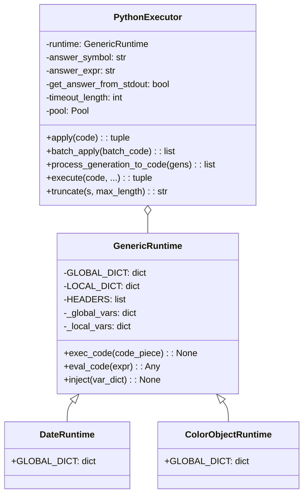
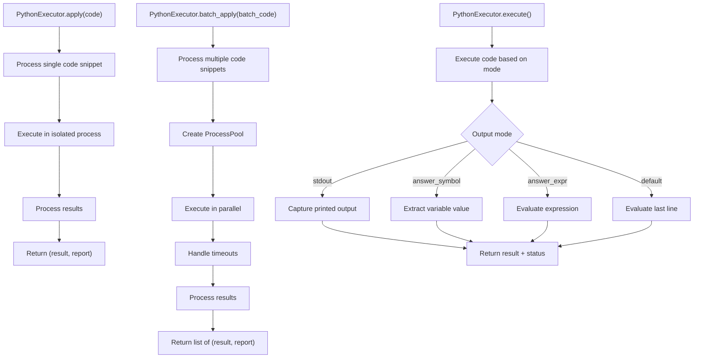
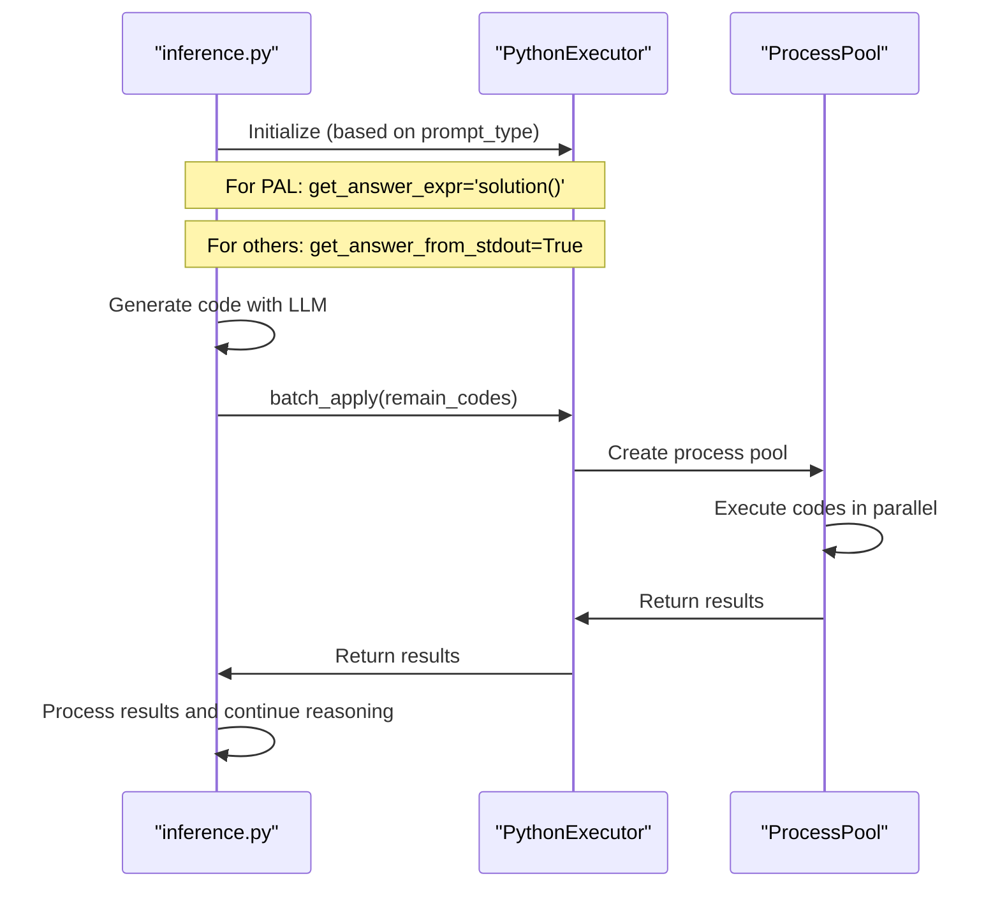
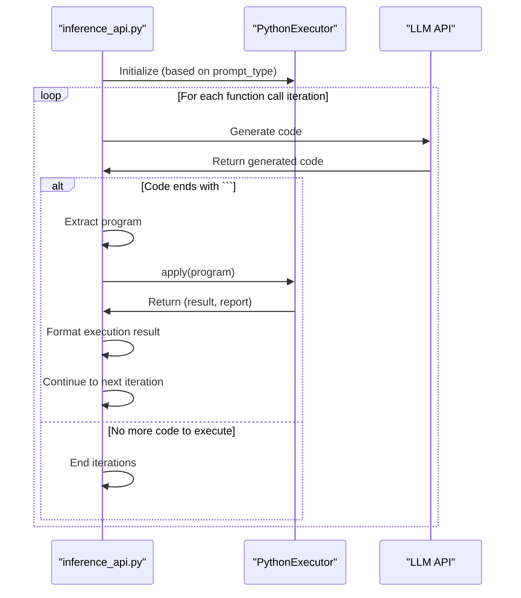
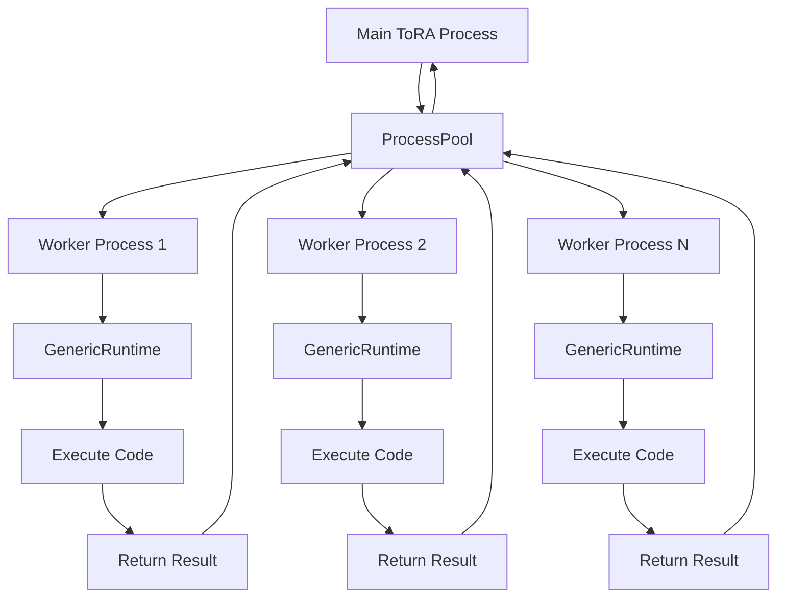
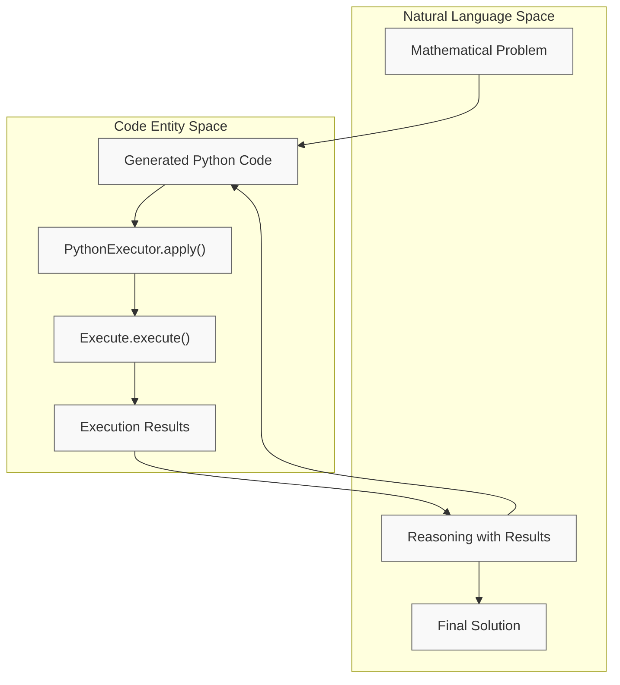

<!-- source: DeepWiki mcp.deepwiki.com · repo microsoft/ToRA · page 5.1 Python Executor · fetched 2026-10-26 -->

# Python Executor

<details>
<summary>Relevant source files</summary>

The following files were used as context for generating this wiki page:

- [src/infer/inference.py](src/infer/inference.py)
- [src/infer/inference_api.py](src/infer/inference_api.py)
- [src/scripts/infer_api.sh](src/scripts/infer_api.sh)
- [src/utils/python_executor.py](src/utils/python_executor.py)

</details>


This page documents the Python Executor component in the ToRA system, a specialized utility designed for safely executing Python code generated by large language models. The Python Executor plays a critical role in enabling ToRA's tool-integrated reasoning capabilities by providing a controlled environment for running generated Python code and retrieving execution results.

For information about how Python Executor integrates with the larger inference pipeline, see [Inference System](#2.2). For details on tool-integrated reasoning, see [Tool-Integrated Reasoning](#2.4).

## 1. Purpose and Architecture

The Python Executor safely executes Python code snippets while handling timeouts, errors, and various output formats. It serves as the bridge between natural language reasoning and programmatic computation in ToRA.



Sources: [src/utils/python_executor.py:62-173](). [src/utils/python_executor.py:20-60]()

## 2. Core Components

### 2.1 Runtime Environments

The Python Executor uses various runtime environments based on execution needs:

1. **GenericRuntime**: Base runtime providing a controlled execution environment with isolated global variables
2. **DateRuntime**: Specialized runtime with datetime utilities pre-imported
3. **ColorObjectRuntime**: Specialized runtime with custom dictionary implementation

These runtime environments ensure that code execution occurs in a controlled context with appropriate libraries available.

Sources: [src/utils/python_executor.py:20-60]()

### 2.2 Execution Methods

The Python Executor offers several methods for code execution:



Sources: [src/utils/python_executor.py:82-114](). [src/utils/python_executor.py:116-173]()

## 3. Usage in the ToRA System

The Python Executor is primarily used in two inference modes:

### 3.1 Batch Inference (vLLM-based)

In batch inference, the Python Executor processes multiple code snippets in parallel for efficient evaluation:



Sources: [src/infer/inference.py:94-97](). [src/infer/inference.py:184-196]()

### 3.2 API-based Inference

In API-based inference, the Python Executor is used in an interactive loop with multiple function calls:



Sources: [src/infer/inference_api.py:112-115](). [src/infer/inference_api.py:50-105]()

## 4. Key Features and Safety Mechanisms

### 4.1 Timeout Protection

The Python Executor implements strict timeouts to prevent infinite loops or excessively long computations:

- Default timeout: 5 seconds per execution
- Implemented at both function level (using `timeout_decorator`) and process level (using `Pebble`)

Sources: [src/utils/python_executor.py:64-77](). [src/utils/python_executor.py:139-156]()

### 4.2 Process Isolation

Code execution occurs in separate processes to prevent crashes or memory issues from affecting the main application:



Sources: [src/utils/python_executor.py:130-164]()

### 4.3 Security Measures

The Python Executor implements several security measures:

- Blocks `input()` functions that would hang execution
- Blocks `os.system()` calls to prevent system access
- Serialization checks to ensure results can be safely transmitted

Sources: [src/utils/python_executor.py:32-33](). [src/utils/python_executor.py:108-109]()

## 5. Result Processing and Output Modes

The Python Executor supports multiple ways to extract results from executed code:

| Mode | Description | Configuration |
|------|-------------|--------------|
| Standard Output | Captures printed output | `get_answer_from_stdout=True` |
| Symbol Extraction | Extracts a specific variable | `get_answer_symbol='answer'` |
| Expression Evaluation | Evaluates an expression | `get_answer_expr='solution()'` |
| Default | Evaluates the last line as an expression | (default behavior) |

All execution results include both the result value and an execution report, formatted as `(result, report)`.

Sources: [src/utils/python_executor.py:82-114]()

## 6. Integration with Tool-Integrated Reasoning

The Python Executor is a critical component of ToRA's tool-integrated reasoning approach:



In the tool-integrated reasoning approach:

1. The model generates Python code to perform calculations
2. Python Executor runs the code safely
3. Execution results are formatted and returned to the model
4. The model continues reasoning with the computation results
5. This process repeats until a final solution is reached

Sources: [src/infer/inference.py:132-196](). [src/infer/inference_api.py:50-105]()

## 7. Implementation Details

### 7.1 Classes and Structure

The Python Executor is implemented in [src/utils/python_executor.py]() with the following structure:

- `PythonExecutor`: Main executor class that manages code execution
- `GenericRuntime`: Base runtime class providing execution environment
- `DateRuntime`: Specialized runtime with datetime utilities
- `ColorObjectRuntime`: Specialized runtime for custom dictionary operations

Sources: [src/utils/python_executor.py:20-173]()

### 7.2 Multiprocess Execution

The batch execution capability uses the `pebble` library's `ProcessPool` for parallel execution with proper timeout handling:

```python
with ProcessPool(max_workers=min(len(all_code_snippets), os.cpu_count())) as pool:
    executor = partial(
        self.execute,
        get_answer_from_stdout=self.get_answer_from_stdout,
        runtime=self.runtime,
        answer_symbol=self.answer_symbol,
        answer_expr=self.answer_expr,
        timeout_length=self.timeout_length,
    )
    future = pool.map(executor, all_code_snippets, timeout=self.timeout_length)
    iterator = future.result()
```

This approach allows executing multiple code snippets in parallel while ensuring each execution is properly time-limited.

Sources: [src/utils/python_executor.py:130-141]()

## 8. Usage Examples

### 8.1 Basic Initialization and Execution

```python
# Initialize executor for ToRA-style execution
executor = PythonExecutor(get_answer_from_stdout=True)

# Execute a single code snippet
result, report = executor.apply("print('Hello world!')")
```

### 8.2 Different Answer Extraction Methods

```python
# Extract answer from solution() function (PAL approach)
executor = PythonExecutor(get_answer_expr='solution()')

# Extract answer from a specific variable
executor = PythonExecutor(get_answer_symbol='answer')

# Capture printed output
executor = PythonExecutor(get_answer_from_stdout=True)
```

Sources: [src/infer/inference.py:94-97](). [src/infer/inference_api.py:112-115]()

## 9. Error Handling and Result Processing

The Python Executor provides robust error handling and result processing:

1. All execution results include both the result and an error report
2. Timeouts are properly captured and reported
3. Long results are truncated for readability
4. Results are serialized to ensure they can be safely transmitted

Sources: [src/utils/python_executor.py:166-172]()

## 10. Summary

The Python Executor is a critical component of the ToRA system that bridges natural language reasoning with programmatic computation. It provides a secure, isolated environment for executing Python code generated by large language models, with robust error handling, timeout protection, and result processing capabilities.

By enabling safe and efficient code execution, the Python Executor powers ToRA's tool-integrated reasoning approach to mathematical problem-solving.

Sources: [src/utils/python_executor.py:1-188](). [src/infer/inference.py:94-97](). [src/infer/inference_api.py:112-115]()

---

