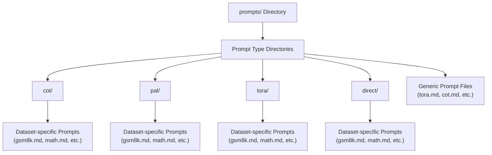
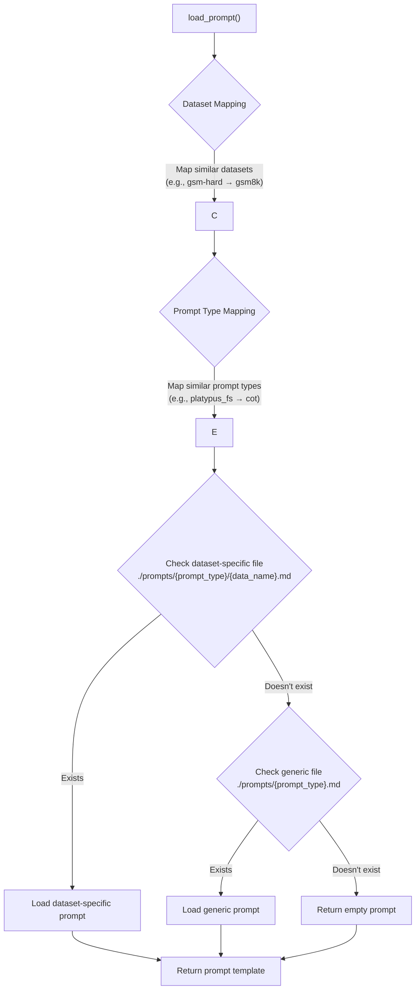
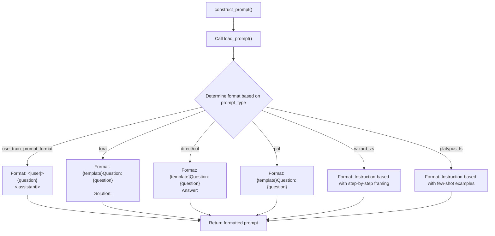
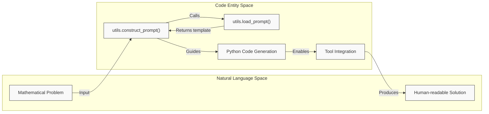
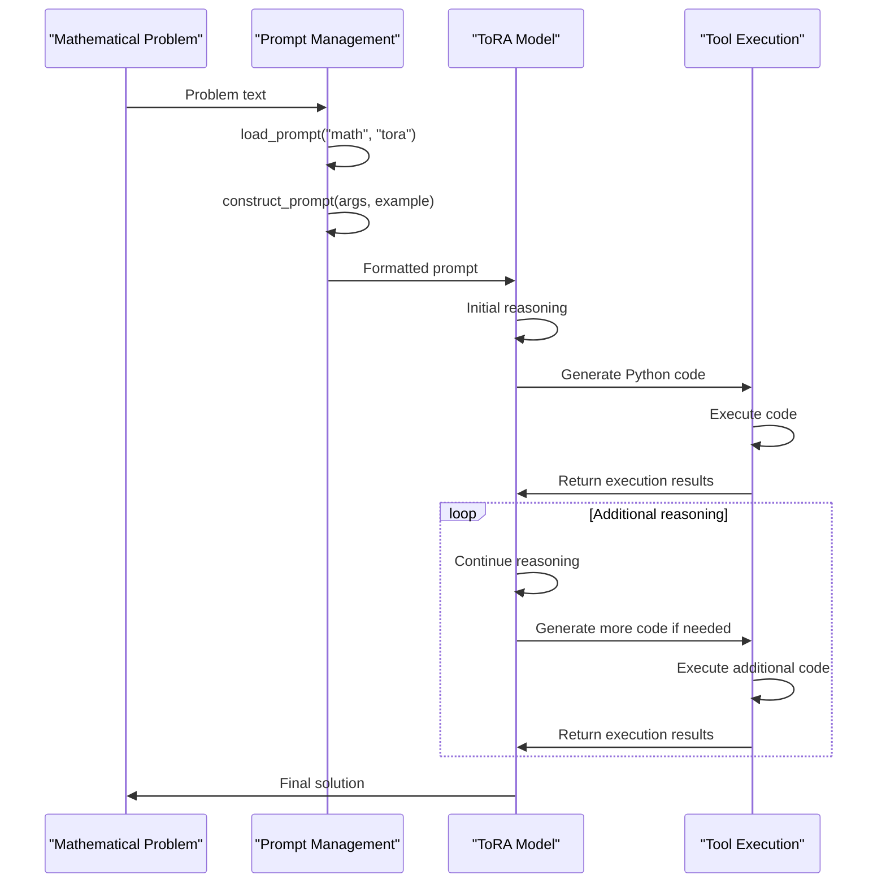
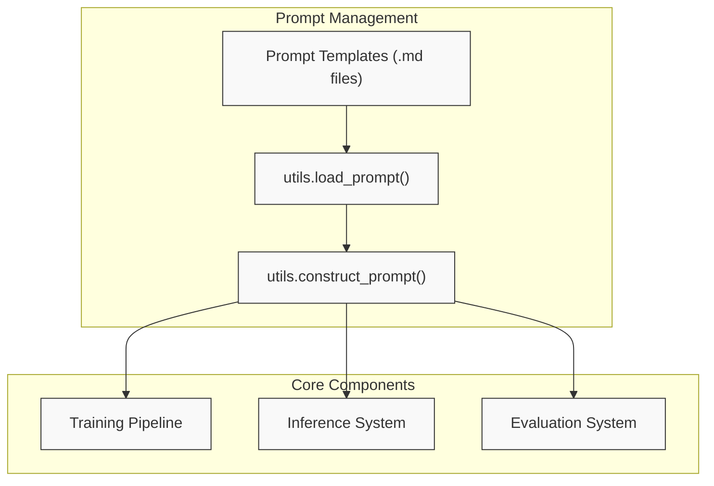
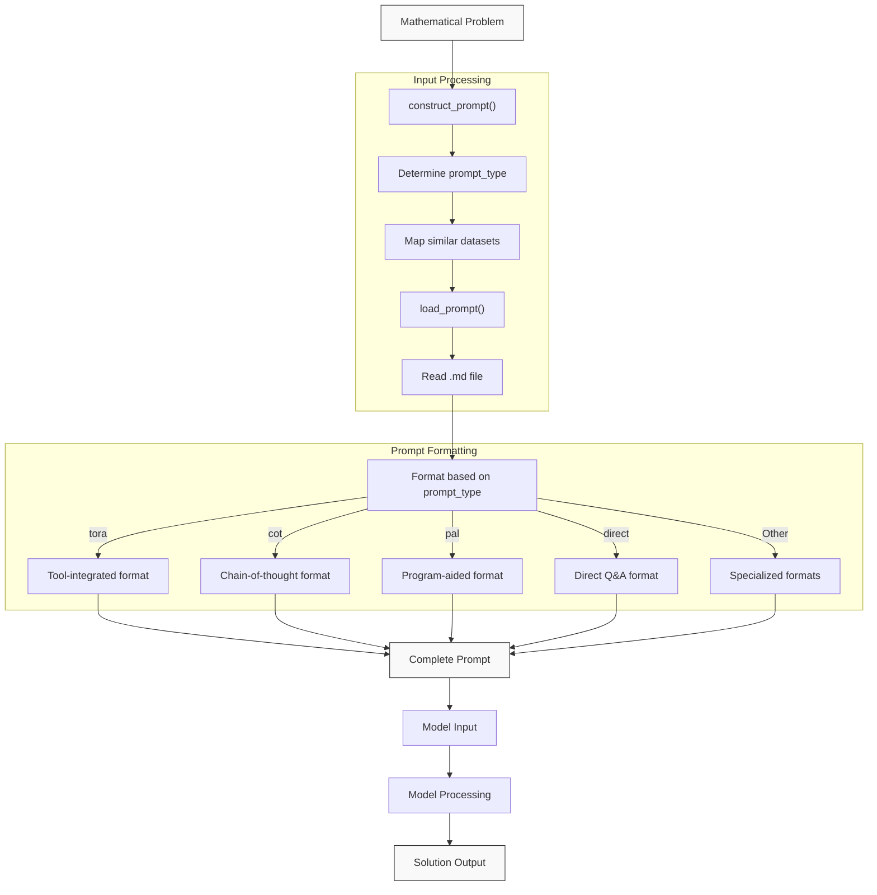

<!-- source: DeepWiki mcp.deepwiki.com · repo microsoft/ToRA · page 5.2 Prompt Management · fetched 2026-10-26 -->

# Prompt Management

Relevant source files

The following files were used as context for generating this wiki page:

- [README.md](README.md)
- [src/requirements.txt](src/requirements.txt)
- [src/train/llama2_flash_attn_monkey_patch.py](src/train/llama2_flash_attn_monkey_patch.py)
- [src/utils/utils.py](src/utils/utils.py)

## Purpose and Scope

The Prompt Management system in ToRA handles the loading and construction of prompts for different models, datasets, and reasoning approaches. It provides a standardized mechanism to manage prompt templates and construct complete prompts for specific mathematical problems. This component serves as a bridge between natural language mathematical problems and the structured prompts needed for different reasoning strategies in ToRA.

For information about executing generated code, see [Python Executor](#5.1).

## Prompt Organization

Prompts in ToRA are stored in a structured directory hierarchy that facilitates flexible prompt management across various datasets and prompting strategies.

Sources: [src/utils/utils.py:50-66]()

This organization enables:
1. Different prompting techniques (Chain-of-Thought, Program-Aided Learning, Tool-integrated Reasoning, etc.)
2. Dataset-specific prompts for each technique
3. Fallback to generic prompts when dataset-specific ones aren't available

## Prompt Types

ToRA supports several prompt types that correspond to different reasoning approaches:

| Prompt Type | Format | Purpose |
|-------------|--------|---------|
| tora | `[template] Question: [question] Solution:` | Guide tool-integrated reasoning |
| cot | `[template] Question: [question] Answer:` | Guide chain-of-thought reasoning |
| pal | `[template] Question: [question]` | Guide program generation |
| direct | `[template] Question: [question] Answer:` | Direct question-answering |
| wizard_zs | Zero-shot instruction format | Alternative CoT format |
| platypus_fs | Few-shot instruction format | Alternative CoT format |

Sources: [src/utils/utils.py:68-97]()

## Prompt Loading and Construction Process

The prompt management system includes two main functions:

### Prompt Loading Flow

Sources: [src/utils/utils.py:50-66]()

### Prompt Construction Flow

Sources: [src/utils/utils.py:68-97]()

## Bridging Natural Language and Code Execution

The prompt management system plays a crucial role in ToRA by bridging between natural language mathematical problems and the code that solves them.

Sources: [src/utils/utils.py:50-97]()

## Tool-Integrated Reasoning Process

For the ToRA prompt type specifically, the prompt management system facilitates tool-integrated reasoning by structuring prompts that encourage the model to interleave natural language reasoning with tool use.

Sources: [README.md:71-77]()

## Integration with ToRA Components

The prompt management system is used by all major components of ToRA:

Sources: [src/utils/utils.py:68-97]()

## Customizing Prompts

To create new prompts or modify existing ones:

1. Create or modify `.md` files in the `prompts/` directory
2. For dataset-specific prompts: `prompts/{prompt_type}/{data_name}.md`
3. For generic prompt types: `prompts/{prompt_type}.md`

When a prompt is required, the system will:
1. First check for a dataset-specific prompt
2. If not found, fall back to the generic prompt for that prompt type
3. If neither exists, use an empty prompt (with a warning message)

Sources: [src/utils/utils.py:50-66]()

## Data Flow in Prompt Management

The complete data flow through the prompt management system:

Sources: [src/utils/utils.py:50-97]()

---

