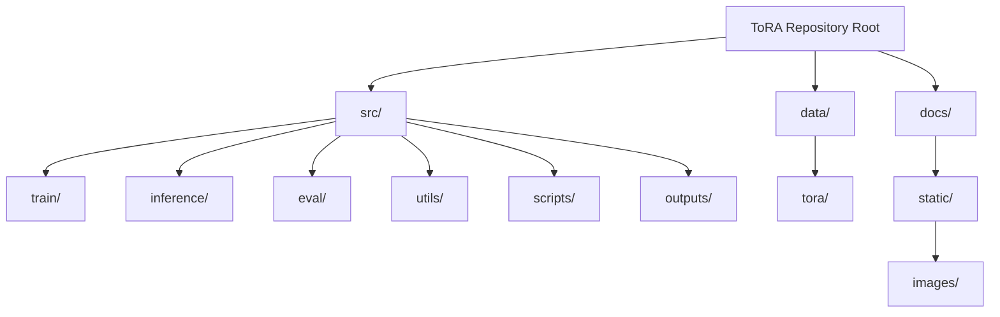
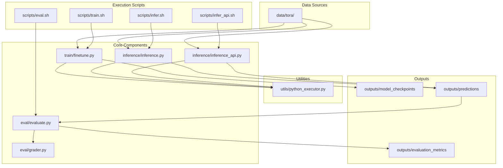
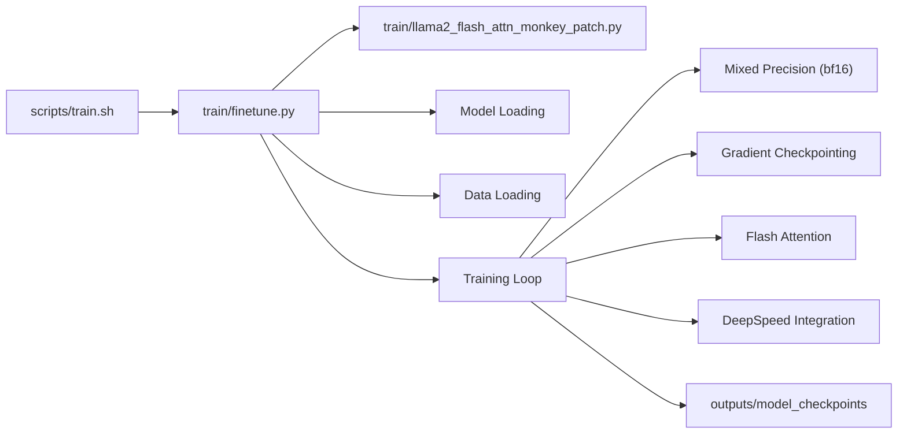
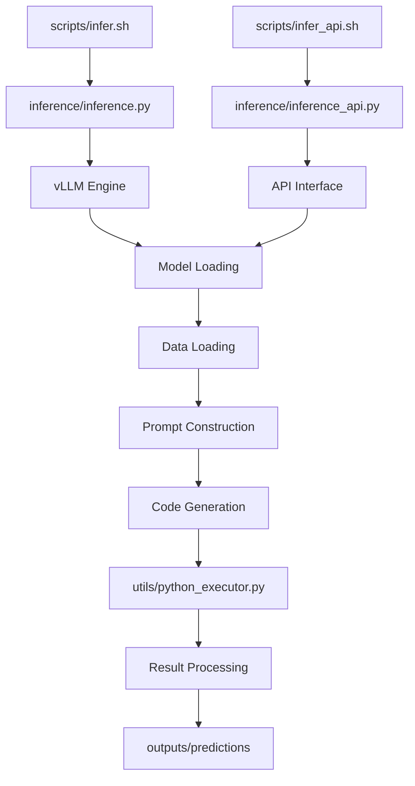
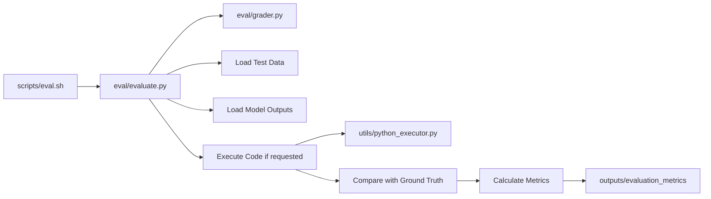
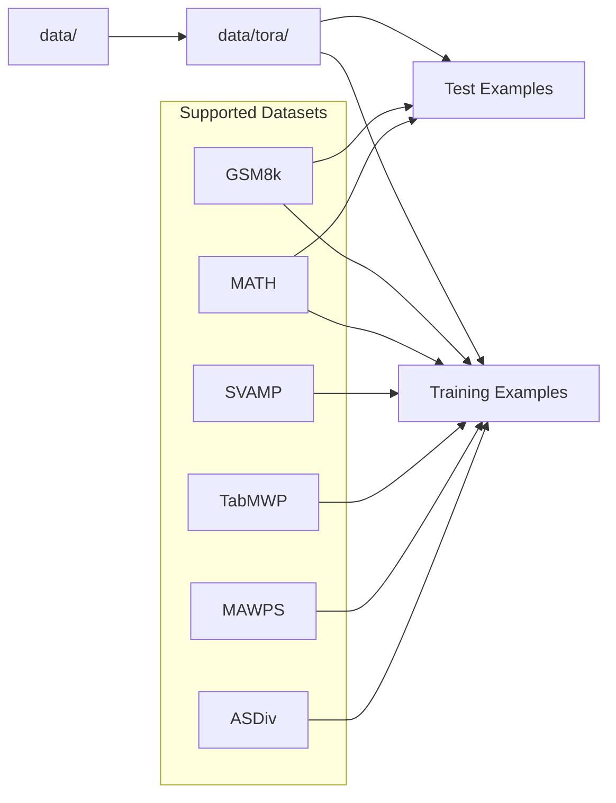
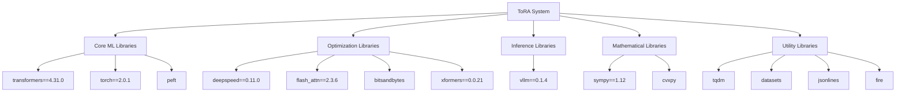

<!-- source: DeepWiki mcp.deepwiki.com · repo microsoft/ToRA · page 6.1 Repository Structure · fetched 2026-10-26 -->

# Repository Structure

Relevant source files

The following files were used as context for generating this wiki page:

- [.gitignore](.gitignore)
- [README.md](README.md)
- [src/requirements.txt](src/requirements.txt)
- [src/scripts/eval.sh](src/scripts/eval.sh)
- [src/train/llama2_flash_attn_monkey_patch.py](src/train/llama2_flash_attn_monkey_patch.py)

This document provides an overview of the ToRA repository structure, explaining the organization of directories and key files. This documentation is intended for developers who want to understand how the codebase is organized to facilitate navigation and contributions. For information on extending ToRA with new models, datasets, or tools, see [Extending ToRA](#6.2).

## High-Level Organization

The ToRA repository follows a structured organization with clear separation of concerns between its core components: training, inference, evaluation, utilities, and data.

Sources: [README.md:95-101]()

## Source Code (`src/`) Organization

The `src/` directory contains all the source code for the ToRA system, organized into logical subdirectories by functionality.

### Key Subdirectories

| Directory | Purpose |
|-----------|---------|
| `train/` | Contains code for the training pipeline, including model fine-tuning |
| `inference/` | Implements inference pipelines for model deployment |
| `eval/` | Contains code for evaluating model performance |
| `utils/` | Utility functions used across the system |
| `scripts/` | Shell scripts for running various operations |
| `outputs/` | Stores model predictions, checkpoints, and evaluation results |

### Component Relationships

The following diagram illustrates how the different components in the repository interact with each other:

Sources: [README.md:88-126](), [src/scripts/eval.sh:1-8]()

## Detailed Component Structure

### Training Pipeline

Sources: [src/train/llama2_flash_attn_monkey_patch.py:1-240]()

### Inference System

Sources: [README.md:106-109]()

### Evaluation System

Sources: [README.md:113-136]()

## File Structure and Key Files

| Path | Description |
|------|-------------|
| `README.md` | Main documentation with system overview and quickstart |
| `src/requirements.txt` | Dependencies for the ToRA system |
| `src/train/finetune.py` | Main training script for fine-tuning models |
| `src/train/llama2_flash_attn_monkey_patch.py` | Optimization for LLaMA models with Flash Attention |
| `src/inference/inference.py` | vLLM-based inference pipeline |
| `src/inference/inference_api.py` | API-based inference pipeline |
| `src/eval/evaluate.py` | Evaluation script for model outputs |
| `src/eval/grader.py` | Grading logic for assessing answer accuracy |
| `src/utils/python_executor.py` | Utility for executing Python code generated by models |
| `src/scripts/*.sh` | Shell scripts for running different operations |

Sources: [README.md:95-126](), [src/requirements.txt:1-35]()

## Data Organization

The `data/` directory contains datasets used for training and evaluating ToRA models:

Sources: [README.md:142]()

## Dependency Structure

ToRA relies on several key dependencies, which are specified in `requirements.txt`:

Sources: [src/requirements.txt:1-35]()

## Ignored Files and Directories

The repository's `.gitignore` file specifies files and directories that are excluded from version control, including:

- Build artifacts (`__pycache__/`, `*.pyc`)
- Output files (`outputs/`)
- IDE-specific files (`.vscode/`, `.vs/`)
- System files (`.DS_Store`)
- Generated PDFs (`*.pdf`)

This ensures that the repository remains clean and focused on source code rather than generated artifacts.

Sources: [.gitignore:6-8]()

---

