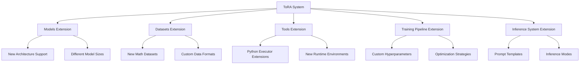
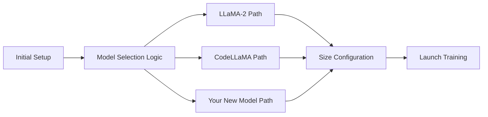
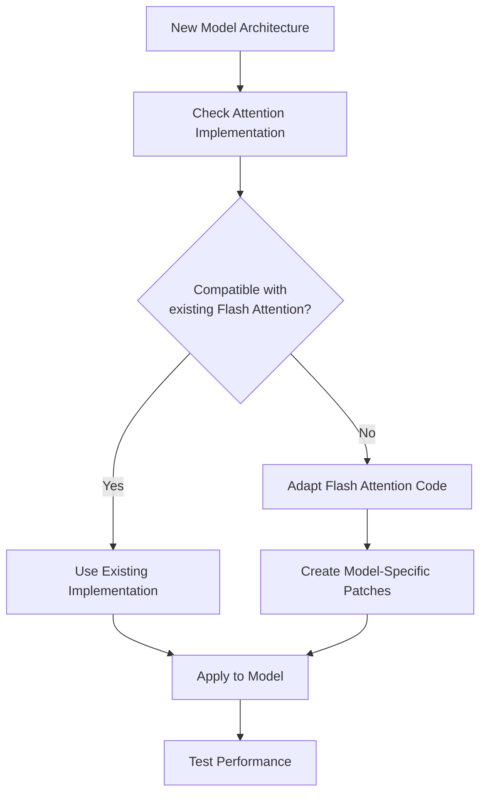
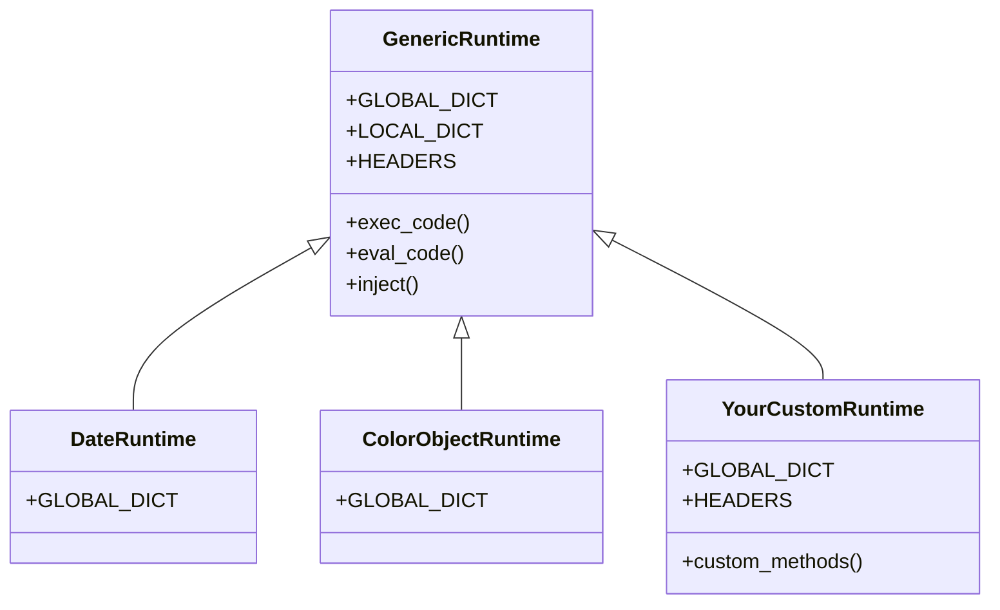
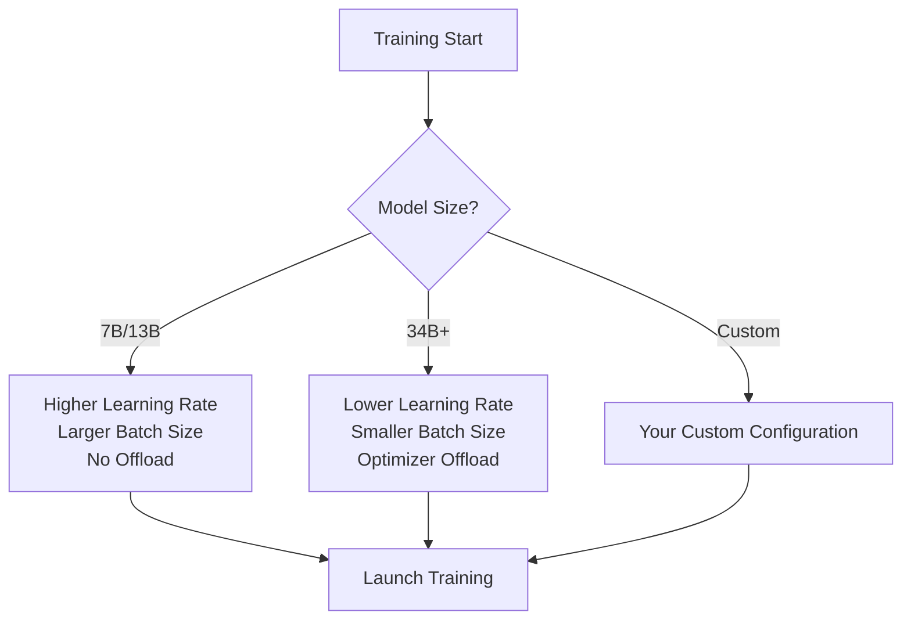
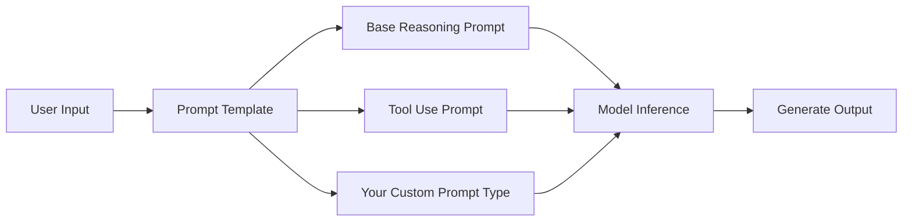
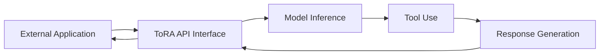

<!-- source: DeepWiki mcp.deepwiki.com · repo microsoft/ToRA · page 6.2 Extending ToRA · fetched 2026-10-26 -->

# Extending ToRA

Relevant source files

The following files were used as context for generating this wiki page:

- [README.md](README.md)
- [data/tora/examples.jsonl](data/tora/examples.jsonl)
- [src/requirements.txt](src/requirements.txt)
- [src/scripts/train.sh](src/scripts/train.sh)
- [src/train/llama2_flash_attn_monkey_patch.py](src/train/llama2_flash_attn_monkey_patch.py)
- [src/utils/python_executor.py](src/utils/python_executor.py)

This document provides technical guidelines for extending the ToRA system with new models, datasets, and tools. It serves as a developer's reference for customizing and enhancing ToRA's capabilities to suit specific requirements or expand its functionality.

For information about the overall ToRA repository structure, see [Repository Structure](#6.1).

## Extension Points Overview

The ToRA architecture is designed with modularity in mind, allowing for several extension points:

Sources: [README.md:32-85](), [src/scripts/train.sh:1-78]()

## Adding New Models

ToRA supports various model sizes and architectures with a focus on LLaMA-2 and CodeLLaMA variants. You can extend ToRA with additional models by following these guidelines.

### Model Integration Process

To integrate a new model type:

1. Update the `train.sh` script to support your model
2. Configure model-specific optimizations
3. Ensure the inference system can handle your model

The existing model selection logic in the training script can be extended as follows:

Sources: [src/scripts/train.sh:26-34](), [README.md:55-66]()

### Flash Attention Support

ToRA uses flash attention for performance optimization. When adding a new model architecture, you may need to adapt the flash attention implementation:

Sources: [src/train/llama2_flash_attn_monkey_patch.py:1-241]()

## Adding New Datasets

ToRA works with mathematical reasoning datasets in a specific format. To add new datasets:

### Dataset Format Requirements

Each example in the dataset should follow this structure:

| Field | Description |
|-------|-------------|
| `dataset` | Dataset identifier |
| `level` | Difficulty level (optional) |
| `id` | Unique example identifier |
| `gt` | Ground truth answer |
| `gt_cot` | Ground truth chain-of-thought (optional) |
| `messages` | Conversation format with user query and assistant response |

### Dataset Integration Steps

1. Convert your dataset to the required format (JSONL)
2. Place it in the appropriate data directory
3. Update data loading code if necessary
4. Add evaluation support for the new dataset

Sources: [data/tora/examples.jsonl:1-31](), [README.md:112-116]()

## Extending the Python Executor

The Python executor is a core component that enables ToRA to use Python as a reasoning tool. You can extend it to add new capabilities.

### Runtime Environment Extensions

The base `GenericRuntime` class can be extended to create custom runtime environments with specific capabilities:

To create a custom runtime:

1. Subclass `GenericRuntime`
2. Define your `GLOBAL_DICT` with available modules/functions
3. Add any initialization code to `HEADERS`
4. Implement custom methods if needed

### Executor Configuration

The `PythonExecutor` class accepts parameters to customize its behavior:

| Parameter | Description |
|-----------|-------------|
| `runtime` | Custom runtime environment instance |
| `get_answer_symbol` | Symbol to extract from global vars |
| `get_answer_expr` | Expression to evaluate for answer |
| `get_answer_from_stdout` | Whether to capture stdout |
| `timeout_length` | Timeout for code execution |

Sources: [src/utils/python_executor.py:1-188]()

## Customizing the Training Pipeline

The training pipeline can be customized for different model sizes and training requirements.

### Hyperparameter Configuration

You can customize these key hyperparameters based on your model:

| Parameter | Small Models (7B/13B) | Large Models (34B/70B) |
|-----------|---------------------|---------------------|
| Learning Rate | 2e-5 | 1e-5 |
| Batch Size | 16 per GPU | 4-8 per GPU |
| DeepSpeed Config | No optimizer offload | Optimizer offload |

To add a custom configuration:

1. Edit the `train.sh` script 
2. Add a new condition for your model size
3. Set appropriate hyperparameters
4. Configure training command with your settings

Sources: [src/scripts/train.sh:8-24](), [src/requirements.txt:1-35]()

## Extending the Inference System

The inference system supports both vLLM-based batch inference and API-based interactive inference. You can extend it in several ways:

### Prompt Template Customization

Create custom prompt templates to control how the model interacts with tools:

### Inference Mode Extensions

ToRA supports different inference modes:

| Mode | Description |
|------|-------------|
| CoT | Chain-of-Thought direct text generation |
| PAL | Program-Aided Learning with code generation |
| ToRA | Interactive tool use with feedback loop |

To add a new inference mode:

1. Implement the prompt construction logic
2. Add code to handle the specific inference flow
3. Update the result processing for your mode

Sources: [README.md:102-109]()

## Integration with External Systems

ToRA can be integrated with external systems through its API-based inference.

Integration options include:

1. Web interfaces using the API-based inference
2. Connecting to other AI systems
3. Using ToRA as a component in larger workflows

Sources: [README.md:87-101]()

## Best Practices for Extensions

When extending ToRA, follow these best practices:

1. **Compatibility**: Ensure your extensions maintain compatibility with the core system
2. **Testing**: Test extensions thoroughly using the provided evaluation scripts
3. **Documentation**: Document your extensions clearly for other developers
4. **Performance**: Consider the performance impact of your extensions, especially for large models
5. **Modularity**: Design extensions to be modular and reusable

Sources: [README.md:164-173]()