# Page: Overview

# Overview

<details>
<summary>Relevant source files</summary>

The following files were used as context for generating this wiki page:

- [README.md](README.md)
- [docs/index.html](docs/index.html)
- [src/requirements.txt](src/requirements.txt)
- [src/train/llama2_flash_attn_monkey_patch.py](src/train/llama2_flash_attn_monkey_patch.py)

</details>


ToRA is a Tool-integrated Reasoning Agent designed to solve challenging mathematical reasoning problems by seamlessly integrating natural language reasoning with programmatic tool usage. This repository provides the complete implementation for training, inferencing, and evaluating ToRA models, which achieve state-of-the-art performance on mathematical reasoning benchmarks.

This document introduces the purpose, architecture, and key components of the ToRA system. For detailed instructions on getting started, see [Installation and Requirements](#1.1) and [Quick Start Guide](#1.2).

## System Architecture

The ToRA system consists of three primary components that work together to train models, generate solutions, and evaluate performance:


Sources: [README.md:49-67]()

The system architecture is implemented across multiple directories and files:
- Training Pipeline: `src/train/` directory with training scripts and model implementation
- Inference System: `src/inference.py` and `src/inference_api.py` for model inference
- Evaluation System: `src/eval/evaluate.py` and `src/eval/grader.py` for assessing model outputs
- Utilities: `src/utils/` directory containing shared utility functions

## Tool-Integrated Reasoning

The key innovation of ToRA is the tool-integrated reasoning approach, which interleaves natural language reasoning with program-based tool use:

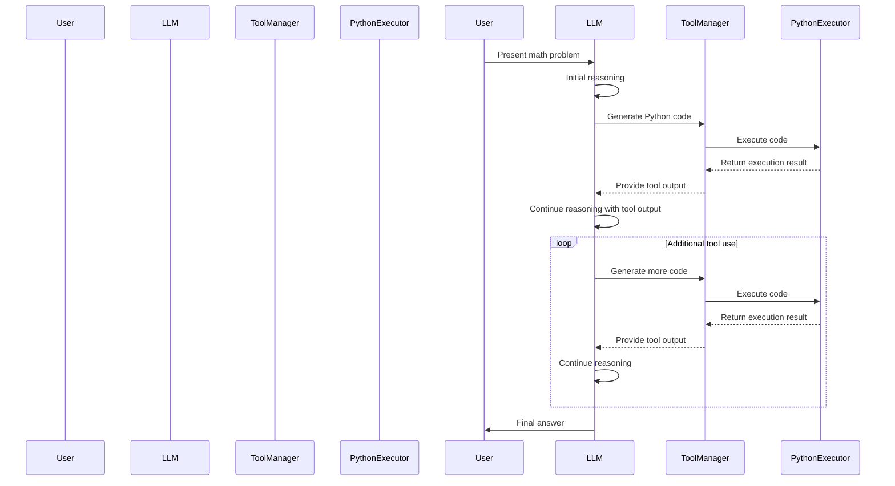

Sources: [README.md:72-78](), [docs/index.html:256-262]()

This process enables ToRA to:
1. Parse and understand problems using natural language reasoning
2. Generate Python code for precise calculations
3. Execute the code in a controlled environment
4. Incorporate the execution results into continued reasoning
5. Produce accurate final solutions

An example of this tool-integrated reasoning is shown in the README, where the model solves a problem by alternating between natural language reasoning and Python code execution.

## Inference System Architecture

The inference system bridges natural language problems to executable code through a multi-stage pipeline:

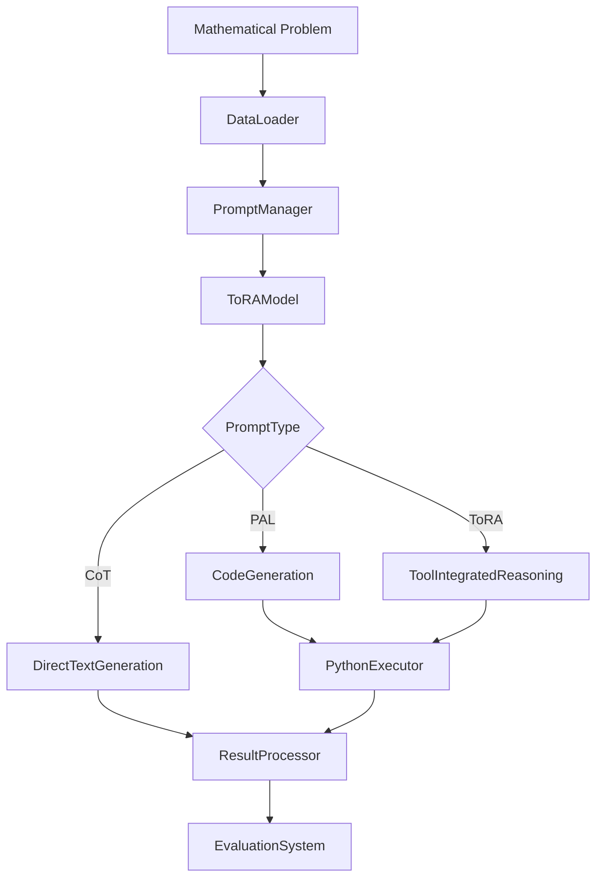

Sources: [README.md:105-111]()

The inference system components include:
- `DataLoader`: Loads and preprocesses mathematical problems
- `PromptManager`: Constructs appropriate prompts based on the selected method
- `ToRAModel`: The pre-trained language model
- `PythonExecutor`: Executes generated Python code in a safe environment
- `ResultProcessor`: Processes model outputs and execution results
- `EvaluationSystem`: Assesses the accuracy of solutions

## Training Pipeline

The training pipeline configures and optimizes models based on their size:

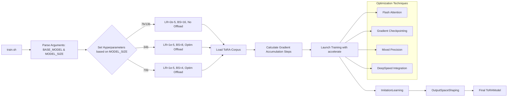

Sources: [README.md:79-86](), [src/train/llama2_flash_attn_monkey_patch.py:135-144]()

The training pipeline uses several optimization techniques, including flash attention, which is implemented in `train/llama2_flash_attn_monkey_patch.py`:

```python
def replace_llama_attn_with_flash_attn():
    cuda_major, cuda_minor = torch.cuda.get_device_capability()
    if cuda_major < 8:
        warnings.warn(
            "Flash attention is only supported on A100 or H100 GPU during training due to head dim > 64 backward."
        )

    LlamaModel._prepare_decoder_attention_mask = _prepare_decoder_attention_mask
    LlamaAttention.forward = forward
```

Training consists of two main phases:
1. **Imitation Learning**: Fine-tuning on tool-integrated reasoning trajectories in the ToRA-Corpus
2. **Output Space Shaping**: Enhancing model performance through self-sampling and trajectory correction

## Model Family and Performance

ToRA is available in several variations, all accessible via Hugging Face:

| Model | Base Model | Size | GSM8k | MATH | AVG@10 tasks |
|-------|------------|------|-------|------|-------------|
| ToRA-7B | LLaMA-2 | 7B | 68.8% | 40.1% | 62.4% |
| ToRA-13B | LLaMA-2 | 13B | 72.7% | 43.0% | 65.9% |
| ToRA-70B | LLaMA-2 | 70B | 84.3% | 49.7% | 76.9% |
| ToRA-Code-7B | CodeLLaMA | 7B | 72.6% | 44.6% | 66.5% |
| ToRA-Code-13B | CodeLLaMA | 13B | 75.8% | 48.1% | 71.3% |
| ToRA-Code-34B | CodeLLaMA | 34B | 80.7% | 51.0% | 74.8% |

Sources: [README.md:53-67]()

Notably, ToRA-Code-34B is the first open-source model to achieve over 50% accuracy on the competition-level MATH dataset, significantly outperforming GPT-4's Chain-of-Thought performance (51.0% vs. 42.5%).

## Installation Requirements

ToRA requires the following key dependencies:

```
transformers==4.31.0
deepspeed==0.11.0
accelerate==0.21.0
flash_attn==2.3.6
vllm==0.1.4
sympy==1.12
```

Sources: [src/requirements.txt:1-35]()

For complete installation instructions, see [Installation and Requirements](#1.1).

## Getting Started

To run inference with a pre-trained ToRA model:

```bash
# Clone the repository
git clone https://github.com/microsoft/ToRA.git && cd ToRA/src

# Set up environment
conda create -n tora python=3.10
conda activate tora
pip install -r requirements.txt

# Run inference
bash scripts/infer.sh
```

Sources: [README.md:88-109]()

The inference script loads a pre-trained model, processes input data, and generates solutions using the tool-integrated reasoning approach.

## Evaluation System

The evaluation system assesses model performance on benchmark datasets:


Sources: [README.md:113-135]()

To evaluate predictions:

```bash
python -m eval.evaluate \
    --data_name "math" \
    --prompt_type "tora" \
    --file_path "outputs/llm-agents/tora-code-34b-v1.0/math/test_tora_-1_seed0_t0.0_s0_e5000.jsonl" \
    --execute
```

This evaluates model performance on the MATH dataset, using the grading system in `eval/grader.py` that has been carefully designed to assess mathematical answers accurately.

## Related Components

For more detailed information on specific components of the ToRA system, refer to:
- [Training Pipeline](#2.1): Details on model training and optimization
- [Inference System](#2.2): Information on generating solutions
- [Evaluation System](#2.3): Explanation of performance metrics and evaluation
- [Tool-Integrated Reasoning](#2.4): Deep dive into the core reasoning methodology

---

# Page: Installation and Requirements

# Installation and Requirements

<details>
<summary>Relevant source files</summary>

The following files were used as context for generating this wiki page:

- [README.md](README.md)
- [src/requirements.txt](src/requirements.txt)
- [src/train/llama2_flash_attn_monkey_patch.py](src/train/llama2_flash_attn_monkey_patch.py)

</details>


This page provides detailed instructions for installing ToRA (Tool-Integrated Reasoning Agent) and setting up the required dependencies. For information on using ToRA after installation, see the [Quick Start Guide](#1.2).

## Hardware Requirements

ToRA models require significant GPU resources, especially for the larger model variants. The hardware requirements vary depending on the model size you intend to use:

| Model Size | Minimum VRAM | Recommended Setup |
|------------|--------------|-------------------|
| 7B         | 24GB         | Single A10/3090/4090 GPU |
| 13B        | 40GB         | Single A100 (40GB) or multiple GPUs |
| 34B        | 80GB         | Multiple A100 GPUs |
| 70B        | 140GB        | Multiple A100 GPUs |

**Important Note**: Flash Attention, which is used for optimizing the models during training, is only fully supported on A100 or H100 GPUs due to head dimension compatibility issues with backward passes.

### Hardware Components Diagram

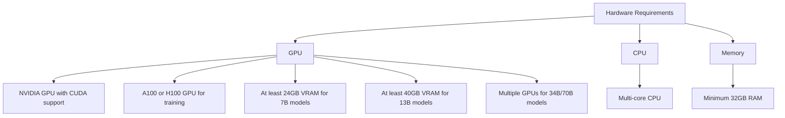

Sources: [README.md:90-101](), [train/llama2_flash_attn_monkey_patch.py:136-141]()

## Software Requirements

ToRA has the following software requirements:

- **Operating System**: Linux (recommended)
- **Python Version**: 3.10
- **CUDA Toolkit**: 11.8 (compatible with PyTorch 2.0.1)
- **Environment Management**: Conda (recommended)

## Installation Process

### Installation Workflow

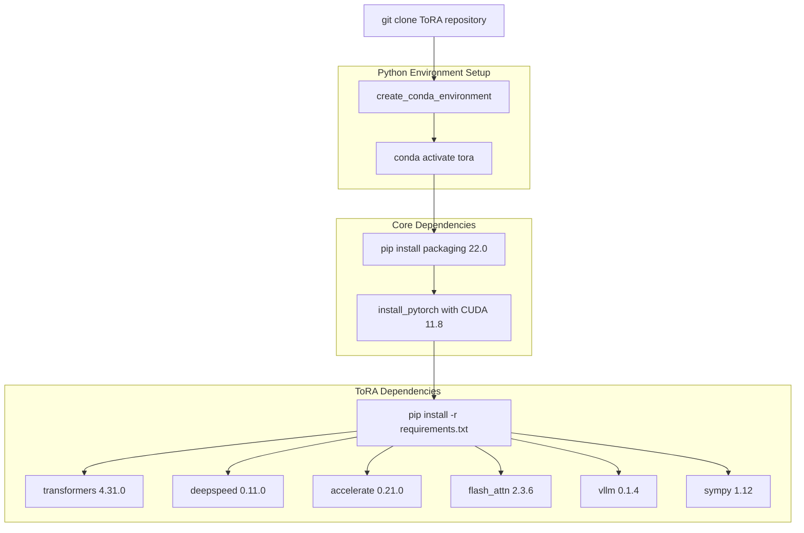

Sources: [README.md:90-101]()

### Step-by-Step Installation

1. **Clone the Repository**:
   ```bash
   git clone https://github.com/microsoft/ToRA.git && cd ToRA/src
   ```

2. **Create and Activate Conda Environment**:
   ```bash
   conda create -n tora python=3.10
   conda activate tora
   ```

3. **Install Prerequisites and PyTorch**:
   ```bash
   pip install packaging==22.0
   pip install torch==2.0.1 --index-url https://download.pytorch.org/whl/cu118
   ```
   Note: This installs PyTorch with CUDA 11.8 support. Adjust for your specific CUDA version if needed.

4. **Install Dependencies**:
   ```bash
   pip install -r requirements.txt
   ```

Sources: [README.md:90-101]()

## Key Dependencies

ToRA relies on several core libraries and packages that enable its functionality. The complete list is specified in the requirements.txt file, but here are the most critical dependencies:

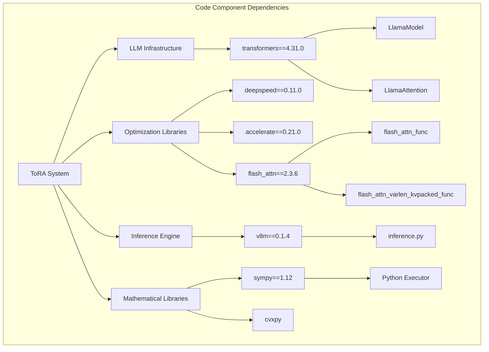

Sources: [src/requirements.txt:1-35](), [train/llama2_flash_attn_monkey_patch.py:10-13]()

### Critical Dependencies

| Dependency | Version | Purpose |
|------------|---------|---------|
| transformers | 4.31.0 | Provides model architecture and tokenization |
| deepspeed | 0.11.0 | Enables efficient distributed training |
| accelerate | 0.21.0 | Facilitates multi-GPU training |
| flash_attn | 2.3.6 | Optimizes attention computation |
| vllm | 0.1.4 | Powers efficient inference (note: must be ≤ 0.1.4) |
| sympy | 1.12 | Symbolic mathematics for code execution |
| antlr4-python3-runtime | 4.11 | Required for sympy compatibility |

Sources: [src/requirements.txt:1-35]()

## Flash Attention Integration

ToRA optimizes performance through Flash Attention, which is integrated via a monkey-patching mechanism for LLaMA models:

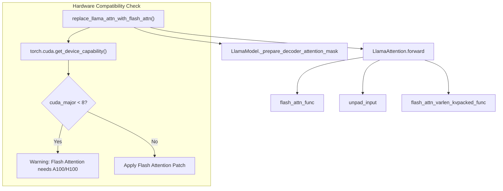

Sources: [train/llama2_flash_attn_monkey_patch.py:21-145]()

## Verification

After installation, you can verify that ToRA is properly installed by running:

```bash
bash scripts/infer.sh
```

Make sure to configure the `MODEL_NAME_OR_PATH` and `DATA` variables in the script before running it.

Sources: [README.md:102-109]()

## Common Issues and Troubleshooting

### CUDA Out of Memory Errors
- Reduce batch size in your configuration
- Enable gradient checkpointing
- Use model parallelism for larger models

### Flash Attention Issues
- Ensure you have a compatible GPU (A100/H100 recommended for optimal performance)
- Verify you're using flash_attn version 2.3.6

### vLLM Version Compatibility
- Make sure to use vLLM version 0.1.4 as specified in requirements.txt
- Later versions may have unresolved compatibility issues with ToRA

### Dependency Conflicts
- Use a fresh conda environment to avoid conflicts
- Follow the exact version specifications in requirements.txt

Sources: [src/requirements.txt:28](), [train/llama2_flash_attn_monkey_patch.py:136-141]()

---

# Page: Quick Start Guide

# Quick Start Guide

<details>
<summary>Relevant source files</summary>

The following files were used as context for generating this wiki page:

- [README.md](README.md)
- [src/requirements.txt](src/requirements.txt)
- [src/scripts/infer.sh](src/scripts/infer.sh)
- [src/train/llama2_flash_attn_monkey_patch.py](src/train/llama2_flash_attn_monkey_patch.py)

</details>


This guide provides a straightforward introduction to using ToRA (Tool-integrated Reasoning Agent) for mathematical problem solving. You'll learn how to set up the environment, run inference using pre-trained models, and evaluate results. For detailed information about the training process, see [Training Pipeline](#2.1), and for more on the evaluation system, see [Evaluation System](#2.3).

## System Overview

ToRA is a series of Tool-integrated Reasoning Agents designed to solve challenging mathematical reasoning problems by interacting with tools such as computation libraries and symbolic solvers. The system seamlessly integrates natural language reasoning with external tools, combining analytical language capabilities with computational efficiency.

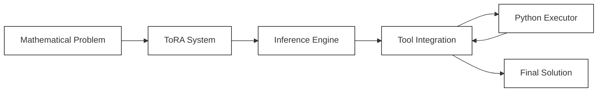

Sources: [README.md:50-51]()

## Available Models

ToRA offers several pre-trained models with varying parameter sizes and capabilities:

| Model | Size | GSM8k | MATH | Link |
|-------|------|-------|------|------|
| ToRA-7B | 7B | 68.8 | 40.1 | [HuggingFace](https://huggingface.co/llm-agents/tora-7b-v1.0) |
| ToRA-Code-7B | 7B | 72.6 | 44.6 | [HuggingFace](https://huggingface.co/llm-agents/tora-code-7b-v1.0) |
| ToRA-13B | 13B | 72.7 | 43.0 | [HuggingFace](https://huggingface.co/llm-agents/tora-13b-v1.0) |
| ToRA-Code-13B | 13B | 75.8 | 48.1 | [HuggingFace](https://huggingface.co/llm-agents/tora-code-13b-v1.0) |
| ToRA-Code-34B | 34B | 80.7 | 51.0 | [HuggingFace](https://huggingface.co/llm-agents/tora-code-34b-v1.0) |
| ToRA-70B | 70B | 84.3 | 49.7 | [HuggingFace](https://huggingface.co/llm-agents/tora-70b-v1.0) |

Sources: [README.md:53-66]()

## Environment Setup

Follow these steps to set up your environment for ToRA:

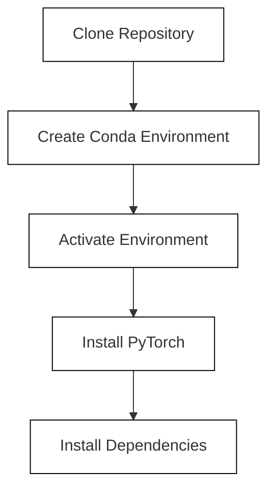

1. Clone the repository and navigate to the source directory:
   ```bash
   git clone https://github.com/microsoft/ToRA.git && cd ToRA/src
   ```

2. Create and activate a conda environment:
   ```bash
   conda create -n tora python=3.10
   conda activate tora
   ```

3. Install PyTorch and other dependencies:
   ```bash
   pip install packaging==22.0
   pip install torch==2.0.1 --index-url https://download.pytorch.org/whl/cu118 # For CUDA 11.8
   pip install -r requirements.txt
   ```

Sources: [README.md:92-101](), [src/requirements.txt:1-35]()

## Running Inference

The inference system in ToRA allows you to use pre-trained models to solve mathematical problems.


### Configuration Parameters

Edit the `src/scripts/infer.sh` script to configure your inference run:

| Parameter | Description | Example Value |
|-----------|-------------|---------------|
| MODEL_NAME_OR_PATH | Path or name of the pre-trained model | "llm-agents/tora-code-34b-v1.0" |
| DATA_NAME | Dataset to use for inference | "math" or "gsm8k" |
| SPLIT | Data split to use | "test" |
| PROMPT_TYPE | Type of prompt to use | "tora" |
| NUM_TEST_SAMPLE | Number of samples to test (-1 for all) | -1 |

### Running the Inference Script

To run inference, execute:

```bash
bash scripts/infer.sh
```

This will:
1. Load the specified model
2. Process the selected dataset
3. Generate solutions to the mathematical problems
4. Save the results to output files

Sources: [src/scripts/infer.sh:1-30](), [README.md:103-111]()

## Tool-Integrated Reasoning Process

One of ToRA's key features is its ability to combine natural language reasoning with tool usage. Here's how this process works:

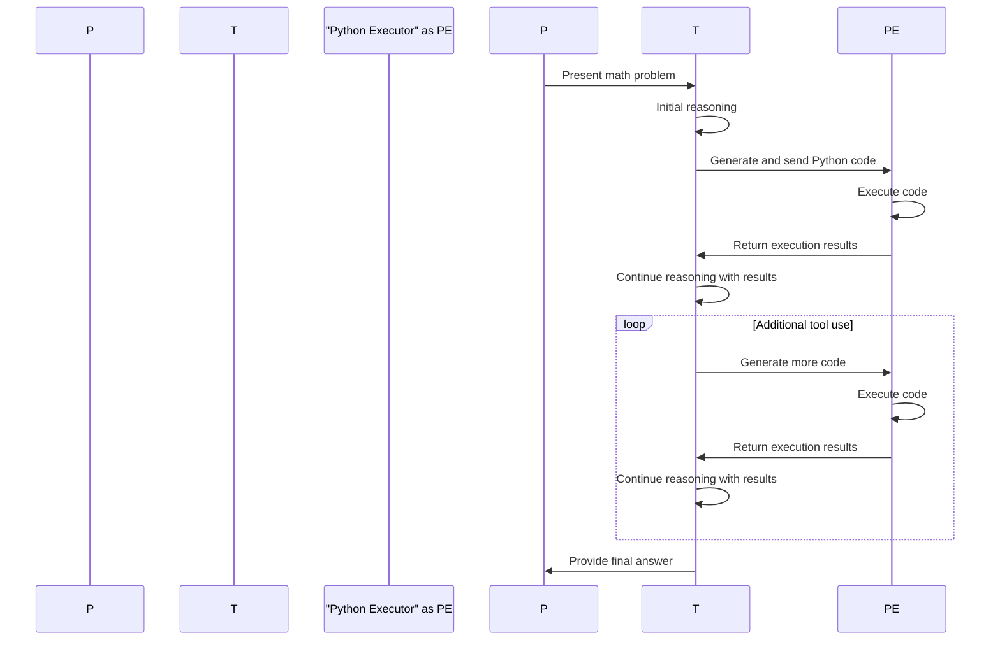

The diagram above shows how ToRA solves problems by alternating between reasoning in natural language and using Python code as a tool for computation. This allows the model to handle complex mathematical problems effectively by leveraging both symbolic reasoning and computational capabilities.

Sources: [README.md:71-77]()

## Evaluating Results

After running inference, you can evaluate the model's performance using the evaluation system.

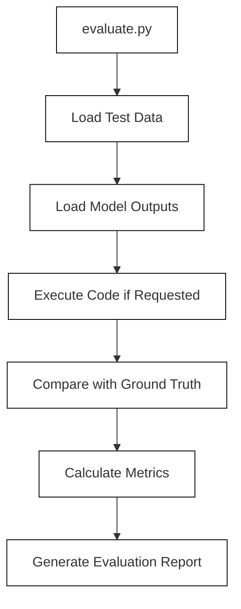

### Running Evaluation

To evaluate your model's outputs, run:

```bash
python -m eval.evaluate \
    --data_name "math" \
    --prompt_type "tora" \
    --file_path "outputs/llm-agents/tora-code-34b-v1.0/math/test_tora_-1_seed0_t0.0_s0_e5000.jsonl" \
    --execute
```

### Understanding Evaluation Results

The evaluation script will output:
- Overall accuracy score
- Type-specific scores (by mathematical domain)
- Information about timeout or empty samples

Sample output:
```
Num samples: 5000
Num scores: 5000
Timeout samples: 0
Empty samples: 2
Mean score: [51.0]
Type scores: {'Algebra': 67.3, 'Counting & Probability': 42.2, 'Geometry': 26.1, 'Intermediate Algebra': 40.0, 'Number Theory': 59.3, 'Prealgebra': 63.8, 'Precalculus': 34.2}
```

Sources: [README.md:113-136]()

## Code Components Overview

The following diagram illustrates the key code components involved in the ToRA inference system:

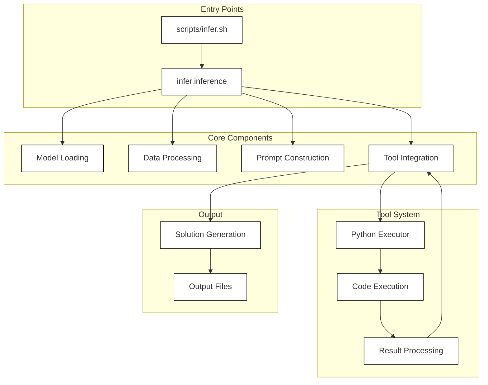

Sources: [README.md:87-136](), [src/scripts/infer.sh:1-30]()

## Next Steps

After getting started with ToRA, you may want to explore:

1. Using different models for comparison
2. Trying various mathematical datasets
3. Testing different prompt configurations
4. Analyzing the generated code and solutions

For more detailed information about specific components of the ToRA system, refer to the following pages:
- [Training Pipeline](#2.1) - For details on how to train your own ToRA models
- [Inference System](#2.2) - For deeper information about the inference system
- [Evaluation System](#2.3) - For comprehensive details on evaluation metrics and methodologies
- [Tool-Integrated Reasoning](#2.4) - For an in-depth explanation of ToRA's tool integration approach

---

# Page: Core Components

# Core Components

<details>
<summary>Relevant source files</summary>

The following files were used as context for generating this wiki page:

- [README.md](README.md)
- [docs/index.html](docs/index.html)
- [src/requirements.txt](src/requirements.txt)
- [src/train/llama2_flash_attn_monkey_patch.py](src/train/llama2_flash_attn_monkey_patch.py)

</details>


This document describes the main architectural components of the ToRA system - a tool-integrated reasoning agent for mathematical problem solving. It provides an overview of the system's primary subsystems and how they interact. For details on specific components, see the pages for [Training Pipeline](#2.1), [Inference System](#2.2), [Evaluation System](#2.3), and [Tool-Integrated Reasoning](#2.4).

## System Architecture Overview

The ToRA system consists of three primary components - the Training Pipeline, Inference System, and Evaluation System - which work together to enable the training, deployment, and assessment of tool-integrated reasoning models.

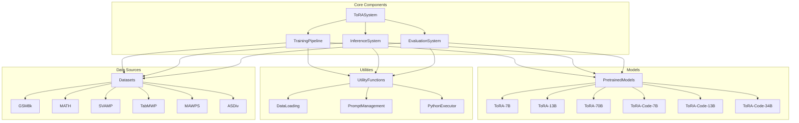

Each core component fulfills a distinct role in the system:

1. **Training Pipeline**: Handles model fine-tuning using the ToRA-Corpus dataset and output space shaping techniques
2. **Inference System**: Provides mechanisms for model deployment and inference using both batch processing and API-based approaches
3. **Evaluation System**: Assesses model performance on mathematical reasoning tasks across various datasets

These components are supported by shared utilities like data loading modules, prompt management, and the Python code executor, which is central to ToRA's tool-integrated reasoning approach.

Sources: [README.md:49-51]()

## Training Pipeline

The Training Pipeline is responsible for fine-tuning pre-trained language models using the ToRA-Corpus dataset and applying output space shaping techniques to improve model performance.

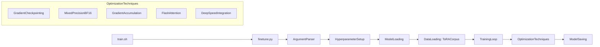

The training process begins with the `train.sh` script, which configures model hyperparameters based on the model size and prepares the environment for training. The pipeline uses several advanced optimization techniques:

| Optimization Technique | Purpose |
|------------------------|---------|
| Gradient Checkpointing | Reduces memory usage by recomputing intermediate activations during the backward pass |
| Mixed Precision (BF16) | Accelerates training by using lower precision arithmetic where appropriate |
| Gradient Accumulation | Enables effective training with larger batch sizes by accumulating gradients over multiple forward/backward passes |
| Flash Attention | Optimizes attention computation for better performance |
| DeepSpeed Integration | Provides distributed training capabilities with optimization for large models |

The Flash Attention optimization is implemented through a custom monkey patch for LLaMA models in [src/train/llama2_flash_attn_monkey_patch.py](), which replaces the standard attention mechanism with an optimized version.

Sources: [README.md:79-85](), [src/train/llama2_flash_attn_monkey_patch.py:135-144]()

## Inference System

The Inference System provides mechanisms for deploying ToRA models and using them to solve mathematical problems. It supports both batch inference using vLLM and interactive API-based inference.

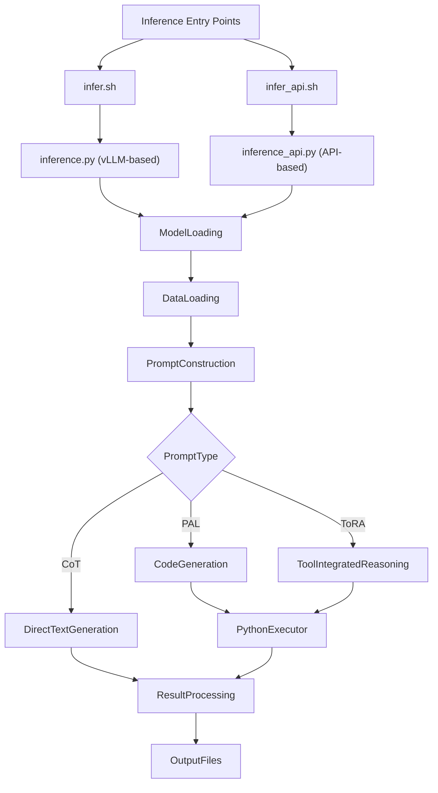

The inference system provides three main types of prompting approaches:

1. **Chain-of-Thought (CoT)**: Generates step-by-step natural language reasoning
2. **Program-Aided Learning (PAL)**: Solves problems by generating and executing Python code
3. **Tool-Integrated Reasoning (ToRA)**: Combines natural language reasoning with interactive tool use

When using the PAL or ToRA approaches, the system leverages the Python Executor to run generated code and feed the results back to the language model. This integration of natural language reasoning with computational tools is a key innovation of the ToRA system.

Sources: [README.md:104-108]()

## Evaluation System

The Evaluation System assesses the performance of ToRA models on mathematical reasoning tasks. It processes model outputs, verifies answers, and calculates accuracy metrics across various datasets.

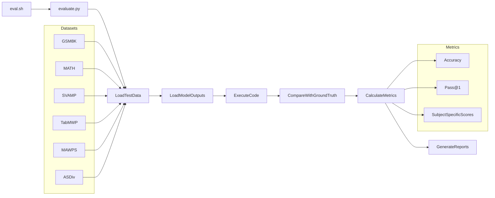

The evaluation process begins with the `eval.sh` script, which calls `evaluate.py` to load test data and model outputs. If code execution is requested, the system executes the generated code before comparing predictions with ground truth. The evaluation system calculates various metrics including overall accuracy, pass@1 rate, and subject-specific scores for different mathematical domains.

The grading logic is based on the Hendrycks' MATH grading system and has been manually verified to minimize false positives and false negatives.

Sources: [README.md:113-136]()

## Tool-Integrated Reasoning Process

The Tool-Integrated Reasoning process is the core innovation of ToRA. It enables the model to interleave natural language reasoning with programmatic tool use for solving complex mathematical problems.

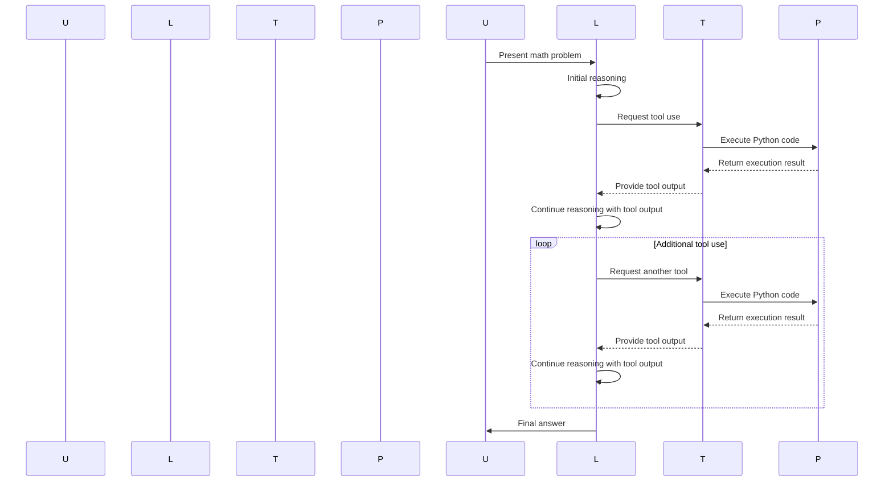

This sequence diagram illustrates the interaction pattern in ToRA:

1. The user presents a mathematical problem to the language model
2. The model performs initial reasoning in natural language
3. When computational steps are needed, the model requests tool use
4. The ToolManager invokes the PythonExecutor to run the code
5. The execution results are returned to the model
6. The model continues its reasoning with the new information
7. The process repeats as needed until the model reaches a final answer

This approach allows ToRA to combine the analytical reasoning capabilities of language models with the computational precision of programmatic tools.

Sources: [README.md:71-77]()

## Data Flow in ToRA System

The ToRA system processes data through several stages, from input mathematical problems to final predictions and evaluation metrics.

```mermaid
graph LR
    subgraph "Input"
        A["MathematicalProblems"]
        B["Datasets"]
    end
    
    subgraph "Processing"
        C["DataLoading"]
        D["PromptConstruction"]
        E["LanguageModel"]
        F["ToolIntegration"]
        G["PythonExecution"]
    end
    
    subgraph "Output"
        H["Predictions"]
        I["EvaluationMetrics"]
        J["ModelCheckpoints"]
    end
    
    A --> C
    B --> C
    C --> D
    D --> E
    E --> F
    F --> G
    G --> F
    F --> H
    H --> I
    E --> J
```

This diagram shows how data flows through the ToRA system:

1. Mathematical problems from various datasets are loaded and preprocessed
2. Prompts are constructed based on the selected reasoning approach
3. The language model generates initial reasoning and/or code
4. When using tool integration, the generated code is executed
5. The execution results inform further reasoning
6. The final predictions are produced and evaluated
7. During training, model checkpoints are saved for future use

This data flow enables ToRA to process complex mathematical problems through a combination of natural language reasoning and computational tool use.

Sources: [README.md:49-52]()

## Key Dependencies and Requirements

The ToRA system relies on several key libraries and dependencies to enable its functionality:

| Dependency | Purpose |
|------------|---------|
| PyTorch | Deep learning framework |
| Transformers | Hugging Face library for transformer models |
| vLLM | Inference acceleration for LLMs |
| DeepSpeed | Distributed training optimization |
| Flash Attention | Optimized attention implementation |
| SymPy | Symbolic mathematics library |
| CVXPY | Convex optimization library |

The full list of requirements can be found in [src/requirements.txt]().

Sources: [src/requirements.txt:1-35]()

## Integration Between Components

The three core components of ToRA - Training Pipeline, Inference System, and Evaluation System - are integrated through shared models, utilities, and data formats:

```mermaid
graph TB
    subgraph "Model Artifacts"
        M1["PretrainedModels"]
        M2["FineTunedModels"]
        M3["OutputSpaceShapedModels"]
    end
    
    subgraph "Data Artifacts"
        D1["ToRACorpus"]
        D2["InferenceOutputs"]
        D3["EvaluationResults"]
    end
    
    subgraph "Shared Utilities"
        U1["DataLoaders"]
        U2["PromptManagers"]
        U3["PythonExecutor"]
        U4["MetricsCalculators"]
    end
    
    T["TrainingPipeline"] --> M2
    M2 --> M3
    
    I["InferenceSystem"] --> D2
    M3 --> I
    
    E["EvaluationSystem"] --> D3
    D2 --> E
    
    U1 --> T
    U1 --> I
    U1 --> E
    
    U2 --> I
    
    U3 --> I
    U3 --> E
    
    U4 --> E
    
    D1 --> T
```

This diagram illustrates how the components share resources and how data and models flow between them. The training pipeline produces fine-tuned models, which are used by the inference system to generate outputs. These outputs are then assessed by the evaluation system. All components share common utilities like data loaders and the Python executor.

Sources: [README.md:49-52](), [README.md:104-108](), [README.md:113-136]()

---

# Page: Training Pipeline

# Training Pipeline

<details>
<summary>Relevant source files</summary>

The following files were used as context for generating this wiki page:

- [README.md](README.md)
- [data/tora/examples.jsonl](data/tora/examples.jsonl)
- [docs/index.html](docs/index.html)
- [src/requirements.txt](src/requirements.txt)
- [src/scripts/train.sh](src/scripts/train.sh)
- [src/train/llama2_flash_attn_monkey_patch.py](src/train/llama2_flash_attn_monkey_patch.py)

</details>


The ToRA Training Pipeline is a comprehensive system for fine-tuning large language models (LLMs) to perform tool-integrated mathematical reasoning. This document explains the architecture, process flow, and key components of the training pipeline used to create the ToRA family of models. For information about inference and evaluation, see the [Inference System](#2.2) and [Evaluation System](#2.3) pages respectively.

## Overview

The ToRA training pipeline consists of two main phases: Imitation Learning and Output Space Shaping. The pipeline is designed to efficiently train models of various sizes (7B to 70B parameters) using distributed training techniques and optimization methods to handle the computational demands of large model training.

```mermaid
flowchart TD
    subgraph "Training Pipeline"
        A["Base Model \n(LLaMA-2/CodeLLaMA)"] --> B["Imitation Learning"]
        B --> C["Output Space Shaping"]
        C --> D["Final ToRA Model"]
    end
    
    subgraph "Data Sources"
        E["ToRA-Corpus-16k"] --> B
        F["Model-Generated Trajectories"] --> C
    end
    
    subgraph "Training Infrastructure"
        G["DeepSpeed Integration"] --> B
        G --> C
        H["Mixed Precision (bf16)"] --> B
        H --> C
        I["Flash Attention"] --> B
        I --> C
        J["Gradient Checkpointing"] --> B
        J --> C
    end
```

Sources: [README.md:79-86](), [src/scripts/train.sh:2-78]()

## Training Methodology

The ToRA training methodology involves a two-step process designed to maximize the model's ability to use computational tools while maintaining natural language reasoning capabilities.

### Imitation Learning

The first stage of training involves fine-tuning a base model on the ToRA-Corpus, a dataset containing approximately 16k high-quality examples of tool-integrated reasoning for mathematical problems. This dataset was created by prompting GPT-4 to generate interactive tool-use trajectories for problems from GSM8k and MATH datasets.

```mermaid
flowchart LR
    A["Mathematical\nProblems"] --> B["GPT-4 Prompting"]
    B --> C["ToRA-Corpus-16k"]
    C --> D["Supervised\nFine-Tuning"]
    E["Base Model"] --> D
    D --> F["Imitation Model (M)"]
```

Sources: [README.md:67-78](), [data/tora/examples.jsonl:1-31]()

### Output Space Shaping

The second stage involves enriching the model's reasoning capabilities through a process called output space shaping:

1. The imitation model (M) samples diverse tool-use trajectories
2. Valid trajectories are retained
3. Invalid trajectories are corrected using a teacher model (M')
4. The model is retrained on the union of valid trajectories, corrected ones, and the initial ToRA-Corpus

This process significantly improves reasoning performance, enabling models to achieve over 50% accuracy on the competition-level MATH dataset.

```mermaid
flowchart TD
    A["Imitation Model (M)"] --> B["Sample Diverse\nTrajectories"]
    B --> C{"Valid?"}
    C -->|"Yes"| D["Keep Valid\nTrajectories"]
    C -->|"No"| E["Teacher Model (M')\nCorrection"]
    D --> F["Combine Datasets"]
    E --> F
    G["Original ToRA-Corpus"] --> F
    F --> H["Retrain Model M"]
    H --> I["Final ToRA Model"]
```

Sources: [README.md:79-86]()

## Technical Implementation

### Configuration Based on Model Size

The training pipeline automatically configures hyperparameters based on the model size to optimize for both performance and resource utilization.

| Model Size | Learning Rate | Batch Size/GPU | Optimizer Offload | Total Batch Size |
|------------|---------------|----------------|-------------------|------------------|
| 7B/13B     | 2e-5          | 16             | No                | 128              |
| 34B        | 1e-5          | 8              | Yes               | 128              |
| 70B        | 1e-5          | 4              | Yes               | 128              |

Sources: [src/scripts/train.sh:8-24]()

### Training Infrastructure Setup

The training script sets up the necessary environment for distributed training, including CUDA device configuration and gradient accumulation calculation to maintain a consistent total batch size across different model scales.

```mermaid
flowchart LR
    A["train.sh"] --> B["Parse Arguments:\nBASE_MODEL & MODEL_SIZE"]
    B --> C["Set Hyperparameters\nBased on MODEL_SIZE"]
    C --> D["Calculate Gradient\nAccumulation Steps"]
    D --> E["Set MODEL_PATH\nBased on BASE_MODEL"]
    E --> F["Set OUTPUT_DIR"]
    F --> G["Launch accelerate"]
    G --> H["train/finetune.py"]

    subgraph "DeepSpeed Configuration"
        I["stage3_no_offload.conf"] -.-> C
        J["stage3_offload_optim.conf"] -.-> C
    end
```

Sources: [src/scripts/train.sh:36-48](), [src/requirements.txt:1-35]()

### Optimization Techniques

The training pipeline incorporates several optimization techniques to efficiently train large language models:

1. **Mixed Precision Training**: Uses bf16 format to reduce memory usage while maintaining numerical stability
2. **Gradient Checkpointing**: Reduces memory requirements by recomputing intermediate activations during backpropagation
3. **Gradient Accumulation**: Enables effective training with larger batch sizes by accumulating gradients across multiple forward and backward passes
4. **Flash Attention**: Optimizes the attention mechanism for better performance and reduced memory usage
5. **DeepSpeed Integration**: Provides optimization for distributed training across multiple GPUs

```mermaid
flowchart TD
    subgraph "Optimization Techniques"
        A["Mixed Precision (bf16)"] -->|"Reduces Memory Usage"| G["Efficient Training of Large Models"]
        B["Gradient Checkpointing"] -->|"Trades Computation for Memory"| G
        C["Gradient Accumulation"] -->|"Enables Larger Batch Sizes"| G
        D["Flash Attention"] -->|"Optimizes Attention Computation"| G
        E["DeepSpeed Integration"] -->|"Enables Distributed Training"| G
    end
```

Sources: [src/scripts/train.sh:51-78](), [src/train/llama2_flash_attn_monkey_patch.py:1-241]()

### Flash Attention Implementation

The training pipeline uses a custom implementation of Flash Attention specifically optimized for LLaMA-based models. This implementation patches the native attention mechanism to enable faster and more memory-efficient computation of attention scores.

```mermaid
flowchart LR
    A["llama2_flash_attn_monkey_patch.py"] --> B["replace_llama_attn_with_flash_attn()"]
    B --> C["LlamaModel._prepare_decoder_attention_mask"]
    B --> D["LlamaAttention.forward"]
    
    subgraph "Performance Benefits"
        E["Reduced Memory Usage"]
        F["Faster Training"]
        G["Support for Longer Sequences"]
    end
    
    D --> E
    D --> F
    D --> G
```

Sources: [src/train/llama2_flash_attn_monkey_patch.py:135-144]()

## Training Launch Process

The training pipeline is launched using accelerate, which manages the distributed training environment. The launch command specifies configurations for mixed precision, deepspeed integration, and model training parameters.

```mermaid
sequenceDiagram
    participant User
    participant train.sh
    participant accelerate
    participant finetune.py
    participant DeepSpeed
    
    User->>train.sh: Execute with BASE_MODEL & MODEL_SIZE
    train.sh->>train.sh: Configure hyperparameters
    train.sh->>accelerate: Launch with DeepSpeed config
    accelerate->>finetune.py: Execute with parameters
    finetune.py->>DeepSpeed: Initialize distributed training
    finetune.py->>finetune.py: Load model & data
    loop Training Epochs
        finetune.py->>finetune.py: Forward pass
        finetune.py->>finetune.py: Backward pass
        finetune.py->>finetune.py: Optimizer step
    end
    finetune.py->>User: Save final model
```

Sources: [src/scripts/train.sh:51-78]()

## Data Processing

The training pipeline works with the ToRA-Corpus dataset, which contains examples of tool-integrated reasoning for mathematical problems. Each example in the dataset includes:

1. A mathematical problem (user message)
2. A solution using Python code for computation (assistant message)
3. Metadata including the problem difficulty level and ground truth answer

The dataset format is designed to train the model to interleave natural language reasoning with program-based tool use, combining the advantages of language reasoning with computational tools.

```mermaid
classDiagram
    class TrainingExample {
        dataset: String
        level: String
        id: String
        gt: String
        gt_cot: String
        messages: List~Message~
    }
    
    class Message {
        role: String
        content: String
    }
    
    TrainingExample --> Message: contains
```

Sources: [data/tora/examples.jsonl:1-31]()

## Model Configuration

The ToRA models are built on either LLaMA-2 or CodeLLaMA base models, with the latter showing better performance for mathematical reasoning tasks due to enhanced code capabilities. The training pipeline supports models of various sizes, including 7B, 13B, 34B, and 70B parameters.

| Model | Base Model | Size | GSM8k Accuracy | MATH Accuracy |
|-------|------------|------|----------------|---------------|
| ToRA-7B | LLaMA-2 | 7B | 68.8% | 40.1% |
| ToRA-Code-7B | CodeLLaMA | 7B | 72.6% | 44.6% |
| ToRA-13B | LLaMA-2 | 13B | 72.7% | 43.0% |
| ToRA-Code-13B | CodeLLaMA | 13B | 75.8% | 48.1% |
| ToRA-Code-34B | CodeLLaMA | 34B | 80.7% | 51.0% |
| ToRA-70B | LLaMA-2 | 70B | 84.3% | 49.7% |

Sources: [README.md:53-66]()

## Summary

The ToRA Training Pipeline represents a sophisticated approach to training large language models for mathematical reasoning with tool integration. By combining imitation learning with output space shaping, the pipeline enables models to leverage both natural language reasoning and computational tools, resulting in state-of-the-art performance on mathematical reasoning benchmarks.

The technical implementation addresses the challenges of training large models through distributed training, optimization techniques, and careful configuration based on model size. This approach has enabled ToRA-Code-34B to be the first open-source model to achieve over 50% accuracy on the MATH dataset, demonstrating the effectiveness of the training methodology.

---

# Page: Inference System

# Inference System

<details>
<summary>Relevant source files</summary>

The following files were used as context for generating this wiki page:

- [README.md](README.md)
- [src/infer/inference.py](src/infer/inference.py)
- [src/infer/inference_api.py](src/infer/inference_api.py)
- [src/requirements.txt](src/requirements.txt)
- [src/scripts/infer.sh](src/scripts/infer.sh)
- [src/scripts/infer_api.sh](src/scripts/infer_api.sh)
- [src/train/llama2_flash_attn_monkey_patch.py](src/train/llama2_flash_attn_monkey_patch.py)

</details>


## Purpose and Scope

The Inference System is the component of ToRA responsible for generating mathematical reasoning outputs from pre-trained ToRA models. It provides both batch inference capabilities using vLLM and API-based inference for interactive usage. This system supports multiple prompting strategies, including Chain-of-Thought (CoT), Program-Aided Learning (PAL), and Tool-integrated Reasoning (ToRA's signature approach).

For information about training the models, see [Training Pipeline](#2.1). For details on how ToRA's tool integration works, see [Tool-Integrated Reasoning](#2.4).

## System Architecture Overview

The Inference System provides two primary pathways for running inference with ToRA models: a vLLM-based pipeline for efficient batch inference and an API-based pipeline for flexible integration with external services.

```mermaid
flowchart TD
    subgraph "Entry Points"
        A["infer.sh"] --> B["inference.py"]
        C["infer_api.sh"] --> D["inference_api.py"]
    end
    
    subgraph "Core Components"
        B --> E["Model Loading"]
        D --> E
        E --> F["Data Loading"]
        F --> G["Prompt Construction"]
        G --> H{"Prompt Type"}
        H -->|"CoT"| I["Direct Text Generation"]
        H -->|"PAL"| J["Code Generation"]
        H -->|"ToRA"| K["Tool-Integrated Reasoning"]
        
        J --> L["Python Executor"]
        K --> L
        
        I --> M["Result Processing"]
        L --> M
        M --> N["Evaluation"]
    end
    
    subgraph "Tool Integration"
        K --> O["Extract Code"]
        O --> P["Execute Code"]
        P --> Q["Feed Results Back"]
        Q --> K
    end
```

Sources: [src/infer/inference.py](), [src/infer/inference_api.py](), [src/scripts/infer.sh](), [src/scripts/infer_api.sh]()

## Entry Points

The ToRA Inference System is accessed through two main entry points, each catering to different use cases.

### vLLM-Based Inference

The vLLM-based inference pipeline is optimized for batch processing and leverages the vLLM library for efficient inference with large language models.

```mermaid
flowchart LR
    A["infer.sh"] -->|"Configures inference parameters"| B["inference.py"]
    B --> C["prepare_data()"]
    C --> D["Load vLLM Model"]
    D --> E["Batch Generate Responses"]
    E --> F["Process Responses"]
    F --> G["Execute Code if needed"]
    G --> H["Save Results"]
    H --> I["Evaluate Accuracy"]
```

The vLLM pipeline is configured through `infer.sh`, where users can specify:
- Model path
- Dataset
- Prompt type (CoT, PAL, or ToRA)
- Generation parameters (temperature, top-p, etc.)
- Sampling configurations

Sources: [src/scripts/infer.sh](), [src/infer/inference.py:20-46](), [src/infer/inference.py:90-106]()

### API-Based Inference

The API-based inference pipeline provides integration with external language model APIs (e.g., OpenAI's APIs).

```mermaid
flowchart LR
    A["infer_api.sh"] -->|"Configures API parameters"| B["inference_api.py"]
    B --> C["prepare_data()"]
    C --> D["Call LLM API"]
    D --> E["Process API Response"]
    E --> F["Execute Code if needed"]
    F --> G["Save Results"]
    G --> H["Evaluate Accuracy"]
```

The API-based pipeline is useful for:
- Accessing models not available locally
- Integrating with cloud-based LLM services
- Comparing proprietary models with ToRA models

Sources: [src/scripts/infer_api.sh](), [src/infer/inference_api.py:27-47](), [src/infer/inference_api.py:109-203]()

## Inference Flow

### Data Processing and Prompt Construction

The inference system begins by loading and processing the input data, which consists of mathematical problems from various datasets.

```mermaid
flowchart TD
    A["prepare_data()"] --> B["Load Dataset"]
    B --> C["Filter Samples"]
    C --> D["Deduplicate Processed Samples"]
    D --> E["Determine Output Path"]
    
    F["Main Inference Loop"] --> G["Parse Question and Answer"]
    G --> H["Construct Prompt"]
    H --> I["Add Metadata"]
    I --> J["Begin Inference"]
```

Key steps in data preparation:
1. Load the specified dataset
2. Optionally sample a subset of the data
3. Deduplicate already processed samples
4. Prepare output file paths for results

Sources: [src/infer/inference.py:44-87](), [src/infer/inference_api.py:110-127]()

### Model Inference and Tool Integration

The core of the inference system is the interaction between the language model and external tools, particularly for the ToRA prompt type.

```mermaid
sequenceDiagram
    participant ModelEngine
    participant PythonExecutor
    participant ResultProcessor
    
    Note over ModelEngine,ResultProcessor: vLLM-Based Path
    ModelEngine->>ModelEngine: Generate Initial Response
    ModelEngine->>ResultProcessor: Extract Python Code
    ResultProcessor->>PythonExecutor: Execute Code
    PythonExecutor-->>ResultProcessor: Return Execution Result
    ResultProcessor->>ModelEngine: Feed Results Back
    
    loop Iterative Tool Use
        ModelEngine->>ModelEngine: Continue Reasoning
        ModelEngine->>ResultProcessor: Extract More Code
        ResultProcessor->>PythonExecutor: Execute Code
        PythonExecutor-->>ResultProcessor: Return Results
        ResultProcessor->>ModelEngine: Feed Results Back
    end
    
    ModelEngine->>ResultProcessor: Final Answer
```

For ToRA-style prompts, the system supports up to 4 rounds of tool usage by default, with the model dynamically deciding when to use tools versus when to provide a final answer.

Sources: [src/infer/inference.py:133-197](), [src/infer/inference_api.py:50-105]()

## Prompt Types and Execution

The inference system supports three main prompting strategies, each with different execution patterns:

### Chain-of-Thought (CoT)

CoT prompts encourage the model to explain its reasoning step by step before arriving at a final answer. This is a purely language-based approach without tool usage.

```mermaid
flowchart LR
    A["Question Input"] --> B["CoT Prompt Template"]
    B --> C["LLM Generation"]
    C --> D["Extract Final Answer"]
    D --> E["Evaluate Result"]
```

Sources: [src/infer/inference.py:135-136]()

### Program-Aided Learning (PAL)

PAL prompts the model to generate executable Python code to solve the problem, extracts and executes this code, and then uses the code's output as the answer.

```mermaid
flowchart LR
    A["Question Input"] --> B["PAL Prompt Template"]
    B --> C["LLM Generates Code"]
    C --> D["Extract Python Program"]
    D --> E["Execute Code"]
    E --> F["Extract solution() Result"]
    F --> G["Evaluate Result"]
```

Sources: [src/infer/inference.py:93-97](), [src/infer/inference_api.py:112-115]()

### Tool-Integrated Reasoning (ToRA)

ToRA combines natural language reasoning with code execution in an iterative process, allowing the model to use tools as needed throughout its reasoning.

```mermaid
flowchart TD
    A["Question Input"] --> B["ToRA Prompt Template"]
    B --> C["LLM Reasoning"]
    C --> D{"Contains Code Block?"}
    D -->|"Yes"| E["Extract Python Code"]
    D -->|"No"| F["Final Answer"]
    E --> G["Execute Code"]
    G --> H["Feed Results Back to LLM"]
    H --> C
    F --> I["Evaluate Result"]
```

The tool integration process allows ToRA to leverage computational tools for complex mathematical operations while maintaining the flexibility of natural language reasoning.

Sources: [src/infer/inference.py:175-182](), [src/infer/inference_api.py:130-138]()

## Key Components

### Python Executor

The Python Executor is responsible for safely running generated Python code and capturing its output.

```mermaid
flowchart TD
    A["PythonExecutor"] --> B["batch_apply()"]
    A --> C["apply()"]
    
    B --> D["Process Multiple Code Snippets"]
    C --> E["Process Single Code Snippet"]
    
    D --> F{"Execution Successful?"}
    E --> F
    
    F -->|"Yes"| G["Return Result"]
    F -->|"No"| H["Return Error Report"]
```

The executor has two modes:
1. For PAL: Executes code and extracts the value from `solution()`
2. For ToRA: Executes code and captures stdout for the answer

It handles errors gracefully, providing informative error messages that can be fed back to the model.

Sources: [src/infer/inference.py:93-97](), [src/infer/inference.py:184-196]()

### Result Processing and Evaluation

After generating responses, the system processes the results and evaluates the model's performance.

```mermaid
flowchart LR
    A["Generated Responses"] --> B["Extract Answers"]
    B --> C["Execute Code if Needed"]
    C --> D["Compare with Ground Truth"]
    D --> E["Calculate Metrics"]
    E --> F["Save Results and Metrics"]
```

The system evaluates model outputs by:
1. Extracting the final answer from the generated text
2. Comparing the answer with the ground truth using specialized math equality checking
3. Calculating accuracy metrics by problem type and dataset

Sources: [src/infer/inference.py:207-232](), [src/infer/inference_api.py:166-202]()

## Implementation Details

### vLLM Configuration

The vLLM-based inference leverages tensor parallelism for efficient model loading and inference across multiple GPUs.

```mermaid
flowchart TD
    A["Parse CLI Arguments"] --> B["Set vLLM Parameters"]
    B --> C["Determine Available GPUs"]
    C --> D["Initialize LLM with Tensor Parallelism"]
    D --> E["Configure Sampling Parameters"]
    E --> F["Begin Batch Generation"]
```

Key vLLM configuration options:
- Tensor parallelism across available GPUs
- Sampling parameters (temperature, top-p)
- Maximum token length
- Stop tokens for different prompt types

Sources: [src/infer/inference.py:99-106](), [src/infer/inference.py:151-157]()

### API-Based Implementation

The API-based inference provides similar functionality but interfaces with external LLM APIs.

```mermaid
flowchart TD
    A["API Parameters"] --> B["Configure API Call"]
    B --> C["Build Prompt with Query"]
    C --> D["Send to LLM API"]
    D --> E["Process API Response"]
    E --> F["Handle Tool Execution if Needed"]
    F --> G["Format Final Result"]
```

The API implementation supports:
- Multiple LLM service providers
- Configurable generation parameters
- Error handling for API failures
- Progress tracking for long-running jobs

Sources: [src/infer/inference_api.py:50-105](), [src/infer/inference_api.py:143-151]()

## Using the Inference System

### Basic Usage

To use the ToRA Inference System for mathematical problem-solving, follow these steps:

1. Configure the inference parameters in the script:
   ```bash
   # Edit src/scripts/infer.sh
   MODEL_NAME_OR_PATH="llm-agents/tora-code-34b-v1.0"
   DATA_NAME="math"
   SPLIT="test"
   PROMPT_TYPE="tora"
   ```

2. Run the inference script:
   ```bash
   bash scripts/infer.sh
   ```

3. View results in the generated output files:
   ```
   outputs/llm-agents/model-name/dataset/test_prompt-type_samples_seed_...
   ```

Sources: [src/scripts/infer.sh:1-30]()

### Advanced Configuration

The inference system provides numerous configuration options:

| Parameter | Description | Example Values |
|-----------|-------------|----------------|
| `model_name_or_path` | Path to local model or HF model ID | `llm-agents/tora-code-34b-v1.0` |
| `data_name` | Dataset to use | `math`, `gsm8k`, `svamp` |
| `prompt_type` | Type of prompting strategy | `cot`, `pal`, `tora` |
| `temperature` | Sampling temperature | `0` (deterministic), `0.7` (creative) |
| `n_sampling` | Number of samples to generate | `1`, `5` (for self-consistency) |
| `top_p` | Nucleus sampling parameter | `1.0` |
| `max_tokens_per_call` | Maximum tokens to generate | `1024` |

Sources: [src/infer/inference.py:21-40](), [src/infer/inference_api.py:27-46]()

## Conclusion

The ToRA Inference System provides a flexible and powerful framework for mathematical problem-solving using large language models with tool integration. It supports both batch processing through vLLM and API-based inference, accommodating a wide range of use cases and deployment scenarios.

The system's support for multiple prompting strategies—CoT, PAL, and ToRA—allows users to leverage different approaches to mathematical reasoning, from pure language-based reasoning to tool-integrated approaches that combine the strengths of language models and computational tools.

---

# Page: Evaluation System

# Evaluation System

<details>
<summary>Relevant source files</summary>

The following files were used as context for generating this wiki page:

- [.gitignore](.gitignore)
- [README.md](README.md)
- [src/requirements.txt](src/requirements.txt)
- [src/scripts/eval.sh](src/scripts/eval.sh)
- [src/train/llama2_flash_attn_monkey_patch.py](src/train/llama2_flash_attn_monkey_patch.py)

</details>


The ToRA Evaluation System is a comprehensive framework for assessing the performance of ToRA models on mathematical reasoning tasks. This document explains how the evaluation pipeline works, including the components, process flow, metrics, and usage. For information about the inference system that generates the outputs being evaluated, see [Inference System](#2.2).

## Overview

The evaluation system takes model-generated outputs, compares them with ground truth answers, and produces performance metrics. It supports different prompting techniques (Chain-of-Thought, Program-Aided Learning, and Tool-integrated Reasoning) and can execute Python code generated by models before evaluation.

```mermaid
graph TD
    subgraph "Evaluation System Architecture"
        A["Model Outputs"] --> B["Evaluation Pipeline"]
        C["Ground Truth Data"] --> B
        B --> D["evaluate.py"]
        D --> E["Grader"]
        D --> F["Python Executor"]
        E --> G["Metrics Calculator"]
        G --> H["Evaluation Reports"]
    end
```

Sources: [README.md:113-126](), [src/scripts/eval.sh]()

## Evaluation Process

The evaluation pipeline follows a systematic process to evaluate the model outputs against ground truth data.

```mermaid
flowchart LR
    A["eval.sh"] --> B["evaluate.py"]
    B --> C["Load Test Data"]
    C --> D["Load Model Outputs"]
    D --> E{{"Execute Code?"}}
    E -->|"Yes"| F["Run Python Executor"]
    E -->|"No"| G["Direct Comparison"]
    F --> H["Extract Final Answer"]
    G --> H
    H --> I["Compare with Ground Truth"]
    I --> J["Calculate Metrics"]
    J --> K["Generate Reports"]
    
    subgraph "Datasets"
        L["GSM8K"]
        M["MATH"]
        N["SVAMP"]
        O["TabMWP"]
        P["MAWPS"]
        Q["ASDiv"]
    end
    
    L -.-> C
    M -.-> C
    N -.-> C
    O -.-> C
    P -.-> C
    Q -.-> C
```

Sources: [README.md:113-126](), [src/scripts/eval.sh]()

### Data Loading

The evaluation system supports various mathematical datasets:

| Dataset | Description | Type |
|---------|-------------|------|
| GSM8K | Grade School Math Word Problems | Word problems |
| MATH | Complex High School Competition Problems | Multi-subject mathematics |
| SVAMP | Simple Variations of Math Problems | Elementary word problems |
| TabMWP | Tabular Math Word Problems | Word problems with tables |
| MAWPS | Math Word Problems | Elementary arithmetic |
| ASDiv | Arithmetic with Diverse Problem Types | Diverse arithmetic |

The system loads both the test data from these datasets and the model-generated outputs for evaluation.

Sources: [README.md:66-70]()

### Code Execution

For outputs generated using a code-based approach (PAL or ToRA), the evaluation system can execute the generated Python code to obtain the final answer. This is particularly important for Tool-integrated Reasoning where the model generates executable code as part of its reasoning process.

The execution is performed through the Python Executor component, which provides a safe environment for running the generated code and extracting the final answer.

```mermaid
sequenceDiagram
    participant E as "Evaluator"
    participant PE as "Python Executor"
    
    E->>PE: Send Generated Code
    PE->>PE: Execute in Sandbox
    PE->>E: Return Execution Result
    E->>E: Extract Final Answer
```

Sources: [README.md:113-126]()

### Answer Grading

The evaluation system uses a dedicated grader to assess the accuracy of predicted answers. This grading logic is based on the Hendrycks' MATH grading system and is designed to minimize false positives and false negatives.

```mermaid
flowchart TD
    A["Model Answer"] --> B["Grader"]
    C["Ground Truth"] --> B
    B --> D{{"Compare Answers"}}
    D -->|"Match"| E["Correct (1.0)"]
    D -->|"No Match"| F["Incorrect (0.0)"]
    E --> G["Calculate Statistics"]
    F --> G
```

Sources: [README.md:113-126]()

## Evaluation Metrics

The evaluation system calculates several metrics to assess model performance:

1. **Accuracy**: The percentage of correctly answered problems.
2. **Pass@1**: The accuracy when the model has only one attempt to solve the problem.
3. **Subject-specific scores**: For datasets like MATH, performance is broken down by mathematical subjects:
   - Algebra
   - Counting & Probability
   - Geometry
   - Intermediate Algebra
   - Number Theory
   - Prealgebra
   - Precalculus

These metrics provide a comprehensive view of the model's mathematical reasoning capabilities across different problem types and difficulty levels.

Sources: [README.md:52-66]()

## Usage

### Command Line Interface

The evaluation system can be used via a simple command-line interface. The basic command structure is:

```
python -m eval.evaluate \
    --data_name <dataset_name> \
    --prompt_type <prompt_type> \
    --file_path <path_to_model_outputs> \
    [--execute]
```

Where:
- `data_name`: The name of the dataset (e.g., "math", "gsm8k")
- `prompt_type`: The prompting technique used (e.g., "tora", "cot", "pal")
- `file_path`: Path to the file containing model outputs
- `--execute`: Optional flag to execute code in the model outputs

Example:
```
python -m eval.evaluate \
    --data_name "math" \
    --prompt_type "tora" \
    --file_path "outputs/llm-agents/tora-code-34b-v1.0/math/test_tora_-1_seed0_t0.0_s0_e5000.jsonl" \
    --execute
```

Sources: [src/scripts/eval.sh](), [README.md:120-125]()

### Evaluation Script

For convenience, the repository provides a shell script `eval.sh` that can be used to run the evaluation with common parameters:

```
bash scripts/eval.sh
```

This script runs the evaluation on the MATH dataset using ToRA outputs and executes the generated code.

Sources: [src/scripts/eval.sh]()

## Output Reports

After evaluation, the system generates a comprehensive report including:

1. **Overall Accuracy**: The percentage of correctly answered problems across the entire dataset.
2. **Subject-specific Scores**: Breakdown of performance by mathematical subjects.
3. **Error Analysis**: Information about timeout samples and empty responses.

Example output:
```
Num samples: 5000
Num scores: 5000
Timeout samples: 0
Empty samples: 2
Mean score: [51.0]
Type scores: {'Algebra': 67.3, 'Counting & Probability': 42.2, 'Geometry': 26.1, 'Intermediate Algebra': 40.0, 'Number Theory': 59.3, 'Prealgebra': 63.8, 'Precalculus': 34.2}
```

This report provides insights into the model's strengths and weaknesses across different mathematical domains.

Sources: [README.md:129-136]()

## Integration with Model Comparison

The evaluation system facilitates model comparison by standardizing the evaluation process across different model variants and sizes. This allows for consistent benchmarking and performance tracking.

```mermaid
flowchart LR
    subgraph "Model Variants"
        A["ToRA-7B"]
        B["ToRA-13B"]
        C["ToRA-Code-7B"]
        D["ToRA-Code-13B"]
        E["ToRA-Code-34B"]
        F["ToRA-70B"]
    end
    
    subgraph "Evaluation Pipeline"
        G["Evaluation System"]
    end
    
    subgraph "Benchmark Results"
        H["GSM8K Scores"]
        I["MATH Scores"]
        J["AVG@10 math tasks"]
    end
    
    A --> G
    B --> G
    C --> G
    D --> G
    E --> G
    F --> G
    
    G --> H
    G --> I
    G --> J
```

Sources: [README.md:52-66]()

## Related Components

The evaluation system works in conjunction with other components of the ToRA framework:

1. **Inference System**: Generates the outputs that are evaluated by the evaluation system. See [Inference System](#2.2) for details.
2. **Python Executor**: Executes the generated code in a safe environment. See [Python Executor](#5.1) for details.
3. **Tool-Integrated Reasoning**: The core concept of combining natural language reasoning with tool use. See [Tool-Integrated Reasoning](#2.4) for details.

The evaluation system plays a crucial role in validating the effectiveness of the Tool-integrated Reasoning approach and tracking the performance improvements across different model variants and prompting techniques.

Sources: [README.md:69-77]()

---

# Page: Tool-Integrated Reasoning

# Tool-Integrated Reasoning

<details>
<summary>Relevant source files</summary>

The following files were used as context for generating this wiki page:

- [README.md](README.md)
- [docs/index.html](docs/index.html)
- [src/requirements.txt](src/requirements.txt)
- [src/train/llama2_flash_attn_monkey_patch.py](src/train/llama2_flash_attn_monkey_patch.py)
- [src/utils/python_executor.py](src/utils/python_executor.py)

</details>


## Purpose and Overview

Tool-Integrated Reasoning is the core methodology in ToRA (Tool-integrated Reasoning Agent) that enables language models to combine natural language reasoning with the use of external tools, specifically Python code execution, to solve complex mathematical problems. This approach allows the system to leverage both the semantic understanding and reasoning capabilities of language models and the computational precision of programmatic tools.

For information about the broader ToRA system, see [Core Components](#2).

Sources: [README.md](), [docs/index.html]()

## Core Concepts

Tool-Integrated Reasoning is built around the concept of interleaving natural language reasoning with code-based tool use. Rather than relying solely on the language model's ability to perform calculations or solely on programmatic approaches, Tool-Integrated Reasoning creates a synergy between these two approaches.

Key principles include:
- Natural language reasoning for semantic understanding, planning, and abstract thinking
- Program-based tool use for precise calculations, symbolic operations, and algorithm execution
- Iterative interaction between reasoning and tool use
- Single or multiple rounds of tool interactions depending on problem complexity

The combination of these principles enables ToRA to solve complex mathematical problems more effectively than models that use only language reasoning (Chain-of-Thought) or only programmatic approaches (Program-Aided Learning).

Sources: [README.md](), [docs/index.html]()

## Architecture

### Tool-Integrated Reasoning System Architecture

```mermaid
graph TD
    subgraph "User Interface"
        User["User"]
        Problem["Mathematical Problem"]
        FinalAnswer["Final Answer"]
    end

    subgraph "Inference System" 
        InferenceEntry["Inference Entry Points<br>infer.sh/infer_api.sh"]
        InferenceModule["inference.py/inference_api.py"]
        PromptConstruction["Prompt Construction"]
    end

    subgraph "Language Model"
        LLM["ToRA Model<br>(7B/13B/34B/70B)"]
        Reasoning["Natural Language Reasoning"]
        CodeGeneration["Code Generation"]
    end

    subgraph "Tool Integration"
        CodeExtraction["Extract Function Calls"]
        PythonExecutor["PythonExecutor"]
        ResultFeedback["Feed Results back to LLM"]
    end

    User --> Problem
    Problem --> InferenceEntry
    InferenceEntry --> InferenceModule
    InferenceModule --> PromptConstruction
    PromptConstruction --> LLM
    LLM --> Reasoning
    Reasoning --> CodeGeneration
    CodeGeneration --> CodeExtraction
    CodeExtraction --> PythonExecutor
    PythonExecutor --> ResultFeedback
    ResultFeedback --> LLM
    LLM --> FinalAnswer
    FinalAnswer --> User
```

The Tool-Integrated Reasoning architecture consists of several key components:

1. **Inference System**: Processes mathematical problems through entry points (`infer.sh`, `infer_api.sh`) and constructs appropriate prompts for the language model.

2. **Language Model**: A ToRA model (available in 7B, 13B, 34B, and 70B parameters) that generates both natural language reasoning and Python code.

3. **Tool Integration**: Handles the extraction of function calls from the model's output, executes them using the `PythonExecutor`, and feeds the results back to the language model.

4. **PythonExecutor**: A specialized component that safely executes Python code generated by the model and returns the execution results.

Sources: [README.md](), Tool-Integrated Reasoning Process diagram, Inference System Architecture diagram

## The Tool-Integrated Reasoning Process

```mermaid
sequenceDiagram
    participant User
    participant InferenceSystem as "Inference System"
    participant LLM as "ToRA Model"
    participant PythonExecutor
    
    User->>InferenceSystem: Present math problem
    InferenceSystem->>LLM: Construct prompt
    LLM->>LLM: Initial reasoning
    LLM->>InferenceSystem: Generate code for computation
    InferenceSystem->>PythonExecutor: Extract and send code
    PythonExecutor-->>InferenceSystem: Return execution result
    InferenceSystem-->>LLM: Feed results back
    
    loop Additional tool use as needed
        LLM->>LLM: Continue reasoning
        LLM->>InferenceSystem: Generate more code
        InferenceSystem->>PythonExecutor: Extract and send code
        PythonExecutor-->>InferenceSystem: Return execution result
        InferenceSystem-->>LLM: Feed results back
    end
    
    LLM->>InferenceSystem: Provide final answer
    InferenceSystem->>User: Return solution
```

The process of solving a problem using Tool-Integrated Reasoning typically follows these steps:

1. The user presents a mathematical problem to the system.
2. The Inference System constructs a prompt for the ToRA model.
3. The model performs initial reasoning about the problem.
4. When computation is needed, the model generates Python code.
5. The Inference System extracts this code and sends it to the `PythonExecutor`.
6. The `PythonExecutor` runs the code and returns the results.
7. The results are fed back to the model, which continues its reasoning.
8. Steps 4-7 may repeat multiple times for complex problems.
9. Finally, the model provides a complete solution to the problem.

Sources: [README.md](), Tool-Integrated Reasoning Process diagram

## Implementation Details

### Python Executor Component

The core component that enables tool use in ToRA is the `PythonExecutor`, which is responsible for safely executing Python code generated by the language model.

```mermaid
classDiagram
    class PythonExecutor {
        +runtime: GenericRuntime
        +answer_symbol: str
        +answer_expr: str
        +get_answer_from_stdout: bool
        +timeout_length: int
        +process_generation_to_code(gens)
        +execute(code, ...)
        +apply(code)
        +batch_apply(batch_code)
        +truncate(s, max_length)
    }
    
    class GenericRuntime {
        +GLOBAL_DICT: dict
        +LOCAL_DICT: dict
        +HEADERS: list
        +exec_code(code_piece)
        +eval_code(expr)
        +inject(var_dict)
        +answer
    }
    
    class DateRuntime {
        +GLOBAL_DICT: dict
    }
    
    class ColorObjectRuntime {
        +GLOBAL_DICT: dict
    }
    
    GenericRuntime <|-- DateRuntime
    GenericRuntime <|-- ColorObjectRuntime
    PythonExecutor --> GenericRuntime
```

The `PythonExecutor` class provides the following key methods:

- `process_generation_to_code(gens)`: Prepares generated text for execution
- `execute(code, ...)`: Static method that executes code within a runtime environment
- `apply(code)`: Executes a single piece of code
- `batch_apply(batch_code)`: Executes multiple pieces of code in parallel
- `truncate(s, max_length)`: Truncates long outputs

The `GenericRuntime` class and its specialized subclasses provide controlled environments for executing code:

- `GenericRuntime`: Base class for code execution environments
- `DateRuntime`: Specialized for date/time calculations
- `ColorObjectRuntime`: Specialized for handling custom dictionary structures

The executor uses multiprocessing for parallel execution and includes timeout mechanisms to prevent infinite loops or excessive resource consumption.

Sources: [utils/python_executor.py]()

### Integration with Flash Attention

For optimal performance, ToRA uses Flash Attention to accelerate transformer operations. This is implemented through a monkey patching mechanism that replaces the standard attention mechanism in the LLaMA model with a more efficient implementation.

```mermaid
classDiagram
    class LlamaAttention {
        +forward(hidden_states, attention_mask, position_ids, ...)
    }
    
    class LlamaModel {
        +_prepare_decoder_attention_mask(attention_mask, input_shape, ...)
    }
    
    class FlashAttention {
        +flash_attn_func()
        +flash_attn_varlen_kvpacked_func()
    }
    
    LlamaAttention --> FlashAttention: uses
    LlamaModel --> LlamaAttention: contains
```

The flash attention integration improves both training and inference speed, which is crucial for operating large language models effectively.

Sources: [src/train/llama2_flash_attn_monkey_patch.py]()

## Example of Tool-Integrated Reasoning

Below is an example of how Tool-Integrated Reasoning works in practice:

```
Problem: What is the sum of the first 10 prime numbers?

[ToRA Model's Response]
Let me solve this step by step.

First, I need to find the first 10 prime numbers. I'll use Python to help with this:

```python
def is_prime(n):
    if n <= 1:
        return False
    if n <= 3:
        return True
    if n % 2 == 0 or n % 3 == 0:
        return False
    i = 5
    while i * i <= n:
        if n % i == 0 or n % (i + 2) == 0:
            return False
        i += 6
    return True

primes = []
num = 2
while len(primes) < 10:
    if is_prime(num):
        primes.append(num)
    num += 1

print(f"First 10 prime numbers: {primes}")
print(f"Sum: {sum(primes)}")
```

[Python Executor Output]
First 10 prime numbers: [2, 3, 5, 7, 11, 13, 17, 19, 23, 29]
Sum: 129

Now I can see that the first 10 prime numbers are 2, 3, 5, 7, 11, 13, 17, 19, 23, and 29.
The sum of these numbers is 129.

Therefore, the sum of the first 10 prime numbers is 129.
```

This example demonstrates how the model interleaves natural language reasoning with Python code execution to solve the problem effectively. The model formulates an approach in natural language, implements it in Python code, receives the execution results, and incorporates them into its final reasoning to provide the answer.

Sources: [README.md](), [docs/index.html]()

## Performance and Advantages

Tool-Integrated Reasoning provides several key advantages that have enabled ToRA models to achieve state-of-the-art performance:

| Advantage | Description |
|-----------|-------------|
| Precision | Python execution provides exact calculations, avoiding arithmetic errors common in pure language models |
| Flexibility | Combines the planning and abstract reasoning of language models with the computational precision of code |
| Efficiency | Allows complex calculations to be offloaded to code, reducing token usage for number manipulation |
| Scalability | More effective at handling problems with large numbers or many computational steps |
| Visualization | Code can generate plots or intermediate results that help in problem solving |
| Algorithm Use | Enables use of well-established algorithms for specialized mathematical tasks |

According to benchmark results, ToRA models significantly outperform other open-source models on mathematical reasoning tasks. ToRA-Code-34B achieves 51.0% accuracy on the challenging MATH dataset, outperforming GPT-4's Chain-of-Thought result (42.5%) and approaching GPT-4's Program-Aided Learning result (51.8%). ToRA-70B achieves 84.3% accuracy on GSM8k, surpassing ChatGPT (80.8%).

Sources: [README.md](), [docs/index.html]()

## Integration with ToRA System

Tool-Integrated Reasoning is a core component of the ToRA system, working alongside the training pipeline, inference system, and evaluation system.

```mermaid
graph TD
    subgraph "ToRA System Components"
        Training["Training Pipeline"]
        Inference["Inference System"]
        Evaluation["Evaluation System"]
    end

    subgraph "Tool-Integrated Reasoning"
        ToolReasoning["Natural Language + Tool Use"]
        PromptFormat["Tool-Integrated Prompt Format"]
        PythonExec["PythonExecutor Component"]
    end

    subgraph "Models"
        ToraModels["ToRA Models (7B to 70B)"]
    end

    Training --> ToolReasoning
    Inference --> ToolReasoning
    ToolReasoning --> Evaluation
    
    ToolReasoning --> PromptFormat
    PromptFormat --> PythonExec
    ToraModels --> ToolReasoning
```

During training, models learn the Tool-Integrated Reasoning format through a specially curated dataset. During inference, this format is used to solve new mathematical problems by interleaving reasoning with code execution. The evaluation system then assesses the correctness of the solutions.

Sources: [README.md](), High-Level ToRA System Components diagram

## Conclusion

Tool-Integrated Reasoning is the innovative methodology at the heart of the ToRA system. By combining the semantic understanding and planning capabilities of language models with the computational precision of Python code execution, it enables significantly improved performance on mathematical reasoning tasks. The implementation, centered around the `PythonExecutor` component, allows for safe and efficient execution of code generated by the language model. This approach has proven highly effective, enabling ToRA models to achieve state-of-the-art results on challenging mathematical benchmarks.

Sources: [README.md](), [docs/index.html]()

---

# Page: Models

# Models

<details>
<summary>Relevant source files</summary>

The following files were used as context for generating this wiki page:

- [README.md](README.md)
- [docs/index.html](docs/index.html)
- [src/requirements.txt](src/requirements.txt)
- [src/train/llama2_flash_attn_monkey_patch.py](src/train/llama2_flash_attn_monkey_patch.py)

</details>


This page provides an overview of the ToRA model family, their architecture, and their performance on mathematical reasoning tasks. For information about training these models, see [Training Pipeline](#2.1). For inference information, see [Inference System](#2.2).

## Overview

ToRA (Tool-integrated Reasoning Agent) comprises a series of large language models specifically fine-tuned for mathematical reasoning using a tool-integrated approach. The models are designed to solve complex mathematical problems by interleaving natural language reasoning with programmatic tool use, primarily through Python code execution.

The model family includes multiple sizes and variants based on either LLaMA-2 or CodeLLaMA as the base architecture. All ToRA models are optimized to leverage external tools, particularly Python libraries for computation, to enhance their mathematical problem-solving capabilities.

```mermaid
flowchart TD
    subgraph "ToRA Models"
        subgraph "LLaMA-2 Based"
            tora7b["ToRA-7B"]
            tora13b["ToRA-13B"]
            tora70b["ToRA-70B"]
        end
        
        subgraph "CodeLLaMA Based"
            toracode7b["ToRA-Code-7B"]
            toracode13b["ToRA-Code-13B"]
            toracode34b["ToRA-Code-34B"]
        end
    end
    
    subgraph "Base Models"
        llama2["LLaMA-2"]
        codellama["CodeLLaMA"]
    end
    
    llama2 --> tora7b
    llama2 --> tora13b
    llama2 --> tora70b
    
    codellama --> toracode7b
    codellama --> toracode13b
    codellama --> toracode34b
```

Sources: [README.md:54-67]()

## Model Variants

The ToRA model family consists of two main series with multiple parameter sizes:

### ToRA Series (LLaMA-2 Based)

These models are fine-tuned from LLaMA-2 base models:

1. **ToRA-7B**: 7 billion parameter model fine-tuned from LLaMA-2-7B
2. **ToRA-13B**: 13 billion parameter model fine-tuned from LLaMA-2-13B 
3. **ToRA-70B**: 70 billion parameter model fine-tuned from LLaMA-2-70B

### ToRA-Code Series (CodeLLaMA Based)

These models are fine-tuned from CodeLLaMA base models, which have enhanced coding capabilities:

1. **ToRA-Code-7B**: 7 billion parameter model fine-tuned from CodeLLaMA-7B
2. **ToRA-Code-13B**: 13 billion parameter model fine-tuned from CodeLLaMA-13B
3. **ToRA-Code-34B**: 34 billion parameter model fine-tuned from CodeLLaMA-34B

All models can be accessed through Hugging Face at the organization `llm-agents`: [https://huggingface.co/llm-agents](https://huggingface.co/llm-agents).

Sources: [README.md:54-67](), [docs/index.html:133-140]()

## Model Architecture

ToRA models preserve the fundamental architecture of their base models (LLaMA-2 or CodeLLaMA) while incorporating optimizations for improved performance, particularly for mathematical reasoning tasks.

### Flash Attention Integration

A key optimization in ToRA is the integration of Flash Attention, which significantly improves both training and inference speed, particularly for larger models. The implementation modifies the standard attention mechanism in LLaMA models to use Flash Attention:

```mermaid
flowchart TD
    subgraph "ToRA Model Architecture"
        input["Input Tokens"]
        embeddings["Embeddings Layer"]
        
        subgraph "Transformer Layers"
            attn["Flash Attention Layer"]
            ffn["Feed-Forward Network"]
            ln["Layer Normalization"]
        end
        
        output["Output Logits"]
        
        subgraph "Flash Attention Components"
            qproj["Q Projection"]
            kproj["K Projection"]
            vproj["V Projection"]
            flash["Flash Attention Function"]
            oproj["Output Projection"]
            rotary["Rotary Position Embeddings"]
        end
    end
    
    input --> embeddings
    embeddings --> attn
    
    attn --> ffn
    ffn --> ln
    ln --> output
    
    attn --> qproj
    attn --> kproj
    attn --> vproj
    qproj --> rotary
    kproj --> rotary
    rotary --> flash
    vproj --> flash
    flash --> oproj
```

The Flash Attention implementation in ToRA:
- Applies rotary position embeddings to queries and keys
- Uses optimized CUDA kernels for attention computation
- Handles key-value caching for efficient autoregressive generation
- Provides support for both padded and unpadded inputs

Note: Flash Attention is particularly important for the larger models (34B and 70B) as it enables efficient training and inference on current hardware.

Sources: [src/train/llama2_flash_attn_monkey_patch.py:1-145]()

## Performance and Benchmarks

ToRA models demonstrate strong performance on mathematical reasoning benchmarks, with larger models and CodeLLaMA-based variants generally achieving better results.

The table below shows the performance of ToRA models on key mathematical reasoning datasets:

| Model | Parameter Size | GSM8k | MATH | AVG@10 math tasks |
|-------|---------------|-------|------|-------------------|
| ToRA-7B | 7B | 68.8% | 40.1% | 62.4% |
| ToRA-Code-7B | 7B | 72.6% | 44.6% | 66.5% |
| ToRA-13B | 13B | 72.7% | 43.0% | 65.9% |
| ToRA-Code-13B | 13B | 75.8% | 48.1% | 71.3% |
| ToRA-Code-34B | 34B | 80.7% | 51.0% | 74.8% |
| ToRA-70B | 70B | 84.3% | 49.7% | 76.9% |

When using self-consistency (generating multiple solutions and taking a majority vote), performance improves further:

| Model | Parameters | GSM8k with SC (k=50) | MATH with SC (k=50) |
|-------|------------|----------------------|---------------------|
| ToRA-Code-7B | 7B | 76.8% | 52.5% |
| ToRA-Code-13B | 13B | 80.4% | 55.1% |
| ToRA-Code-34B | 34B | 85.1% | 60.0% |
| ToRA-70B | 70B | 88.3% | 56.9% |

Notably, ToRA-Code-34B is the first open-source model to exceed 50% accuracy on the competition-level MATH dataset, outperforming GPT-4's chain-of-thought results.

Sources: [README.md:54-67](), [README.md:68-70]()

## Model Integration with Tool-Based Reasoning

ToRA models are designed to integrate reasoning with external tools. The diagram below illustrates how models interact with the Python executor to solve mathematical problems:

```mermaid
sequenceDiagram
    participant ProblemInput
    participant Model as "ToRA Model"
    participant ToolManager
    participant PythonExecutor
    
    ProblemInput->>Model: Mathematical problem
    Model->>Model: Initial reasoning in natural language
    Model->>ToolManager: Generate Python code
    ToolManager->>PythonExecutor: Execute Python code
    PythonExecutor-->>ToolManager: Execution results
    ToolManager-->>Model: Provide results to model
    Model->>Model: Continue reasoning with tool outputs
    
    loop Additional Tool Use
        Model->>ToolManager: Generate additional code
        ToolManager->>PythonExecutor: Execute code
        PythonExecutor-->>ToolManager: Execution results
        ToolManager-->>Model: Provide new results
    end
    
    Model->>ProblemInput: Final answer with reasoning
```

This tool-integrated reasoning approach alternates between natural language reasoning and programmatic tool use, allowing the model to leverage both its internal knowledge and external computational capabilities.

Sources: [README.md:71-77](), [README.md:78-85]()

## Hardware Requirements

The hardware requirements for ToRA models vary by model size:

### Training Requirements

- **7B/13B models**: Can be trained with LR=2e-5, batch size 16, without parameter offloading
- **34B models**: Require LR=1e-5, batch size 8, with optimizer offloading
- **70B models**: Require LR=1e-5, batch size 4, with optimizer offloading

### Inference Requirements

- **Flash Attention**: Optimally runs on A100 or H100 GPUs
- **Memory Requirements**:
  - 7B models: ~14GB VRAM
  - 13B models: ~26GB VRAM
  - 34B models: ~68GB VRAM
  - 70B models: ~140GB VRAM (often requiring multi-GPU setups)

Note: The vLLM library is used for optimized inference, which reduces memory requirements through PagedAttention.

Sources: [src/requirements.txt:1-35](), [src/train/llama2_flash_attn_monkey_patch.py:136-141]()

## Package Dependencies

To use ToRA models, the following key dependencies are required:

- transformers (version 4.31.0)
- flash_attn (version 2.3.6)
- vllm (version 0.1.4)
- accelerate (version 0.21.0)
- deepspeed (version 0.11.0)
- peft
- bitsandbytes (for quantization)

For a complete list of dependencies, refer to the requirements.txt file.

Sources: [src/requirements.txt:1-35]()

---

# Page: Available Models and Checkpoints

# Available Models and Checkpoints

<details>
<summary>Relevant source files</summary>

The following files were used as context for generating this wiki page:

- [README.md](README.md)
- [docs/index.html](docs/index.html)
- [src/requirements.txt](src/requirements.txt)
- [src/train/llama2_flash_attn_monkey_patch.py](src/train/llama2_flash_attn_monkey_patch.py)

</details>


This document provides comprehensive information about the pre-trained ToRA models available in the repository, their specifications, performance metrics, and how to access and use them. For details about model architecture, see [Model Architecture](#3.3). For in-depth performance analysis, see [Performance and Benchmarks](#3.2).

## ToRA Model Family Overview

The ToRA model family consists of language models specifically designed for mathematical reasoning with integrated tool use capabilities. These models are available in different parameter sizes and are based on two different foundational architectures.

```mermaid
graph TD
    subgraph "ToRA Model Family"
        LLaMA["LLaMA-2 Based Models"] --> ToRA7B["ToRA-7B"]
        LLaMA --> ToRA13B["ToRA-13B"]
        LLaMA --> ToRA70B["ToRA-70B"]
        
        CodeLLaMA["CodeLLaMA Based Models"] --> ToRACode7B["ToRA-Code-7B"]
        CodeLLaMA --> ToRACode13B["ToRA-Code-13B"]
        CodeLLaMA --> ToRACode34B["ToRA-Code-34B"]
    end
```

Sources: [README.md:52-69]()

## Available Model Variants

ToRA models are built on two different base architectures:

1. **LLaMA-2 Based Models**:
   - **ToRA-7B**: 7 billion parameter model
   - **ToRA-13B**: 13 billion parameter model
   - **ToRA-70B**: 70 billion parameter model

2. **CodeLLaMA Based Models**:
   - **ToRA-Code-7B**: 7 billion parameter model
   - **ToRA-Code-13B**: 13 billion parameter model
   - **ToRA-Code-34B**: 34 billion parameter model

CodeLLaMA-based models generally demonstrate better performance on mathematical reasoning tasks compared to their LLaMA-2-based counterparts of the same size, due to enhanced code generation capabilities.

Sources: [README.md:52-69]()

## Model Performance

The table below presents the accuracy of ToRA models on key mathematical reasoning benchmarks:

| Model | Size | GSM8k | MATH | AVG@10 math tasks |
|---|---|---|---|---|
| GPT-4 | - | 92.0% | 42.5% | 78.3% |
| GPT-4 (PAL) | - | 94.2% | 51.8% | 86.4% |
| ToRA-7B | 7B | 68.8% | 40.1% | 62.4% |
| ToRA-Code-7B | 7B | 72.6% | 44.6% | 66.5% | 
| ToRA-Code-7B + self-consistency (k=50) | 7B | 76.8% | 52.5% | - |
| ToRA-13B | 13B | 72.7% | 43.0% | 65.9% |
| ToRA-Code-13B | 13B | 75.8% | 48.1% | 71.3% |
| ToRA-Code-13B + self-consistency (k=50) | 13B | 80.4% | 55.1% | - |
| ToRA-Code-34B | 34B | 80.7% | 51.0% | 74.8% |
| ToRA-Code-34B + self-consistency (k=50) | 34B | 85.1% | 60.0% | - |
| ToRA-70B | 70B | 84.3% | 49.7% | 76.9% |
| ToRA-70B + self-consistency (k=50) | 70B | 88.3% | 56.9% | - |

**Key Highlights**:
- **ToRA-Code-34B** is the first open-source model to achieve over 50% accuracy on the competition-level MATH dataset, significantly outperforming GPT-4's CoT result (51.0% vs. 42.5%)
- **ToRA-70B** achieves 84.3% on GSM8k, outperforming ChatGPT
- Self-consistency with k=50 samples significantly improves performance across all models

The AVG@10 math tasks column represents average performance across 10 mathematical reasoning datasets: GSM8k, MATH, GSM-Hard, SVAMP, TabMWP, ASDiv, SingleEQ, SingleOP, AddSub, and MultiArith.

Sources: [README.md:53-66](), [README.md:68-70]()

## Technical Implementation Details

ToRA models are built upon transformer-based architectures with several optimizations for training and inference:

```mermaid
graph TB
    subgraph "Model Architecture Integration"
        BaseModels["Base Models"] --> LLaMA2["LLaMA-2"]
        BaseModels --> CodeLLaMA["CodeLLaMA"]
        
        LLaMA2 --> ToRABase["ToRA Models (7B/13B/70B)"]
        CodeLLaMA --> ToRACode["ToRA-Code Models (7B/13B/34B)"]
        
        subgraph "Optimization Techniques"
            FlashAttn["flash_attn v2.3.6"]
            MixedPrecision["Mixed Precision (BF16)"]
            GradCheckpointing["Gradient Checkpointing"]
            DeepSpeed["DeepSpeed v0.11.0"]
        end
        
        FlashAttn --> ToRABase
        FlashAttn --> ToRACode
        MixedPrecision --> ToRABase
        MixedPrecision --> ToRACode
        GradCheckpointing --> ToRABase
        GradCheckpointing --> ToRACode
        DeepSpeed --> ToRABase
        DeepSpeed --> ToRACode
    end
```

Key implementation features:
- **Flash Attention**: Implemented via the `flash_attn` library (version 2.3.6) with custom implementation for LLaMA models in [src/train/llama2_flash_attn_monkey_patch.py]()
- **Mixed Precision Training**: BF16 format used for faster training and memory efficiency
- **vLLM Integration**: Version 0.1.4 is used for accelerated inference
- **DeepSpeed**: Version 0.11.0 for distributed training of large models

Sources: [src/requirements.txt:1-35](), [src/train/llama2_flash_attn_monkey_patch.py:1-242]()

## Model Checkpoints and Access

All ToRA models are available on Hugging Face under the llm-agents organization:

| Model | HuggingFace Link | Base Model | Parameters |
|-------|------------------|------------|------------|
| ToRA-7B | [llm-agents/tora-7b-v1.0](https://huggingface.co/llm-agents/tora-7b-v1.0) | LLaMA-2 | 7B |
| ToRA-13B | [llm-agents/tora-13b-v1.0](https://huggingface.co/llm-agents/tora-13b-v1.0) | LLaMA-2 | 13B |
| ToRA-70B | [llm-agents/tora-70b-v1.0](https://huggingface.co/llm-agents/tora-70b-v1.0) | LLaMA-2 | 70B |
| ToRA-Code-7B | [llm-agents/tora-code-7b-v1.0](https://huggingface.co/llm-agents/tora-code-7b-v1.0) | CodeLLaMA | 7B |
| ToRA-Code-13B | [llm-agents/tora-code-13b-v1.0](https://huggingface.co/llm-agents/tora-code-13b-v1.0) | CodeLLaMA | 13B |
| ToRA-Code-34B | [llm-agents/tora-code-34b-v1.0](https://huggingface.co/llm-agents/tora-code-34b-v1.0) | CodeLLaMA | 34B |

The model outputs from ToRA-Code-34B and ToRA-70B on various datasets are also available in the repository's `src/outputs/llm-agents/` directory for reference and evaluation.

Sources: [README.md:46-47](), [README.md:57-66](), [README.md:111-112]()

## Using the Models

### Loading Models with Transformers

ToRA models are compatible with the Hugging Face Transformers library and can be loaded like standard LLaMA models:

```python
from transformers import AutoModelForCausalLM, AutoTokenizer
import torch

model_name = "llm-agents/tora-7b-v1.0"
tokenizer = AutoTokenizer.from_pretrained(model_name)
model = AutoModelForCausalLM.from_pretrained(
    model_name,
    torch_dtype=torch.bfloat16,
    device_map="auto"
)
```

### Inference with Repository Scripts

The repository provides scripts for running inference with ToRA models:

```sh
# Edit src/scripts/infer.sh to set MODEL_NAME_OR_PATH
bash scripts/infer.sh
```

This uses vLLM (version 0.1.4) for efficient, accelerated inference.

### Self-Consistency Inference

For higher accuracy, ToRA models can be run with self-consistency sampling:

```sh
python -m inference \
    --model_name_or_path llm-agents/tora-code-34b-v1.0 \
    --data_path data/math/test.jsonl \
    --prompt_type tora \
    --temperature 0.7 \
    --n_samples 50 \
    --execute
```

Sources: [README.md:103-109](), [README.md:119-125]()

## Hardware Requirements

Hardware requirements vary based on model size:

| Model | Minimum GPU Memory | Recommended Configuration |
|---|---|---|
| ToRA-7B / ToRA-Code-7B | 16GB | 1 × A100-40GB |
| ToRA-13B / ToRA-Code-13B | 30GB | 1 × A100-80GB |
| ToRA-Code-34B | 70GB | 2 × A100-80GB |
| ToRA-70B | 140GB | 4 × A100-80GB |

For inference with limited GPU memory, models can be loaded with quantization techniques (supported by libraries like `bitsandbytes`), though this may impact model performance.

Sources: [README.md:88-101](), [src/requirements.txt:1-35]()

## Environment Setup

The repository provides a script to set up the environment for using ToRA models:

```sh
git clone https://github.com/microsoft/ToRA.git && cd ToRA/src
conda create -n tora python=3.10
conda activate tora
pip install packaging==22.0
pip install torch==2.0.1 --index-url https://download.pytorch.org/whl/cu118
pip install -r requirements.txt
```

Key dependencies include:
- torch 2.0.1
- transformers 4.31.0
- flash_attn 2.3.6
- vllm 0.1.4
- deepspeed 0.11.0

Sources: [README.md:94-101](), [src/requirements.txt:1-35]()

## Model Evaluation

The repository includes a grading system to evaluate model outputs:

```sh
python -m eval.evaluate \
    --data_name "math" \
    --prompt_type "tora" \
    --file_path "outputs/llm-agents/tora-code-34b-v1.0/math/test_tora_-1_seed0_t0.0_s0_e5000.jsonl" \
    --execute
```

This will output accuracy scores overall and by subject category:

```
Num samples: 5000
Num scores: 5000
Timeout samples: 0
Empty samples: 2
Mean score: [51.0]
Type scores: {'Algebra': 67.3, 'Counting & Probability': 42.2, 'Geometry': 26.1, 'Intermediate Algebra': 40.0, 'Number Theory': 59.3, 'Prealgebra': 63.8, 'Precalculus': 34.2}
```

Sources: [README.md:119-136]()

## Conclusion

ToRA models represent state-of-the-art open-source models for mathematical reasoning with tool use capabilities. The larger variants, especially ToRA-Code-34B and ToRA-70B, achieve performance competitive with or exceeding proprietary models in specific mathematical reasoning tasks. ToRA-Code-34B is notably the first open-source model to achieve over 50% accuracy on the MATH dataset, representing a significant advancement in the field of mathematical reasoning.

---

# Page: Performance and Benchmarks

# Performance and Benchmarks

<details>
<summary>Relevant source files</summary>

The following files were used as context for generating this wiki page:

- [README.md](README.md)
- [docs/index.html](docs/index.html)
- [src/outputs/llm-agents/tora-70b-v1.0/gsm8k/test_tora_-1_seed0_t0.0_s0_e1319.metrics](src/outputs/llm-agents/tora-70b-v1.0/gsm8k/test_tora_-1_seed0_t0.0_s0_e1319.metrics)
- [src/outputs/llm-agents/tora-code-34b-v1.0/math/test_tora_-1_seed0_t0.0_s0_e5000.metrics](src/outputs/llm-agents/tora-code-34b-v1.0/math/test_tora_-1_seed0_t0.0_s0_e5000.metrics)
- [src/requirements.txt](src/requirements.txt)
- [src/train/llama2_flash_attn_monkey_patch.py](src/train/llama2_flash_attn_monkey_patch.py)

</details>


This document provides a comprehensive overview of the performance metrics and benchmarks for the ToRA family of models on mathematical reasoning tasks. It details comparative performance across model sizes, architectures, and reasoning formats, along with benchmark dataset descriptions and analysis of factors affecting performance.

For information about the model architecture, see [Model Architecture](#3.3).

## Model Performance Overview

ToRA models have been evaluated on a variety of mathematical reasoning benchmarks, demonstrating significant improvements over prior state-of-the-art models. The table below summarizes the performance of ToRA variants across key benchmark datasets.

| Model | Size | GSM8k | MATH | AVG@10 math tasks |
|-------|------|-------|------|-------------------|
| GPT-4 | - | 92.0 | 42.5 | 78.3 |
| GPT-4 (PAL) | - | 94.2 | 51.8 | 86.4 |
| ToRA-7B | 7B | 68.8 | 40.1 | 62.4 |
| ToRA-Code-7B | 7B | 72.6 | 44.6 | 66.5 | 
| ToRA-Code-7B + self-consistency (k=50) | 7B | 76.8 | 52.5 | - |
| ToRA-13B | 13B | 72.7 | 43.0 | 65.9 |
| ToRA-Code-13B | 13B | 75.8 | 48.1 | 71.3 |
| ToRA-Code-13B + self-consistency (k=50) | 13B | 80.4 | 55.1 | - |
| ToRA-Code-34B | 34B | 80.7 | 51.0 | 74.8 |
| ToRA-Code-34B + self-consistency (k=50) | 34B | 85.1 | 60.0 | - |
| ToRA-70B | 70B | 84.3 | 49.7 | 76.9 |
| ToRA-70B + self-consistency (k=50) | 70B | 88.3 | 56.9 | - |

Sources: [README.md:53-67]()

The AVG@10 math tasks column represents the average performance across 10 diverse mathematical reasoning datasets: GSM8k, MATH, GSM-Hard, SVAMP, TabMWP, ASDiv, SingleEQ, SingleOP, AddSub, and MultiArith.

### Performance Progression Across Model Sizes

```mermaid
flowchart LR
    subgraph "LLaMA-2 Base Models"
        L7B["ToRA-7B\n68.8% GSM8k\n40.1% MATH"]
        L13B["ToRA-13B\n72.7% GSM8k\n43.0% MATH"]
        L70B["ToRA-70B\n84.3% GSM8k\n49.7% MATH"]
    end

    subgraph "CodeLLaMA Base Models"
        C7B["ToRA-Code-7B\n72.6% GSM8k\n44.6% MATH"]
        C13B["ToRA-Code-13B\n75.8% GSM8k\n48.1% MATH"]
        C34B["ToRA-Code-34B\n80.7% GSM8k\n51.0% MATH"]
    end

    subgraph "Self-Consistency (k=50)"
        SC7B["ToRA-Code-7B + SC\n76.8% GSM8k\n52.5% MATH"]
        SC13B["ToRA-Code-13B + SC\n80.4% GSM8k\n55.1% MATH"]
        SC34B["ToRA-Code-34B + SC\n85.1% GSM8k\n60.0% MATH"]
        SC70B["ToRA-70B + SC\n88.3% GSM8k\n56.9% MATH"]
    end

    L7B --> L13B --> L70B
    C7B --> C13B --> C34B
    
    L7B -- "+5% with\nCodeLLaMA" --> C7B
    L13B -- "+5% with\nCodeLLaMA" --> C13B
    
    C7B -- "+Self-Consistency" --> SC7B
    C13B -- "+Self-Consistency" --> SC13B
    C34B -- "+Self-Consistency" --> SC34B
    L70B -- "+Self-Consistency" --> SC70B
```

Sources: [README.md:53-67]()

### Key Performance Highlights

1. **ToRA-Code-34B** is the first open-source model to exceed 50% accuracy on the MATH dataset (51.0%), significantly outperforming GPT-4's Chain of Thought (CoT) result (42.5%).

2. **ToRA-70B** achieves 84.3% accuracy on GSM8k, surpassing ChatGPT (80.8%) and approaching GPT-4 (92.0%).

3. **Self-consistency** sampling (with k=50) provides substantial improvements across all model sizes, with ToRA-Code-34B reaching 60.0% on MATH and ToRA-70B reaching 88.3% on GSM8k.

4. **CodeLLaMA-based models** (ToRA-Code) consistently outperform their LLaMA-2-based counterparts by approximately 5% on average, demonstrating the value of improved code capabilities for mathematical problem-solving.

Sources: [README.md:67-70](), [docs/index.html:324-346]()

## Benchmark Datasets

ToRA models are evaluated on multiple mathematical reasoning datasets of varying complexity. Here's an overview of the primary benchmarks:

```mermaid
graph TD
    subgraph "Key Benchmark Datasets"
        GSM8k["GSM8k\nGrade School Math\n1,319 test problems"]
        MATH["MATH\nCompetition-level Math\n5,000 test problems"]
    end
    
    subgraph "Additional Math Tasks"
        GSMHard["GSM-Hard"]
        SVAMP["SVAMP"]
        TabMWP["TabMWP\nTable-based Problems"]
        ASDiv["ASDiv"]
        SingleEQ["SingleEQ"]
        SingleOP["SingleOP"]
        AddSub["AddSub"]
        MultiArith["MultiArith"]
    end
    
    subgraph "Evaluation Metrics"
        Acc["Accuracy / Pass@1"]
        TopicScores["Subject-specific Scores"]
    end
    
    GSM8k --> Acc
    MATH --> Acc
    MATH --> TopicScores
    
    GSMHard --> Acc
    SVAMP --> Acc
    TabMWP --> Acc
    ASDiv --> Acc
    SingleEQ --> Acc
    SingleOP --> Acc
    AddSub --> Acc
    MultiArith --> Acc
```

Sources: [README.md:71]()

### GSM8k

GSM8k (Grade School Math 8k) consists of high-quality grade school math word problems that require multi-step reasoning. The test set contains 1,319 problems. This dataset is widely used as a standard benchmark for mathematical reasoning capabilities of language models.

### MATH

The MATH dataset contains 5,000 test problems at the level of mathematics competitions (including the AMC and AIME). Problems are organized by subject and difficulty level, with the following subject areas:

| Subject | Topic Performance (ToRA-Code-34B) |
|---------|----------------------------------|
| Algebra | 67.3% |
| Counting & Probability | 42.2% |
| Geometry | 26.1% |
| Intermediate Algebra | 40.0% |
| Number Theory | 59.3% |
| Prealgebra | 63.8% |
| Precalculus | 34.2% |

Sources: [src/outputs/llm-agents/tora-code-34b-v1.0/math/test_tora_-1_seed0_t0.0_s0_e5000.metrics:5-6]()

## Performance Analysis

### Performance by Reasoning Format

ToRA's performance can be attributed to its tool-integrated reasoning approach, which combines natural language reasoning with programmatic tool usage. Comparative analysis shows the advantages of this approach over alternatives:

```mermaid
graph LR
    subgraph "Reasoning Formats"
        CoT["Rationale-only\n(Chain-of-Thought)"]
        PAL["Program-only\n(Program-Aided Learning)"]
        ToRA["Tool-integrated Reasoning\n(ToRA)"]
    end
    
    subgraph "Reasoning Components"
        NLR["Natural Language Reasoning"]
        PGE["Program Generation & Execution"]
        TIR["Tool Integration & Refinement"]
    end
    
    subgraph "Key Benefits"
        AE["Analytical Expressiveness"]
        PC["Precise Computation"]
        IE["Iterative Exploration"]
    end
    
    CoT --> NLR --> AE
    PAL --> PGE --> PC
    ToRA --> NLR
    ToRA --> PGE
    ToRA --> TIR --> IE
```

Sources: [docs/index.html:350-359]()

### Impact of Output Space Shaping

Output space shaping has been shown to significantly improve ToRA's performance. This technique involves:

1. Using the imitation model to perform diverse self-sampling of tool-use trajectories
2. Retaining valid trajectories and correcting invalid ones
3. Fine-tuning the model on this enhanced set of examples

This approach improves the model's ability to generate valid tool interactions and provides more diverse reasoning paths, leading to better overall performance.

Sources: [docs/index.html:298-313]()

### Performance by Base Model

The choice of base model significantly impacts performance, with CodeLLaMA-based models outperforming their LLaMA-2 counterparts:

```mermaid
graph TD
    subgraph "Base Models"
        LLaMA["LLaMA-2\nBase Model"]
        CodeLLaMA["CodeLLaMA\nBase Model"]
    end
    
    subgraph "ToRA Models"
        ToRA7B["ToRA-7B\n(LLaMA-2 Base)\n40.1% MATH"]
        ToRA13B["ToRA-13B\n(LLaMA-2 Base)\n43.0% MATH"]
        ToRA70B["ToRA-70B\n(LLaMA-2 Base)\n49.7% MATH"]
        
        ToRACode7B["ToRA-Code-7B\n(CodeLLaMA Base)\n44.6% MATH"]
        ToRACode13B["ToRA-Code-13B\n(CodeLLaMA Base)\n48.1% MATH"]
        ToRACode34B["ToRA-Code-34B\n(CodeLLaMA Base)\n51.0% MATH"]
    end
    
    LLaMA --> ToRA7B
    LLaMA --> ToRA13B
    LLaMA --> ToRA70B
    
    CodeLLaMA --> ToRACode7B
    CodeLLaMA --> ToRACode13B
    CodeLLaMA --> ToRACode34B
    
    ToRA7B -- "+4.5%" --> ToRACode7B
    ToRA13B -- "+5.1%" --> ToRACode13B
```

Sources: [docs/index.html:324-346]()

The performance gap between ToRA and ToRA-Code models demonstrates that improving the base model's code capabilities directly enhances mathematical problem-solving ability. This is consistent with the tool-integrated reasoning approach, which relies heavily on code generation and execution.

### Performance by Mathematical Topic

ToRA models show varying performance across different mathematical topics. ToRA-Code-34B demonstrates the following performance pattern on the MATH dataset:

```mermaid
graph TB
    subgraph "Mathematics Topic Hierarchy"
        MATH["MATH Dataset\n51.0% Overall"]
        
        Elementary["Elementary Math\n~63.8% avg"]
        Intermediate["Intermediate Math\n~53.6% avg"]
        Advanced["Advanced Math\n~34.2% avg"]
        
        Prealgebra["Prealgebra\n63.8%"]
        Algebra["Algebra\n67.3%"]
        NumTheory["Number Theory\n59.3%"]
        CountProb["Counting & Probability\n42.2%"]
        IntAlgebra["Intermediate Algebra\n40.0%"]
        Geometry["Geometry\n26.1%"]
        Precalculus["Precalculus\n34.2%"]
    end
    
    MATH --> Elementary
    MATH --> Intermediate
    MATH --> Advanced
    
    Elementary --> Prealgebra
    
    Intermediate --> Algebra
    Intermediate --> NumTheory
    Intermediate --> CountProb
    Intermediate --> IntAlgebra
    
    Advanced --> Geometry
    Advanced --> Precalculus
```

Sources: [src/outputs/llm-agents/tora-code-34b-v1.0/math/test_tora_-1_seed0_t0.0_s0_e5000.metrics:6]()

The performance analysis reveals:

1. **Strongest performance** in algebraic topics (67.3%) and prealgebra (63.8%)
2. **Moderate performance** in number theory (59.3%) and counting & probability (42.2%)
3. **Weakest performance** in geometry (26.1%) and precalculus (34.2%)

This suggests that ToRA models excel in domains with clear computational patterns but struggle more with topics that require spatial reasoning or complex symbolic manipulation.

## Inference Efficiency

### Tool Interaction Analysis

ToRA models are designed to use tools efficiently during inference. Analysis shows:

- Average of 1.02 tool interaction rounds per problem
- Single-round interaction for most problems
- Minimal overhead compared to standard inference

This demonstrates that the tool-integrated approach provides substantial performance benefits without significantly increasing inference complexity or latency.

Sources: [docs/index.html:324-346]()

### Optimization for Inference Speed

ToRA leverages several optimizations to maintain efficient inference:

1. **Flash Attention** implementation for faster attention computation ([src/train/llama2_flash_attn_monkey_patch.py]())
2. **vLLM-based inference** for increased throughput
3. **Parallelized code execution** when using self-consistency sampling

Sources: [src/train/llama2_flash_attn_monkey_patch.py:1-145]()

## Comparison with Closed-Source Models

ToRA models have been benchmarked against leading closed-source models like GPT-4 and ChatGPT:

| Model | GSM8k | MATH |
|-------|-------|------|
| GPT-4 | 92.0 | 42.5 |
| GPT-4 (PAL) | 94.2 | 51.8 |
| ChatGPT | 80.8 | 35.5 |
| ChatGPT (PAL) | 78.6 | 38.7 |
| ToRA-Code-34B | 80.7 | 51.0 |
| ToRA-70B | 84.3 | 49.7 |

Sources: [README.md:53-67]()

Key comparative findings:

1. **ToRA-70B** outperforms ChatGPT on both GSM8k (84.3% vs. 80.8%) and MATH (49.7% vs. 35.5%)
2. **ToRA-Code-34B** surpasses GPT-4's Chain-of-Thought result on MATH (51.0% vs. 42.5%)
3. **ToRA-Code-34B + self-consistency** achieves the highest open-source model performance on MATH at 60.0%, exceeding even GPT-4 with PAL (51.8%)

Sources: [docs/index.html:324-346](), [README.md:67-70]()

## Evaluation Pipeline

ToRA models are evaluated using a standardized pipeline:

```mermaid
flowchart LR
    subgraph "Evaluation Pipeline Components"
        evalsh["eval.sh"]
        evalpy["evaluate.py"]
        load["Load Test Data"]
        outputs["Load Model Outputs"]
        execute["Execute Code if requested"]
        compare["Compare with Ground Truth"]
        metrics["Calculate Metrics"]
        reports["Generate Reports"]
    end
    
    subgraph "Evaluation Metrics"
        accuracy["Accuracy"]
        pass1["Pass@1"]
        topicscores["Subject-specific scores"]
    end
    
    evalsh --> evalpy
    evalpy --> load
    load --> outputs
    outputs --> execute
    execute --> compare
    compare --> metrics
    metrics --> reports
    
    metrics --> accuracy
    metrics --> pass1
    metrics --> topicscores
```

Sources: [README.md:112-136]()

The evaluation process includes:
1. Loading test data from the appropriate benchmark dataset
2. Loading model outputs (which may be stored in `/src/outputs/llm-agents/`)
3. Executing generated code if needed
4. Comparing predicted answers with ground truth using grading logic based on the Hendrycks' MATH grading system
5. Calculating and reporting performance metrics

---

# Page: Model Architecture

# Model Architecture

<details>
<summary>Relevant source files</summary>

The following files were used as context for generating this wiki page:

- [README.md](README.md)
- [src/requirements.txt](src/requirements.txt)
- [src/train/llama2_flash_attn_monkey_patch.py](src/train/llama2_flash_attn_monkey_patch.py)

</details>


This document describes the architecture of ToRA models, including their foundation, key components, and the optimizations employed. For information about available model variants and checkpoints, see [Available Models and Checkpoints](#3.1). For performance benchmarks, see [Performance and Benchmarks](#3.2).

## Base Architecture Overview

ToRA models are built upon the LLaMA-2 architecture, with specific optimizations for mathematical reasoning tasks. The models come in various sizes (7B, 13B, 34B, and 70B parameters) and variants (standard ToRA and ToRA-Code).

```mermaid
flowchart TD
    subgraph "ToRA Model Architecture"
        A["LLaMA-2 Foundation"] --> B["ToRA Architecture"]
        B --> C1["ToRA Standard Models"]
        B --> C2["ToRA-Code Models"]
        
        C1 --> D1["ToRA-7B"]
        C1 --> D2["ToRA-13B"]
        C1 --> D3["ToRA-70B"]
        
        C2 --> E1["ToRA-Code-7B"]
        C2 --> E2["ToRA-Code-13B"]
        C2 --> E3["ToRA-Code-34B"]
        
        F["Flash Attention"] --> B
        G["Rotary Positional Embeddings"] --> B
    end
```

Sources: [README.md:50-71](https://github.com/microsoft/ToRA/blob/main/README.md), [src/requirements.txt:6-9]()

## Attention Mechanism

ToRA uses an optimized attention mechanism based on Flash Attention to improve training and inference efficiency. The standard LLaMA attention is replaced with Flash Attention using a monkey patch, which enables faster processing of attention computations.

```mermaid
flowchart LR
    subgraph "ToRA Attention Mechanism"
        A["Input Hidden States"] --> B["Query Projection (q_proj)"]
        A --> C["Key Projection (k_proj)"]
        A --> D["Value Projection (v_proj)"]
        
        B --> E["Rotary Position Embedding"]
        C --> E
        
        E --> F["Flash Attention"]
        
        F --> G["Output Projection (o_proj)"]
        G --> H["Output Hidden States"]
    end
```

The implementation includes several optimizations:
- Flash Attention for efficient attention computation
- Support for causal attention masks
- Handling of key-value caching for efficient inference
- Specialized padding handling for variable sequence lengths

Sources: [src/train/llama2_flash_attn_monkey_patch.py:1-145]()

## Rotary Positional Embeddings

ToRA uses Rotary Positional Embeddings (RoPE) for encoding positional information. This approach applies a rotation to the query and key vectors in the attention mechanism based on their positions, allowing the model to better understand relative positions in the input.

```mermaid
flowchart TD
    subgraph "Rotary Positional Embeddings"
        A["Position IDs"] --> B["Gather Indices"]
        B --> C["Extract cos/sin Values"]
        
        D["Query Vectors (q)"] --> E["Apply Rotation"]
        F["Key Vectors (k)"] --> E
        C --> E
        
        E --> G["Rotated q, k Vectors"]
    end
```

Sources: [src/train/llama2_flash_attn_monkey_patch.py:21-32]()

## Model Size Variants and Configuration

ToRA is available in multiple sizes, with hyperparameters optimized for each variant:

| Model Size | Learning Rate | Batch Size | Optimizer Offload | Key Capabilities |
|------------|---------------|------------|-------------------|------------------|
| 7B         | 2e-5          | 16         | No                | Base mathematical reasoning |
| 13B        | 2e-5          | 16         | No                | Enhanced reasoning capabilities |
| 34B        | 1e-5          | 8          | Yes               | Advanced reasoning, competitive with GPT-4 CoT |
| 70B        | 1e-5          | 4          | Yes               | State-of-the-art reasoning among open models |

The hyperparameters are configured based on model size to balance training efficiency and model performance.

Sources: [README.md:14-16](), [README.md:53-66]()

## Code vs. Standard Variants

ToRA comes in two main variants:

1. **Standard ToRA**: Focused on general mathematical reasoning with natural language
2. **ToRA-Code**: Specialized for tool-integrated reasoning with enhanced code generation capabilities

The ToRA-Code variants typically outperform their standard counterparts on mathematical reasoning tasks, especially when combined with techniques like self-consistency.

Sources: [README.md:53-66]()

## Optimization Techniques

ToRA employs several optimization techniques to enable efficient training and inference of large language models:

```mermaid
flowchart TD
    subgraph "ToRA Optimization Techniques"
        A["ToRA Training Pipeline"] --> B["Mixed Precision (bf16)"]
        A --> C["Gradient Checkpointing"]
        A --> D["Gradient Accumulation"]
        A --> E["Flash Attention"]
        A --> F["DeepSpeed Integration"]
        
        B --> G["Memory Efficiency"]
        C --> G
        D --> H["Training Stability"]
        E --> I["Computation Efficiency"]
        F --> G
        F --> I
    end
```

### Mixed Precision Training

ToRA uses bfloat16 (bf16) mixed precision training to reduce memory usage and accelerate computations while maintaining numerical stability better than float16.

### Gradient Checkpointing

Gradient checkpointing is used to reduce memory usage during training by recomputing intermediate activations during the backward pass instead of storing them.

### Flash Attention

Flash attention is a memory-efficient attention implementation that reduces the memory complexity of attention from O(n²) to O(n), where n is the sequence length.

### DeepSpeed Integration

ToRA leverages DeepSpeed for distributed training, enabling efficient scaling across multiple GPUs using techniques like optimizer state partitioning and ZeRO optimizer stages.

Sources: [src/requirements.txt:4-6](), [src/train/llama2_flash_attn_monkey_patch.py:135-144]()

## Hardware Requirements

Flash attention in ToRA is optimized for NVIDIA A100 or H100 GPUs. As noted in the code comments, Flash attention with head dimensions greater than 64 in backward pass requires compute capability 8.0 or higher (A100/H100 GPUs).

Sources: [src/train/llama2_flash_attn_monkey_patch.py:136-141]()

## Integration with Tool-Based Reasoning

The ToRA architecture is designed to support tool-integrated reasoning for mathematical problem solving. The model is trained to seamlessly combine natural language reasoning with code execution, enabling it to leverage external tools like computation libraries and symbolic solvers.

```mermaid
sequenceDiagram
    participant "Input" as I
    participant "ToRA Model" as M
    participant "Flash Attention" as FA
    participant "Output" as O
    participant "Python Executor" as PE
    
    I->>M: Mathematical Problem
    M->>FA: Generate Tokens
    FA->>M: Attention Output
    M->>O: Natural Language Reasoning
    O->>M: Continue Generation
    M->>O: Python Code Generation
    O->>PE: Execute Code
    PE->>M: Execution Results
    M->>O: Final Answer
```

This architectural design allows the model to interleave natural language reasoning with programmatic tool use, combining the analytical capabilities of language models with the computational precision of external tools.

Sources: [README.md:71-77]()

---

# Page: Data Processing

# Data Processing

<details>
<summary>Relevant source files</summary>

The following files were used as context for generating this wiki page:

- [README.md](README.md)
- [src/requirements.txt](src/requirements.txt)
- [src/train/llama2_flash_attn_monkey_patch.py](src/train/llama2_flash_attn_monkey_patch.py)
- [src/utils/data_loader.py](src/utils/data_loader.py)

</details>


This document provides a comprehensive overview of the data processing components in the ToRA system. It covers the supported datasets, data loading mechanisms, and preprocessing steps used in training ToRA models and evaluating their performance on mathematical reasoning tasks. For information about the training pipeline that uses this data, see [Training Pipeline](#2.1). For information about the evaluation system that consumes processed data, see [Evaluation System](#2.3).

## Data Flow in ToRA System

The data processing components play a central role in the ToRA system, serving as the bridge between raw mathematical datasets and the training, inference, and evaluation pipelines. The following diagram illustrates how data flows through the system:

```mermaid
flowchart TD
    subgraph "Raw Data Sources"
        A["Mathematical Datasets"] --> A1["GSM8k"]
        A --> A2["MATH"]
        A --> A3["SVAMP"]
        A --> A4["TabMWP"]
        A --> A5["Other Math Datasets"]
    end

    subgraph "Data Processing"
        B["load_data() Function"]
        C["Dataset Preprocessing"]
        D["ToRA-Corpus Creation"]
    end

    subgraph "System Components"
        E["Training Pipeline"]
        F["Inference System"]
        G["Evaluation System"]
    end

    A1 --> B
    A2 --> B
    A3 --> B
    A4 --> B
    A5 --> B
    
    B --> C
    C --> D
    
    D --> E
    C --> F
    C --> G
```

Sources: [src/utils/data_loader.py:1-71](), [README.md:43-67]()

## Supported Datasets

ToRA leverages various mathematical reasoning datasets for training and evaluation. The system supports the following datasets, each serving different aspects of mathematical reasoning:

| Dataset | Description | Category | Example Count |
|---------|-------------|----------|--------------|
| GSM8k | Grade school math word problems | Arithmetic | ~8.5K |
| MATH | Competition-level mathematics problems | Advanced Math | 5K |
| GSM-Hard | Challenging subset of GSM8k-style problems | Arithmetic | Subset |
| SVAMP | Elementary math word problems with variations | Arithmetic | ~1K |
| TabMWP | Tabular math word problems | Tabular Math | ~1K (sampled) |
| ASDiv | Diverse arithmetic word problems | Arithmetic | Varies |
| MAWPS | Collection of math word problem subsets | Arithmetic | Varies |
| SingleEQ | Single-equation problems (MAWPS subset) | Arithmetic | Subset |
| SingleOP | Single-operation problems (MAWPS subset) | Arithmetic | Subset |
| AddSub | Addition-subtraction problems (MAWPS subset) | Arithmetic | Subset |
| MultiArith | Multi-step arithmetic problems (MAWPS subset) | Arithmetic | Subset |
| FinQA | Financial reasoning questions | Finance | ~1K (sampled) |
| BBH | Big-Bench Hard tasks (selective subset) | Reasoning | Subset |
| TheoremQA | Theorem-based questions | Mathematical Proofs | Varies |

According to the README, ToRA achieves competitive performance across 10 mathematical tasks, including GSM8k, MATH, GSM-Hard, SVAMP, TabMWP, ASDiv, SingleEQ, SingleOP, AddSub, and MultiArith.

Sources: [src/utils/data_loader.py:7-71](), [README.md:43-67]()

## Dataset Loading and Preprocessing

The ToRA system employs a unified approach to dataset loading through the `load_data` function in `utils/data_loader.py`. This function serves as the primary interface for accessing all supported datasets.

```mermaid
flowchart TD
    A["load_data(data_name, split, data_dir)"] --> B{"Check if data_file exists"}
    B -->|"Yes"| C["Load from local JSONL file"]
    B -->|"No"| D{"Which dataset?"}
    
    D -->|"math"| E1["Load competition_math from HF"]
    D -->|"theorem-qa"| E2["Load TheoremQA from HF"]
    D -->|"gsm8k"| E3["Load GSM8k from HF"]
    D -->|"gsm-hard"| E4["Load gsm-hard from HF"]
    D -->|"svamp"| E5["Load SVAMP from HF"]
    D -->|"asdiv"| E6["Load asdiv from HF"]
    D -->|"mawps"| E7["Load MAWPS subtasks"]
    D -->|"finqa"| E8["Load FinQA from HF"]
    D -->|"tabmwp"| E9["Load TabMWP from JSON"]
    D -->|"bbh"| E10["Load BBH subtasks"]
    
    E1 --> F["Normalize example formats"]
    E2 --> F
    E3 --> F
    E4 --> F
    E5 --> F
    E6 --> F
    E7 --> F
    E8 --> F
    E9 --> F
    E10 --> F
    
    F --> G["Add idx field if missing"]
    G --> H["Deduplicate and sort by idx"]
    H --> I["Return examples list"]
    
    C --> G
```

Sources: [src/utils/data_loader.py:7-71]()

### Data Loading Process

The data loading process follows these steps:

1. **Check for cached data**: The system first checks if the dataset has already been loaded and cached as a JSONL file in the specified data directory.

2. **Load from source if needed**: If a cached version is not available, the system loads the dataset from its original source, which could be:
   - Hugging Face datasets library
   - Local JSON files
   - Custom data sources

3. **Normalize data format**: All loaded datasets have their keys converted to lowercase to ensure consistency.

4. **Add index**: Each example is assigned a unique index if not already present.

5. **Sort and deduplicate**: Examples are sorted by their index to ensure consistent ordering.

The following code snippet illustrates this process:

```python
def load_data(data_name, split, data_dir='./data'):
    data_file = f"{data_dir}/{data_name}/{split}.jsonl"
    if os.path.exists(data_file):
        examples = list(load_jsonl(data_file))
    else:
        # Dataset-specific loading logic
        # ...
        
        examples = list(dataset)
        examples = [lower_keys(example) for example in examples]
        dataset = Dataset.from_list(examples)
        os.makedirs(f"{data_dir}/{data_name}", exist_ok=True)
        dataset.to_json(data_file)

    # add 'idx' in the first column
    if 'idx' not in examples[0]:
        examples = [{'idx': i, **example} for i, example in enumerate(examples)]

    # dedeplicate & sort
    examples = sorted(examples, key=lambda x: x['idx'])
    return examples
```

Sources: [src/utils/data_loader.py:7-71]()

## Dataset-Specific Processing

Different datasets require specific processing steps:

### MAWPS Processing

MAWPS consists of four subtasks (SingleEQ, SingleOP, AddSub, and MultiArith), which are loaded separately and then combined:

```mermaid
flowchart LR
    A["MAWPS Dataset"] --> B1["singleeq.jsonl"]
    A --> B2["singleop.jsonl"]
    A --> B3["addsub.jsonl"]
    A --> B4["multiarith.jsonl"]
    
    B1 --> C["Add 'type' field for each example"]
    B2 --> C
    B3 --> C
    B4 --> C
    
    C --> D["Combine into single dataset"]
```

Sources: [src/utils/data_loader.py:27-35]()

### BBH Processing

Big-Bench Hard (BBH) tasks are selectively loaded, focusing on reasoning tasks:

```mermaid
flowchart LR
    A["BBH Dataset"] --> B1["reasoning_about_colored_objects.json"]
    A --> B2["penguins_in_a_table.json"]
    A --> B3["date_understanding.json"]
    A --> B4["repeat_copy_logic.json"]
    A --> B5["object_counting.json"]
    
    B1 --> C["Add 'type' field for each example"]
    B2 --> C
    B3 --> C
    B4 --> C
    B5 --> C
    
    C --> D["Combine into single dataset"]
```

Sources: [src/utils/data_loader.py:46-55]()

## ToRA-Corpus Dataset

The ToRA-Corpus is a specialized dataset used for training ToRA models. According to the README, the ToRA training pipeline involves two main components:

1. **Imitation Learning**: Training on demonstrations of tool-integrated reasoning.
2. **Output Space Shaping**: Training on specific formats to improve model capabilities.

```mermaid
flowchart TD
    A["ToRA-Corpus-16k"] --> B["Imitation Learning Data"]
    A --> C["Output Space Shaping Data"]
    
    B --> D["Tool-integrated Reasoning Examples"]
    C --> E["Format-specific Training Examples"]
    
    D --> F["ToRA Training Pipeline"]
    E --> F
    
    subgraph "Example Format"
        G["Problem Statement"]
        H["Natural Language Reasoning"]
        I["Tool Invocation"]
        J["Tool Output"]
        K["Continued Reasoning"]
        L["Final Answer"]
        
        G --> H
        H --> I
        I --> J
        J --> K
        K --> L
    end
```

Sources: [README.md:79-86]()

### Data Example Structure

Based on the repository information, a typical example in the ToRA-Corpus would contain:

1. A mathematical problem statement
2. Natural language reasoning steps
3. Tool invocation (Python code)
4. Tool output results
5. Further reasoning incorporating tool outputs
6. Final answer

This structure aligns with the tool-integrated reasoning approach described in the ToRA paper, where the model alternates between natural language reasoning and Python code execution.

Note: As mentioned in the README, the ToRA-Corpus-16k dataset is currently undergoing internal review for open-sourcing. The repository provides example data in the `data/tora/` directory that follows this structure.

Sources: [README.md:138-141]()

## Data Requirements

The ToRA system has specific data-related requirements as indicated by the dependencies listed in `requirements.txt`:

- **Data Libraries**: The system relies on libraries like `datasets`, `sentencepiece`, and `jsonlines` for data loading and processing.
- **Mathematical Processing**: Libraries such as `sympy` are used for symbolic mathematics.
- **Execution Environment**: `func-timeout`, `timeout-decorator`, and `pebble` are used to manage code execution timeouts when running Python code for tool-integrated reasoning.

Sources: [src/requirements.txt:1-35]()

## Integration with Other Components

The data processing component integrates with other parts of the ToRA system in specific ways:

```mermaid
flowchart TD
    subgraph "Data Processing"
        A["load_data() Function"]
        B["Dataset Preprocessing"]
        C["ToRA-Corpus Processing"]
    end
    
    subgraph "Training Pipeline"
        D["train.sh"]
        E["finetune.py"]
        F["Model Training"]
    end
    
    subgraph "Inference System"
        G["infer.sh"]
        H["inference.py"]
        I["Model Inference"]
    end
    
    subgraph "Evaluation System"
        J["eval.sh"]
        K["evaluate.py"]
        L["Model Evaluation"]
    end
    
    A --> B
    B --> C
    
    C --> F
    B --> I
    B --> L
    
    F --> D --> E
    I --> G --> H
    L --> J --> K
```

Sources: [README.md:87-125]()

## Flash Attention Optimization

To optimize training on large mathematical datasets, ToRA employs Flash Attention, which is particularly important for handling long mathematical problems efficiently. This optimization is applied during the model training phase but is prepared during data preprocessing:

```mermaid
flowchart LR
    A["Preprocessed Data"] --> B["Tokenization"]
    B --> C["Attention Mask Creation"]
    C --> D["Flash Attention Processing"]
    
    D --> E["Optimized Training"]
    
    subgraph "Flash Attention Optimizations"
        F["Mixed Precision (bf16)"]
        G["Gradient Checkpointing"]
        H["Gradient Accumulation"]
        I["Flash Attention Implementation"]
    end
    
    E --> F
    E --> G
    E --> H
    E --> I
```

Sources: [src/train/llama2_flash_attn_monkey_patch.py:1-241]()

## Summary

The data processing component of ToRA handles the loading, preprocessing, and management of various mathematical datasets. It provides a unified interface through the `load_data` function, supports multiple dataset formats, and prepares data for the training, inference, and evaluation pipelines. The ToRA-Corpus dataset, specifically designed for training tool-integrated reasoning capabilities, plays a crucial role in the system's performance on mathematical reasoning tasks.

The data processing pipeline is optimized for handling mathematical content, with special attention to normalization, indexing, and efficient training through Flash Attention optimization.

---

# Page: Supported Datasets

# Supported Datasets

<details>
<summary>Relevant source files</summary>

The following files were used as context for generating this wiki page:

- [src/data/asdiv/test.jsonl](src/data/asdiv/test.jsonl)
- [src/data/gsm-hard/test.jsonl](src/data/gsm-hard/test.jsonl)
- [src/data/gsm8k/test.jsonl](src/data/gsm8k/test.jsonl)
- [src/data/math/test.jsonl](src/data/math/test.jsonl)
- [src/data/mawps/test.jsonl](src/data/mawps/test.jsonl)
- [src/data/svamp/test.jsonl](src/data/svamp/test.jsonl)
- [src/data/tabmwp/test.jsonl](src/data/tabmwp/test.jsonl)
- [src/utils/data_loader.py](src/utils/data_loader.py)

</details>


This page documents the various mathematical reasoning datasets supported by the ToRA system. These datasets serve as inputs for training, evaluation, and inference within the ToRA framework. For information about how these datasets are loaded and processed, see [Dataset Loading and Preprocessing](#4.2).

## Overview of Supported Datasets

ToRA supports a diverse collection of mathematical reasoning datasets, each with different characteristics and complexity levels. These datasets provide the foundation for training ToRA's mathematical reasoning capabilities and serve as benchmarks for evaluating performance.

```mermaid
graph TD
    subgraph "Primary Datasets"
        GSM8K["GSM8k (Grade School Math)"]
        MATH["MATH (Competition Math)"]
        SVAMP["SVAMP (Simple Variations on AMPs)"]
        ASDIV["ASDiv (Arithmetic Dataset)"]
        MAWPS["MAWPS (Math Word Problems)"]
        TABMWP["TabMWP (Tabular Math Problems)"]
        GSMH["GSM-Hard (Harder GSM8k)"]
    end
    
    subgraph "Additional Datasets"
        TQA["TheoremQA"]
        FINQA["FinQA (Financial QA)"]
        BBH["BBH (Big Bench Hard)"]
    end
    
    subgraph "ToRA Components"
        TR["Training Pipeline"]
        EV["Evaluation System"]
        IN["Inference System"]
    end
    
    GSM8K --> TR
    GSM8K --> EV
    GSM8K --> IN
    
    MATH --> TR
    MATH --> EV
    
    SVAMP --> EV
    ASDIV --> EV
    MAWPS --> EV
    TABMWP --> EV
    GSMH --> EV
    
    TQA --> EV
    FINQA --> EV
    BBH --> EV
```

Sources: [src/utils/data_loader.py:1-71]()

## Core Mathematical Datasets

### GSM8k (Grade School Math 8K)

GSM8k is a dataset of grade school math word problems that test basic mathematical operations and problem-solving skills. It has become a standard benchmark for evaluating mathematical reasoning capabilities in language models.

**Format Example:**
```json
{
  "question": "Janet's ducks lay 16 eggs per day. She eats three for breakfast every morning and bakes muffins for her friends every day with four. She sells the remainder at the farmers' market daily for $2 per fresh duck egg. How much in dollars does she make every day at the farmers' market?",
  "answer": "Janet sells 16 - 3 - 4 = 9 duck eggs a day.\nShe makes 9 * 2 = $18 every day at the farmer's market.\n#### 18",
  "idx": 0
}
```

Sources: [src/data/gsm8k/test.jsonl:1-10](), [src/utils/data_loader.py:16-17]()

### MATH (Competition Math)

The MATH dataset contains more advanced mathematical problems spanning various topics including algebra, geometry, calculus, and more. These problems are on the level of mathematics competitions and require deeper mathematical understanding.

**Format Example:**
```json
{
  "problem": "How many vertical asymptotes does the graph of $y=\\frac{2}{x^2+x-6}$ have?",
  "level": "Level 3",
  "type": "Algebra",
  "solution": "The denominator of the rational function factors into $x^2+x-6=(x-2)(x+3)$. Since the numerator is always nonzero, there is a vertical asymptote whenever the denominator is $0$, which occurs for $x = 2$ and $x = -3$.  Therefore, the graph has $\\boxed{2}$ vertical asymptotes.",
  "idx": 0
}
```

Sources: [src/data/math/test.jsonl:1-10](), [src/utils/data_loader.py:12-13]()

### SVAMP (Simple Variations on Arithmetic Math word Problems)

SVAMP contains simple variations on arithmetic math word problems designed to test a model's robustness to structural changes in problem statements.

**Format Example:**
```json
{
  "Answer": 145.0,
  "Question": "How big is each group of bananas?",
  "Equation": "( 290.0 / 2.0 )",
  "Body": "There are 87 oranges and 290 bananas in Philip's collection. If the bananas are organized into 2 groups and oranges are organized into 93 groups",
  "Type": "Common-Division",
  "ID": "chal-777",
  "idx": 0
}
```

Sources: [src/data/svamp/test.jsonl:1-10](), [src/utils/data_loader.py:20-23]()

### ASDIV (Arthur's Subset of Division Problems)

ASDIV is an arithmetic dataset focused on elementary school-level arithmetic operations with a particular emphasis on division problems.

**Format Example:**
```json
{
  "body": "Seven red apples and two green apples are in the basket.",
  "question": "How many apples are in the basket?",
  "solution_type": "Addition",
  "answer": "9 (apples)",
  "formula": "7+2=9",
  "idx": 0
}
```

Sources: [src/data/asdiv/test.jsonl:1-10](), [src/utils/data_loader.py:24-26]()

### MAWPS (Math Word Problems)

MAWPS consists of several subsets of math word problems, each focusing on different types of mathematical operations: single equation, single operation, addition-subtraction, and multi-step arithmetic.

**Format Example:**
```json
{
  "input": "Joan found 70 seashells on the beach. she gave Sam some of her seashells. She has 27 seashell left. How many seashells did she give to Sam?",
  "target": 43.0,
  "type": "singleeq",
  "idx": 0
}
```

Sources: [src/data/mawps/test.jsonl:1-10](), [src/utils/data_loader.py:27-35]()

### TabMWP (Tabular Math Word Problems)

TabMWP contains math word problems that reference tabular data, requiring the model to understand both the problem text and the accompanying table to solve the problem.

**Format Example:**
```json
{
  "question": "Ryan wants to buy 5 pounds of dried pear. How much will he spend?",
  "answer": "34.35",
  "unit": "$",
  "table": "banana chips | $6.95/pound\nraisins | $5.49/pound\ndried mango | $6.32/pound\ndried pineapple | $2.22/pound\ndried apple | $6.89/pound\ndried pear | $6.87/pound",
  "solution": "Find the cost of the dried pear. Multiply the price per pound by the number of pounds.\n\n$6.87 × 5 = $34.35\n\nHe will spend $34.35.",
  "idx": 0
}
```

Sources: [src/data/tabmwp/test.jsonl:1-10](), [src/utils/data_loader.py:39-45]()

### GSM-Hard (Harder GSM8k)

GSM-Hard contains more challenging versions of the GSM8k problems, designed to test the limits of mathematical reasoning capabilities.

**Format Example:**
```json
{
  "input": "Janet's ducks lay 16 eggs per day. She eats three for breakfast every morning and bakes muffins for her friends every day with 4933828. She sells the remainder at the farmers' market daily for $2 per fresh duck egg. How much in dollars does she make every day at the farmers' market?",
  "code": "def solution():\n    \"\"\"Janet's ducks lay 16 eggs per day. She eats three for breakfast every morning and bakes muffins for her friends every day with four. She sells the remainder at the farmers' market daily for $2 per fresh duck egg. How much in dollars does she make every day at the farmers' market?\"\"\"\n    eggs_per_day = 16\n    eggs_eaten = 3\n    eggs_baked = 4933828\n    eggs_sold = eggs_per_day - eggs_eaten - eggs_baked\n    price_per_egg = 2\n    money_made = eggs_sold * price_per_egg\n    result = money_made\n    return result",
  "target": -9867630.0,
  "idx": 0
}
```

Sources: [src/data/gsm-hard/test.jsonl:1-10](), [src/utils/data_loader.py:18-19]()

## Additional Supported Datasets

### TheoremQA

TheoremQA focuses on theoretical mathematics problems, testing a model's understanding of mathematical theorems and principles.

Sources: [src/utils/data_loader.py:14-15]()

### FinQA (Financial Question Answering)

FinQA contains finance-related mathematical problems that require understanding of financial concepts and calculations.

Sources: [src/utils/data_loader.py:36-38]()

### BBH (Big Bench Hard)

BBH includes a subset of the Big Bench Hard benchmark focusing on various reasoning tasks:
- Reasoning about colored objects
- Understanding data in tables
- Date understanding
- Logical reasoning
- Object counting

Sources: [src/utils/data_loader.py:46-55]()

## Dataset Loading Mechanism

ToRA uses a unified data loading system implemented in `load_data` function that handles different dataset formats and sources. This function can load data either from local JSONL files or from HuggingFace's datasets library.

```mermaid
flowchart TD
    A["load_data(data_name, split, data_dir)"] --> B{"Local JSONL file exists?"}
    B -->|"Yes"| C["Load from local file"]
    B -->|"No"| D{"Which dataset?"}
    
    D -->|"math"| E1["Load from competition_math"]
    D -->|"theorem-qa"| E2["Load from wenhu/TheoremQA"]
    D -->|"gsm8k"| E3["Load from gsm8k"]
    D -->|"gsm-hard"| E4["Load from reasoning-machines/gsm-hard"]
    D -->|"svamp"| E5["Load from ChilleD/SVAMP"]
    D -->|"asdiv"| E6["Load from EleutherAI/asdiv"]
    D -->|"mawps"| E7["Load from multiple JSONL files"]
    D -->|"finqa"| E8["Load from dreamerdeo/finqa"]
    D -->|"tabmwp"| E9["Load from local JSON file"]
    D -->|"bbh"| E10["Load from multiple JSON files"]
    
    C --> F["Standardize format"]
    E1 --> F
    E2 --> F
    E3 --> F
    E4 --> F
    E5 --> F
    E6 --> F
    E7 --> F
    E8 --> F
    E9 --> F
    E10 --> F
    
    F --> G["Normalize keys to lowercase"]
    G --> H["Add index if missing"]
    H --> I["Return examples list"]
```

Sources: [src/utils/data_loader.py:7-71]()

## Dataset Usage in ToRA

The datasets serve different purposes within the ToRA system:

| Dataset | Training | Evaluation | Inference | Special Characteristics |
|---------|----------|------------|-----------|-------------------------|
| GSM8k   | ✓        | ✓          | ✓         | Primary benchmark for math reasoning |
| MATH    | ✓        | ✓          | ✓         | Advanced mathematical problems |
| SVAMP   | -        | ✓          | ✓         | Tests robustness to problem variations |
| ASDiv   | -        | ✓          | ✓         | Focuses on elementary arithmetic |
| MAWPS   | -        | ✓          | ✓         | Multiple math word problem subtypes |
| TabMWP  | -        | ✓          | ✓         | Requires understanding tabular data |
| GSM-Hard| -        | ✓          | ✓         | Stress-testing math capabilities |
| TheoremQA| -       | ✓          | ✓         | Tests theoretical math understanding |
| FinQA   | -        | ✓          | ✓         | Financial domain math problems |
| BBH     | -        | ✓          | ✓         | Tests various reasoning capabilities |

Sources: [src/utils/data_loader.py:1-71]()

## Dataset Examples in Natural Language and Code

Below is a diagram illustrating how mathematical problems from these datasets flow through the ToRA system, from natural language representation to code execution:

```mermaid
graph LR
    subgraph "Natural Language Space"
        NL["Mathematical Problem Text"]
    end
    
    subgraph "ToRA Processing"
        DL["data_loader.load_data"]
        PM["Prompt Construction"]
        LLM["ToRA Model Reasoning"]
        PE["Python Executor"]
    end
    
    subgraph "Code Entity Space"
        PY["Generated Python Code"]
        SOL["Final Solution"]
    end
    
    NL --> DL
    DL --> PM
    PM --> LLM
    LLM --> PY
    PY --> PE
    PE --> SOL
    
    classDef default font-family:sans-serif
```

Sources: [src/utils/data_loader.py:1-71]()

---

# Page: Dataset Loading and Preprocessing

# Dataset Loading and Preprocessing

<details>
<summary>Relevant source files</summary>

The following files were used as context for generating this wiki page:

- [src/utils/data_loader.py](src/utils/data_loader.py)
- [src/utils/utils.py](src/utils/utils.py)

</details>


This page documents the dataset loading and preprocessing pipeline in the ToRA system, explaining how mathematical reasoning datasets are loaded, transformed, and prepared for use in training, inference, and evaluation processes. For information about the specific datasets supported by ToRA, see [Supported Datasets](#4.1).

## Overview

The ToRA system provides a flexible framework for handling various mathematical reasoning datasets through a set of utility functions and data loaders. The dataset loading and preprocessing components ensure that data from different sources is consistently formatted and ready for model consumption.

```mermaid
flowchart TD
    A["Data Sources"] --> B["data_loader.py"]
    B --> C["load_data()"]
    C --> D["Local .jsonl Files"]
    C --> E["HuggingFace Datasets API"]
    D --> F["Data Preprocessing"]
    E --> F
    F --> G["lower_keys()"]
    F --> H["Indexing & Deduplication"]
    G --> I["Processed Examples"]
    H --> I
    I --> J["Prompt Construction"]
    J --> K["construct_prompt()"]
    K --> L["Final Formatted Data"]
    
    style C fill:#f9f9f9,stroke:#333,stroke-width:1px
    style G fill:#f9f9f9,stroke:#333,stroke-width:1px
    style K fill:#f9f9f9,stroke:#333,stroke-width:1px
```

Sources: [src/utils/data_loader.py:7-71](), [src/utils/utils.py:39-47](), [src/utils/utils.py:68-97]()

## Data Loading Framework

### The `load_data` Function

The central component of ToRA's data loading system is the `load_data` function in `data_loader.py`. This function serves as a unified interface for loading various mathematical reasoning datasets.

```mermaid
classDiagram
    class load_data {
        +String data_name
        +String split
        +String data_dir
        +List examples
        +load_local_jsonl()
        +load_from_huggingface()
        +normalize_keys()
        +add_indices()
        +deduplicate_and_sort()
    }
    
    load_data --> load_jsonl : uses
    load_data --> lower_keys : uses
    load_data --> Dataset : returns
    
    class load_jsonl {
        +Union[str, Path] file
        +Iterable[Any] yield_json_objects
    }
    
    class lower_keys {
        +Dict example
        +Dict new_example
    }
    
    class Dataset {
        +from_list()
        +to_json()
    }
```

Sources: [src/utils/data_loader.py:7-71](), [src/utils/utils.py:18-25](), [src/utils/utils.py:39-47]()

### Loading Process

The data loading process follows these steps:

1. Check if a local JSONL file exists at the specified path
2. If local file exists, load data using the `load_jsonl` utility
3. If not, load the dataset using the appropriate method:
   - Direct loading via Hugging Face `load_dataset` for supported datasets
   - Custom loading for specialized datasets (e.g., MAWPS, TabMWP, BBH)
4. Process the loaded examples (lowercase keys, add indices)
5. Deduplicate and sort examples by index

| Dataset | Loading Method | Notes |
|---------|---------------|-------|
| math | HuggingFace (competition_math) | Main split |
| theorem-qa | HuggingFace (wenhu/TheoremQA) | |
| gsm8k | HuggingFace (gsm8k) | |
| gsm-hard | HuggingFace (reasoning-machines/gsm-hard) | Train split only |
| svamp | HuggingFace (ChilleD/SVAMP) | Combined train and test splits |
| asdiv | HuggingFace (EleutherAI/asdiv) | Validation split, filters multi-answer examples |
| mawps | Custom loader | Combines four sub-tasks: singleeq, singleop, addsub, multiarith |
| finqa | HuggingFace (dreamerdeo/finqa) | Random sample of 1000 examples |
| tabmwp | Custom JSON loader | Random sample of 1000 examples |
| bbh | Custom JSON loader | Combines multiple reasoning tasks |

Sources: [src/utils/data_loader.py:7-57]()

## Data Preprocessing

After loading the raw data, ToRA applies several preprocessing steps to ensure consistency and usability:

### Key Normalization

All dictionary keys are normalized to lowercase using the `lower_keys` utility function:

```
function lower_keys(example):
  - Create new_example dictionary
  - For each key-value pair in example:
    - If key is not lowercase, convert it to lowercase
    - Add the (potentially converted) key and original value to new_example
  - Return new_example
```

Sources: [src/utils/utils.py:39-47]()

### Indexing and Deduplication

ToRA ensures that each example has a unique identifier:

1. If 'idx' field is not present, add sequential indices to examples
2. Sort examples by their indices to maintain deterministic ordering
3. Deduplicate examples to avoid redundancy

Sources: [src/utils/data_loader.py:66-70]()

## Prompt Construction

A key part of preprocessing is constructing appropriate prompts for different models and reasoning tasks. ToRA includes utilities for building prompts based on dataset type and prompting strategy.

### Prompt Loading

The `load_prompt` function retrieves prompt templates from markdown files:

```mermaid
flowchart LR
    A["load_prompt()"] --> B{"Map dataset name\nto base dataset"}
    B --> C{"Map prompt type\nto base type"}
    C --> D{"Check prompt path\n./prompts/{prompt_type}/{data_name}.md"}
    D -->|"Exists"| E["Load prompt from file"]
    D -->|"Not found"| F{"Check fallback\n./prompts/{prompt_type}.md"}
    F -->|"Exists"| E
    F -->|"Not found"| G["Return empty prompt"]
    E --> H["Return prompt + newlines"]
    G --> H
```

Sources: [src/utils/utils.py:50-66]()

### Prompt Types

ToRA supports several prompt construction strategies through the `construct_prompt` function:

| Prompt Type | Format | Purpose |
|-------------|--------|---------|
| tora | Template + "Question: {question}\n\nSolution:" | Tool-integrated reasoning |
| direct/cot | Template + "Question: {question}\nAnswer:" | Direct answer or chain-of-thought |
| pal | Template + "Question: {question}" | Program-aided learning |
| wizard_zs | Instruction format with step-by-step thinking | Zero-shot prompting |
| platypus_fs | Instruction format with template | Few-shot prompting |
| train_prompt_format | Conversational: "\<\|user\|\>\n{question}\n\<\|assistant\|\>\n" | Training format |

Sources: [src/utils/utils.py:68-97]()

## Integration with ToRA System

The dataset loading and preprocessing components integrate with the broader ToRA system as follows:

```mermaid
flowchart TB
    subgraph "Data Loading & Preprocessing"
        A["load_data()"] --> B["Data Preprocessing"]
        B --> C["construct_prompt()"]
    end
    
    subgraph "Training Pipeline"
        D["Training Data Loader"]
        E["ToRA-Corpus"]
    end
    
    subgraph "Inference System"
        F["Test Data Loader"]
        G["Prompt Construction"]
    end
    
    subgraph "Evaluation System"
        H["Benchmark Datasets"]
        I["Result Processing"]
    end
    
    A --> D
    A --> F
    A --> H
    C --> G
    
    style A fill:#f9f9f9,stroke:#333,stroke-width:1px
    style C fill:#f9f9f9,stroke:#333,stroke-width:1px
```

Sources: [src/utils/data_loader.py:7-71](), [src/utils/utils.py:68-97]()

## Practical Example: Dataset Loading Workflow

Below is a typical workflow for loading and processing a dataset in the ToRA system:

1. Call `load_data` with dataset name, split, and data directory
2. The function checks if a cached JSONL file exists:
   - If yes, load directly from the file
   - If no, load via Hugging Face or custom loaders
3. Apply key normalization with `lower_keys`
4. Add indices if missing and deduplicate examples
5. Use `construct_prompt` to format examples according to the desired prompt type
6. Pass the processed examples to the model for training, inference, or evaluation

### Loading GSM8K Example

```
# Workflow example (pseudocode):
examples = load_data("gsm8k", "test", "./data")
for example in examples:
    prompt = construct_prompt(args, example)
    # Pass to model for inference or evaluation
```

Sources: [src/utils/data_loader.py:11-14](), [src/utils/utils.py:68-97]()

## Utility Functions

In addition to the core loading and preprocessing functions, ToRA includes several utility functions for data manipulation:

| Function | Purpose | Location |
|----------|---------|----------|
| `load_jsonl` | Load data from JSONL files | `utils.py` |
| `save_jsonl` | Save data to JSONL files | `utils.py` |
| `lower_keys` | Normalize dictionary keys to lowercase | `utils.py` |
| `load_prompt` | Load prompt templates from markdown files | `utils.py` |
| `construct_prompt` | Build prompts based on dataset and strategy | `utils.py` |
| `show_sample` | Display example data in a readable format | `utils.py` |

Sources: [src/utils/utils.py:18-127]()

## Summary

The dataset loading and preprocessing pipeline in ToRA provides a flexible and extensible framework for handling mathematical reasoning datasets from various sources. The system supports multiple dataset formats and prompting strategies, making it adaptable to different training, inference, and evaluation needs.

Key components include:
- Unified data loading interface via `load_data`
- Support for local files and Hugging Face datasets
- Consistent preprocessing steps for normalization and indexing
- Flexible prompt construction for different reasoning strategies

For details on specific datasets used in ToRA, see [Supported Datasets](#4.1). For information about the ToRA-Corpus used for training, see [ToRA-Corpus](#4.3).

---

# Page: ToRA-Corpus

# ToRA-Corpus

<details>
<summary>Relevant source files</summary>

The following files were used as context for generating this wiki page:

- [data/tora/examples.jsonl](data/tora/examples.jsonl)
- [docs/index.html](docs/index.html)
- [src/scripts/train.sh](src/scripts/train.sh)

</details>


The ToRA-Corpus is a specialized dataset designed for training Tool-integrated Reasoning Agents (ToRA) to solve mathematical reasoning problems. It consists of tool-integrated reasoning trajectories that combine natural language explanations with Python code execution for mathematical problem-solving. This page documents the structure, composition, and usage of the ToRA-Corpus within the ToRA system. For information about dataset loading and preprocessing in general, see [Dataset Loading and Preprocessing](#4.2).

## Overview

ToRA-Corpus is a collection of approximately 16,000 annotated examples created using GPT-4 to generate high-quality interactive tool-use trajectories for mathematical problems from GSM8k and MATH datasets. The corpus uniquely combines natural language rationales with program-based tool usage, providing a foundation for imitation learning to train models that can effectively reason about mathematical problems using both natural language and code execution.

```mermaid
flowchart TD
    subgraph "ToRA-Corpus Structure"
        A["ToRA-Corpus"] --> B["Problem Statements"]
        A --> C["Solution Trajectories"]
        C --> D["Natural Language Reasoning"]
        C --> E["Python Code Solutions"]
        A --> F["Ground Truth Answers"]
        A --> G["Difficulty Levels"]
        
        B --- H["from MATH dataset"]
        B --- I["from GSM8k dataset"]
    end
```

Sources: [docs/index.html:264-278](), [data/tora/examples.jsonl:1-31]()

## Data Format and Structure

Each entry in the ToRA-Corpus is a JSON object with the following fields:

| Field | Description |
|-------|-------------|
| `dataset` | Source dataset identifier (typically "tora-corpus-math") |
| `level` | Difficulty level (e.g., "Level 1" to "Level 5") |
| `id` | Unique identifier for the problem (e.g., "math-train-1149-0") |
| `gt` | Ground truth answer |
| `gt_cot` | Ground truth chain-of-thought explanation |
| `messages` | A list of conversational messages containing the problem and solution |

The `messages` field follows a conversational format:
1. A `user` message containing the mathematical problem
2. An `assistant` message containing a tool-integrated solution that interleaves natural language reasoning with Python code

### Example Entry

```
{
  "dataset": "tora-corpus-math",
  "level": "Level 3",
  "id": "math-train-1459-0",
  "gt": "21",
  "gt_cot": "We have the system of equations: ...[detailed explanation]...",
  "messages": [
    {
      "role": "user",
      "content": "The sum of two numbers $x$ and $y$ is 399, and the value of the fraction $\\frac{x}{y}$ is 0.9. What is the value of $y - x$?"
    },
    {
      "role": "assistant",
      "content": "Let's write a function to solve the system of equations:\n\n```python\nfrom sympy import symbols, Eq, solve\n\ndef find_difference():\n    \"\"\"The sum of two numbers $x$ and $y$ is 399, and the value of the fraction $\\frac{x}{y}$ is 0.9. What is the value of $y - x$?\"\"\"\n    x, y = symbols('x y')\n\n    # Define the equations\n    eq1 = Eq(x + y, 399)\n    eq2 = Eq(x/y, 0.9)\n\n    # Solve the system of equations\n    solution = solve((eq1,eq2), (x, y))\n\n    # Calculate the difference\n    difference = solution[y] - solution[x]\n\n    return difference\n\nresult = find_difference()\nprint(result)\n```\n```output\n21.0000000000000\n```\nThe value of $y - x$ is $\\boxed{21}$."
    }
  ]
}
```

Sources: [data/tora/examples.jsonl:2]()

## Tool-Integrated Reasoning Format

The ToRA-Corpus follows a specific format that interleaves natural language reasoning with programmatic tool use. This format allows models to learn how to decompose problems, plan solutions, and use Python code as a tool to perform calculations or symbolic manipulations.

```mermaid
sequenceDiagram
    participant "User" as U
    participant "Assistant" as A
    participant "Python Code" as P
    participant "Code Output" as O
    
    U->>A: Present math problem
    A->>A: Reason about approach
    A->>P: Write Python code solution 
    P->>O: Execute code
    O->>A: Provide calculation results
    A->>A: Interpret results
    A->>U: Present final answer
```

Sources: [docs/index.html:256-262](), [data/tora/examples.jsonl:1-31]()

## Dataset Composition

The ToRA-Corpus includes problems from multiple mathematical domains at varying difficulty levels:

```mermaid
graph TD
    subgraph "Problem Categories"
        A["ToRA-Corpus Problem Categories"]
        A --> B["Algebra"]
        A --> C["Arithmetic"]
        A --> D["Geometry"]
        A --> E["Calculus"]
        A --> F["Probability"]
        A --> G["Number Theory"]
    end
    
    subgraph "Difficulty Levels"
        H["Difficulty Distribution"]
        H --> I["Level 1: Basic"]
        H --> J["Level 2: Easy"]
        H --> K["Level 3: Medium"]
        H --> L["Level 4: Hard"]
        H --> M["Level 5: Competition"]
    end
```

Sources: [data/tora/examples.jsonl:1-31]()

## Usage in Training Pipeline

The ToRA-Corpus is a crucial component in the training pipeline of ToRA models. It is used in a two-step training process:

1. **Imitation Learning**: The corpus is used to fine-tune a base model (M) to imitate the tool-integrated reasoning patterns demonstrated in the dataset.

2. **Output Space Shaping**: After initial fine-tuning, the model samples diverse tool-use trajectories that are validated, corrected if needed, and combined with the original corpus for continued training.

```mermaid
flowchart LR
    subgraph "Training Pipeline"
        A["Base LLM Model"] --> B["Imitation Learning"]
        B --> C["ToRA Model M"]
        C --> D["Diverse Trajectory Sampling"]
        D --> E["Validation & Correction"]
        E --> F["Output Space Shaping"]
        
        G["ToRA-Corpus"] --> B
        G --> F
        E --> F
        F --> H["Final ToRA Model"]
    end
```

Sources: [docs/index.html:291-311](), [src/scripts/train.sh:36-47]()

## Integration with Training System

The ToRA-Corpus is integrated with the training system via file paths and command-line parameters:

```mermaid
flowchart TD
    subgraph "Data Integration Flow"
        A["train.sh"] -->|"DATA_NAME='tora'"| B["Set Data Variables"]
        B -->|"TRAIN_FILE=../data/${DATA_NAME}/examples.jsonl"| C["Load Training File"]
        C --> D["finetune.py"]
        D --> E["Model Training"]
        
        F["data/tora/examples.jsonl"] --> C
    end
```

Sources: [src/scripts/train.sh:38-48](), [src/scripts/train.sh:58-77]()

## Dataset Files and Storage

The ToRA-Corpus is stored in a JSONL (JSON Lines) file where each line contains a single example in JSON format:

```mermaid
graph TD
    subgraph "File Structure"
        A["data/tora/examples.jsonl"]
        A --> B["Example 1: JSON Object"]
        A --> C["Example 2: JSON Object"]
        A --> D["..."]
        A --> E["Example ~16k: JSON Object"]
        
        B --> F["Problem + Solution + Ground Truth"]
        C --> F
        E --> F
    end
```

Sources: [src/scripts/train.sh:46](), [data/tora/examples.jsonl:1-31]()

## Unique Features

The ToRA-Corpus differs from other mathematical reasoning datasets in several important ways:

| Feature | ToRA-Corpus | Other Datasets |
|---------|-------------|----------------|
| Reasoning Style | Interleaves natural language with code | Typically only one format (code or natural language) |
| Tool Integration | Explicit tool usage via Python code | Usually no tool integration |
| Problem Source | MATH and GSM8k | Various sources |
| Annotation Method | Generated by GPT-4 | Typically human-authored |
| Presentation Format | Conversational | Often non-conversational |

Sources: [docs/index.html:264-278]()

## Conclusion

The ToRA-Corpus is a foundational element of the ToRA system, providing the training data necessary to teach models how to combine natural language reasoning with programmatic tool use. The corpus demonstrates the power of interleaving rationales with code execution, enabling models to tackle complex mathematical problems by leveraging both symbolic reasoning capabilities and computational precision.

---

# Page: Utilities

# Utilities

<details>
<summary>Relevant source files</summary>

The following files were used as context for generating this wiki page:

- [src/utils/python_executor.py](src/utils/python_executor.py)
- [src/utils/utils.py](src/utils/utils.py)

</details>


## Purpose and Scope

The ToRA Utilities module provides essential support functions that underpin the core operations of the ToRA system. These utilities facilitate data handling, prompt management, and most notably, the execution of Python code generated by ToRA models. This page details the utility components that enable ToRA's sophisticated mathematical reasoning capabilities through tool-integrated reasoning.

For information about how these utilities are used in training, see [Training Pipeline](#2.1). For details on their application in model inference, see [Inference System](#2.2). For a deep dive into tool-integrated reasoning, see [Tool-Integrated Reasoning](#2.4).

## Utilities Overview

The Utilities module consists of several key components that support various operations across the ToRA system:

```mermaid
graph TD
    subgraph "ToRA Utilities"
        A["Basic Utilities"]
        B["Python Executor"]
        C["Prompt Management"]
    end

    subgraph "Basic Utilities Functions"
        A --> A1["File Operations"]
        A --> A2["Seed Setting"]
        A --> A3["Data Formatting"]
    end

    subgraph "Python Executor Components"
        B --> B1["Runtime Environments"]
        B --> B2["Code Execution"]
        B --> B3["Error Handling"]
        B --> B4["Timeout Management"]
    end

    subgraph "Prompt Management"
        C --> C1["Prompt Loading"]
        C --> C2["Prompt Construction"]
    end

    B1 --> B11["GenericRuntime"]
    B1 --> B12["DateRuntime"]
    B1 --> B13["ColorObjectRuntime"]
```

Sources: [src/utils/utils.py](), [src/utils/python_executor.py]()

## Integration with ToRA Components

The utility functions serve as connective tissue between different components of the ToRA system:

```mermaid
flowchart TD
    subgraph "Core ToRA Components"
        TC1["Training Pipeline"]
        TC2["Inference System"]
        TC3["Evaluation System"]
    end

    subgraph "Utility Components"
        UC1["load_jsonl/save_jsonl"]
        UC2["set_seed"]
        UC3["load_prompt/construct_prompt"]
        UC4["PythonExecutor"]
    end

    TC1 --> UC1
    TC1 --> UC2
    TC1 --> UC3
    
    TC2 --> UC1
    TC2 --> UC3
    TC2 --> UC4
    
    TC3 --> UC1
    TC3 --> UC4
    
    UC4 --> PX1["Code Execution"]
    UC4 --> PX2["Result Validation"]
    
    UC3 --> PM1["Prompt Templates"]
    UC3 --> PM2["Context Construction"]
    
    UC1 --> FO1["Dataset Loading"]
    UC1 --> FO2["Result Saving"]
```

Sources: [src/utils/utils.py](), [src/utils/python_executor.py]()

## Basic Utilities

### File Operations

ToRA includes utilities for handling JSONL files, which are commonly used for storing datasets and model outputs:

| Function | Purpose | Key Implementation Details |
|----------|---------|----------------------------|
| `load_jsonl` | Loads JSONL files line by line | Uses generator pattern for memory efficiency |
| `save_jsonl` | Saves data to JSONL format | Automatically creates directories if needed |

Example implementation for loading JSONL files:

```
load_jsonl(file: Union[str, Path]) -> Iterable[Any]
```

Sources: [src/utils/utils.py:18-25]()

### Seed Setting

For reproducibility across experiments, ToRA provides a seed-setting utility:

```
set_seed(seed: int = 42) -> None
```

This function sets random seeds for Python's `random` module, NumPy, and the Python hash seed.

Sources: [src/utils/utils.py:11-15]()

### Data Manipulation Utilities

ToRA includes utilities for manipulating data structures:

| Function | Purpose |
|----------|---------|
| `lower_keys` | Converts dictionary keys to lowercase |
| `show_sample` | Displays sample data in a readable format |

Sources: [src/utils/utils.py:39-128]()

## Prompt Management

Prompt management is critical for ToRA's ability to handle various mathematical reasoning tasks. The utilities provide functions for loading and constructing prompts based on dataset types and prompting strategies.

### Prompt Loading

The `load_prompt` function handles prompt template retrieval:

```mermaid
flowchart LR
    A["load_prompt"] --> B{"Dataset mapping"}
    B -->|"Maps similar datasets"| C["e.g., gsm-hard → gsm8k"]
    C --> D{"Prompt type mapping"}
    D -->|"Maps similar prompts"| E["e.g., platypus_fs → cot"]
    E --> F{"Load prompt file"}
    F -->|"File exists"| G["Return prompt"]
    F -->|"File not found"| H["Try fallback path"]
    H -->|"File exists"| G
    H -->|"File not found"| I["Return empty prompt"]
```

Sources: [src/utils/utils.py:50-66]()

### Prompt Construction

The `construct_prompt` function builds complete prompts for various prompting strategies:

| Prompt Type | Format | Use Case |
|-------------|--------|----------|
| `tora` | Includes demo prompt + context | Tool-integrated reasoning |
| `direct` / `cot` | Question + Answer format | Direct answer or chain-of-thought |
| `pal` | Program-aided format | Program-aided learning |
| `wizard_zs` / `platypus_fs` | Instruction-following format | Zero-shot/few-shot learning |

Sources: [src/utils/utils.py:68-97]()

## Python Executor

The Python Executor is a critical component that enables ToRA's tool-integrated reasoning by safely executing Python code generated by language models. It provides a sandboxed environment for code execution with timeout protection.

### Architecture

```mermaid
classDiagram
    class PythonExecutor {
        -runtime: GenericRuntime
        -answer_symbol: str
        -answer_expr: str
        -get_answer_from_stdout: bool
        -timeout_length: int
        +__init__()
        +process_generation_to_code()
        +execute()
        +apply()
        +batch_apply()
        +truncate()
    }
    
    class GenericRuntime {
        +GLOBAL_DICT: dict
        +LOCAL_DICT: dict
        +HEADERS: list
        -_global_vars: dict
        -_local_vars: dict
        +__init__()
        +exec_code()
        +eval_code()
        +inject()
        +answer
    }
    
    class DateRuntime {
        +GLOBAL_DICT: dict
    }
    
    class ColorObjectRuntime {
        +GLOBAL_DICT: dict
    }
    
    PythonExecutor --> GenericRuntime: uses
    GenericRuntime <|-- DateRuntime: extends
    GenericRuntime <|-- ColorObjectRuntime: extends
```

Sources: [src/utils/python_executor.py:20-61](), [src/utils/python_executor.py:63-172]()

### Runtime Environments

The Python Executor provides several runtime environments to support different execution contexts:

| Runtime | Purpose | Special Features |
|---------|---------|-----------------|
| `GenericRuntime` | Base runtime for code execution | Provides basic code execution and variable tracking |
| `DateRuntime` | Specialized for date calculations | Pre-imports datetime modules |
| `ColorObjectRuntime` | Handles custom dictionary behavior | Implements custom iteration behavior |

Each runtime environment maintains its own global and local variable dictionaries, allowing for isolated execution contexts.

Sources: [src/utils/python_executor.py:20-61]()

### Code Execution Process

The code execution process in ToRA follows a carefully managed pipeline to ensure safety and reliability:

```mermaid
flowchart TD
    A["Python Executor"] --> B["process_generation_to_code"]
    B --> C["batch_apply"]
    C --> D["ProcessPool"]
    D --> E["execute function"]
    E --> F{"Execution mode?"}
    F -->|"get_answer_from_stdout"| G["Capture stdout"]
    F -->|"answer_symbol"| H["Get variable value"]
    F -->|"answer_expr"| I["Evaluate expression"]
    F -->|"default"| J["Eval last line"]
    G --> K["Post-processing"]
    H --> K
    I --> K
    J --> K
    K --> L["Return result and report"]
    
    subgraph "Error Handling"
        E --> E1["Timeout detection"]
        E --> E2["Exception catching"]
        E1 --> K
        E2 --> K
    end
```

Sources: [src/utils/python_executor.py:82-114](), [src/utils/python_executor.py:125-172]()

### Safety Features

The Python Executor implements several safety features to prevent harmful code execution:

1. **Input and OS Command Blocking**: Code containing `input()` or `os.system()` calls is rejected
2. **Timeout Protection**: Code execution is limited by timeout to prevent infinite loops
3. **Exception Handling**: All exceptions are caught and reported without crashing the system
4. **Result Validation**: Results are checked for serializability using pickle
5. **Result Truncation**: Long outputs are truncated to prevent memory issues

Sources: [src/utils/python_executor.py:32-34](), [src/utils/python_executor.py:93-114](), [src/utils/python_executor.py:119-123]()

## Integration with Tool-Integrated Reasoning

The Python Executor is a key enabler for ToRA's tool-integrated reasoning approach, serving as the bridge between natural language reasoning and programmatic problem-solving:

```mermaid
sequenceDiagram
    participant LM as "Language Model"
    participant PM as "Prompt Manager"
    participant PE as "Python Executor"
    
    LM->>PM: Request problem prompt
    PM->>LM: Provide formatted prompt
    LM->>LM: Generate reasoning with code
    LM->>PE: Submit generated code
    PE->>PE: execute()
    PE->>LM: Return execution results
    LM->>LM: Continue reasoning with results
    LM->>PE: Submit additional code (if needed)
    PE->>LM: Return additional results
    LM->>LM: Finalize solution
```

This interaction pattern enables ToRA to leverage both natural language reasoning capabilities and the precision of programmatic computation, forming the foundation of its superior mathematical problem-solving abilities.

Sources: [src/utils/python_executor.py](), [src/utils/utils.py]()

## Performance Considerations

The Python Executor is designed with performance in mind, particularly for batch processing scenarios:

1. **Parallel Execution**: Uses multiprocessing to execute code snippets in parallel
2. **Progress Tracking**: Implements progress bars for large batch executions
3. **Resource Management**: Automatically limits workers based on CPU count
4. **Efficient Error Handling**: Captures and reports errors without terminating the batch process

Sources: [src/utils/python_executor.py:125-165]()

---

# Page: Python Executor

# Python Executor

<details>
<summary>Relevant source files</summary>

The following files were used as context for generating this wiki page:

- [src/infer/inference.py](src/infer/inference.py)
- [src/infer/inference_api.py](src/infer/inference_api.py)
- [src/scripts/infer_api.sh](src/scripts/infer_api.sh)
- [src/utils/python_executor.py](src/utils/python_executor.py)

</details>


This page documents the Python Executor component in the ToRA system, a specialized utility designed for safely executing Python code generated by large language models. The Python Executor plays a critical role in enabling ToRA's tool-integrated reasoning capabilities by providing a controlled environment for running generated Python code and retrieving execution results.

For information about how Python Executor integrates with the larger inference pipeline, see [Inference System](#2.2). For details on tool-integrated reasoning, see [Tool-Integrated Reasoning](#2.4).

## 1. Purpose and Architecture

The Python Executor safely executes Python code snippets while handling timeouts, errors, and various output formats. It serves as the bridge between natural language reasoning and programmatic computation in ToRA.

```mermaid
classDiagram
    class PythonExecutor {
        -runtime: GenericRuntime
        -answer_symbol: str
        -answer_expr: str
        -get_answer_from_stdout: bool
        -timeout_length: int
        -pool: Pool
        +apply(code): tuple
        +batch_apply(batch_code): list
        +process_generation_to_code(gens): list
        +execute(code, ...): tuple
        +truncate(s, max_length): str
    }
    
    class GenericRuntime {
        -GLOBAL_DICT: dict
        -LOCAL_DICT: dict
        -HEADERS: list
        -_global_vars: dict
        -_local_vars: dict
        +exec_code(code_piece): None
        +eval_code(expr): Any
        +inject(var_dict): None
    }
    
    class DateRuntime {
        +GLOBAL_DICT: dict
    }
    
    class ColorObjectRuntime {
        +GLOBAL_DICT: dict
    }
    
    GenericRuntime <|-- DateRuntime
    GenericRuntime <|-- ColorObjectRuntime
    PythonExecutor o-- GenericRuntime
```

Sources: [src/utils/python_executor.py:62-173](). [src/utils/python_executor.py:20-60]()

## 2. Core Components

### 2.1 Runtime Environments

The Python Executor uses various runtime environments based on execution needs:

1. **GenericRuntime**: Base runtime providing a controlled execution environment with isolated global variables
2. **DateRuntime**: Specialized runtime with datetime utilities pre-imported
3. **ColorObjectRuntime**: Specialized runtime with custom dictionary implementation

These runtime environments ensure that code execution occurs in a controlled context with appropriate libraries available.

Sources: [src/utils/python_executor.py:20-60]()

### 2.2 Execution Methods

The Python Executor offers several methods for code execution:

```mermaid
flowchart TD
    A["PythonExecutor.apply(code)"] --> B["Process single code snippet"]
    B --> C["Execute in isolated process"]
    C --> D["Process results"]
    D --> E["Return (result, report)"]
    
    F["PythonExecutor.batch_apply(batch_code)"] --> G["Process multiple code snippets"]
    G --> H["Create ProcessPool"]
    H --> I["Execute in parallel"]
    I --> J["Handle timeouts"]
    J --> K["Process results"]
    K --> L["Return list of (result, report)"]
    
    M["PythonExecutor.execute()"] --> N["Execute code based on mode"]
    N --> O{Output mode}
    O -->|stdout| P["Capture printed output"]
    O -->|answer_symbol| Q["Extract variable value"]
    O -->|answer_expr| R["Evaluate expression"]
    O -->|default| S["Evaluate last line"]
    P --> T["Return result + status"]
    Q --> T
    R --> T
    S --> T
```

Sources: [src/utils/python_executor.py:82-114](). [src/utils/python_executor.py:116-173]()

## 3. Usage in the ToRA System

The Python Executor is primarily used in two inference modes:

### 3.1 Batch Inference (vLLM-based)

In batch inference, the Python Executor processes multiple code snippets in parallel for efficient evaluation:

```mermaid
sequenceDiagram
    participant I as "inference.py"
    participant PE as "PythonExecutor"
    participant PP as "ProcessPool"
    
    I->>PE: Initialize (based on prompt_type)
    Note over I,PE: For PAL: get_answer_expr='solution()'
    Note over I,PE: For others: get_answer_from_stdout=True
    
    I->>I: Generate code with LLM
    I->>PE: batch_apply(remain_codes)
    PE->>PP: Create process pool
    PP->>PP: Execute codes in parallel
    PP->>PE: Return results
    PE->>I: Return results
    I->>I: Process results and continue reasoning
```

Sources: [src/infer/inference.py:94-97](). [src/infer/inference.py:184-196]()

### 3.2 API-based Inference

In API-based inference, the Python Executor is used in an interactive loop with multiple function calls:

```mermaid
sequenceDiagram
    participant IA as "inference_api.py"
    participant PE as "PythonExecutor"
    participant LLM as "LLM API"
    
    IA->>PE: Initialize (based on prompt_type)
    
    loop For each function call iteration
        IA->>LLM: Generate code
        LLM->>IA: Return generated code
        
        alt Code ends with ```
            IA->>IA: Extract program
            IA->>PE: apply(program)
            PE->>IA: Return (result, report)
            IA->>IA: Format execution result
            IA->>IA: Continue to next iteration
        else No more code to execute
            IA->>IA: End iterations
        end
    end
```

Sources: [src/infer/inference_api.py:112-115](). [src/infer/inference_api.py:50-105]()

## 4. Key Features and Safety Mechanisms

### 4.1 Timeout Protection

The Python Executor implements strict timeouts to prevent infinite loops or excessively long computations:

- Default timeout: 5 seconds per execution
- Implemented at both function level (using `timeout_decorator`) and process level (using `Pebble`)

Sources: [src/utils/python_executor.py:64-77](). [src/utils/python_executor.py:139-156]()

### 4.2 Process Isolation

Code execution occurs in separate processes to prevent crashes or memory issues from affecting the main application:

```mermaid
flowchart TD
    A["Main ToRA Process"] --> B["ProcessPool"]
    B --> C["Worker Process 1"]
    B --> D["Worker Process 2"]
    B --> E["Worker Process N"]
    
    C --> F["GenericRuntime"]
    D --> G["GenericRuntime"]
    E --> H["GenericRuntime"]
    
    F --> I["Execute Code"]
    G --> J["Execute Code"]
    H --> K["Execute Code"]
    
    I --> L["Return Result"]
    J --> M["Return Result"]
    K --> N["Return Result"]
    
    L --> B
    M --> B
    N --> B
    
    B --> A
```

Sources: [src/utils/python_executor.py:130-164]()

### 4.3 Security Measures

The Python Executor implements several security measures:

- Blocks `input()` functions that would hang execution
- Blocks `os.system()` calls to prevent system access
- Serialization checks to ensure results can be safely transmitted

Sources: [src/utils/python_executor.py:32-33](). [src/utils/python_executor.py:108-109]()

## 5. Result Processing and Output Modes

The Python Executor supports multiple ways to extract results from executed code:

| Mode | Description | Configuration |
|------|-------------|--------------|
| Standard Output | Captures printed output | `get_answer_from_stdout=True` |
| Symbol Extraction | Extracts a specific variable | `get_answer_symbol='answer'` |
| Expression Evaluation | Evaluates an expression | `get_answer_expr='solution()'` |
| Default | Evaluates the last line as an expression | (default behavior) |

All execution results include both the result value and an execution report, formatted as `(result, report)`.

Sources: [src/utils/python_executor.py:82-114]()

## 6. Integration with Tool-Integrated Reasoning

The Python Executor is a critical component of ToRA's tool-integrated reasoning approach:

```mermaid
flowchart TB
    subgraph "Natural Language Space"
        A["Mathematical Problem"]
        Z["Reasoning with Results"]
        Y["Final Solution"]
    end
    
    subgraph "Code Entity Space"
        B["Generated Python Code"]
        C["PythonExecutor.apply()"]
        D["Execute.execute()"]
        E["Execution Results"]
    end
    
    A --> B
    B --> C
    C --> D
    D --> E
    E --> Z
    Z --> B
    Z --> Y
    
    style A fill:#f9f9f9,stroke:#666
    style B fill:#f9f9f9,stroke:#666
    style C fill:#f9f9f9,stroke:#666
    style D fill:#f9f9f9,stroke:#666
    style E fill:#f9f9f9,stroke:#666
    style Z fill:#f9f9f9,stroke:#666
    style Y fill:#f9f9f9,stroke:#666
```

In the tool-integrated reasoning approach:

1. The model generates Python code to perform calculations
2. Python Executor runs the code safely
3. Execution results are formatted and returned to the model
4. The model continues reasoning with the computation results
5. This process repeats until a final solution is reached

Sources: [src/infer/inference.py:132-196](). [src/infer/inference_api.py:50-105]()

## 7. Implementation Details

### 7.1 Classes and Structure

The Python Executor is implemented in [src/utils/python_executor.py]() with the following structure:

- `PythonExecutor`: Main executor class that manages code execution
- `GenericRuntime`: Base runtime class providing execution environment
- `DateRuntime`: Specialized runtime with datetime utilities
- `ColorObjectRuntime`: Specialized runtime for custom dictionary operations

Sources: [src/utils/python_executor.py:20-173]()

### 7.2 Multiprocess Execution

The batch execution capability uses the `pebble` library's `ProcessPool` for parallel execution with proper timeout handling:

```python
with ProcessPool(max_workers=min(len(all_code_snippets), os.cpu_count())) as pool:
    executor = partial(
        self.execute,
        get_answer_from_stdout=self.get_answer_from_stdout,
        runtime=self.runtime,
        answer_symbol=self.answer_symbol,
        answer_expr=self.answer_expr,
        timeout_length=self.timeout_length,
    )
    future = pool.map(executor, all_code_snippets, timeout=self.timeout_length)
    iterator = future.result()
```

This approach allows executing multiple code snippets in parallel while ensuring each execution is properly time-limited.

Sources: [src/utils/python_executor.py:130-141]()

## 8. Usage Examples

### 8.1 Basic Initialization and Execution

```python
# Initialize executor for ToRA-style execution
executor = PythonExecutor(get_answer_from_stdout=True)

# Execute a single code snippet
result, report = executor.apply("print('Hello world!')")
```

### 8.2 Different Answer Extraction Methods

```python
# Extract answer from solution() function (PAL approach)
executor = PythonExecutor(get_answer_expr='solution()')

# Extract answer from a specific variable
executor = PythonExecutor(get_answer_symbol='answer')

# Capture printed output
executor = PythonExecutor(get_answer_from_stdout=True)
```

Sources: [src/infer/inference.py:94-97](). [src/infer/inference_api.py:112-115]()

## 9. Error Handling and Result Processing

The Python Executor provides robust error handling and result processing:

1. All execution results include both the result and an error report
2. Timeouts are properly captured and reported
3. Long results are truncated for readability
4. Results are serialized to ensure they can be safely transmitted

Sources: [src/utils/python_executor.py:166-172]()

## 10. Summary

The Python Executor is a critical component of the ToRA system that bridges natural language reasoning with programmatic computation. It provides a secure, isolated environment for executing Python code generated by large language models, with robust error handling, timeout protection, and result processing capabilities.

By enabling safe and efficient code execution, the Python Executor powers ToRA's tool-integrated reasoning approach to mathematical problem-solving.

Sources: [src/utils/python_executor.py:1-188](). [src/infer/inference.py:94-97](). [src/infer/inference_api.py:112-115]()

---

# Page: Prompt Management

# Prompt Management

<details>
<summary>Relevant source files</summary>

The following files were used as context for generating this wiki page:

- [README.md](README.md)
- [src/requirements.txt](src/requirements.txt)
- [src/train/llama2_flash_attn_monkey_patch.py](src/train/llama2_flash_attn_monkey_patch.py)
- [src/utils/utils.py](src/utils/utils.py)

</details>


## Purpose and Scope

The Prompt Management system in ToRA handles the loading and construction of prompts for different models, datasets, and reasoning approaches. It provides a standardized mechanism to manage prompt templates and construct complete prompts for specific mathematical problems. This component serves as a bridge between natural language mathematical problems and the structured prompts needed for different reasoning strategies in ToRA.

For information about executing generated code, see [Python Executor](#5.1).

## Prompt Organization

Prompts in ToRA are stored in a structured directory hierarchy that facilitates flexible prompt management across various datasets and prompting strategies.

```mermaid
graph TD
    A["prompts/ Directory"] --> B["Prompt Type Directories"]
    B --> C["cot/"]
    B --> D["pal/"]
    B --> E["tora/"]
    B --> F["direct/"]
    
    C --> G["Dataset-specific Prompts<br>(gsm8k.md, math.md, etc.)"]
    D --> H["Dataset-specific Prompts<br>(gsm8k.md, math.md, etc.)"]
    E --> I["Dataset-specific Prompts<br>(gsm8k.md, math.md, etc.)"]
    F --> J["Dataset-specific Prompts<br>(gsm8k.md, math.md, etc.)"]
    
    B --> K["Generic Prompt Files<br>(tora.md, cot.md, etc.)"]
```

Sources: [src/utils/utils.py:50-66]()

This organization enables:
1. Different prompting techniques (Chain-of-Thought, Program-Aided Learning, Tool-integrated Reasoning, etc.)
2. Dataset-specific prompts for each technique
3. Fallback to generic prompts when dataset-specific ones aren't available

## Prompt Types

ToRA supports several prompt types that correspond to different reasoning approaches:

| Prompt Type | Format | Purpose |
|-------------|--------|---------|
| tora | `[template] Question: [question] Solution:` | Guide tool-integrated reasoning |
| cot | `[template] Question: [question] Answer:` | Guide chain-of-thought reasoning |
| pal | `[template] Question: [question]` | Guide program generation |
| direct | `[template] Question: [question] Answer:` | Direct question-answering |
| wizard_zs | Zero-shot instruction format | Alternative CoT format |
| platypus_fs | Few-shot instruction format | Alternative CoT format |

Sources: [src/utils/utils.py:68-97]()

## Prompt Loading and Construction Process

The prompt management system includes two main functions:

### Prompt Loading Flow

```mermaid
flowchart TB
    A["load_prompt()"] --> B{"Dataset Mapping"}
    B -->|"Map similar datasets<br>(e.g., gsm-hard → gsm8k)"| C
    C --> D{"Prompt Type Mapping"}
    D -->|"Map similar prompt types<br>(e.g., platypus_fs → cot)"| E
    E --> F{"Check dataset-specific file<br>./prompts/{prompt_type}/{data_name}.md"}
    F -->|"Exists"| G["Load dataset-specific prompt"]
    F -->|"Doesn't exist"| H{"Check generic file<br>./prompts/{prompt_type}.md"}
    H -->|"Exists"| I["Load generic prompt"]
    H -->|"Doesn't exist"| J["Return empty prompt"]
    G --> K["Return prompt template"]
    I --> K
    J --> K
```

Sources: [src/utils/utils.py:50-66]()

### Prompt Construction Flow

```mermaid
flowchart TD
    A["construct_prompt()"] --> B["Call load_prompt()"]
    B --> C{"Determine format based on prompt_type"}
    
    C -->|"use_train_prompt_format"| D["Format: <|user|>\n{question}\n<|assistant|>\n"]
    C -->|"tora"| E["Format: {template}Question: {question}\n\nSolution:"]
    C -->|"direct/cot"| F["Format: {template}Question: {question}\nAnswer:"]
    C -->|"pal"| G["Format: {template}Question: {question}"]
    C -->|"wizard_zs"| H["Format: Instruction-based with step-by-step framing"]
    C -->|"platypus_fs"| I["Format: Instruction-based with few-shot examples"]
    
    D --> J["Return formatted prompt"]
    E --> J
    F --> J
    G --> J
    H --> J
    I --> J
```

Sources: [src/utils/utils.py:68-97]()

## Bridging Natural Language and Code Execution

The prompt management system plays a crucial role in ToRA by bridging between natural language mathematical problems and the code that solves them.

```mermaid
graph LR
    subgraph "Natural Language Space"
        A["Mathematical Problem"]
        B["Human-readable Solution"]
    end
    
    subgraph "Code Entity Space"
        C["utils.construct_prompt()"]
        D["utils.load_prompt()"]
        E["Python Code Generation"]
        F["Tool Integration"]
    end
    
    A -->|"Input"| C
    C -->|"Calls"| D
    D -->|"Returns template"| C
    C -->|"Guides"| E
    E -->|"Enables"| F
    F -->|"Produces"| B
    
    style A fill:#f9f9f9,stroke:#333,stroke-width:1px
    style B fill:#f9f9f9,stroke:#333,stroke-width:1px
    style C fill:#f9f9f9,stroke:#333,stroke-width:1px
    style D fill:#f9f9f9,stroke:#333,stroke-width:1px
    style E fill:#f9f9f9,stroke:#333,stroke-width:1px
    style F fill:#f9f9f9,stroke:#333,stroke-width:1px
```

Sources: [src/utils/utils.py:50-97]()

## Tool-Integrated Reasoning Process

For the ToRA prompt type specifically, the prompt management system facilitates tool-integrated reasoning by structuring prompts that encourage the model to interleave natural language reasoning with tool use.

```mermaid
sequenceDiagram
    participant MP as "Mathematical Problem"
    participant PM as "Prompt Management"
    participant LLM as "ToRA Model"
    participant TE as "Tool Execution"
    
    MP->>PM: Problem text
    PM->>PM: load_prompt("math", "tora")
    PM->>PM: construct_prompt(args, example)
    PM->>LLM: Formatted prompt
    
    LLM->>LLM: Initial reasoning
    LLM->>TE: Generate Python code
    TE->>TE: Execute code
    TE->>LLM: Return execution results
    
    loop Additional reasoning
        LLM->>LLM: Continue reasoning
        LLM->>TE: Generate more code if needed
        TE->>TE: Execute additional code
        TE->>LLM: Return execution results
    end
    
    LLM->>MP: Final solution
```

Sources: [README.md:71-77]()

## Integration with ToRA Components

The prompt management system is used by all major components of ToRA:

```mermaid
graph TB
    subgraph "Prompt Management"
        A["utils.load_prompt()"]
        B["utils.construct_prompt()"]
        C["Prompt Templates (.md files)"]
    end
    
    subgraph "Core Components"
        D["Training Pipeline"]
        E["Inference System"]
        F["Evaluation System"]
    end
    
    A --> B
    C --> A
    
    B --> D
    B --> E
    B --> F
    
    style A fill:#f9f9f9,stroke:#333,stroke-width:1px
    style B fill:#f9f9f9,stroke:#333,stroke-width:1px
    style C fill:#f9f9f9,stroke:#333,stroke-width:1px
    style D fill:#f9f9f9,stroke:#333,stroke-width:1px
    style E fill:#f9f9f9,stroke:#333,stroke-width:1px
    style F fill:#f9f9f9,stroke:#333,stroke-width:1px
```

Sources: [src/utils/utils.py:68-97]()

## Customizing Prompts

To create new prompts or modify existing ones:

1. Create or modify `.md` files in the `prompts/` directory
2. For dataset-specific prompts: `prompts/{prompt_type}/{data_name}.md`
3. For generic prompt types: `prompts/{prompt_type}.md`

When a prompt is required, the system will:
1. First check for a dataset-specific prompt
2. If not found, fall back to the generic prompt for that prompt type
3. If neither exists, use an empty prompt (with a warning message)

Sources: [src/utils/utils.py:50-66]()

## Data Flow in Prompt Management

The complete data flow through the prompt management system:

```mermaid
flowchart TD
    A["Mathematical Problem"] --> B["construct_prompt()"]
    
    subgraph "Input Processing"
        B --> C["Determine prompt_type"]
        C --> D["Map similar datasets"]
        D --> E["load_prompt()"]
        E --> F["Read .md file"]
    end
    
    subgraph "Prompt Formatting"
        F --> G["Format based on prompt_type"]
        G -->|"tora"| H["Tool-integrated format"]
        G -->|"cot"| I["Chain-of-thought format"]
        G -->|"pal"| J["Program-aided format"]
        G -->|"direct"| K["Direct Q&A format"]
        G -->|"Other"| L["Specialized formats"]
    end
    
    H --> M["Complete Prompt"]
    I --> M
    J --> M
    K --> M
    L --> M
    
    M --> N["Model Input"]
    N --> O["Model Processing"]
    O --> P["Solution Output"]
    
    style A fill:#f9f9f9,stroke:#333,stroke-width:1px
    style M fill:#f9f9f9,stroke:#333,stroke-width:1px
    style P fill:#f9f9f9,stroke:#333,stroke-width:1px
```

Sources: [src/utils/utils.py:50-97]()

---

# Page: Developer Guide

# Developer Guide

<details>
<summary>Relevant source files</summary>

The following files were used as context for generating this wiki page:

- [.gitignore](.gitignore)
- [README.md](README.md)
- [src/requirements.txt](src/requirements.txt)
- [src/scripts/eval.sh](src/scripts/eval.sh)
- [src/train/llama2_flash_attn_monkey_patch.py](src/train/llama2_flash_attn_monkey_patch.py)

</details>


This guide provides essential information for developers who want to contribute to or extend the ToRA repository. It covers the repository structure, development environment setup, core architectural components, and guidelines for extending ToRA with new models, datasets, or tools. For an overview of the ToRA system, see [Overview](#1), and for quick usage instructions, see [Quick Start Guide](#1.2).

## Repository Structure

The ToRA repository is organized into a logical structure that separates core components, utilities, scripts, and data. Understanding this structure is essential for effective development.

```mermaid
graph TD
    A["ToRA Repository Root"] --> B["src"]
    A --> C["data"]
    A --> D["docs"]
    
    B --> E["train"]
    B --> F["inference"]
    B --> G["eval"]
    B --> H["utils"]
    B --> I["scripts"]
    
    E --> E1["finetune.py"]
    E --> E2["llama2_flash_attn_monkey_patch.py"]
    
    F --> F1["inference.py"]
    F --> F2["inference_api.py"]
    
    G --> G1["evaluate.py"]
    G --> G2["grader.py"]
    
    H --> H1["data_utils.py"]
    H --> H2["prompt_utils.py"]
    H --> H3["python_executor.py"]
    
    I --> I1["train.sh"]
    I --> I2["infer.sh"]
    I --> I3["eval.sh"]
    
    C --> C1["tora/"]
    C --> C2["gsm8k/"]
    C --> C3["math/"]
    C --> C4["other_datasets/"]
```

Sources: [README.md:1-179](), [.gitignore:1-403]()

### Key Directories and Files

| Directory/File | Description |
|----------------|-------------|
| `src/train/` | Contains training pipeline code for fine-tuning models |
| `src/inference/` | Implements vLLM-based batch inference and API-based inference |
| `src/eval/` | Houses the evaluation system for assessing model performance |
| `src/utils/` | Provides utility functions for data loading, prompt management, and Python execution |
| `src/scripts/` | Contains shell scripts for running training, inference, and evaluation |
| `data/` | Stores datasets for training and evaluation |
| `requirements.txt` | Lists all dependencies required to run the codebase |

Sources: [README.md:90-126](), [src/requirements.txt:1-35]()

## Development Environment Setup

To set up your development environment for ToRA, follow these steps:

1. Clone the repository:
   ```bash
   git clone https://github.com/microsoft/ToRA.git && cd ToRA/src
   ```

2. Create and activate a conda environment:
   ```bash
   conda create -n tora python=3.10
   conda activate tora
   ```

3. Install dependencies:
   ```bash
   pip install packaging==22.0
   pip install torch==2.0.1 --index-url https://download.pytorch.org/whl/cu118 # CUDA 11.8
   pip install -r requirements.txt
   ```

### Critical Dependencies

ToRA has several critical dependencies that developers should be aware of:

- **vLLM (Version <= 0.1.4)**: For efficient batch inference
- **Flash Attention**: For optimized attention computation
- **DeepSpeed**: For distributed training
- **Transformers**: For model architectures
- **sympy**: For symbolic mathematics execution
- **CUDA-compatible PyTorch**: Required for GPU acceleration

Sources: [README.md:90-101](), [src/requirements.txt:1-35]()

## Core Components Architecture

The ToRA system consists of three main components: the Training Pipeline, the Inference System, and the Evaluation System. These components interact with models, utilities, and data sources.

```mermaid
graph TD
    subgraph "Component Relationships"
        A["Developer Interface"] --> B["Training Pipeline"]
        A --> C["Inference System"]
        A --> D["Evaluation System"]
        
        B --> E["Model Integration"]
        C --> E
        D --> E
        
        B --> F["Data Processing"]
        C --> F
        D --> F
        
        E --> G["Tool Integration"]
        F --> G
        
        subgraph "Development Entry Points"
            A1["train.sh"]
            A2["infer.sh"]
            A3["eval.sh"]
        end
        
        A --> A1
        A --> A2
        A --> A3
    end
```

Sources: [README.md:49-77]()

### Training Pipeline Architecture

The training pipeline is responsible for fine-tuning models on mathematical problem-solving tasks. It uses distributed training with DeepSpeed and incorporates various optimization techniques.

```mermaid
flowchart TD
    A["train.sh Entry Point"] --> B["Argument Parsing"]
    B --> C["Model Size Configuration"]
    C --> D["Hyperparameter Setting"]
    D --> E["Model Loading"]
    E --> F["ToRA-Corpus Data Loading"]
    F --> G["Training Initialization"]
    G --> H["finetune.py Main Training Loop"]
    
    H --> I["Optimization Components"]
    
    subgraph "Optimization Components"
        I1["Mixed Precision (bf16)"]
        I2["Gradient Checkpointing"]
        I3["Gradient Accumulation"]
        I4["Flash Attention"]
        I5["DeepSpeed Integration"]
    end
    
    I --> I1
    I --> I2
    I --> I3
    I --> I4
    I --> I5
    
    subgraph "Flash Attention Integration"
        J["llama2_flash_attn_monkey_patch.py"]
        J1["replace_llama_attn_with_flash_attn()"]
        J2["LlamaAttention.forward() Override"]
    end
    
    I4 --> J
    J --> J1
    J1 --> J2
```

Sources: [src/train/llama2_flash_attn_monkey_patch.py:1-241](), [README.md:79-86]()

### Inference System Architecture

The inference system provides two main entry points: a vLLM-based pipeline for batch inference and an API-based pipeline for interactive inference. It supports different prompting techniques, including Chain-of-Thought (CoT), Program-Aided Learning (PAL), and Tool-integrated Reasoning (ToRA).

```mermaid
flowchart TD
    A["Entry Points"] --> B["infer.sh (Batch)"]
    A --> C["infer_api.sh (Interactive)"]
    
    B --> D["inference.py"]
    C --> E["inference_api.py"]
    
    D --> F["Model Loading"]
    E --> F
    
    F --> G["Data Loading"]
    G --> H["Prompt Construction"]
    
    H --> I["Prompting Strategies"]
    
    subgraph "Prompting Strategies"
        I1["Chain-of-Thought (CoT)"]
        I2["Program-Aided Learning (PAL)"]
        I3["Tool-integrated Reasoning (ToRA)"]
    end
    
    I --> I1
    I --> I2
    I --> I3
    
    I2 --> J["Python Executor"]
    I3 --> J
    
    J --> K["Result Processing"]
    I1 --> K
    
    K --> L["Output Generation"]
```

Sources: [README.md:106-108]()

### Evaluation System Architecture

The evaluation system assesses the performance of ToRA models on mathematical reasoning tasks. It supports multiple datasets and provides various metrics for evaluation.

```mermaid
flowchart TD
    A["eval.sh Entry Point"] --> B["evaluate.py"]
    B --> C["Data Loading"]
    C --> D["Model Output Loading"]
    D --> E["Code Execution (Optional)"]
    E --> F["Answer Comparison"]
    F --> G["Metrics Calculation"]
    G --> H["Report Generation"]
    
    subgraph "Supported Datasets"
        C1["GSM8K"]
        C2["MATH"]
        C3["SVAMP"]
        C4["Other Math Datasets"]
    end
    
    C --> C1
    C --> C2
    C --> C3
    C --> C4
    
    subgraph "Evaluation Metrics"
        G1["Accuracy"]
        G2["Pass@k"]
        G3["Subject-specific Scores"]
    end
    
    G --> G1
    G --> G2
    G --> G3
```

Sources: [README.md:110-126](), [src/scripts/eval.sh:1-8]()

## Extending ToRA

ToRA is designed to be extensible in several ways: adding new models, integrating new datasets, and developing custom tools.

### Adding New Models

To add a new model to ToRA, you need to:

1. Implement the model architecture or adapt an existing architecture
2. Configure the training parameters
3. Integrate the model with the inference system

```mermaid
flowchart LR
    A["New Model Integration"] --> B["Model Architecture Implementation"]
    B --> C["Training Configuration"]
    C --> D["Fine-tuning on ToRA-Corpus"]
    D --> E["Model Evaluation"]
    E --> F["Inference Integration"]
    
    subgraph "Key Implementation Points"
        B1["Flash Attention Support"]
        B2["DeepSpeed Compatibility"]
        B3["vLLM Integration"]
    end
    
    B --> B1
    B --> B2
    F --> B3
```

Sources: [src/train/llama2_flash_attn_monkey_patch.py:1-241](), [README.md:79-86]()

### Integrating New Datasets

To integrate a new dataset with ToRA:

1. Format the dataset according to ToRA's expected format
2. Implement data loading and preprocessing functionality
3. Add evaluation metrics specific to the dataset if needed

```mermaid
flowchart TD
    A["New Dataset Integration"] --> B["Data Formatting"]
    B --> C["Data Loading Implementation"]
    C --> D["Preprocessing Logic"]
    D --> E["Training Integration"]
    D --> F["Evaluation Integration"]
    
    subgraph "Data Format Requirements"
        B1["Problem Text"]
        B2["Ground Truth Answer"]
        B3["Optional Solution Steps"]
    end
    
    B --> B1
    B --> B2
    B --> B3
```

Sources: [README.md:129-140]()

### Developing Custom Tools

ToRA's tool-integrated reasoning capability allows for the development of custom tools that can be used during problem-solving. To develop a custom tool:

1. Implement the tool functionality
2. Integrate the tool with the Python executor
3. Update the prompt templates to include the new tool

```mermaid
sequenceDiagram
    participant D as "Developer"
    participant T as "Tool Implementation"
    participant E as "Python Executor"
    participant P as "Prompt System"
    participant M as "Model Inference"
    
    D->>T: Implement tool functionality
    D->>E: Integrate with executor
    D->>P: Update prompt templates
    
    M->>P: Request prompts
    P->>M: Provide tool-aware prompts
    M->>E: Generate code using tool
    E->>T: Execute tool calls
    T->>E: Return results
    E->>M: Provide execution results
```

Sources: [README.md:71-77]()

## Best Practices for ToRA Development

When developing for ToRA, consider the following best practices:

### Performance Optimization

- Use Flash Attention for optimized attention computation
- Enable gradient checkpointing to reduce memory usage during training
- Configure mixed precision training (bf16/fp16) for better performance
- Utilize gradient accumulation for larger effective batch sizes

### Model Deployment

- For inference, use vLLM for optimal throughput
- Consider using model quantization for deployment on memory-constrained environments
- For large models (34B+), use tensor parallelism to distribute the model across multiple GPUs

### Debugging Tips

- Monitor memory usage during training using tools like `gpustat`
- Use `wandb` for tracking training metrics
- Check Python executor outputs carefully for runtime errors
- Validate that the tool integration is working correctly by examining intermediate outputs

## Contributing to ToRA

Contributions to ToRA are welcome. Before contributing, please:

1. Read the [Microsoft Open Source Code of Conduct](https://opensource.microsoft.com/codeofconduct/)
2. Ensure that your code follows the repository's coding standards
3. Test your changes thoroughly
4. Submit a pull request with a clear description of your changes

Sources: [README.md:165-173]()

## Troubleshooting Common Issues

| Issue | Possible Solution |
|-------|-------------------|
| Out of memory during training | Reduce batch size, enable gradient checkpointing, or try a smaller model |
| Flash Attention errors | Ensure CUDA compatibility (A100 or H100 GPU), check Flash Attention version (≥ 2.1.0 needed for KV cache) |
| Python executor timeouts | Increase timeout limits, check for infinite loops in generated code |
| vLLM issues | Ensure version ≤ 0.1.4 as noted in requirements.txt |
| Evaluation discrepancies | Check grading logic, ensure ground truth format matches expected format |

Sources: [src/requirements.txt:1-35](), [src/train/llama2_flash_attn_monkey_patch.py:135-141]()

---

# Page: Repository Structure

# Repository Structure

<details>
<summary>Relevant source files</summary>

The following files were used as context for generating this wiki page:

- [.gitignore](.gitignore)
- [README.md](README.md)
- [src/requirements.txt](src/requirements.txt)
- [src/scripts/eval.sh](src/scripts/eval.sh)
- [src/train/llama2_flash_attn_monkey_patch.py](src/train/llama2_flash_attn_monkey_patch.py)

</details>


This document provides an overview of the ToRA repository structure, explaining the organization of directories and key files. This documentation is intended for developers who want to understand how the codebase is organized to facilitate navigation and contributions. For information on extending ToRA with new models, datasets, or tools, see [Extending ToRA](#6.2).

## High-Level Organization

The ToRA repository follows a structured organization with clear separation of concerns between its core components: training, inference, evaluation, utilities, and data.

```mermaid
graph TD
    A["ToRA Repository Root"] --> B["src/"]
    A --> C["docs/"]
    A --> D["data/"]
    
    B --> B1["train/"]
    B --> B2["inference/"]
    B --> B3["eval/"]
    B --> B4["utils/"]
    B --> B5["scripts/"]
    B --> B6["outputs/"]
    
    D --> D1["tora/"]
    
    C --> C1["static/"]
    C1 --> C1_1["images/"]
```

Sources: [README.md:95-101]()

## Source Code (`src/`) Organization

The `src/` directory contains all the source code for the ToRA system, organized into logical subdirectories by functionality.

### Key Subdirectories

| Directory | Purpose |
|-----------|---------|
| `train/` | Contains code for the training pipeline, including model fine-tuning |
| `inference/` | Implements inference pipelines for model deployment |
| `eval/` | Contains code for evaluating model performance |
| `utils/` | Utility functions used across the system |
| `scripts/` | Shell scripts for running various operations |
| `outputs/` | Stores model predictions, checkpoints, and evaluation results |

### Component Relationships

The following diagram illustrates how the different components in the repository interact with each other:

```mermaid
flowchart TD
    subgraph "Data Sources"
        A["data/tora/"]
    end
    
    subgraph "Core Components"
        B["train/finetune.py"]
        C["inference/inference.py"]
        D["inference/inference_api.py"]
        E["eval/evaluate.py"]
        F["eval/grader.py"]
    end
    
    subgraph "Utilities"
        G["utils/python_executor.py"]
    end
    
    subgraph "Execution Scripts"
        H["scripts/train.sh"]
        I["scripts/infer.sh"]
        J["scripts/infer_api.sh"]
        K["scripts/eval.sh"]
    end
    
    subgraph "Outputs"
        L["outputs/model_checkpoints"]
        M["outputs/predictions"]
        N["outputs/evaluation_metrics"]
    end
    
    A --> B
    A --> C
    A --> D
    
    H --> B
    B --> G
    B --> L
    
    I --> C
    C --> G
    C --> M
    
    J --> D
    D --> G
    D --> M
    
    K --> E
    M --> E
    E --> F
    E --> N
```

Sources: [README.md:88-126](), [src/scripts/eval.sh:1-8]()

## Detailed Component Structure

### Training Pipeline

```mermaid
flowchart LR
    A["scripts/train.sh"] --> B["train/finetune.py"]
    B --> C["train/llama2_flash_attn_monkey_patch.py"]
    
    B --> D["Model Loading"]
    B --> E["Data Loading"]
    B --> F["Training Loop"]
    
    F --> G["Mixed Precision (bf16)"]
    F --> H["Gradient Checkpointing"]
    F --> I["Flash Attention"]
    F --> J["DeepSpeed Integration"]
    
    F --> K["outputs/model_checkpoints"]
```

Sources: [src/train/llama2_flash_attn_monkey_patch.py:1-240]()

### Inference System

```mermaid
flowchart TD
    A["scripts/infer.sh"] --> B["inference/inference.py"]
    C["scripts/infer_api.sh"] --> D["inference/inference_api.py"]
    
    B --> E["vLLM Engine"]
    D --> F["API Interface"]
    
    E --> G["Model Loading"]
    F --> G
    
    G --> H["Data Loading"]
    H --> I["Prompt Construction"]
    
    I --> J["Code Generation"]
    J --> K["utils/python_executor.py"]
    K --> L["Result Processing"]
    
    L --> M["outputs/predictions"]
```

Sources: [README.md:106-109]()

### Evaluation System

```mermaid
flowchart LR
    A["scripts/eval.sh"] --> B["eval/evaluate.py"]
    B --> C["eval/grader.py"]
    
    B --> D["Load Test Data"]
    B --> E["Load Model Outputs"]
    B --> F["Execute Code if requested"]
    F --> G["utils/python_executor.py"]
    
    F --> H["Compare with Ground Truth"]
    H --> I["Calculate Metrics"]
    I --> J["outputs/evaluation_metrics"]
```

Sources: [README.md:113-136]()

## File Structure and Key Files

| Path | Description |
|------|-------------|
| `README.md` | Main documentation with system overview and quickstart |
| `src/requirements.txt` | Dependencies for the ToRA system |
| `src/train/finetune.py` | Main training script for fine-tuning models |
| `src/train/llama2_flash_attn_monkey_patch.py` | Optimization for LLaMA models with Flash Attention |
| `src/inference/inference.py` | vLLM-based inference pipeline |
| `src/inference/inference_api.py` | API-based inference pipeline |
| `src/eval/evaluate.py` | Evaluation script for model outputs |
| `src/eval/grader.py` | Grading logic for assessing answer accuracy |
| `src/utils/python_executor.py` | Utility for executing Python code generated by models |
| `src/scripts/*.sh` | Shell scripts for running different operations |

Sources: [README.md:95-126](), [src/requirements.txt:1-35]()

## Data Organization

The `data/` directory contains datasets used for training and evaluating ToRA models:

```mermaid
flowchart LR
    A["data/"] --> B["data/tora/"]
    
    B --> C["Training Examples"]
    B --> D["Test Examples"]
    
    subgraph "Supported Datasets"
        E["GSM8k"]
        F["MATH"]
        G["SVAMP"]
        H["TabMWP"]
        I["MAWPS"]
        J["ASDiv"]
    end
    
    E --> C
    F --> C
    G --> C
    H --> C
    I --> C
    J --> C
    
    E --> D
    F --> D
```

Sources: [README.md:142]()

## Dependency Structure

ToRA relies on several key dependencies, which are specified in `requirements.txt`:

```mermaid
flowchart TD
    A["ToRA System"] --> B["Core ML Libraries"]
    A --> C["Optimization Libraries"]
    A --> D["Inference Libraries"]
    A --> E["Mathematical Libraries"]
    A --> F["Utility Libraries"]
    
    B --> B1["transformers==4.31.0"]
    B --> B2["torch==2.0.1"]
    B --> B3["peft"]
    
    C --> C1["deepspeed==0.11.0"]
    C --> C2["flash_attn==2.3.6"]
    C --> C3["bitsandbytes"]
    C --> C4["xformers==0.0.21"]
    
    D --> D1["vllm==0.1.4"]
    
    E --> E1["sympy==1.12"]
    E --> E2["cvxpy"]
    
    F --> F1["tqdm"]
    F --> F2["datasets"]
    F --> F3["jsonlines"]
    F --> F4["fire"]
```

Sources: [src/requirements.txt:1-35]()

## Ignored Files and Directories

The repository's `.gitignore` file specifies files and directories that are excluded from version control, including:

- Build artifacts (`__pycache__/`, `*.pyc`)
- Output files (`outputs/`)
- IDE-specific files (`.vscode/`, `.vs/`)
- System files (`.DS_Store`)
- Generated PDFs (`*.pdf`)

This ensures that the repository remains clean and focused on source code rather than generated artifacts.

Sources: [.gitignore:6-8]()

---

# Page: Extending ToRA

# Extending ToRA

<details>
<summary>Relevant source files</summary>

The following files were used as context for generating this wiki page:

- [README.md](README.md)
- [data/tora/examples.jsonl](data/tora/examples.jsonl)
- [src/requirements.txt](src/requirements.txt)
- [src/scripts/train.sh](src/scripts/train.sh)
- [src/train/llama2_flash_attn_monkey_patch.py](src/train/llama2_flash_attn_monkey_patch.py)
- [src/utils/python_executor.py](src/utils/python_executor.py)

</details>


This document provides technical guidelines for extending the ToRA system with new models, datasets, and tools. It serves as a developer's reference for customizing and enhancing ToRA's capabilities to suit specific requirements or expand its functionality.

For information about the overall ToRA repository structure, see [Repository Structure](#6.1).

## Extension Points Overview

The ToRA architecture is designed with modularity in mind, allowing for several extension points:

```mermaid
graph TB
    ToRA["ToRA System"] --> Models["Models Extension"]
    ToRA --> Datasets["Datasets Extension"] 
    ToRA --> Tools["Tools Extension"]
    ToRA --> Training["Training Pipeline Extension"]
    ToRA --> Inference["Inference System Extension"]
    
    Models --> M1["New Architecture Support"]
    Models --> M2["Different Model Sizes"]
    
    Datasets --> D1["New Math Datasets"]
    Datasets --> D2["Custom Data Formats"]
    
    Tools --> T1["Python Executor Extensions"]
    Tools --> T2["New Runtime Environments"]
    
    Training --> TR1["Custom Hyperparameters"]
    Training --> TR2["Optimization Strategies"]
    
    Inference --> I1["Prompt Templates"]
    Inference --> I2["Inference Modes"]
```

Sources: [README.md:32-85](), [src/scripts/train.sh:1-78]()

## Adding New Models

ToRA supports various model sizes and architectures with a focus on LLaMA-2 and CodeLLaMA variants. You can extend ToRA with additional models by following these guidelines.

### Model Integration Process

To integrate a new model type:

1. Update the `train.sh` script to support your model
2. Configure model-specific optimizations
3. Ensure the inference system can handle your model

The existing model selection logic in the training script can be extended as follows:

```mermaid
flowchart LR
    Start["Initial Setup"] --> ModelSelection["Model Selection Logic"]
    
    ModelSelection --> LLaMA["LLaMA-2 Path"]
    ModelSelection --> CodeLLaMA["CodeLLaMA Path"]
    ModelSelection --> NewModel["Your New Model Path"]
    
    LLaMA --> SizeConfig["Size Configuration"]
    CodeLLaMA --> SizeConfig
    NewModel --> SizeConfig
    
    SizeConfig --> Training["Launch Training"]
```

Sources: [src/scripts/train.sh:26-34](), [README.md:55-66]()

### Flash Attention Support

ToRA uses flash attention for performance optimization. When adding a new model architecture, you may need to adapt the flash attention implementation:

```mermaid
flowchart TB
    Model["New Model Architecture"] --> CheckAttention["Check Attention Implementation"]
    CheckAttention --> Compatible{"Compatible with\nexisting Flash Attention?"}
    
    Compatible -- Yes --> UseExisting["Use Existing Implementation"]
    Compatible -- No --> Adapt["Adapt Flash Attention Code"]
    
    UseExisting --> Apply["Apply to Model"]
    Adapt --> MonkeyPatch["Create Model-Specific Patches"]
    MonkeyPatch --> Apply
    
    Apply --> Test["Test Performance"]
```

Sources: [src/train/llama2_flash_attn_monkey_patch.py:1-241]()

## Adding New Datasets

ToRA works with mathematical reasoning datasets in a specific format. To add new datasets:

### Dataset Format Requirements

Each example in the dataset should follow this structure:

| Field | Description |
|-------|-------------|
| `dataset` | Dataset identifier |
| `level` | Difficulty level (optional) |
| `id` | Unique example identifier |
| `gt` | Ground truth answer |
| `gt_cot` | Ground truth chain-of-thought (optional) |
| `messages` | Conversation format with user query and assistant response |

### Dataset Integration Steps

1. Convert your dataset to the required format (JSONL)
2. Place it in the appropriate data directory
3. Update data loading code if necessary
4. Add evaluation support for the new dataset

```mermaid
flowchart LR
    RawData["Raw Dataset"] --> Convert["Convert to ToRA Format"]
    Convert --> Validate["Validate Format"]
    Validate --> Place["Place in Data Directory"]
    Place --> Update["Update Data Loaders"]
    Update --> Evaluate["Add Evaluation Support"]
```

Sources: [data/tora/examples.jsonl:1-31](), [README.md:112-116]()

## Extending the Python Executor

The Python executor is a core component that enables ToRA to use Python as a reasoning tool. You can extend it to add new capabilities.

### Runtime Environment Extensions

The base `GenericRuntime` class can be extended to create custom runtime environments with specific capabilities:

```mermaid
classDiagram
    class GenericRuntime {
        +GLOBAL_DICT
        +LOCAL_DICT
        +HEADERS
        +exec_code()
        +eval_code()
        +inject()
    }
    
    class DateRuntime {
        +GLOBAL_DICT
    }
    
    class ColorObjectRuntime {
        +GLOBAL_DICT
    }
    
    class YourCustomRuntime {
        +GLOBAL_DICT
        +HEADERS
        +custom_methods()
    }
    
    GenericRuntime <|-- DateRuntime
    GenericRuntime <|-- ColorObjectRuntime
    GenericRuntime <|-- YourCustomRuntime
```

To create a custom runtime:

1. Subclass `GenericRuntime`
2. Define your `GLOBAL_DICT` with available modules/functions
3. Add any initialization code to `HEADERS`
4. Implement custom methods if needed

### Executor Configuration

The `PythonExecutor` class accepts parameters to customize its behavior:

| Parameter | Description |
|-----------|-------------|
| `runtime` | Custom runtime environment instance |
| `get_answer_symbol` | Symbol to extract from global vars |
| `get_answer_expr` | Expression to evaluate for answer |
| `get_answer_from_stdout` | Whether to capture stdout |
| `timeout_length` | Timeout for code execution |

Sources: [src/utils/python_executor.py:1-188]()

## Customizing the Training Pipeline

The training pipeline can be customized for different model sizes and training requirements.

### Hyperparameter Configuration

You can customize these key hyperparameters based on your model:

| Parameter | Small Models (7B/13B) | Large Models (34B/70B) |
|-----------|---------------------|---------------------|
| Learning Rate | 2e-5 | 1e-5 |
| Batch Size | 16 per GPU | 4-8 per GPU |
| DeepSpeed Config | No optimizer offload | Optimizer offload |

```mermaid
flowchart TB
    Start["Training Start"] --> ModelSize{"Model Size?"}
    
    ModelSize -- "7B/13B" --> SmallConfig["Higher Learning Rate\nLarger Batch Size\nNo Offload"]
    ModelSize -- "34B+" --> LargeConfig["Lower Learning Rate\nSmaller Batch Size\nOptimizer Offload"]
    ModelSize -- "Custom" --> CustomConfig["Your Custom Configuration"]
    
    SmallConfig --> LaunchTraining["Launch Training"]
    LargeConfig --> LaunchTraining
    CustomConfig --> LaunchTraining
```

To add a custom configuration:

1. Edit the `train.sh` script 
2. Add a new condition for your model size
3. Set appropriate hyperparameters
4. Configure training command with your settings

Sources: [src/scripts/train.sh:8-24](), [src/requirements.txt:1-35]()

## Extending the Inference System

The inference system supports both vLLM-based batch inference and API-based interactive inference. You can extend it in several ways:

### Prompt Template Customization

Create custom prompt templates to control how the model interacts with tools:

```mermaid
flowchart LR
    Input["User Input"] --> PromptTemplate["Prompt Template"]
    PromptTemplate --> BasePrompt["Base Reasoning Prompt"]
    PromptTemplate --> ToolPrompt["Tool Use Prompt"]
    PromptTemplate --> CustomPrompt["Your Custom Prompt Type"]
    
    BasePrompt --> ModelInference["Model Inference"]
    ToolPrompt --> ModelInference
    CustomPrompt --> ModelInference
    
    ModelInference --> Output["Generate Output"]
```

### Inference Mode Extensions

ToRA supports different inference modes:

| Mode | Description |
|------|-------------|
| CoT | Chain-of-Thought direct text generation |
| PAL | Program-Aided Learning with code generation |
| ToRA | Interactive tool use with feedback loop |

To add a new inference mode:

1. Implement the prompt construction logic
2. Add code to handle the specific inference flow
3. Update the result processing for your mode

Sources: [README.md:102-109]()

## Integration with External Systems

ToRA can be integrated with external systems through its API-based inference.

```mermaid
flowchart LR
    ExternalSystem["External Application"] --> ToRAAPI["ToRA API Interface"]
    
    ToRAAPI --> ModelInference["Model Inference"]
    ModelInference --> ToolUse["Tool Use"]
    ToolUse --> ResponseGeneration["Response Generation"]
    
    ResponseGeneration --> ToRAAPI
    ToRAAPI --> ExternalSystem
```

Integration options include:

1. Web interfaces using the API-based inference
2. Connecting to other AI systems
3. Using ToRA as a component in larger workflows

Sources: [README.md:87-101]()

## Best Practices for Extensions

When extending ToRA, follow these best practices:

1. **Compatibility**: Ensure your extensions maintain compatibility with the core system
2. **Testing**: Test extensions thoroughly using the provided evaluation scripts
3. **Documentation**: Document your extensions clearly for other developers
4. **Performance**: Consider the performance impact of your extensions, especially for large models
5. **Modularity**: Design extensions to be modular and reusable

Sources: [README.md:164-173]()