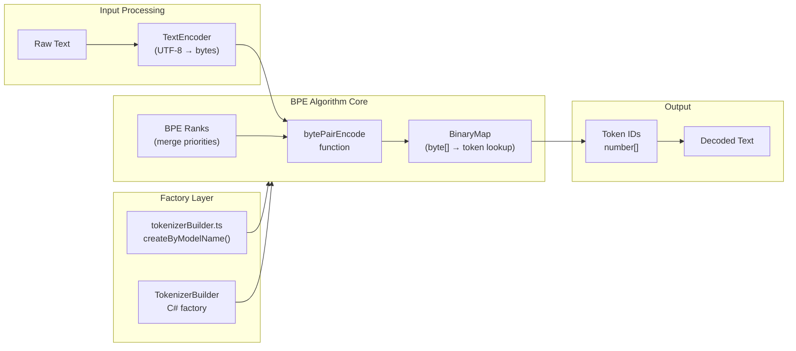
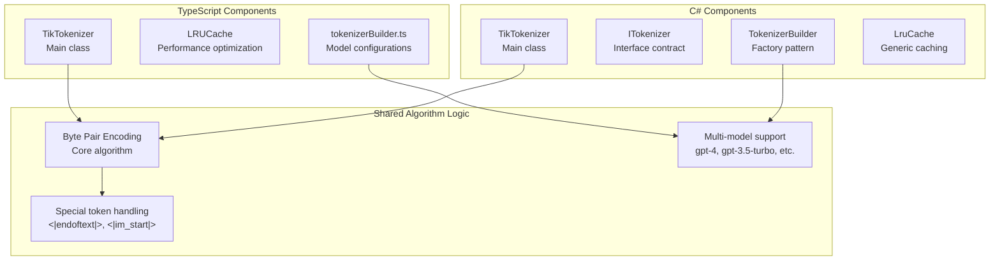

<!-- source: DeepWiki mcp.deepwiki.com · repo microsoft/Tokenizer · page 1 Overview · fetched 2026-10-26 -->

# Overview

<details>
<summary>Relevant source files</summary>

The following files were used as context for generating this wiki page:

- [CONTRIBUTING.md](CONTRIBUTING.md)
- [README.md](README.md)
- [SUPPORT.md](SUPPORT.md)
- [tokenizer_ts/README.md](tokenizer_ts/README.md)

</details>


## Purpose and Scope

This document provides a comprehensive overview of the Microsoft Tokenizer repository, which contains dual-language implementations of Byte Pair Encoding (BPE) tokenization for OpenAI large language models. The repository provides both TypeScript and C# implementations that enable prompt tokenization in Node.js, web browser, and .NET environments before feeding prompts into LLMs.

For detailed implementation specifics, see the [TypeScript Implementation](#3) and [C# Implementation](#4) sections. For quick setup instructions, see [Getting Started](#2). For advanced technical details about the BPE algorithm, see [BPE Algorithm Deep Dive](#7.1).

## Repository Architecture

The Microsoft Tokenizer repository implements a dual-language approach to BPE tokenization, providing equivalent functionality across TypeScript and C# ecosystems. Both implementations are based on the open-sourced Rust implementation from [OpenAI tiktoken](https://github.com/openai/tiktoken).

```mermaid
graph TB
    subgraph REPO["Microsoft Tokenizer Repository"]
        subgraph TS_IMPL["TypeScript Implementation"]
            TS_PKG["@microsoft/tiktokenizer"]
            TS_SRC["tokenizer_ts/"]
        end
        
        subgraph CS_IMPL["C# Implementation"] 
            CS_PKG["Microsoft.DeepDev.TokenizerLib"]
            CS_SRC["Tokenizer_C#/"]
            CS_NOTICE["Migration Notice:<br/>→ Microsoft.ML.Tokenizers"]
        end
        
        subgraph SHARED["Shared Resources"]
            README["README.md"]
            CONTRIB["CONTRIBUTING.md"]
            BPE_MODELS["BPE Model Files<br/>*.tiktoken"]
        end
    end
    
    subgraph EXTERNAL["External Systems"]
        OPENAI_TIKTOKEN["OpenAI tiktoken<br/>(Rust implementation)"]
        OPENAI_MODELS["OpenAI Models<br/>gpt-4, gpt-3.5-turbo, etc."]
        NPM_REG["npm Registry"]
        NUGET_REG["NuGet Registry"]
    end
    
    TS_PKG --> NPM_REG
    CS_PKG --> NUGET_REG
    
    TS_IMPL -.->|"Based on"| OPENAI_TIKTOKEN
    CS_IMPL -.->|"Based on"| OPENAI_TIKTOKEN
    
    TS_PKG --> OPENAI_MODELS
    CS_PKG --> OPENAI_MODELS
    
    CS_NOTICE -.->|"Migrate to"| NUGET_REG
```

**Repository Structure Overview**
Sources: [README.md:1-25](), [tokenizer_ts/README.md:1-8](), [CONTRIBUTING.md:10-26]()

## Core Functionality

Both implementations provide equivalent BPE tokenization capabilities with the following core features:

| Feature | TypeScript API | C# API | Description |
|---------|----------------|--------|-------------|
| Model Creation | `createByModelName()` | `TokenizerBuilder` | Factory pattern for creating tokenizers |
| Text Encoding | `tokenizer.encode()` | `tikTokenizer.Encode()` | Convert text to token IDs |
| Text Decoding | `tokenizer.decode()` | `tikTokenizer.Decode()` | Convert token IDs back to text |
| Trim Operations | `encodeTrimSuffix()`, `encodeTrimPrefix()` | Similar methods | Encode with length constraints |
| Special Tokens | `specialTokens` parameter | Special token handling | Support for model-specific tokens |

The implementations support multiple OpenAI model families including `gpt-4`, `gpt-3.5-turbo`, and other models through configurable BPE rank files.

Sources: [tokenizer_ts/README.md:15-43](), [README.md:3-11]()

## Implementation Architecture

### Core BPE Algorithm Flow



### Language-Specific Components



Sources: [README.md:3](), [tokenizer_ts/README.md:45]()

## Key Components and Usage Contexts

### TypeScript Implementation (`@microsoft/tiktokenizer`)

The TypeScript implementation targets Node.js and browser environments, providing:

- **Package**: Distributed via npm as `@microsoft/tiktokenizer`
- **Main API**: `createByModelName()` factory function from `tokenizerBuilder.ts`
- **Core Class**: `TikTokenizer` with methods like `encode()`, `decode()`, `encodeTrimSuffix()`
- **Environment**: Node.js ≥18.0.0 and modern browsers
- **Use Cases**: Web applications, Node.js services, client-side tokenization

Sources: [tokenizer_ts/README.md:8-13](), [tokenizer_ts/README.md:15-26]()

### C# Implementation (`Microsoft.DeepDev.TokenizerLib`)

The C# implementation targets .NET environments with:

- **Package**: Distributed via NuGet as `Microsoft.DeepDev.TokenizerLib`
- **Main API**: `TokenizerBuilder` factory and `ITokenizer` interface
- **Core Class**: `TikTokenizer` implementing `ITokenizer`
- **Framework**: .NET Standard 2.0 compatibility
- **Use Cases**: .NET applications, services, and libraries

**Important Migration Notice**: Users should migrate to `Microsoft.ML.Tokenizers` as this library is being consolidated into the official .NET ML tokenizer library, with improved performance expected alongside .NET 9.0 release.

Sources: [README.md:11-12]()

## Development and Distribution

The repository maintains separate build and distribution pipelines:

| Aspect | TypeScript | C# |
|--------|------------|-----|
| **Build System** | npm scripts | MSBuild (.csproj) |
| **CI/CD** | GitHub Actions | Azure Pipelines |
| **Testing** | `npm run test` | `dotnet test` |
| **Distribution** | npmjs.org | NuGet.org |
| **Code Style** | ESLint + Prettier | Microsoft C# Conventions |

Both implementations follow the same contributing guidelines defined in [CONTRIBUTING.md:1-76]() and maintain equivalent functionality despite different language ecosystems.

Sources: [CONTRIBUTING.md:8-44](), [README.md:14-16]()

---

