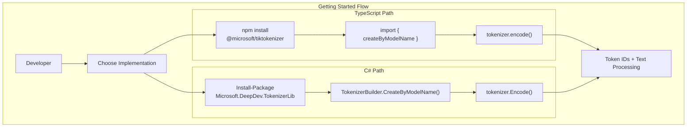
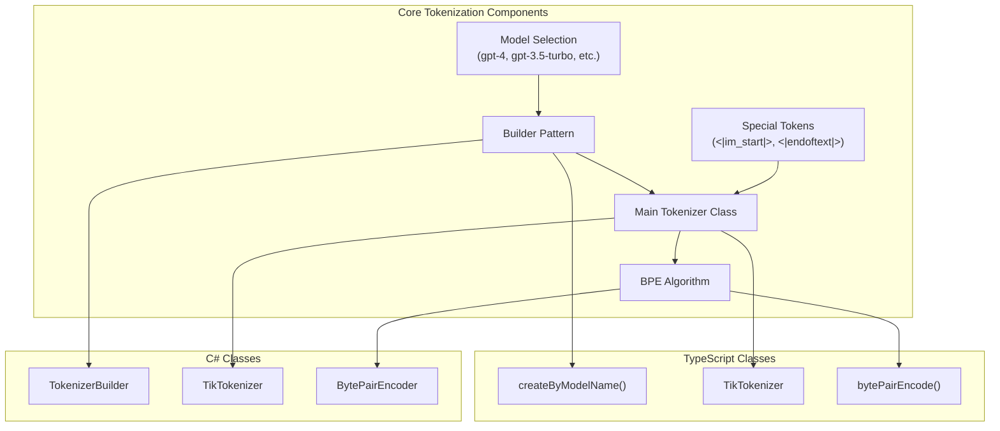

<!-- source: DeepWiki mcp.deepwiki.com · repo microsoft/Tokenizer · page 2 Getting Started · fetched 2026-10-26 -->

# Getting Started

<details>
<summary>Relevant source files</summary>

The following files were used as context for generating this wiki page:

- [README.md](README.md)
- [SUPPORT.md](SUPPORT.md)
- [Tokenizer_C#/TokenizerLib/TokenizerLib.csproj](Tokenizer_C#/TokenizerLib/TokenizerLib.csproj)
- [tokenizer_ts/README.md](tokenizer_ts/README.md)
- [tokenizer_ts/package.json](tokenizer_ts/package.json)

</details>


This document provides a quick start guide for using the Microsoft Tokenizer repository, which offers byte pair encoding (BPE) tokenization for OpenAI large language models in both TypeScript and C#. You'll learn how to install, configure, and perform basic tokenization operations in both environments.

For detailed API documentation, see [TypeScript Implementation](#3) and [C# Implementation](#4). For performance optimization techniques, see [Performance and Benchmarking](#5).

## Overview

The Microsoft Tokenizer repository provides two parallel implementations of OpenAI's tiktoken BPE algorithm:



Sources: [README.md:1-25](), [tokenizer_ts/README.md:1-50]()

## TypeScript Quick Start

### Prerequisites

- Node.js 18.0.0 or higher
- npm or yarn package manager

### Installation

Install the npm package:

```bash
npm install @microsoft/tiktokenizer
```

### Basic Usage

```typescript
import { createByModelName } from '@microsoft/tiktokenizer';

// Define special tokens if needed
const IM_START = "<|im_start|>";
const IM_END = "<|im_end|>";
const specialTokens = new Map([
  [IM_START, 100264],
  [IM_END, 100265],
]);

// Create tokenizer and encode text
const main = async () => {
  const tokenizer = await createByModelName("gpt-3.5-turbo", specialTokens);
  const text = "<|im_start|>Hello World<|im_end|>";
  
  // Basic encoding
  const tokens = tokenizer.encode(text, Array.from(specialTokens.keys()));
  console.log("Tokens:", tokens);
  
  // Encoding with suffix trimming
  const trimmed = tokenizer.encodeTrimSuffix(text, 3, Array.from(specialTokens.keys()));
  console.log("Trimmed tokens:", trimmed.tokenIds);
  console.log("Trimmed text:", trimmed.text);
};

main();
```

Sources: [tokenizer_ts/README.md:15-43](), [tokenizer_ts/package.json:18-21]()

## C# Quick Start

> **Important Migration Notice**: Users of `Microsoft.DeepDev.TokenizerLib` should migrate to `Microsoft.ML.Tokenizers`, which will be the central tokenizer library for .NET going forward with improved performance.

### Prerequisites

- .NET Standard 2.0 or higher
- NuGet package manager

### Installation

Install the NuGet package:

```bash
Install-Package Microsoft.DeepDev.TokenizerLib
```

Or via .NET CLI:

```bash
dotnet add package Microsoft.DeepDev.TokenizerLib
```

### Basic Usage

```csharp
using Microsoft.DeepDev.TokenizerLib;

// Create tokenizer for specific model
var tokenizer = await TokenizerBuilder.CreateByModelNameAsync("gpt-3.5-turbo");

// Encode text to tokens
string text = "Hello World";
var tokens = tokenizer.Encode(text, Array.Empty<string>());
Console.WriteLine($"Tokens: [{string.Join(", ", tokens)}]");

// Decode tokens back to text
var decodedText = tokenizer.Decode(tokens);
Console.WriteLine($"Decoded: {decodedText}");
```

Sources: [README.md:9-13](), [Tokenizer_C#/TokenizerLib/TokenizerLib.csproj:4-28]()

## Core Concepts

Understanding these key components will help you work effectively with both implementations:



### Model Support

Both implementations support the same OpenAI models:

| Model | Description | Typical Use Case |
|-------|-------------|------------------|
| `gpt-4` | GPT-4 base model | Advanced reasoning tasks |
| `gpt-3.5-turbo` | ChatGPT model | Conversational AI |
| `text-davinci-003` | Legacy completion model | Text completion |
| `text-embedding-ada-002` | Embedding model | Semantic search |

### Special Tokens

Special tokens are model-specific markers that have special meaning:

- `<|endoftext|>` - End of document marker
- `<|im_start|>` - Start of message (chat models)
- `<|im_end|>` - End of message (chat models)
- `<|fim_prefix|>` - Fill-in-middle prefix

Sources: [tokenizer_ts/README.md:21-26](), [tokenizer_ts/README.md:44-45]()

## Common Operations

### Encoding Text

Both implementations provide similar encoding methods:

| Operation | TypeScript | C# | Purpose |
|-----------|------------|----|---------| 
| Basic encoding | `encode(text, allowedSpecial)` | `Encode(text, allowedSpecial)` | Convert text to token IDs |
| Trim suffix | `encodeTrimSuffix(text, maxTokens, allowedSpecial)` | N/A | Encode with suffix trimming |
| Trim prefix | `encodeTrimPrefix(text, maxTokens, allowedSpecial)` | N/A | Encode with prefix trimming |

### Decoding Tokens

Convert token IDs back to readable text:

- **TypeScript**: `decode(tokens)`
- **C#**: `Decode(tokens)`

Sources: [tokenizer_ts/README.md:32-39]()

## Performance Considerations

For production usage:

1. **Pre-download BPE files**: Avoid downloading model files on-the-fly by caching them locally
2. **Reuse tokenizer instances**: Create tokenizers once and reuse them across requests
3. **Handle large texts**: Use trimming methods for texts exceeding token limits

For detailed performance optimization strategies, see [Performance and Benchmarking](#5).

## Next Steps

- **TypeScript developers**: See [TypeScript Implementation](#3) for comprehensive API documentation
- **C# developers**: See [C# Implementation](#4) for detailed .NET integration
- **Advanced usage**: Explore [Advanced Topics](#7) for BPE algorithm internals
- **Contributing**: Follow [Development and Contributing](#6) guidelines

Sources: [README.md:1-25](), [tokenizer_ts/README.md:47-49]()

---

