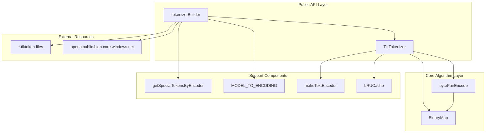
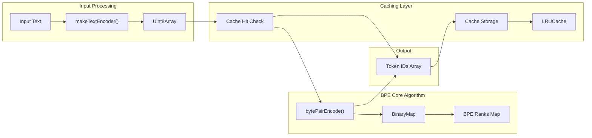

<!-- source: DeepWiki mcp.deepwiki.com · repo microsoft/Tokenizer · page 3 TypeScript Implementation · fetched 2026-10-26 -->

# TypeScript Implementation

<details>
<summary>Relevant source files</summary>

The following files were used as context for generating this wiki page:

- [tokenizer_ts/package.json](tokenizer_ts/package.json)
- [tokenizer_ts/src/tikTokenizer.ts](tokenizer_ts/src/tikTokenizer.ts)
- [tokenizer_ts/src/tokenizerBuilder.ts](tokenizer_ts/src/tokenizerBuilder.ts)

</details>


This document covers the TypeScript implementation of the Microsoft Tokenizer library, distributed as the `@microsoft/tiktokenizer` npm package. This implementation provides Byte Pair Encoding (BPE) tokenization for OpenAI large language models in Node.js and browser environments.

The TypeScript implementation focuses on performance optimization through caching and efficient data structures, while maintaining compatibility with OpenAI's tiktoken library. For information about the C# implementation, see [C# Implementation](#4). For performance analysis and benchmarking, see [Performance and Benchmarking](#5).

## Package Overview

The `@microsoft/tiktokenizer` package is distributed via npm and provides a complete TypeScript implementation of BPE tokenization. The package supports Node.js environments version 18.0.0 and higher, with browser compatibility through deferred module loading.

| Property | Value |
|----------|-------|
| Package Name | `@microsoft/tiktokenizer` |
| Current Version | 1.0.10 |
| License | MIT |
| Node.js Requirement | ≥18.0.0 |
| Main Entry Point | `dist/index.js` |

Sources: [tokenizer_ts/package.json:1-41]()

## Core Architecture

The TypeScript implementation follows a layered architecture with clear separation between tokenization logic, model configuration, and performance optimization components.

### System Component Diagram



Sources: [tokenizer_ts/src/tikTokenizer.ts:1-495](), [tokenizer_ts/src/tokenizerBuilder.ts:1-310]()

## TikTokenizer Class

The `TikTokenizer` class is the primary interface for tokenization operations. It encapsulates the BPE algorithm, manages special tokens, and provides caching for performance optimization.

### Core Methods and Properties

```mermaid
graph LR
    subgraph "TikTokenizer Class"
        constructor["constructor()"]
        encode["encode()"]
        decode["decode()"]
        encodeTrimSuffix["encodeTrimSuffix()"]
        encodeTrimPrefix["encodeTrimPrefix()"]
        cache["cache: ILRUCache"]
    end
    
    subgraph "Internal Components"
        encoder["encoder: BinaryMap<number>"]
        decoder["decoder: Map<number, Uint8Array>"]
        regex["regex: RegExp"]
        specialTokensEncoder["specialTokensEncoder: ReadonlyMap<string, number>"]
        textEncoder["textEncoder: TextEncoder"]
        textDecoder["textDecoder: TextDecoder"]
    end
    
    constructor --> encoder
    constructor --> decoder
    constructor --> regex
    constructor --> specialTokensEncoder
    
    encode --> encoder
    encode --> cache
    decode --> decoder
    
    encodeTrimSuffix --> encode
    encodeTrimPrefix --> encode
```

### Constructor Parameters

The `TikTokenizer` constructor accepts the following parameters:

| Parameter | Type | Description |
|-----------|------|-------------|
| `tikTokenBpeFileOrDict` | `string \| Map<Uint8Array, number>` | BPE rank file path or parsed dictionary |
| `specialTokensEncoder` | `ReadonlyMap<string, number>` | Special tokens mapping |
| `regexPattern` | `string` | Regex pattern for text splitting |
| `cacheSize` | `number` | LRU cache size (default: 8192) |

Sources: [tokenizer_ts/src/tikTokenizer.ts:80-89]()

### Encoding Methods

The class provides three main encoding methods:

- **`encode(text: string, allowedSpecial?: ReadonlyArray<string>): number[]`** - Standard encoding with optional special token allowlist
- **`encodeTrimSuffix(text: string, maxTokenCount: number, allowedSpecial: ReadonlyArray<string>)`** - Encoding with suffix trimming to fit token limit
- **`encodeTrimPrefix(text: string, maxTokenCount: number, allowedSpecial?: ReadonlyArray<string>)`** - Encoding with prefix trimming to fit token limit

Sources: [tokenizer_ts/src/tikTokenizer.ts:152-181](), [tokenizer_ts/src/tikTokenizer.ts:300-361](), [tokenizer_ts/src/tikTokenizer.ts:370-468]()

## Model Support and Builder Pattern

The `tokenizerBuilder` module provides factory functions for creating tokenizers configured for specific OpenAI models. It manages model-to-encoding mappings and automatically downloads required BPE files.

### Model Configuration System

```mermaid
graph TB
    subgraph "Model Name Resolution"
        modelName["Model Name Input"]
        MODEL_TO_ENCODING["MODEL_TO_ENCODING Map"]
        MODEL_PREFIX_TO_ENCODING["MODEL_PREFIX_TO_ENCODING Map"]
        getEncoderFromModelName["getEncoderFromModelName()"]
    end
    
    subgraph "Encoder Configuration"
        encoderName["Encoder Name"]
        getSpecialTokensByEncoder["getSpecialTokensByEncoder()"]
        getRegexByEncoder["getRegexByEncoder()"]
        specialTokens["Special Tokens Map"]
        regexPattern["Regex Pattern"]
    end
    
    subgraph "File Management"
        mergeableRanksFileUrl["BPE File URL"]
        fetchAndSaveFile["fetchAndSaveFile()"]
        localFile["Local .tiktoken File"]
    end
    
    subgraph "Tokenizer Creation"
        createTokenizer["createTokenizer()"]
        TikTokenizer["TikTokenizer Instance"]
    end
    
    modelName --> getEncoderFromModelName
    MODEL_TO_ENCODING --> getEncoderFromModelName
    MODEL_PREFIX_TO_ENCODING --> getEncoderFromModelName
    getEncoderFromModelName --> encoderName
    
    encoderName --> getSpecialTokensByEncoder
    encoderName --> getRegexByEncoder
    getSpecialTokensByEncoder --> specialTokens
    getRegexByEncoder --> regexPattern
    
    encoderName --> mergeableRanksFileUrl
    mergeableRanksFileUrl --> fetchAndSaveFile
    fetchAndSaveFile --> localFile
    
    localFile --> createTokenizer
    specialTokens --> createTokenizer
    regexPattern --> createTokenizer
    createTokenizer --> TikTokenizer
```



### Supported Models and Encodings

The implementation supports the following model categories and their corresponding encodings:

| Model Category | Example Models | Encoding | Regex Pattern |
|----------------|----------------|----------|---------------|
| GPT-4o | `gpt-4o`, `gpt-4o-2024-05-13` | `o200k_base` | `REGEX_PATTERN_3` |
| GPT-4 | `gpt-4`, `gpt-4-0314` | `cl100k_base` | `REGEX_PATTERN_2` |
| GPT-3.5 Turbo | `gpt-3.5-turbo`, `gpt-35-turbo` | `cl100k_base` | `REGEX_PATTERN_2` |
| Text Models | `text-davinci-003`, `text-davinci-002` | `p50k_base` | `REGEX_PATTERN_1` |
| Code Models | `code-davinci-002`, `davinci-codex` | `p50k_base` | `REGEX_PATTERN_1` |
| Legacy Models | `davinci`, `curie`, `babbage`, `ada` | `r50k_base` | `REGEX_PATTERN_1` |

Sources: [tokenizer_ts/src/tokenizerBuilder.ts:14-55](), [tokenizer_ts/src/tokenizerBuilder.ts:6-12]()

### Special Tokens by Encoding

Different encodings support different sets of special tokens:

| Encoding | Special Tokens | Token IDs |
|----------|----------------|-----------|
| `o200k_base` | `<\|endoftext\|>`, `<\|endofprompt\|>` | 199999, 200018 |
| `cl100k_base` | `<\|endoftext\|>`, `<\|fim_prefix\|>`, `<\|fim_middle\|>`, `<\|fim_suffix\|>`, `<\|endofprompt\|>` | 100257, 100258, 100259, 100260, 100276 |
| `p50k_edit` | `<\|endoftext\|>`, `<\|fim_prefix\|>`, `<\|fim_middle\|>`, `<\|fim_suffix\|>` | 50256, 50281, 50282, 50283 |
| Default | `<\|endoftext\|>` | 50256 |

Sources: [tokenizer_ts/src/tokenizerBuilder.ts:128-160]()

## Factory Functions

The builder module provides two main factory functions:

### `createByModelName(modelName: string, extraSpecialTokens?: ReadonlyMap<string, number>): Promise<TikTokenizer>`

Creates a tokenizer instance from an OpenAI model name. Automatically resolves the appropriate encoding and downloads required files.

### `createByEncoderName(encoderName: string, extraSpecialTokens?: ReadonlyMap<string, number>): Promise<TikTokenizer>`

Creates a tokenizer instance from an encoding name directly. Provides more granular control over the tokenizer configuration.

Sources: [tokenizer_ts/src/tokenizerBuilder.ts:210-218](), [tokenizer_ts/src/tokenizerBuilder.ts:226-286]()

## BPE Algorithm Implementation

The core BPE algorithm is implemented through the `bytePairEncode` function and `BinaryMap` class, which provide efficient byte-level tokenization with optimized lookups.

### Data Flow Architecture



The algorithm follows these key steps:
1. Text input is converted to UTF-8 bytes using `makeTextEncoder()`
2. Cache is checked for previously computed results
3. On cache miss, `bytePairEncode()` processes the byte array using `BinaryMap` for efficient lookups
4. Results are cached for future use

Sources: [tokenizer_ts/src/tikTokenizer.ts:4-6](), [tokenizer_ts/src/tikTokenizer.ts:192-223]()

## Performance Optimization

The TypeScript implementation includes several performance optimizations:

### LRU Caching
- **Cache Size**: Default 8192 entries, configurable per tokenizer instance
- **Cache Key**: Raw text pieces from regex splitting
- **Cache Value**: Pre-computed token ID arrays
- **Implementation**: Custom `LRUCache` class with `ILRUCache` interface

### Efficient Data Structures
- **`BinaryMap<T>`**: Optimized byte array to value mapping
- **`ReadonlyMap<K, V>`**: Immutable mappings for model configurations
- **`Uint8Array`**: Native byte array handling for UTF-8 encoding

### Regex Optimization
Three different regex patterns are used based on model requirements:
- **`REGEX_PATTERN_1`**: Legacy pattern for older models
- **`REGEX_PATTERN_2`**: Pattern for GPT-3.5-turbo and GPT-4
- **`REGEX_PATTERN_3`**: Advanced pattern for GPT-4o with improved Unicode handling

Sources: [tokenizer_ts/src/tikTokenizer.ts:69](), [tokenizer_ts/src/tokenizerBuilder.ts:66-89]()

## Build and Distribution

The TypeScript implementation uses a standard Node.js build pipeline with TypeScript compilation and npm distribution.

### Build Configuration
- **TypeScript Compiler**: Configured via `tsconfig.json`
- **Build Command**: `tsc -p ./tsconfig.json`
- **Output Directory**: `dist/`
- **Entry Point**: `dist/index.js`

### Development Dependencies
The package includes comprehensive development tooling:
- **Testing**: Mocha with TypeScript support via ts-node
- **Linting**: ESLint with TypeScript parser and Prettier integration
- **Type Checking**: TypeScript definitions for Node.js and Mocha

### NPM Scripts
| Script | Command | Purpose |
|--------|---------|---------|
| `build` | `tsc -p ./tsconfig.json` | Compile TypeScript to JavaScript |
| `test` | `mocha -u tdd --require ts-node/register test/**/*.ts` | Run test suite |
| `watch` | `tsc -p ./tsconfig.json --watch` | Watch mode compilation |
| `eslint` | `eslint src --ext ts` | Lint TypeScript files |
| `format` | `prettier --write "./**/*.{ts,tsx}"` | Format code |

Sources: [tokenizer_ts/package.json:22-40]()

---

