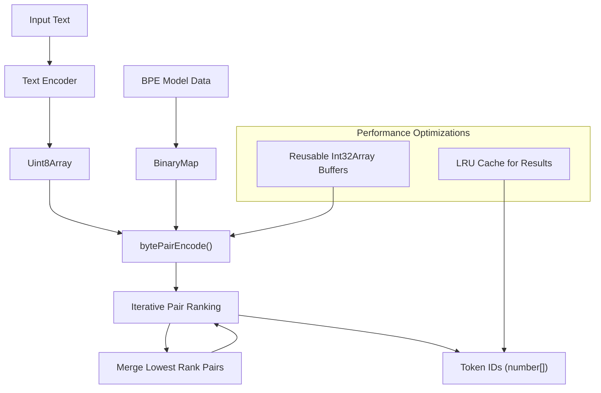
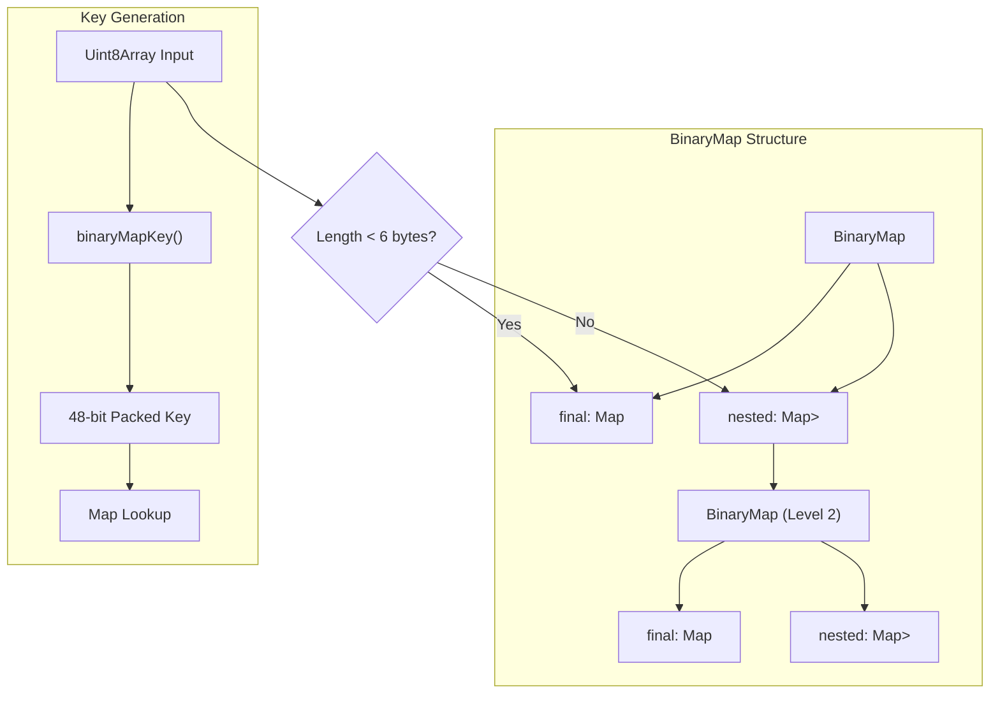
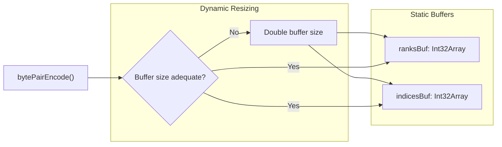
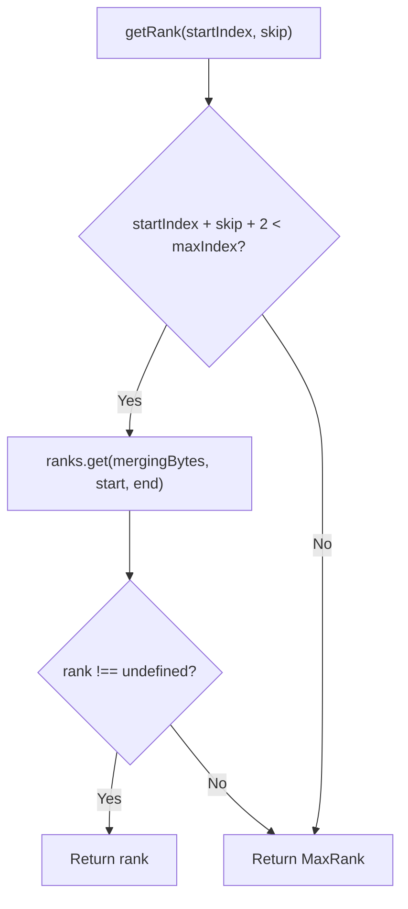

<!-- source: DeepWiki mcp.deepwiki.com · repo microsoft/Tokenizer · page 3.2 BPE Algorithm Implementation · fetched 2026-10-26 -->

# BPE Algorithm Implementation

Relevant source files

The following files were used as context for generating this wiki page:

- [tokenizer_ts/src/bytePairEncode.ts](tokenizer_ts/src/bytePairEncode.ts)
- [tokenizer_ts/src/lru.ts](tokenizer_ts/src/lru.ts)
- [tokenizer_ts/src/textEncoder.ts](tokenizer_ts/src/textEncoder.ts)
- [tokenizer_ts/test/binaryMap.test.ts](tokenizer_ts/test/binaryMap.test.ts)
- [tokenizer_ts/test/lru.test.ts](tokenizer_ts/test/lru.test.ts)

This document covers the TypeScript implementation of the Byte Pair Encoding (BPE) algorithm and its supporting data structures within the `@microsoft/tiktokenizer` package. The BPE algorithm is the core tokenization mechanism that iteratively merges the most frequent byte pairs based on learned merge rules.

For information about the C# BPE implementation, see [4.2](#4.2). For details about model loading and builder patterns, see [3.3](#3.3).

## Core Algorithm Overview

The BPE algorithm implementation consists of three primary components that work together to efficiently tokenize text:

**Core BPE Algorithm Process**
Sources: [tokenizer_ts/src/bytePairEncode.ts:75-159]()

The `bytePairEncode` function implements the standard BPE merging process:

1. **Initialization**: Sets up reusable buffers (`ranksBuf`, `indicesBuf`) and finds the initial minimum rank pair
2. **Iterative Merging**: Repeatedly finds the lowest-ranked byte pair and merges it
3. **Rank Updates**: Updates ranks for affected adjacent pairs after each merge
4. **Output Generation**: Converts the final merged segments into token IDs

## BinaryMap Data Structure

The `BinaryMap<V>` class provides efficient storage and retrieval of byte sequences to values (typically rank numbers). It uses a hierarchical approach to handle variable-length byte sequences:

**BinaryMap Key Encoding**
Sources: [tokenizer_ts/src/bytePairEncode.ts:14-31]()

The `binaryMapKey` function packs up to 6 bytes into a single 48-bit number for efficient map lookups:

| Byte Position | Bit Range | Purpose |
|---------------|-----------|---------|
| 0-2 | 0-23 | Lower 24 bits |
| 3-5 | 24-47 | Upper 24 bits |

The key generation uses bitwise operations and masking to handle variable-length sequences efficiently, supporting the hierarchical storage model.

## Algorithm Implementation Details

### Buffer Management and Performance

**Buffer Reuse Strategy**
Sources: [tokenizer_ts/src/bytePairEncode.ts:66-67](), [tokenizer_ts/src/bytePairEncode.ts:86-89]()

The implementation uses module-level static buffers (`ranksBuf`, `indicesBuf`) that grow as needed but are reused across tokenization calls. This avoids repeated memory allocation for better performance.

### Rank Calculation and Merging

The core merging loop follows this process:

1. **Find Minimum Rank**: Scan all adjacent pairs to find the lowest rank
2. **Update Adjacent Ranks**: Recalculate ranks for pairs affected by the merge
3. **Remove Merged Index**: Splice out the merged byte from the index array
4. **Repeat**: Continue until no more valid merges exist

Sources: [tokenizer_ts/src/bytePairEncode.ts:91-106](), [tokenizer_ts/src/bytePairEncode.ts:123-146]()

### Helper Functions

The `getRank` nested function handles rank lookups with bounds checking and skip logic for non-contiguous byte sequences:

Sources: [tokenizer_ts/src/bytePairEncode.ts:109-121]()

## Supporting Components

### LRU Cache Integration

While not directly part of the BPE algorithm, the `LRUCache` class provides performance optimization by caching tokenization results:

| Component | Purpose | Key Features |
|-----------|---------|--------------|
| `LRUCache<T>` | Result caching | O(1) operations, configurable size |
| `ILRUCache` | Interface contract | Standardized cache operations |

Sources: [tokenizer_ts/src/lru.ts:13-77]()

### Text Encoding Support

The text encoding abstraction provides cross-platform UTF-8 encoding:

| Implementation | Environment | Optimization |
|----------------|-------------|--------------|
| `NodeTextEncoder` | Node.js | Reusable Buffer allocation |
| `UniversalTextEncoder` | Browser/Universal | Standard TextEncoder API |

Sources: [tokenizer_ts/src/textEncoder.ts:22-56]()

## Constants and Configuration

The algorithm uses several important constants:

| Constant | Value | Purpose |
|----------|-------|---------|
| `BytesPerLevel` | 6 | Bytes per BinaryMap level |
| `MaxRank` | 0x7FFFFFFF | Maximum rank value (2^31 - 1) |

Sources: [tokenizer_ts/src/bytePairEncode.ts:4-11]()

These constants ensure the algorithm operates within safe integer bounds while maximizing the efficiency of the hierarchical data structure.

---

