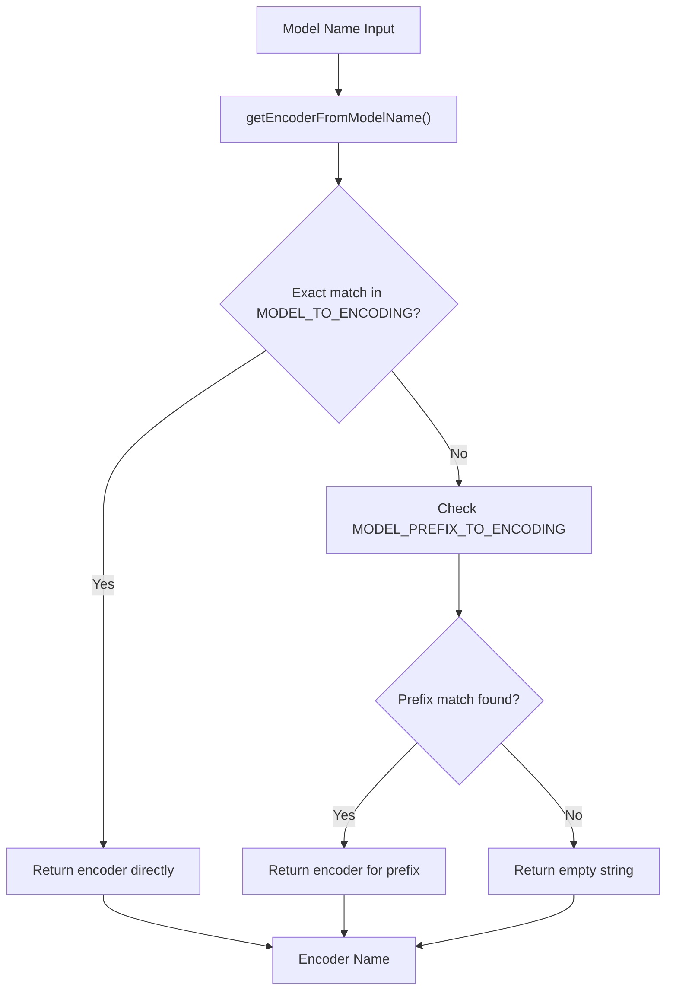
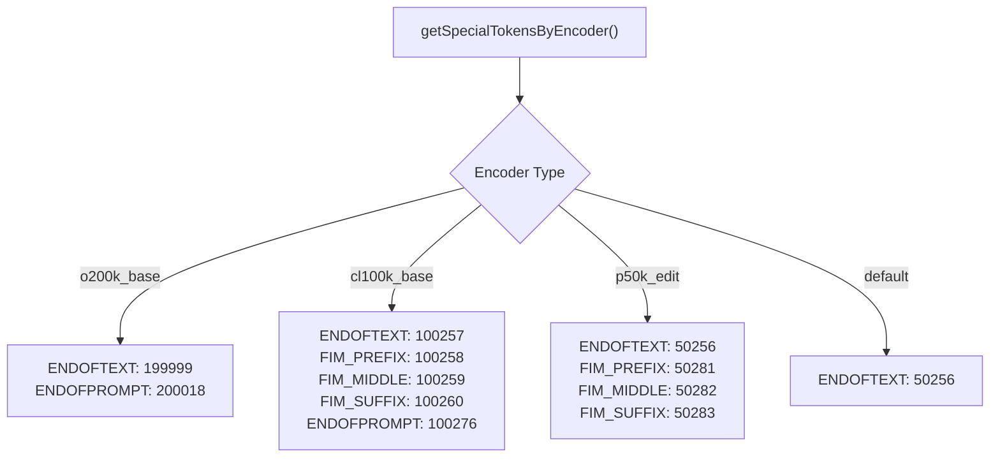
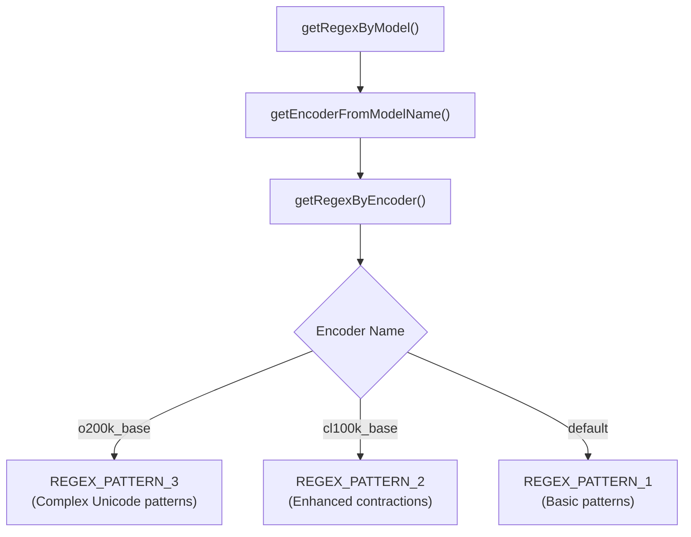
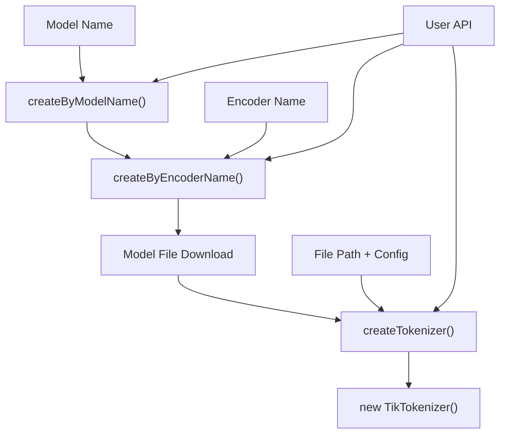
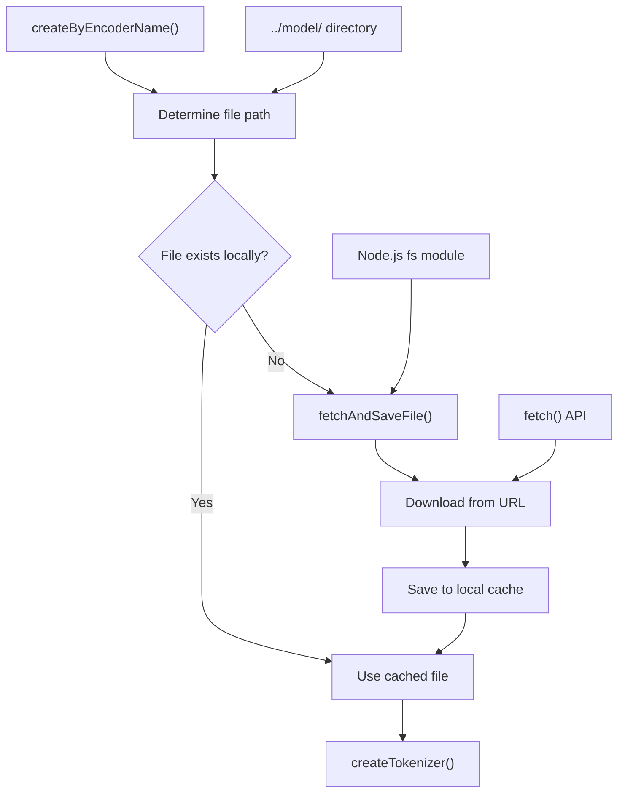
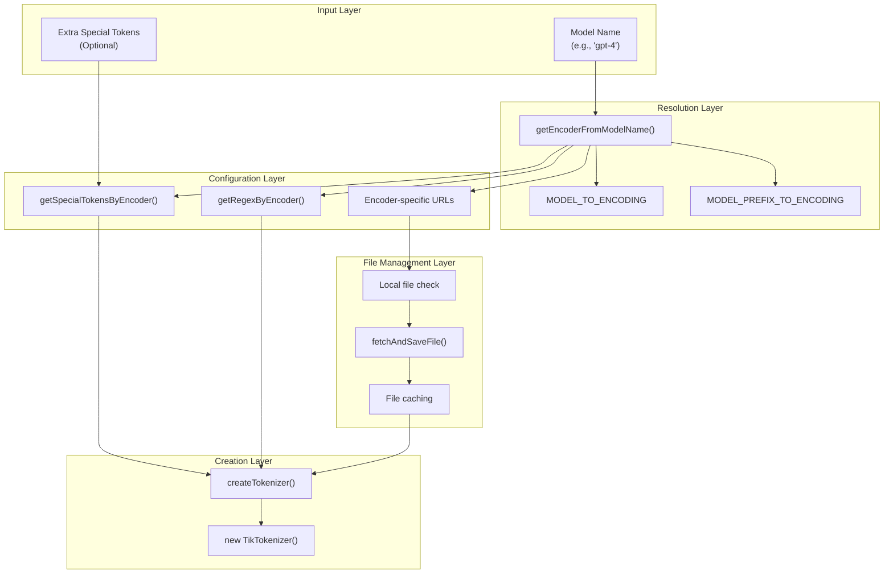

<!-- source: DeepWiki mcp.deepwiki.com · repo microsoft/Tokenizer · page 3.3 Model Support and Builder · fetched 2026-10-26 -->

# Model Support and Builder

<details>
<summary>Relevant source files</summary>

The following files were used as context for generating this wiki page:

- [model/gpt2.tiktoken](model/gpt2.tiktoken)
- [tokenizer_ts/src/tokenizerBuilder.ts](tokenizer_ts/src/tokenizerBuilder.ts)

</details>


## Purpose and Scope

This page documents the TypeScript tokenizer builder system, which provides a factory interface for creating `TikTokenizer` instances configured for specific OpenAI models. The builder handles model-to-encoder mappings, special token configurations, regex patterns, and automatic downloading of BPE model files from remote sources.

For information about the core tokenizer API, see [Core API](#3.1). For details about the underlying BPE algorithm implementation, see [BPE Algorithm Implementation](#3.2).

## Model to Encoder Mapping System

The tokenizer builder maintains comprehensive mappings between OpenAI model names and their corresponding encoders through two primary data structures:

### Direct Model Mappings

The `MODEL_TO_ENCODING` map provides exact model name to encoder mappings for supported models:

| Model Category | Models | Encoder |
|----------------|--------|---------|
| Chat Models | `gpt-4o`, `gpt-4`, `gpt-3.5-turbo` | `o200k_base`, `cl100k_base`, `cl100k_base` |
| Text Models | `text-davinci-003`, `text-davinci-002`, `text-davinci-001` | `p50k_base`, `p50k_base`, `r50k_base` |
| Code Models | `code-davinci-002`, `davinci-codex`, `cushman-codex` | `p50k_base`, `p50k_base`, `p50k_base` |
| Embedding Models | `text-embedding-ada-002` | `cl100k_base` |
| Legacy Models | `davinci`, `curie`, `babbage`, `ada` | `r50k_base` |

### Prefix-Based Model Matching

The `MODEL_PREFIX_TO_ENCODING` map handles versioned models and Azure deployment names:

| Prefix Pattern | Encoder | Example Matches |
|----------------|---------|-----------------|
| `gpt-4o-` | `o200k_base` | `gpt-4o-2024-05-13` |
| `gpt-4-` | `cl100k_base` | `gpt-4-0314`, `gpt-4-32k` |
| `gpt-3.5-turbo-` | `cl100k_base` | `gpt-3.5-turbo-0301` |
| `gpt-35-turbo-` | `cl100k_base` | Azure deployment names |

### Model Name Resolution Flow



**Sources:** [tokenizer_ts/src/tokenizerBuilder.ts:91-104]()

## Special Token Management

The builder system manages special tokens that are model-specific and used for various purposes like marking text boundaries and enabling features like fill-in-the-middle (FIM) functionality.

### Special Token Types

| Token | Purpose | Models |
|-------|---------|--------|
| `<\|endoftext\|>` | Text boundary marker | All models |
| `<\|fim_prefix\|>` | Fill-in-the-middle prefix | Code models |
| `<\|fim_middle\|>` | Fill-in-the-middle middle | Code models |
| `<\|fim_suffix\|>` | Fill-in-the-middle suffix | Code models |
| `<\|endofprompt\|>` | Prompt boundary marker | Chat models |

### Encoder-Specific Token Configurations



The `getSpecialTokensByEncoder` function returns encoder-specific special token mappings, while `getSpecialTokensByModel` provides a convenience wrapper that resolves the model name to encoder first.

**Sources:** [tokenizer_ts/src/tokenizerBuilder.ts:57-175]()

## Regex Pattern Management

Different encoders use different regex patterns for text preprocessing before tokenization. The system maintains three distinct patterns:

### Pattern Definitions

| Pattern | Usage | Encoder |
|---------|-------|---------|
| `REGEX_PATTERN_1` | Legacy models | `r50k_base`, `p50k_base`, `gpt2` |
| `REGEX_PATTERN_2` | Modern chat models | `cl100k_base` |
| `REGEX_PATTERN_3` | Latest models | `o200k_base` |

### Pattern Resolution



The regex patterns become progressively more sophisticated, with `REGEX_PATTERN_3` handling complex Unicode categories and various case combinations for contractions.

**Sources:** [tokenizer_ts/src/tokenizerBuilder.ts:66-89](), [tokenizer_ts/src/tokenizerBuilder.ts:182-203]()

## Tokenizer Factory Functions

The builder provides multiple factory functions for creating tokenizer instances with different levels of abstraction:

### Factory Function Hierarchy



### Primary Factory Functions

#### `createByModelName()`
Highest-level factory that takes a model name and optional extra special tokens:

```typescript
createByModelName(modelName: string, extraSpecialTokens?: ReadonlyMap<string, number>)
```

#### `createByEncoderName()`
Mid-level factory that works with encoder names and handles file downloading:

```typescript
createByEncoderName(encoderName: string, extraSpecialTokens?: ReadonlyMap<string, number>)
```

#### `createTokenizer()`
Low-level factory for direct tokenizer creation with all parameters:

```typescript
createTokenizer(
  tikTokenBpeFileOrDict: string | Map<Uint8Array, number>,
  specialTokensEncoder: ReadonlyMap<string, number>,
  regexPattern: string,
  cacheSize: number = 8192
)
```

**Sources:** [tokenizer_ts/src/tokenizerBuilder.ts:210-309]()

## Model File Management

The builder automatically downloads and caches BPE model files from remote sources when they are not locally available.

### File Source Mapping

| Encoder | Source URL |
|---------|------------|
| `o200k_base` | `https://openaipublic.blob.core.windows.net/encodings/o200k_base.tiktoken` |
| `cl100k_base` | `https://openaipublic.blob.core.windows.net/encodings/cl100k_base.tiktoken` |
| `p50k_base` | `https://openaipublic.blob.core.windows.net/encodings/p50k_base.tiktoken` |
| `r50k_base` | `https://openaipublic.blob.core.windows.net/encodings/r50k_base.tiktoken` |
| `gpt2` | `https://raw.githubusercontent.com/microsoft/Tokenizer/main/model/gpt2.tiktoken` |

### File Download and Caching Flow



The system creates a `model/` directory relative to the source file location and downloads files on-demand. Files are cached permanently after the first download.

**Sources:** [tokenizer_ts/src/tokenizerBuilder.ts:106-121](), [tokenizer_ts/src/tokenizerBuilder.ts:269-285]()

## Complete Builder Architecture

The following diagram shows the complete flow from model name to tokenizer instance:



This architecture provides a clean separation between model identification, configuration resolution, file management, and tokenizer instantiation, making it easy to support new models and encoders.

**Sources:** [tokenizer_ts/src/tokenizerBuilder.ts:1-310]()

---

