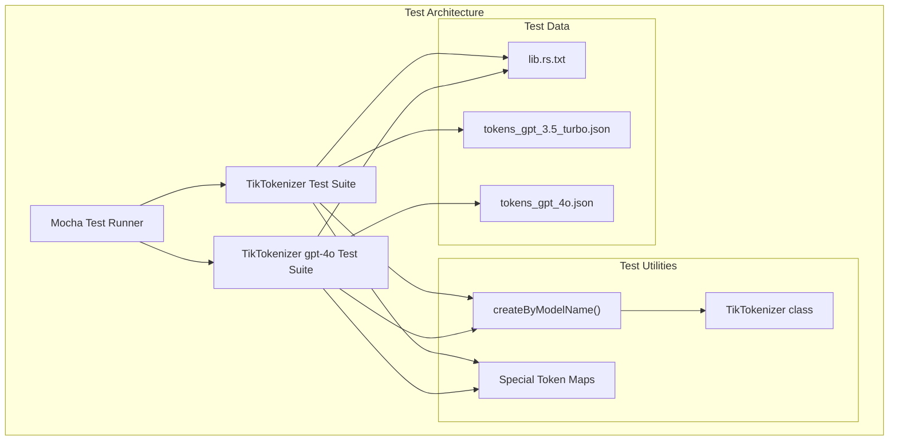
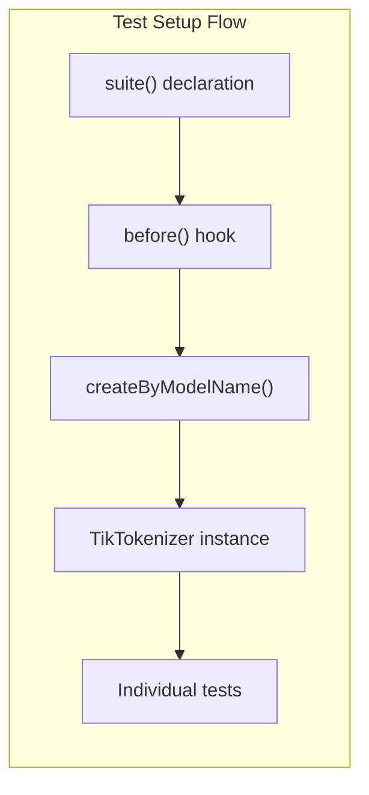
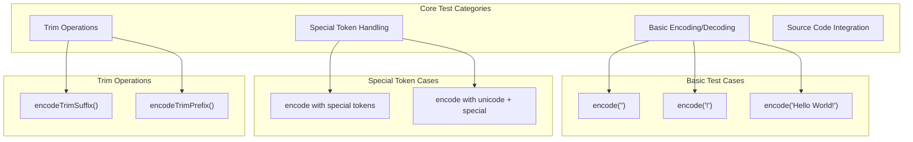
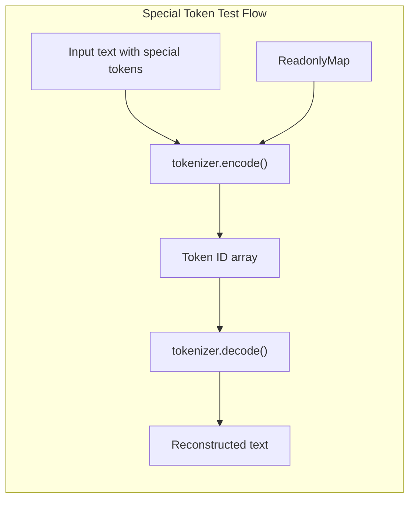
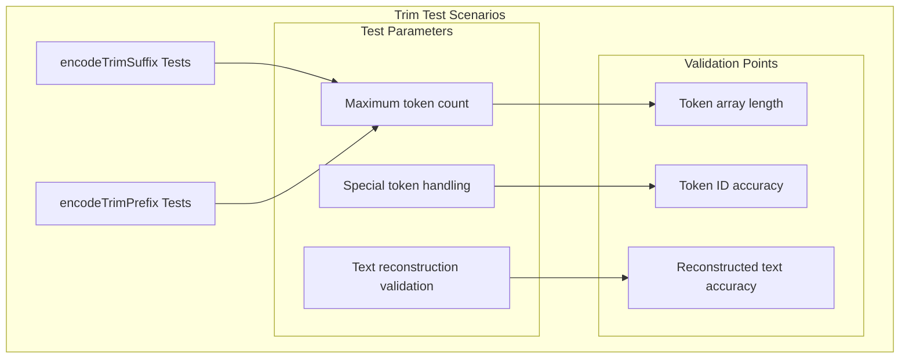
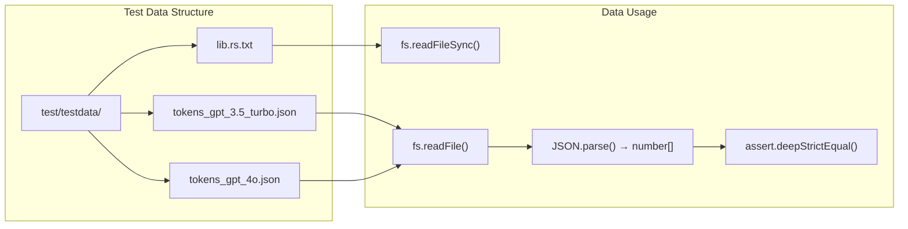
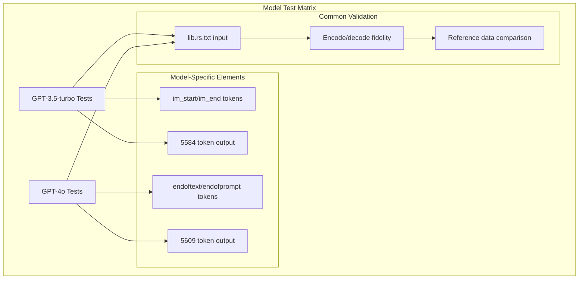
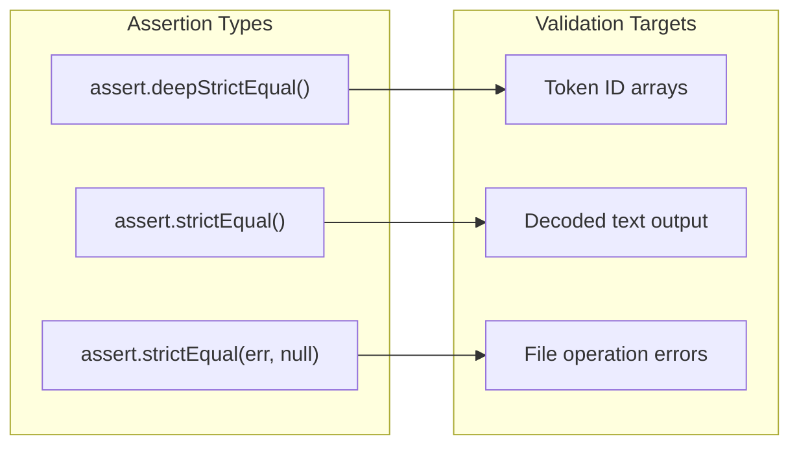

<!-- source: DeepWiki mcp.deepwiki.com · repo microsoft/Tokenizer · page 3.5 Testing · fetched 2026-10-26 -->

# Testing

Relevant source files

The following files were used as context for generating this wiki page:

- [tokenizer_ts/test/testdata/tokens_gpt_4o.json](tokenizer_ts/test/testdata/tokens_gpt_4o.json)
- [tokenizer_ts/test/tikTokenizer.test.ts](tokenizer_ts/test/tikTokenizer.test.ts)
- [tokenizer_ts/test/tikTokenizerGpt4o.test.ts](tokenizer_ts/test/tikTokenizerGpt4o.test.ts)

This page documents the testing approach and test suite for the TypeScript implementation of the Microsoft Tokenizer. The testing focuses on validating the `TikTokenizer` class functionality, model-specific behavior, and integration with various OpenAI models.

For information about the C# testing implementation, see [C# Testing](#4.5). For performance benchmarking and measurement, see [Performance and Benchmarking](#5).

## Test Framework and Structure

The TypeScript implementation uses the Mocha testing framework with Node.js assertions for comprehensive validation of tokenization functionality.

Sources: [tokenizer_ts/test/tikTokenizer.test.ts:1-231](), [tokenizer_ts/test/tikTokenizerGpt4o.test.ts:1-40]()

### Test Suite Configuration

Each test suite follows a consistent pattern using Mocha's `suite` and `before` hooks:

The main test suite initializes with `gpt-3.5-turbo` model and custom special tokens:
- `<|im_start|>` mapped to token ID `100264`
- `<|im_end|>` mapped to token ID `100265` 

The GPT-4o test suite uses different special tokens:
- `<|endoftext|>` mapped to token ID `199999`
- `<|endofprompt|>` mapped to token ID `200018`

Sources: [tokenizer_ts/test/tikTokenizer.test.ts:9-20](), [tokenizer_ts/test/tikTokenizerGpt4o.test.ts:9-20]()

## Core Functionality Tests

The test suite validates fundamental tokenization operations through systematic unit tests.

Sources: [tokenizer_ts/test/tikTokenizer.test.ts:22-139]()

### Basic Encoding Validation

The tests verify correct token ID generation and bidirectional encoding/decoding:

- Empty string produces empty token array `[]`
- Single exclamation mark `"!"` produces token `[0]`
- `"Hello World!"` produces tokens `[9906, 4435, 0]`

Each test validates both encoding and decoding operations to ensure perfect round-trip fidelity.

Sources: [tokenizer_ts/test/tikTokenizer.test.ts:22-41]()

### Special Token Processing

Special token tests validate proper handling of model-specific control tokens within text content:

Test cases include:
- `"<|im_start|>Hello World<|im_end|>"` → `[100264, 9906, 4435, 100265]`
- Special tokens with Unicode characters
- Various positioning of special tokens within text

Sources: [tokenizer_ts/test/tikTokenizer.test.ts:43-62]()

### Trim Operations Testing

The `encodeTrimSuffix` and `encodeTrimPrefix` methods are tested with multiple scenarios to validate token-level text truncation:

Sources: [tokenizer_ts/test/tikTokenizer.test.ts:64-214]()

## Test Data and Fixtures

The test suite uses carefully curated test data to validate tokenization accuracy against expected outputs.

### Source Code Tokenization Tests

Large-scale integration tests validate tokenizer performance on real source code:

- `lib.rs.txt`: Rust source code file used as test input
- GPT-3.5-turbo produces 5584 tokens for the test file
- GPT-4o produces 5609 tokens for the same file

The tests verify:
1. Token count matches expected values
2. Token arrays match pre-computed reference data
3. Decoded output perfectly reconstructs original source

Sources: [tokenizer_ts/test/tikTokenizer.test.ts:216-229](), [tokenizer_ts/test/tikTokenizerGpt4o.test.ts:22-38](), [tokenizer_ts/test/testdata/tokens_gpt_4o.json:1]()

## Model-Specific Test Validation

Different models require distinct validation approaches due to varying tokenization behaviors and special token sets.

### Reference Data Validation

Each model test suite compares tokenization output against JSON reference files containing pre-computed token arrays. This approach ensures:

- Consistent tokenization behavior across code changes
- Detection of regression in tokenization accuracy
- Validation of model-specific tokenization differences

The reference data files contain token ID arrays that serve as the ground truth for tokenization validation.

Sources: [tokenizer_ts/test/tikTokenizer.test.ts:220-228](), [tokenizer_ts/test/tikTokenizerGpt4o.test.ts:26-37]()

## Test Execution and Assertions

The testing framework employs comprehensive assertion strategies to validate tokenizer behavior across multiple dimensions.

### Asynchronous Test Handling

File-based tests use asynchronous patterns with callback-based assertions:

- `fs.readFile()` for loading reference data
- `done()` callback for test completion signaling
- Error-first callback pattern for file operation validation

This approach ensures proper handling of I/O operations within the test execution flow while maintaining test isolation and reliability.

Sources: [tokenizer_ts/test/tikTokenizer.test.ts:220-229](), [tokenizer_ts/test/tikTokenizerGpt4o.test.ts:26-38]()

---

