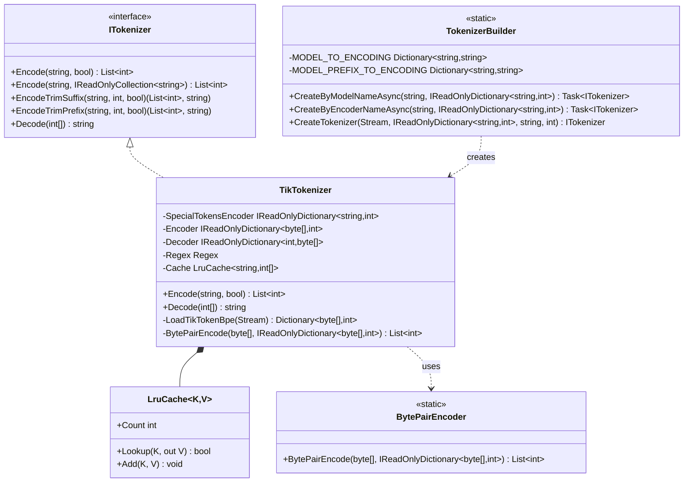
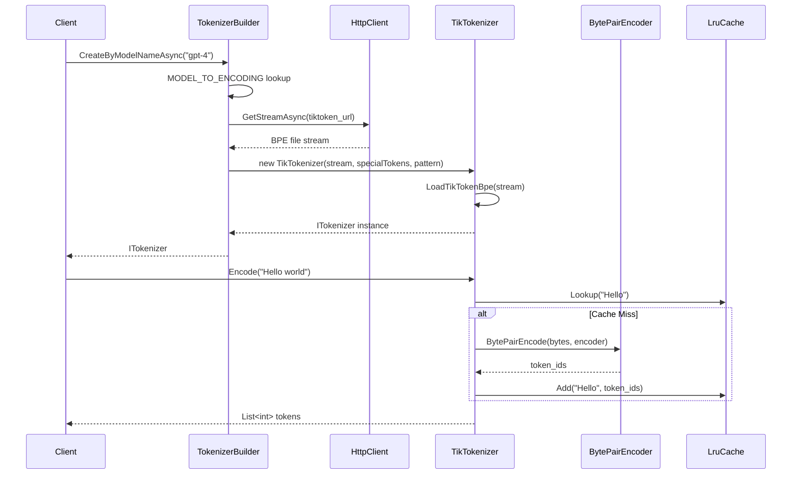
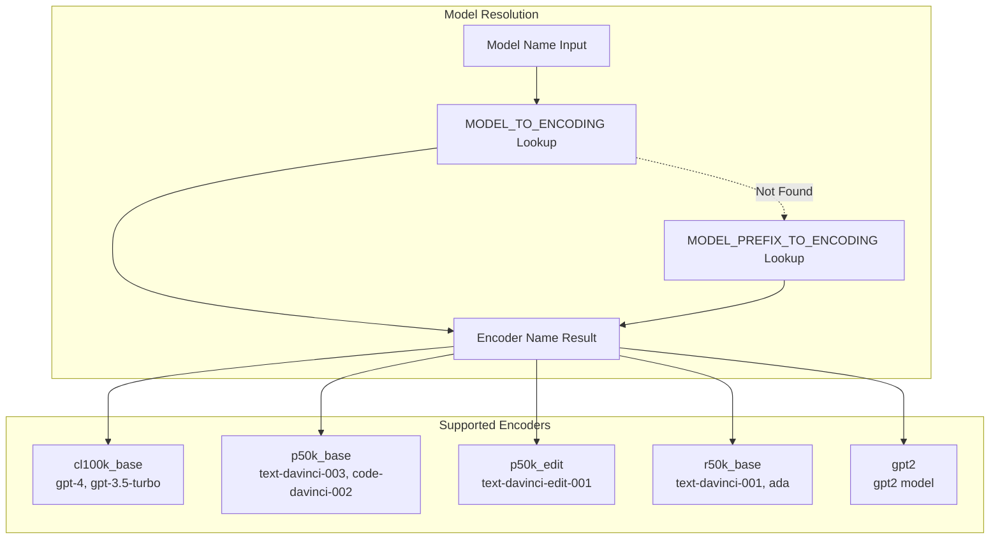
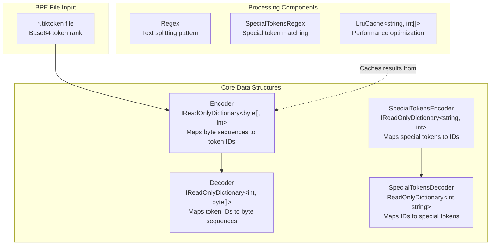
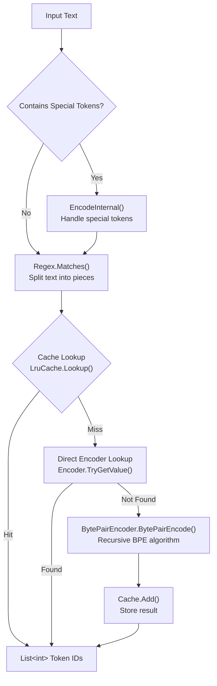
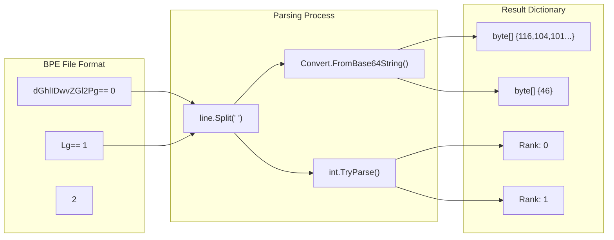

<!-- source: DeepWiki mcp.deepwiki.com · repo microsoft/Tokenizer · page 4 C# Implementation · fetched 2026-10-26 -->

# C# Implementation

Relevant source files

The following files were used as context for generating this wiki page:

- [Tokenizer_C#/TokenizerLib/TikTokenizer.cs](Tokenizer_C#/TokenizerLib/TikTokenizer.cs)
- [Tokenizer_C#/TokenizerLib/TokenizerBuilder.cs](Tokenizer_C#/TokenizerLib/TokenizerBuilder.cs)
- [Tokenizer_C#/TokenizerLib/TokenizerLib.csproj](Tokenizer_C#/TokenizerLib/TokenizerLib.csproj)

This document covers the **Microsoft.DeepDev.TokenizerLib** NuGet package, which provides C# implementation of Byte Pair Encoding (BPE) tokenization for OpenAI large language models. The implementation targets .NET Standard 2.0 and offers a complete API for encoding and decoding text using various OpenAI model configurations.

For information about the TypeScript implementation, see [TypeScript Implementation](#3). For details about the underlying BPE algorithm across both implementations, see [BPE Algorithm Deep Dive](#7.1). For build and packaging specifics, see [Build and Distribution](#4.4).

## Package Architecture

The C# implementation follows a factory pattern with clear separation between tokenizer creation, core tokenization logic, and model configuration management.

### Core Class Structure

Sources: [Tokenizer_C#/TokenizerLib/TikTokenizer.cs:20-605](), [Tokenizer_C#/TokenizerLib/TokenizerBuilder.cs:14-214]()

### Component Interaction Flow

Sources: [Tokenizer_C#/TokenizerLib/TokenizerBuilder.cs:82-98](), [Tokenizer_C#/TokenizerLib/TikTokenizer.cs:250-274]()

## TokenizerBuilder Factory

The `TokenizerBuilder` class serves as the primary entry point for creating tokenizer instances. It provides static factory methods that handle model-to-encoder mapping and remote BPE file retrieval.

### Model Configuration Mapping

The builder maintains two key dictionaries for model resolution:

- `MODEL_TO_ENCODING`: Direct model name to encoder mapping
- `MODEL_PREFIX_TO_ENCODING`: Prefix-based matching for model families

Sources: [Tokenizer_C#/TokenizerLib/TokenizerBuilder.cs:17-66](), [Tokenizer_C#/TokenizerLib/TokenizerBuilder.cs:84-96]()

### Factory Methods

| Method | Purpose | Parameters |
|--------|---------|------------|
| `CreateByModelNameAsync` | Create tokenizer from OpenAI model name | `modelName`, `extraSpecialTokens` |
| `CreateByEncoderNameAsync` | Create tokenizer from encoder name | `encoderName`, `extraSpecialTokens` |
| `CreateTokenizer` | Create tokenizer from embedded stream | `tikTokenBpeFileStream`, `specialTokensEncoder`, `pattern`, `cacheSize` |

The async methods download BPE rank files from remote URLs, while the synchronous method accepts a pre-loaded stream for embedded scenarios.

Sources: [Tokenizer_C#/TokenizerLib/TokenizerBuilder.cs:82-98](), [Tokenizer_C#/TokenizerLib/TokenizerBuilder.cs:107-184](), [Tokenizer_C#/TokenizerLib/TokenizerBuilder.cs:210-213]()

## TikTokenizer Core Implementation

The `TikTokenizer` class implements the `ITokenizer` interface and provides the main tokenization functionality using Byte Pair Encoding.

### Internal Data Structures

The tokenizer maintains several key data structures for efficient encoding and decoding:

Sources: [Tokenizer_C#/TokenizerLib/TikTokenizer.cs:23-29](), [Tokenizer_C#/TokenizerLib/TikTokenizer.cs:74-91]()

### Encoding Process

The encoding process handles both regular text and special tokens through a multi-stage pipeline:

Sources: [Tokenizer_C#/TokenizerLib/TikTokenizer.cs:250-274](), [Tokenizer_C#/TokenizerLib/TikTokenizer.cs:141-170]()

### Advanced Encoding Features

The `TikTokenizer` provides specialized encoding methods for token count constraints:

- `EncodeTrimSuffix`: Encodes text up to a maximum token count, truncating from the end
- `EncodeTrimPrefix`: Encodes text up to a maximum token count, truncating from the beginning

These methods are essential for applications that need to fit text within model context windows.

Sources: [Tokenizer_C#/TokenizerLib/TikTokenizer.cs:402-435](), [Tokenizer_C#/TokenizerLib/TikTokenizer.cs:546-579]()

## BPE File Loading and Processing

The tokenizer loads BPE rank data from `.tiktoken` files, which contain Base64-encoded byte sequences paired with integer ranks.

### File Format Processing

Sources: [Tokenizer_C#/TokenizerLib/TikTokenizer.cs:99-139]()

## Special Token Handling

Special tokens like `<|endoftext|>`, `<|fim_prefix|>`, `<|fim_middle|>`, `<|fim_suffix|>`, and `<|endofprompt|>` receive dedicated handling with predefined token IDs that vary by encoder type.

### Special Token Configuration by Encoder

| Encoder | `<|endoftext|>` | `<|fim_prefix|>` | `<|fim_middle|>` | `<|fim_suffix|>` | `<|endofprompt|>` |
|---------|-----------------|------------------|------------------|------------------|-------------------|
| `cl100k_base` | 100257 | 100258 | 100259 | 100260 | 100276 |
| `p50k_base` | 50256 | - | - | - | - |
| `p50k_edit` | 50256 | 50281 | 50282 | 50283 | - |
| `r50k_base` | 50256 | - | - | - | - |
| `gpt2` | 50256 | - | - | - | - |

Sources: [Tokenizer_C#/TokenizerLib/TokenizerBuilder.cs:68-72](), [Tokenizer_C#/TokenizerLib/TokenizerBuilder.cs:114-177]()

## Performance Optimizations

The implementation includes several performance optimizations:

### LRU Cache

The `LruCache<string, int[]>` caches encoding results for frequently used text pieces, with a default size of 4096 entries. Cache performance can be monitored through the `NumOfCacheEntries` property.

### Regex Compilation

Text-splitting regex patterns are compiled once during initialization with `RegexOptions.Compiled` for better performance during repeated tokenization operations.

### Memory Efficiency

The implementation uses `IReadOnlyDictionary` interfaces and `byte[]` keys with custom `ByteArrayComparer` for efficient memory usage and lookup performance.

Sources: [Tokenizer_C#/TokenizerLib/TikTokenizer.cs:34-38](), [Tokenizer_C#/TokenizerLib/TikTokenizer.cs:77-78](), [Tokenizer_C#/TokenizerLib/TikTokenizer.cs:101]()

## Project Configuration and Distribution

The library targets .NET Standard 2.0 for broad compatibility and is configured for NuGet distribution with strong-name signing and Microsoft code signing through MicroBuild.

### Project Properties

- **Target Framework**: `netstandard2.0`
- **Package ID**: `Microsoft.DeepDev.TokenizerLib`
- **Assembly Version**: Defined in project file
- **Strong Name Signing**: Enabled with public key
- **Code Signing**: Microsoft Authenticode through MicroBuild

Sources: [Tokenizer_C#/TokenizerLib/TokenizerLib.csproj:3-23](), [Tokenizer_C#/TokenizerLib/TokenizerLib.csproj:38-50]()

---

