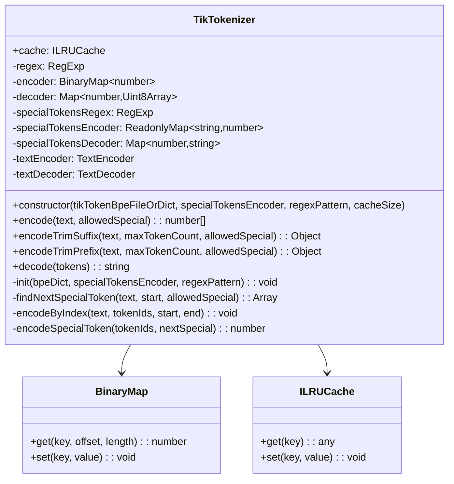
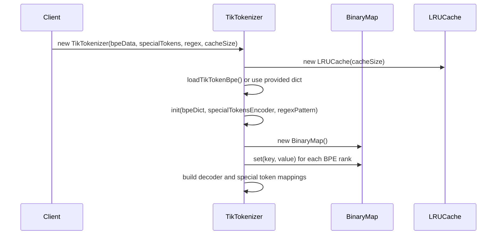
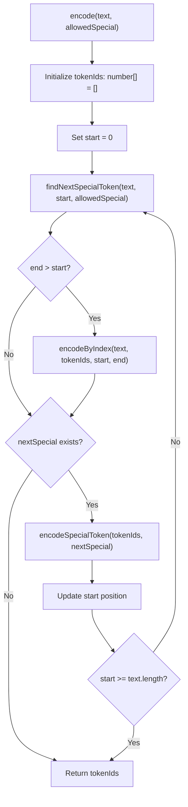
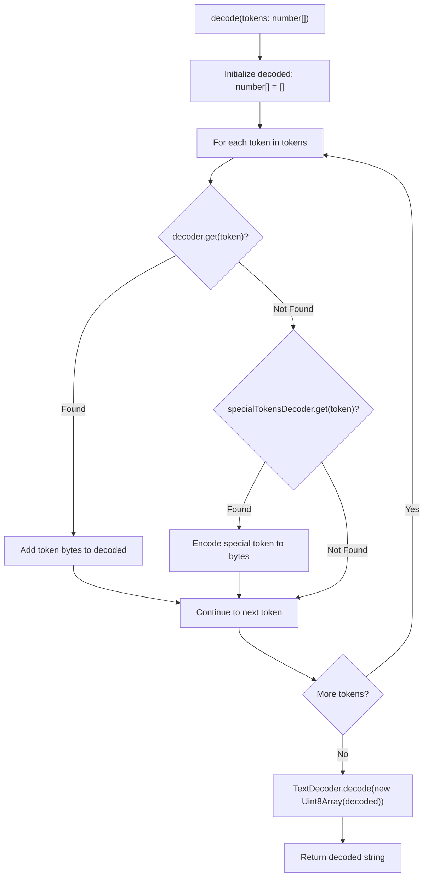
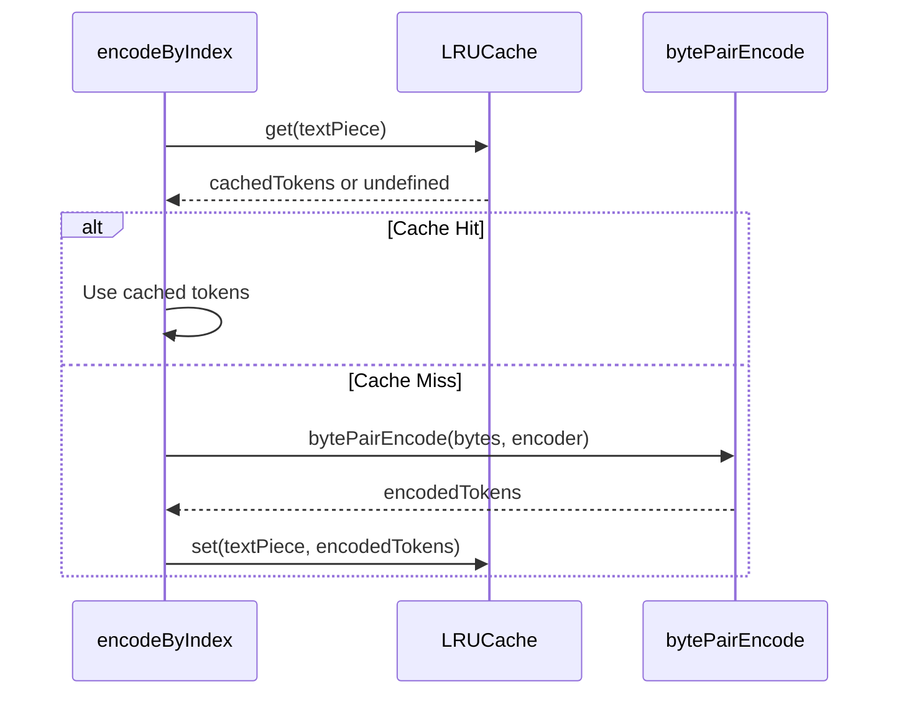

<!-- source: DeepWiki mcp.deepwiki.com · repo microsoft/Tokenizer · page 4.1 Core API · fetched 2026-10-26 -->

# Core API

<details>
<summary>Relevant source files</summary>

The following files were used as context for generating this wiki page:

- [tokenizer_ts/src/tikTokenizer.ts](tokenizer_ts/src/tikTokenizer.ts)
- [tokenizer_ts/test/tikTokenizer.test.ts](tokenizer_ts/test/tikTokenizer.test.ts)

</details>


This document covers the primary public API of the TypeScript tokenizer implementation, specifically the `TikTokenizer` class and its core methods for encoding and decoding text. This page focuses on the main user-facing interface and usage patterns.

For information about the BPE algorithm implementation details, see [BPE Algorithm Implementation](#3.2). For tokenizer creation and model configuration, see [Model Support and Builder](#3.3).

## TikTokenizer Class Overview

The `TikTokenizer` class is the main entry point for tokenization operations in the TypeScript implementation. It provides methods for encoding text to token IDs and decoding token IDs back to text, with support for special tokens and performance optimizations.



Sources: [tokenizer_ts/src/tikTokenizer.ts:60-494]()

## Constructor and Initialization

The `TikTokenizer` constructor accepts BPE ranking data, special token mappings, regex patterns for text splitting, and cache configuration.

| Parameter | Type | Description |
|-----------|------|-------------|
| `tikTokenBpeFileOrDict` | `string \| Map<Uint8Array, number>` | File path to BPE ranks file or pre-parsed BPE dictionary |
| `specialTokensEncoder` | `ReadonlyMap<string, number>` | Mapping of special token strings to token IDs |
| `regexPattern` | `string` | Regular expression pattern for text segmentation |
| `cacheSize` | `number` | LRU cache size (default: 8192) |

The constructor initializes internal data structures including the BPE encoder, decoder mappings, and special token handling components.



Sources: [tokenizer_ts/src/tikTokenizer.ts:80-89](), [tokenizer_ts/src/tikTokenizer.ts:91-121]()

## Primary Encoding Method

The `encode()` method converts input text into an array of token IDs, with optional support for special tokens.

### Method Signature
```typescript
public encode(text: string, allowedSpecial?: ReadonlyArray<string>): number[]
```

### Parameters
- `text`: Input string to tokenize
- `allowedSpecial`: Optional array of special token strings that should be preserved during encoding

### Encoding Process Flow



The encoding process handles both regular text segments and special tokens, using regex-based text segmentation and BPE encoding for regular text portions.

Sources: [tokenizer_ts/src/tikTokenizer.ts:152-181](), [tokenizer_ts/src/tikTokenizer.ts:192-223]()

## Decoding Method

The `decode()` method converts an array of token IDs back into readable text.

### Method Signature
```typescript
public decode(tokens: number[]): string
```

### Decoding Process



Sources: [tokenizer_ts/src/tikTokenizer.ts:475-493]()

## Advanced Encoding Methods

The `TikTokenizer` provides two specialized encoding methods for handling token count limits through text trimming.

### encodeTrimSuffix Method

Encodes text while trimming from the end when the token count exceeds the specified maximum.

```typescript
public encodeTrimSuffix(
    text: string, 
    maxTokenCount: number, 
    allowedSpecial: ReadonlyArray<string>
): { tokenIds: number[]; text: string }
```

Returns both the token IDs and the actual text that was encoded after trimming.

### encodeTrimPrefix Method

Encodes text while trimming from the beginning when the token count exceeds the specified maximum.

```typescript
public encodeTrimPrefix(
    text: string, 
    maxTokenCount: number, 
    allowedSpecial?: ReadonlyArray<string>
): { tokenIds: number[]; text: string }
```

Both methods maintain token boundaries and handle special tokens appropriately during the trimming process.

Sources: [tokenizer_ts/src/tikTokenizer.ts:300-361](), [tokenizer_ts/src/tikTokenizer.ts:370-468]()

## Caching System

The `TikTokenizer` uses an LRU cache to optimize performance by storing previously encoded text segments.

| Property | Type | Description |
|----------|------|-------------|
| `cache` | `ILRUCache` | Public readonly access to the LRU cache instance |

The cache stores mappings from text pieces to their corresponding token arrays, significantly improving performance for repeated or similar text segments.



Sources: [tokenizer_ts/src/tikTokenizer.ts:69](), [tokenizer_ts/src/tikTokenizer.ts:202-221]()

## Usage Examples from Tests

The test suite demonstrates typical usage patterns:

```typescript
// Basic encoding/decoding
const tokenizer = await createByModelName("gpt-3.5-turbo", specialTokens);
const tokens = tokenizer.encode("Hello World!");
const decoded = tokenizer.decode(tokens);

// Special token handling
const textWithSpecial = "<|im_start|>Hello World<|im_end|>";
const tokens = tokenizer.encode(textWithSpecial, ["<|im_start|>", "<|im_end|>"]);

// Trimming operations
const result = tokenizer.encodeTrimSuffix(text, 100, allowedSpecial);
const { tokenIds, text: trimmedText } = result;
```

Sources: [tokenizer_ts/test/tikTokenizer.test.ts:16-230]()

---

