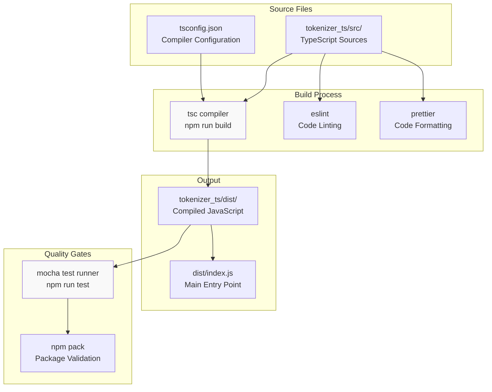
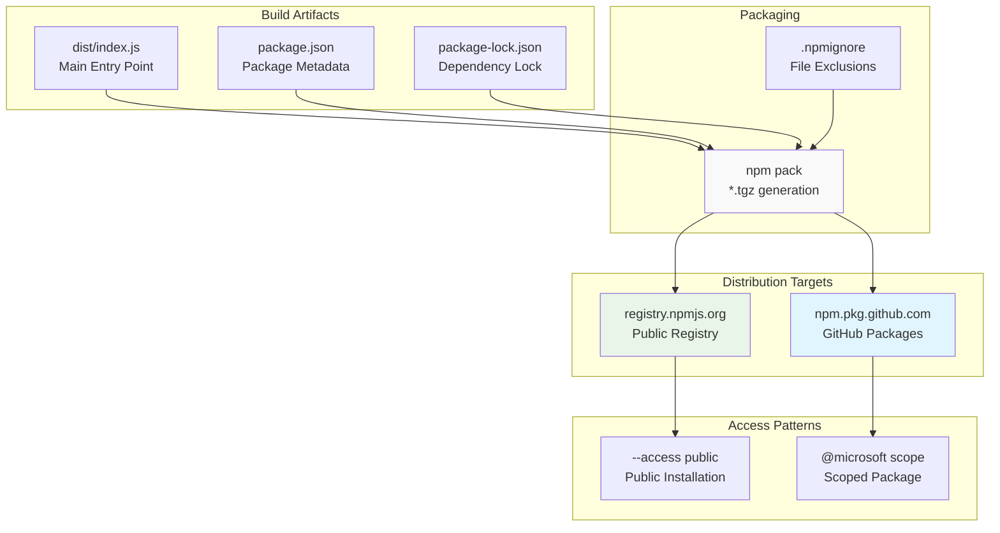
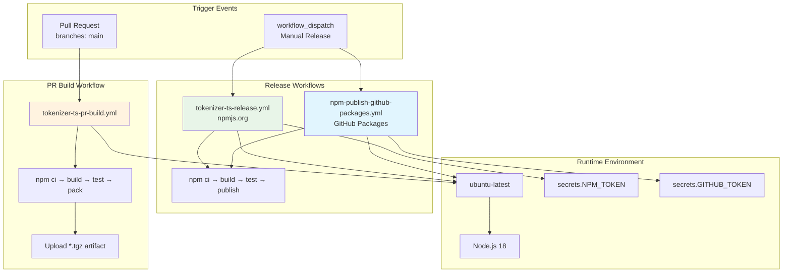
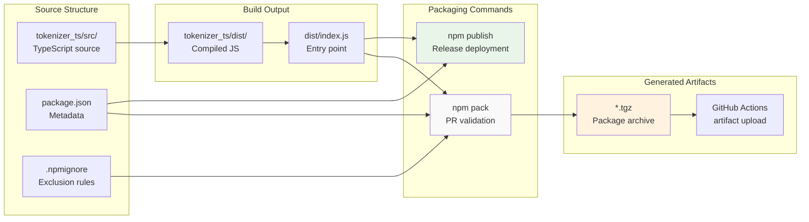

<!-- source: DeepWiki mcp.deepwiki.com · repo microsoft/Tokenizer · page 4.4 Build and Distribution · fetched 2026-10-26 -->

# Build and Distribution

Relevant source files

The following files were used as context for generating this wiki page:

- [.github/workflows/npm-publish-github-packages.yml](.github/workflows/npm-publish-github-packages.yml)
- [.github/workflows/tokenizer-ts-pr-build.yml](.github/workflows/tokenizer-ts-pr-build.yml)
- [.github/workflows/tokenizer-ts-release.yml](.github/workflows/tokenizer-ts-release.yml)
- [tokenizer_ts/.npmignore](tokenizer_ts/.npmignore)
- [tokenizer_ts/package-lock.json](tokenizer_ts/package-lock.json)
- [tokenizer_ts/package.json](tokenizer_ts/package.json)

This document covers the TypeScript implementation's build process, package configuration, and distribution workflows for the `@microsoft/tiktokenizer` npm package. It details how the TypeScript source code is compiled, packaged, and distributed through automated CI/CD pipelines.

For information about the C# build and distribution process, see [Build and Distribution](#4.4). For details about the core TypeScript API implementation, see [Core API](#3.1).

## Package Configuration

The TypeScript tokenizer is configured as an npm package through [tokenizer_ts/package.json:1-41](). The package is published under the scoped name `@microsoft/tiktokenizer` with the MIT license.

| Configuration | Value | Purpose |
|---------------|-------|---------|
| Package Name | `@microsoft/tiktokenizer` | Scoped npm package identifier |
| Version | `1.0.10` | Current release version |
| Main Entry | `dist/index.js` | Compiled JavaScript entry point |
| Node Version | `>=18.0.0` | Minimum Node.js runtime requirement |
| License | MIT | Open source license |

The package defines several npm scripts for development and build automation:

| Script | Command | Purpose |
|--------|---------|---------|
| `build` | `tsc -p ./tsconfig.json` | TypeScript compilation |
| `test` | `mocha -u tdd --require ts-node/register test/**/*.ts` | Test execution |
| `watch` | `tsc -p ./tsconfig.json --watch` | Development mode compilation |
| `eslint` | `eslint src --ext ts` | Code linting |
| `format` | `prettier --write "./**/*.{ts,tsx}"` | Code formatting |

**Sources:** [tokenizer_ts/package.json:1-41]()

## Build Process

The build process transforms TypeScript source code into distributable JavaScript through a standardized compilation pipeline.

### TypeScript Compilation Pipeline

The compilation process uses the TypeScript compiler (`tsc`) with project-specific configuration to generate JavaScript output in the `dist/` directory. The main entry point becomes `dist/index.js` as specified in [tokenizer_ts/package.json:21]().

**Sources:** [tokenizer_ts/package.json:34-40]()

## Distribution Channels

The `@microsoft/tiktokenizer` package is distributed through multiple npm registries with different access patterns and use cases.

### Registry Distribution Architecture

### Package Exclusions

The [tokenizer_ts/.npmignore:1-13]() file defines which files are excluded from the published package:

- Development files: `.vscode`, `tsconfig.json`, `.eslintrc.js`
- Source code: `/src` (only compiled `/dist` is included)
- Test files: `test`, `dist/test/*`
- Build artifacts: `*.tgz`, `*.map`
- Model files: `*.tiktoken`
- Performance tools: `/perf/*`

**Sources:** [tokenizer_ts/.npmignore:1-13](), [.github/workflows/tokenizer-ts-release.yml:19-20](), [.github/workflows/npm-publish-github-packages.yml:19-20]()

## CI/CD Workflows

The project implements automated build and deployment through GitHub Actions workflows that handle different stages of the software lifecycle.

### Workflow Architecture

### Workflow Execution Details

All workflows share a common execution pattern but differ in their final deployment step:

**Common Steps:**
1. `actions/checkout@v4` - Repository checkout
2. `actions/setup-node@v4` - Node.js 18 setup with registry configuration
3. `npm ci` - Clean dependency installation
4. `npm run build` - TypeScript compilation
5. `npm run test` - Test suite execution

**Deployment Variations:**
- **PR Build:** `npm pack` + artifact upload (validation only)
- **NPM Release:** `npm publish --access public` to npmjs.org
- **GitHub Packages:** `npm publish --access public` to npm.pkg.github.com

**Sources:** [.github/workflows/tokenizer-ts-pr-build.yml:1-31](), [.github/workflows/tokenizer-ts-release.yml:1-32](), [.github/workflows/npm-publish-github-packages.yml:1-32]()

## Packaging and Artifacts

The packaging process creates distributable artifacts through npm's packaging system, with specific handling for different deployment scenarios.

### Artifact Generation Process

The packaging process ensures that only production-ready files are included in the distributed package. The `.npmignore` configuration excludes development artifacts while preserving the compiled JavaScript and essential metadata files.

All workflows include artifact upload through `actions/upload-artifact@v4`, storing the generated `*.tgz` files as `npm-package` artifacts for build verification and deployment auditing.

**Sources:** [.github/workflows/tokenizer-ts-pr-build.yml:27-30](), [.github/workflows/tokenizer-ts-release.yml:28-31](), [tokenizer_ts/package.json:21]()

---

