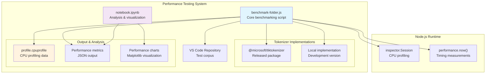
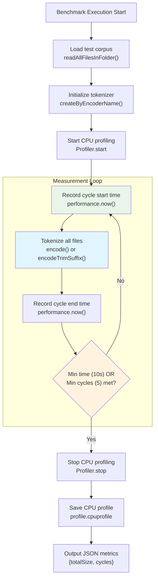
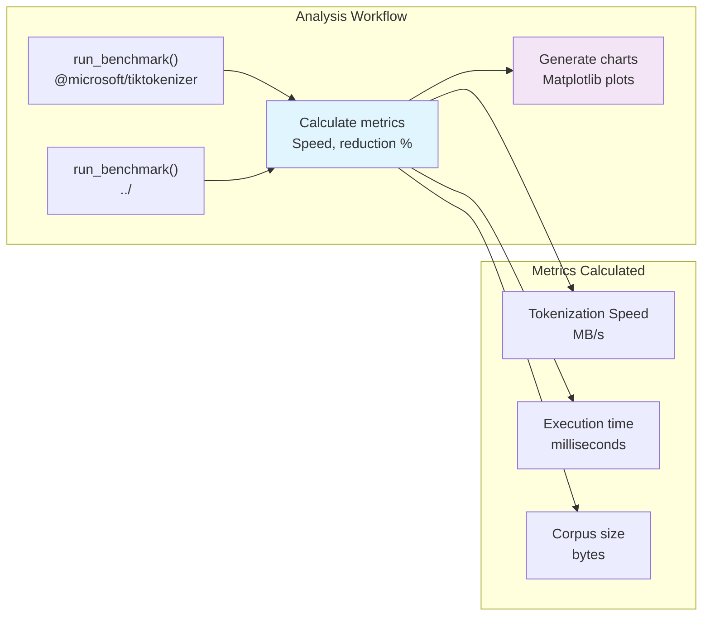
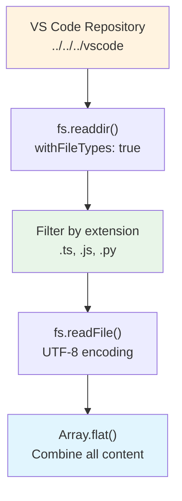
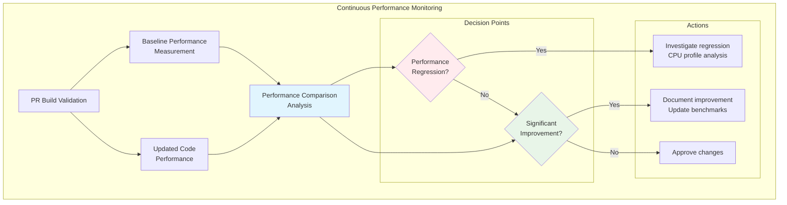

<!-- source: DeepWiki mcp.deepwiki.com · repo microsoft/Tokenizer · page 5 Performance and Benchmarking · fetched 2026-10-26 -->

# Performance and Benchmarking

<details>
<summary>Relevant source files</summary>

The following files were used as context for generating this wiki page:

- [tokenizer_ts/perf/.gitignore](tokenizer_ts/perf/.gitignore)
- [tokenizer_ts/perf/benchmark-folder.js](tokenizer_ts/perf/benchmark-folder.js)
- [tokenizer_ts/perf/notebook.ipynb](tokenizer_ts/perf/notebook.ipynb)

</details>


This document covers the performance measurement tools, benchmarking methodologies, and optimization techniques used in the Microsoft Tokenizer repository. It focuses on the automated performance testing infrastructure and analysis workflows for both TypeScript and C# implementations.

For information about the core BPE algorithm implementation details, see [BPE Algorithm Deep Dive](#7.1). For general development and testing practices, see [Development and Contributing](#6).

## Performance Testing Architecture

The performance testing system is designed around automated benchmarking tools that measure tokenization speed and efficiency across different implementations and configurations.



**Performance Testing Architecture**

The system uses a Node.js-based benchmarking script that measures tokenization performance across different file types and implementations. The Jupyter notebook provides analysis and visualization capabilities for comparing performance metrics.

Sources: [tokenizer_ts/perf/benchmark-folder.js:1-66](), [tokenizer_ts/perf/notebook.ipynb:1-210]()

## Benchmarking Methodology

The benchmarking process follows a systematic approach to ensure reliable and repeatable measurements:



**Benchmarking Execution Flow**

The benchmark runs multiple cycles to ensure statistical reliability, with minimum thresholds of 10 seconds total runtime or 5 measurement cycles.

Sources: [tokenizer_ts/perf/benchmark-folder.js:29-65]()

### Key Measurement Parameters

| Parameter | Value | Purpose |
|-----------|--------|---------|
| `minTime` | 10,000ms | Minimum total benchmark duration |
| `minCycles` | 5 | Minimum number of measurement cycles |
| File Extensions | `.ts`, `.js`, `.py` | Supported file types for corpus |
| Methods | `encode`, `encodeTrimSuffix` | Tokenization operations to benchmark |

Sources: [tokenizer_ts/perf/benchmark-folder.js:8-11]()

## TypeScript Implementation Benchmarks

The TypeScript performance testing focuses on comparing the published npm package against development versions to track performance improvements.

### Benchmark Script Usage

The core benchmarking script accepts the following parameters:

```bash
node benchmark-folder.js <encoderName> <folderPath> <method> <modulePath>
```

**Parameters:**
- `encoderName`: BPE encoder type (e.g., `cl100k_base`)
- `folderPath`: Path to test corpus directory
- `method`: Tokenization method (`encode` or `encodeTrimSuffix`)
- `modulePath`: Path to tokenizer module to test

Sources: [tokenizer_ts/perf/benchmark-folder.js:6-7]()

### Performance Analysis Workflow

The Jupyter notebook provides comprehensive analysis capabilities:



**Performance Analysis Process**

The notebook compares baseline and updated implementations, calculating throughput metrics and generating comparative visualizations.

Sources: [tokenizer_ts/perf/notebook.ipynb:28-33](), [tokenizer_ts/perf/notebook.ipynb:160-186]()

## Test Corpus and Data

### VS Code Repository Corpus

The performance testing uses the VS Code repository as a standardized test corpus, providing a realistic dataset of TypeScript, JavaScript, and Python files.

**Corpus Characteristics:**
- **File Types**: `.ts`, `.js`, `.py` files
- **Size**: Variable (calculated dynamically)
- **Location**: `../../../vscode` relative path
- **Processing**: Recursive directory traversal

Sources: [tokenizer_ts/perf/notebook.ipynb:24-27](), [tokenizer_ts/perf/benchmark-folder.js:11-27]()

### File Processing Pipeline



**File Processing Pipeline**

The system recursively processes the VS Code repository, filtering for relevant file types and loading content for tokenization benchmarks.

Sources: [tokenizer_ts/perf/benchmark-folder.js:13-27]()

## Performance Analysis Tools

### CPU Profiling Integration

The benchmarking system includes integrated CPU profiling using Node.js Inspector API:

**Profiling Features:**
- **Session Management**: `inspector.Session` for profiling control
- **Profile Generation**: Automatic `.cpuprofile` file creation
- **Integration**: Built into benchmark execution cycle

```javascript
// Profiling workflow from benchmark-folder.js
const session = new inspector.Session();
await post('Profiler.enable');
await post('Profiler.start');
// ... benchmark execution ...
const data = await post('Profiler.stop');
await fs.writeFile('profile.cpuprofile', JSON.stringify(data.profile));
```

Sources: [tokenizer_ts/perf/benchmark-folder.js:38-42](), [tokenizer_ts/perf/benchmark-folder.js:61-62]()

### Performance Metrics Calculation

The analysis notebook calculates key performance indicators:

| Metric | Formula | Purpose |
|--------|---------|---------|
| Average Time | `sum(cycles) / len(cycles) / 1000` | Mean execution time in seconds |
| Corpus Size | `totalSize / (1024 * 1024)` | Test data size in MB |
| Throughput | `total_size_MB / avg_time_seconds` | Tokenization speed in MB/s |
| Performance Gain | `100 * (1 - baseline_speed / updated_speed)` | Improvement percentage |

Sources: [tokenizer_ts/perf/notebook.ipynb:163-172](), [tokenizer_ts/perf/notebook.ipynb:182-185]()

## C# Implementation Performance

While the primary benchmarking infrastructure is built for TypeScript, the repository also includes C# performance testing capabilities referenced in the overall architecture.

**C# Performance Components:**
- **Console Application**: Demo and testing program
- **Performance Benchmarks**: C# specific measurement tools
- **Unit Tests**: Validation and performance regression testing

For detailed information about C# implementation benchmarking, see [C# Implementation](#4).

Sources: Architecture overview from repository structure analysis

## Optimization Techniques

### Performance Monitoring Workflow



**Performance Optimization Workflow**

The system enables continuous performance monitoring through automated benchmarking, helping identify regressions and validate optimizations.

Sources: [tokenizer_ts/perf/notebook.ipynb:40-42](), [tokenizer_ts/perf/notebook.ipynb:89-91]()

### Benchmarking Best Practices

**Measurement Reliability:**
- Multiple measurement cycles for statistical validity
- Minimum runtime thresholds to account for variance
- CPU profiling for detailed performance analysis
- Consistent test corpus across measurements

**Analysis Methodology:**
- Baseline vs. updated comparisons
- Throughput measurement in MB/s
- Visual representation of performance trends
- Regression detection and investigation

Sources: [tokenizer_ts/perf/benchmark-folder.js:8-9](), [tokenizer_ts/perf/notebook.ipynb:9-10]()

---

