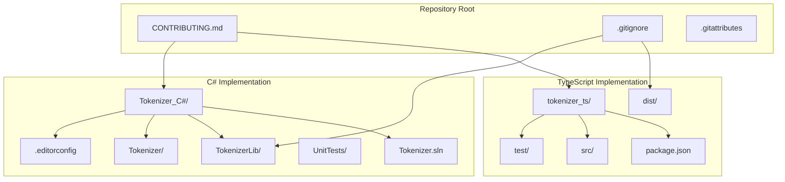
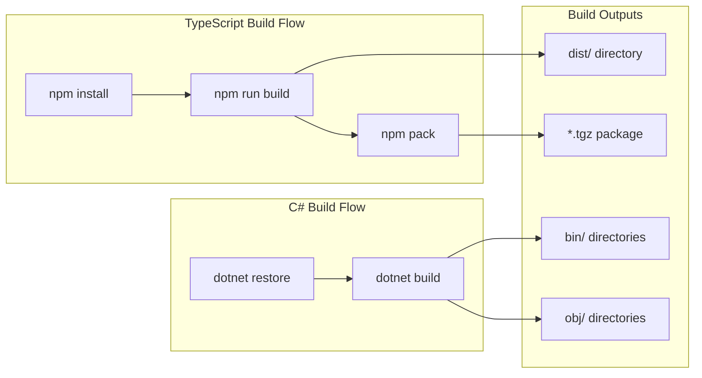
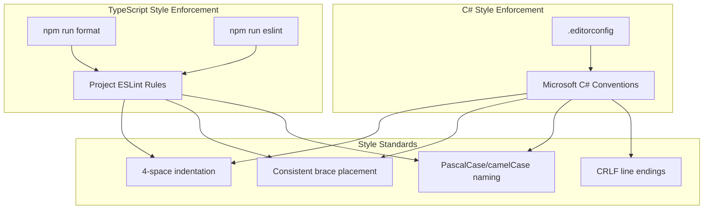
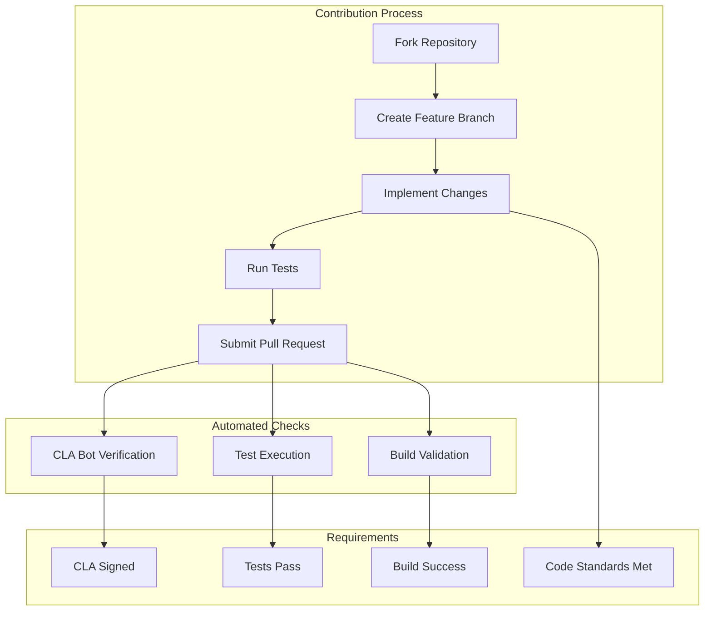

<!-- source: DeepWiki mcp.deepwiki.com · repo microsoft/Tokenizer · page 6 Development and Contributing · fetched 2026-10-26 -->

# Development and Contributing

<details>
<summary>Relevant source files</summary>

The following files were used as context for generating this wiki page:

- [.gitattributes](.gitattributes)
- [.gitignore](.gitignore)
- [CONTRIBUTING.md](CONTRIBUTING.md)
- [Tokenizer_C#/.editorconfig](Tokenizer_C#/.editorconfig)
- [Tokenizer_C#/Tokenizer/Properties/launchSettings.json](Tokenizer_C#/Tokenizer/Properties/launchSettings.json)
- [Tokenizer_C#/TokenizerLib/Utils/Properties/launchSettings.json](Tokenizer_C#/TokenizerLib/Utils/Properties/launchSettings.json)

</details>


This document provides comprehensive guidance for developers who want to contribute to the Microsoft Tokenizer repository. It covers development environment setup, build processes, testing procedures, coding standards, and contribution workflows for both the TypeScript and C# implementations.

For detailed information about the automated CI/CD pipelines, see [CI/CD Pipelines](#6.1).

## Development Environment Setup

The Microsoft Tokenizer repository supports dual-language development with both TypeScript and C# implementations. Each implementation has its own development requirements and workflows.

### Prerequisites

**For TypeScript Development:**
- Node.js ≥18.0.0
- npm package manager
- Development environment in `tokenizer_ts/` directory

**For C# Development:**
- .NET SDK supporting .NET Standard 2.0
- Development environment in `Tokenizer_C#/` directory
- Visual Studio or compatible IDE (optional)

### Repository Structure



**Development Environment Architecture**

Sources: [CONTRIBUTING.md:1-77](), [.gitignore:1-358](), [.gitattributes:1-6]()

## Building the Projects

### TypeScript Build Process

The TypeScript implementation uses npm for package management and build automation:

```bash
cd tokenizer_ts
npm install
npm run build
npm pack
```

The build process compiles TypeScript source code and generates distribution files in the `dist/` directory.

### C# Build Process

The C# implementation uses the .NET CLI and MSBuild:

```bash
cd Tokenizer_C#
dotnet build Tokenizer.sln
```

This builds all projects in the solution including the main library, console application, and unit tests.



**Build Process Flow**

Sources: [CONTRIBUTING.md:10-26]()

## Testing

### TypeScript Testing

Execute the TypeScript test suite using npm:

```bash
cd tokenizer_ts
npm run test
```

### C# Testing

Run the C# unit tests using the .NET CLI:

```bash
cd Tokenizer_C#
dotnet test
```

The C# implementation includes comprehensive unit tests that validate tokenization functionality across different models and scenarios.

| Implementation | Test Command | Test Directory | Test Framework |
|---|---|---|---|
| TypeScript | `npm run test` | `tokenizer_ts/test/` | npm test runner |
| C# | `dotnet test` | `Tokenizer_C#/UnitTests/` | MSTest/xUnit |

Sources: [CONTRIBUTING.md:28-44]()

## Coding Standards and Style

### C# Coding Conventions

The project adheres to Microsoft's C# Coding Conventions as specified in the `.editorconfig` file. Key standards include:

- **Indentation**: 4 spaces, no tabs
- **Line endings**: CRLF (`\r\n`)
- **Modifier order**: `public`, `private`, `protected`, `internal`, `static`, `extern`, `new`, `virtual`, `abstract`, `sealed`, `override`, `readonly`, `unsafe`, `volatile`, `async`
- **Braces**: Always use braces for code blocks
- **Naming**: Use PascalCase for public members, camelCase for private fields

### TypeScript Style Guidelines

For TypeScript development, use the provided formatting and linting tools:

```bash
cd tokenizer_ts
npm run format
npm run eslint
```

These commands ensure consistent code formatting and adherence to project-specific linting rules.



**Coding Standards Architecture**

Sources: [CONTRIBUTING.md:46-59](), [Tokenizer_C#/.editorconfig:1-149]()

## Contributing Workflow

### Development Process

1. **Fork and Branch**: Create a fork of the repository and create a feature branch
2. **Development**: Implement changes following coding standards
3. **Testing**: Run appropriate test suites for your changes
4. **Pull Request**: Submit a pull request with clear description

### Pull Request Requirements

Before submitting a pull request, ensure:

- All tests pass for relevant implementations
- Code follows established style guidelines
- Build process completes successfully
- Changes are well-documented

### Development Configuration

The repository includes launch settings for debugging:

| Configuration File | Purpose | Location |
|---|---|---|
| `launchSettings.json` | Console app debugging | `Tokenizer_C#/Tokenizer/Properties/` |
| `launchSettings.json` | Utils debugging | `Tokenizer_C#/TokenizerLib/Utils/Properties/` |

These configurations set up default command-line arguments for debugging scenarios.

Sources: [CONTRIBUTING.md:4-6](), [Tokenizer_C#/Tokenizer/Properties/launchSettings.json:1-8](), [Tokenizer_C#/TokenizerLib/Utils/Properties/launchSettings.json:1-8]()

## Issue Reporting

For bug reports, feature requests, or other issues, use the GitHub Issues system:

1. **Search Existing Issues**: Check if the issue has already been reported
2. **Create New Issue**: Provide detailed description including:
   - Steps to reproduce (for bugs)
   - Expected vs. actual behavior
   - Environment details (OS, .NET version, Node.js version)
   - Code samples when applicable

3. **Use Appropriate Labels**: Apply relevant labels to categorize the issue

Sources: [CONTRIBUTING.md:61-63]()

## Contributor License Agreement

### Microsoft CLA Requirement

All contributions require agreement to a Contributor License Agreement (CLA). The process is automated:

1. **First-time Contributors**: CLA bot will prompt you to sign the agreement
2. **Automated Verification**: The bot checks CLA status on each pull request
3. **One-time Process**: CLA signature applies across all Microsoft repositories

### Code of Conduct

The project follows the Microsoft Open Source Code of Conduct. Contributors are expected to:

- Be respectful and inclusive
- Focus on constructive feedback
- Report inappropriate behavior to `opencode@microsoft.com`



**Contribution Workflow**

Sources: [CONTRIBUTING.md:65-76]()

---

