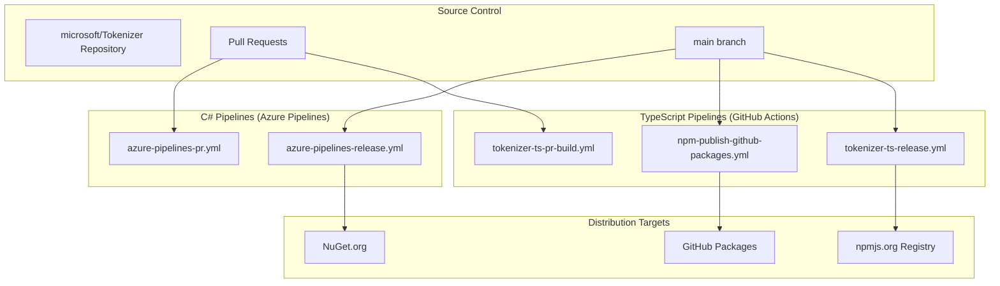
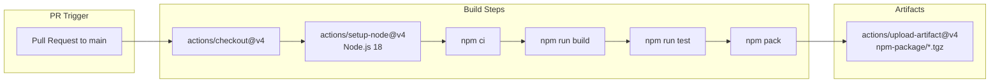
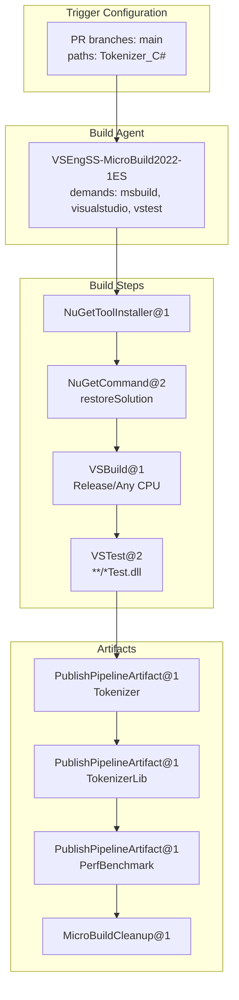
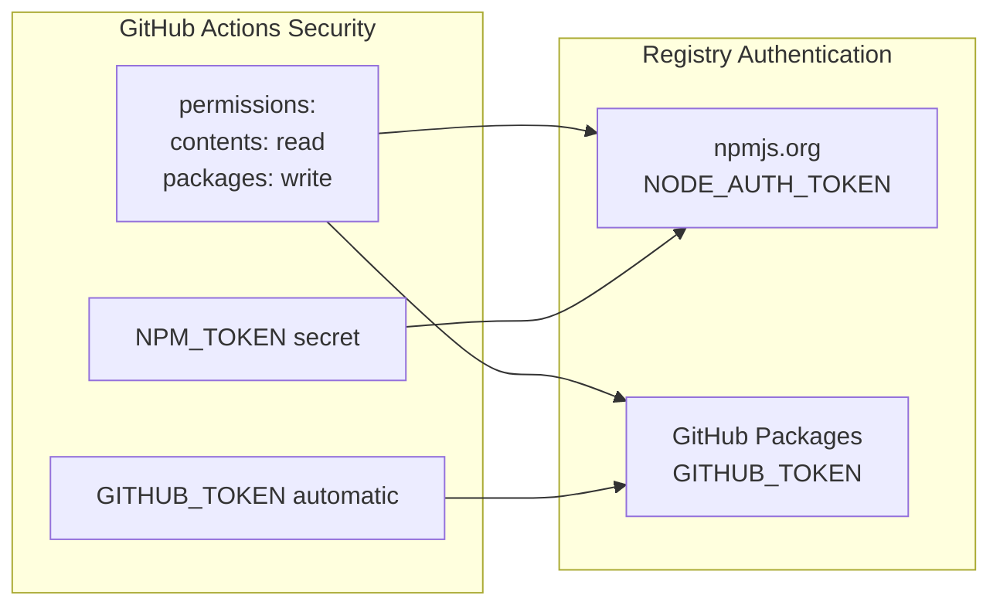

<!-- source: DeepWiki mcp.deepwiki.com · repo microsoft/Tokenizer · page 6.1 CI/CD Pipelines · fetched 2026-10-26 -->

# CI/CD Pipelines

Relevant source files

The following files were used as context for generating this wiki page:

- [.github/workflows/npm-publish-github-packages.yml](.github/workflows/npm-publish-github-packages.yml)
- [.github/workflows/tokenizer-ts-pr-build.yml](.github/workflows/tokenizer-ts-pr-build.yml)
- [.github/workflows/tokenizer-ts-release.yml](.github/workflows/tokenizer-ts-release.yml)
- [Tokenizer_C#/build/azure-pipelines-pr.yml](Tokenizer_C#/build/azure-pipelines-pr.yml)
- [Tokenizer_C#/build/azure-pipelines-release.yml](Tokenizer_C#/build/azure-pipelines-release.yml)

This document covers the automated build, test, and deployment pipelines that support both the TypeScript and C# implementations of the Microsoft Tokenizer. The CI/CD infrastructure ensures code quality, automated testing, and reliable package distribution to npm and NuGet registries.

For information about the build and distribution processes specific to each implementation, see [TypeScript Build and Distribution](#3.4) and [C# Build and Distribution](#4.4). For testing methodologies, see [TypeScript Testing](#3.5) and [C# Testing](#4.5).

## Pipeline Architecture Overview

The repository employs a dual CI/CD strategy with different platforms optimized for each implementation:

**Sources:** [.github/workflows/tokenizer-ts-pr-build.yml](), [.github/workflows/tokenizer-ts-release.yml](), [.github/workflows/npm-publish-github-packages.yml](), [Tokenizer_C#/build/azure-pipelines-pr.yml](), [Tokenizer_C#/build/azure-pipelines-release.yml]()

## TypeScript CI/CD (GitHub Actions)

The TypeScript implementation uses GitHub Actions with three primary workflows located in the `.github/workflows/` directory:

### Pull Request Validation

The `tokenizer-ts-pr-build.yml` workflow validates every pull request targeting the main branch:

The workflow uses the working directory `tokenizer_ts` and configures Node.js with GitHub Packages registry access using the `GITHUB_TOKEN` secret.

**Sources:** [.github/workflows/tokenizer-ts-pr-build.yml:1-31]()

### Production Release to npm

The `tokenizer-ts-release.yml` workflow publishes the `@microsoft/tiktokenizer` package to the public npm registry:

| Workflow Attribute | Value |
|-------------------|-------|
| Trigger | `workflow_dispatch` (manual) |
| Runner | `ubuntu-latest` |
| Registry | `https://registry.npmjs.org` |
| Scope | `@microsoft` |
| Access | `public` |

The workflow requires the `NPM_TOKEN` secret for authentication and performs the complete build-test-publish cycle before uploading the generated `.tgz` artifact.

**Sources:** [.github/workflows/tokenizer-ts-release.yml:1-32]()

### GitHub Packages Release

The `npm-publish-github-packages.yml` workflow publishes to GitHub's internal package registry using identical build steps but targeting `https://npm.pkg.github.com` with `GITHUB_TOKEN` authentication.

**Sources:** [.github/workflows/npm-publish-github-packages.yml:1-32]()

## C# CI/CD (Azure Pipelines)

The C# implementation uses Azure Pipelines with YAML definitions in the `Tokenizer_C#/build/` directory, leveraging Microsoft's internal build infrastructure:

### Pull Request Validation Pipeline

The `azure-pipelines-pr.yml` pipeline validates C# changes on pull requests:

The pipeline includes comprehensive testing with code coverage, parallel test execution, and diagnostics enabled. It publishes artifacts for all three major C# projects: `Tokenizer`, `TokenizerLib`, and `PerfBenchmark`.

**Sources:** [Tokenizer_C#/build/azure-pipelines-pr.yml:1-70]()

### Production Release Pipeline

The `azure-pipelines-release.yml` pipeline handles production releases with additional security measures:

| Pipeline Feature | Configuration |
|------------------|---------------|
| Trigger | `main` branch changes in `Tokenizer_C#` |
| Signing | `MicroBuildSigningPlugin@4` with configurable `SignType` |
| Package Push | `NuGetCommand@2` to external feed |
| Credentials | `publishFeedCredentials: Tokenizer` |

The release pipeline includes the same build and test steps as the PR pipeline but adds code signing via MicroBuild tooling and automatic NuGet package publishing.

**Sources:** [Tokenizer_C#/build/azure-pipelines-release.yml:1-98]()

## Security and Authentication

The CI/CD pipelines implement several security measures:

### TypeScript Security Model

### C# Security Model

The C# pipelines use Microsoft's internal security infrastructure:

- **MicroBuildSigningPlugin@4**: Provides code signing with configurable `SignType` (Test/Real)
- **VSEngSS-MicroBuild2022-1ES**: Secure build agent pool with enterprise security controls
- **External feed credentials**: Named credential set `Tokenizer` for NuGet.org publishing

**Sources:** [Tokenizer_C#/build/azure-pipelines-release.yml:40-47](), [Tokenizer_C#/build/azure-pipelines-release.yml:89-95]()

## Pipeline Triggers and Path Filtering

Both CI/CD systems implement intelligent triggering to optimize build resources:

| Trigger Type | TypeScript Configuration | C# Configuration |
|-------------|-------------------------|------------------|
| PR Builds | `branches: [main]` | `branches: [main]`, `paths: [Tokenizer_C#]` |
| Release Builds | `workflow_dispatch` (manual) | `branches: [main]`, `paths: [Tokenizer_C#]` |
| Working Directory | `tokenizer_ts` | Full repository with path filtering |

The C# pipelines use path-based filtering to only trigger when files in the `Tokenizer_C#` directory are modified, while TypeScript workflows use a dedicated working directory approach.

**Sources:** [.github/workflows/tokenizer-ts-pr-build.yml:3-9](), [Tokenizer_C#/build/azure-pipelines-pr.yml:6-12](), [Tokenizer_C#/build/azure-pipelines-release.yml:6-12]()

## Artifact Management

Both pipeline systems generate and manage build artifacts for distribution and debugging:

### TypeScript Artifacts
- **npm-package**: Contains `.tgz` files from `npm pack` and `npm publish` operations
- **Upload location**: `tokenizer_ts/*.tgz`

### C# Artifacts  
- **Tokenizer**: Console application binaries from `Tokenizer\bin\Release\`
- **TokenizerLib**: Library binaries from `TokenizerLib\bin\Release\`
- **PerfBenchmark**: Performance testing binaries from `PerfBenchmark\bin\Release\`

**Sources:** [.github/workflows/tokenizer-ts-pr-build.yml:27-30](), [Tokenizer_C#/build/azure-pipelines-pr.yml:54-67]()

---

