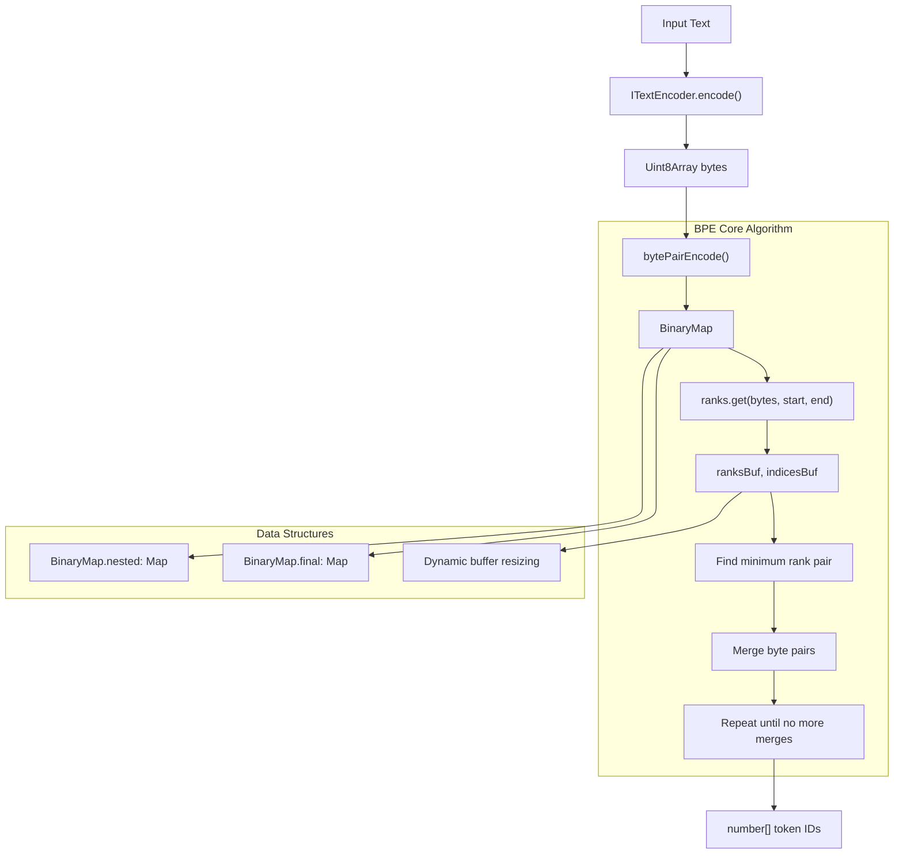
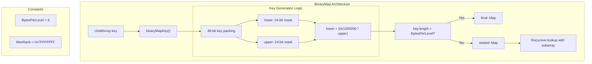
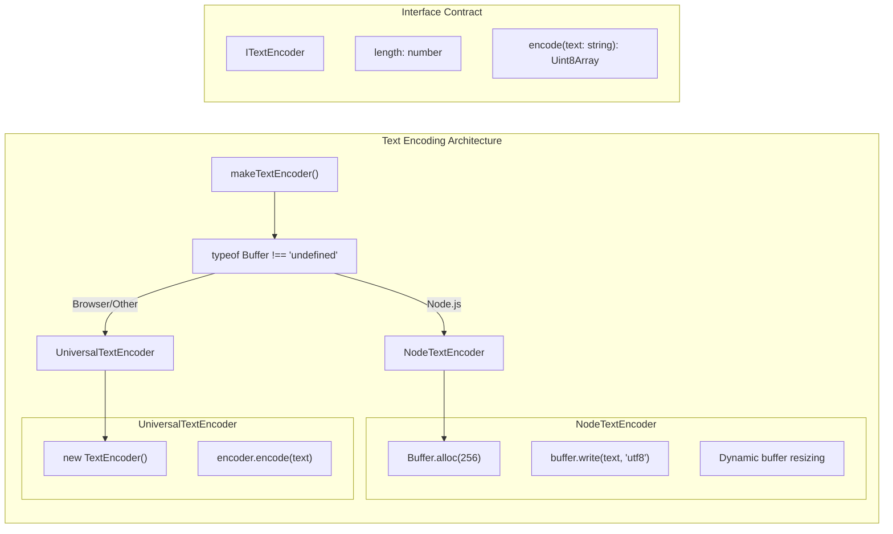
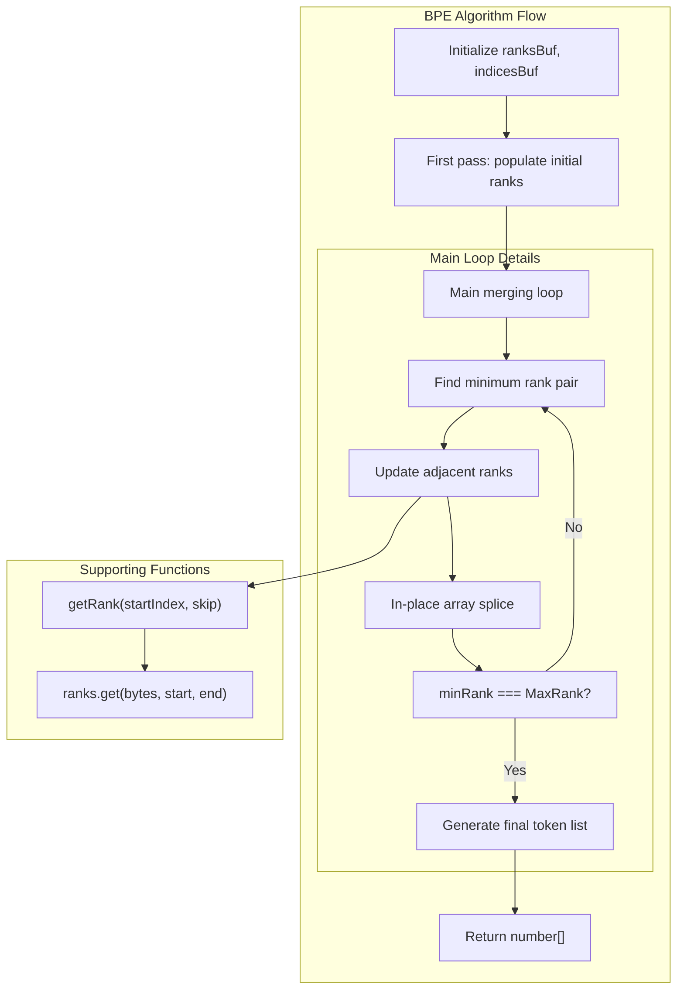
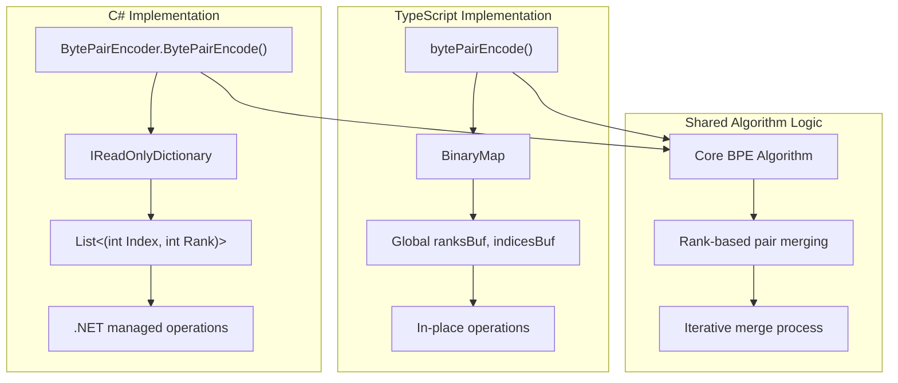

<!-- source: DeepWiki mcp.deepwiki.com · repo microsoft/Tokenizer · page 7 Advanced Topics · fetched 2026-10-26 -->

# Advanced Topics

Relevant source files

The following files were used as context for generating this wiki page:

- [Tokenizer_C#/TokenizerLib/Utils/BytePairEncoder.cs](Tokenizer_C#/TokenizerLib/Utils/BytePairEncoder.cs)
- [tokenizer_ts/src/bytePairEncode.ts](tokenizer_ts/src/bytePairEncode.ts)
- [tokenizer_ts/src/textEncoder.ts](tokenizer_ts/src/textEncoder.ts)
- [tokenizer_ts/test/binaryMap.test.ts](tokenizer_ts/test/binaryMap.test.ts)

This page covers advanced technical implementation details, performance optimizations, and architectural decisions in the Microsoft Tokenizer repository. It focuses on the internal workings of the BPE algorithm implementations, advanced data structures, and cross-platform considerations that are essential for contributors and developers working with the codebase at a deep level.

For basic usage patterns and getting started information, see [Getting Started](#2). For comprehensive algorithm explanation, see [BPE Algorithm Deep Dive](#7.1). For details about model file formats, see [Model Files and Formats](#7.2).

## Advanced BPE Implementation Architecture

The tokenizer implements a highly optimized Byte Pair Encoding algorithm with several advanced architectural decisions that differentiate it from naive implementations. The core algorithm is implemented in both TypeScript and C#, with platform-specific optimizations.

### TypeScript Implementation Data Flow

Sources: [tokenizer_ts/src/bytePairEncode.ts:75-159](), [tokenizer_ts/src/textEncoder.ts:1-57]()

### Advanced Data Structure: BinaryMap Implementation

The `BinaryMap<V>` class implements a sophisticated hierarchical lookup structure optimized for byte sequence keys. This data structure is critical for BPE performance.

Sources: [tokenizer_ts/src/bytePairEncode.ts:14-64](), [tokenizer_ts/test/binaryMap.test.ts:1-101]()

## Performance Optimizations

### Memory Management and Buffer Reuse

The TypeScript implementation employs several advanced memory management techniques to minimize allocations during the BPE process:

| Optimization | Implementation | Location |
|-------------|---------------|----------|
| Buffer Reuse | Global `ranksBuf` and `indicesBuf` arrays | [tokenizer_ts/src/bytePairEncode.ts:66-67]() |
| Dynamic Sizing | Exponential buffer growth when needed | [tokenizer_ts/src/bytePairEncode.ts:86-89]() |
| In-place Operations | Array splicing without allocations | [tokenizer_ts/src/bytePairEncode.ts:129-134]() |
| Bit Packing | 48-bit keys for efficient map lookups | [tokenizer_ts/src/bytePairEncode.ts:14-31]() |

### Cross-Platform Text Encoding Strategy

The system implements a sophisticated text encoding abstraction to handle platform differences efficiently:

Sources: [tokenizer_ts/src/textEncoder.ts:22-56]()

## Algorithm Complexity and Optimization Details

### BPE Algorithm Efficiency Analysis

The `bytePairEncode` function implements several algorithmic optimizations:

- **Rank Lookup Optimization**: Uses `BinaryMap` for O(1) average case lookups instead of linear search
- **Buffer Management**: Pre-allocated buffers with exponential growth to minimize allocations
- **In-place Array Operations**: Custom array splicing logic optimized for Node.js performance
- **Early Termination**: Stops when `minRank === MaxRank` (no more valid merges)

Sources: [tokenizer_ts/src/bytePairEncode.ts:75-159]()

## Cross-Language Implementation Comparison

### TypeScript vs C# Architecture Differences

The repository maintains two separate implementations with different optimization strategies:

| Aspect | TypeScript Implementation | C# Implementation |
|--------|--------------------------|-------------------|
| Data Structure | `BinaryMap<V>` with hierarchical lookup | `IReadOnlyDictionary<byte[], int>` |
| Memory Management | Global buffer reuse | List-based with dynamic allocation |
| Array Operations | Custom in-place splicing | `List<T>.RemoveAt()` |
| Performance Focus | Node.js runtime optimization | .NET garbage collection friendly |

Sources: [tokenizer_ts/src/bytePairEncode.ts:75-159](), [Tokenizer_C#/TokenizerLib/Utils/BytePairEncoder.cs:13-76]()

## Advanced Usage Considerations

### Memory Profile and Performance Characteristics

- **Memory Usage**: The `BinaryMap` structure trades memory for lookup speed, using hierarchical maps for large vocabularies
- **CPU Optimization**: Buffer reuse and in-place operations minimize garbage collection pressure
- **Scalability**: Algorithm complexity is O(n²) in worst case, but optimized for typical BPE vocabulary patterns
- **Platform Adaptation**: Text encoding layer abstracts platform differences while maintaining optimal performance

### Integration Points for Advanced Users

For developers extending or integrating with the tokenizer:

- The `ITextEncoder` interface provides extensibility for custom text encoding strategies
- `BinaryMap<V>` can be reused for other byte sequence lookup scenarios  
- Buffer management patterns from `bytePairEncode` demonstrate efficient TypeScript memory handling
- Cross-platform considerations in `makeTextEncoder()` show best practices for Node.js/browser compatibility

Sources: [tokenizer_ts/src/bytePairEncode.ts:1-160](), [tokenizer_ts/src/textEncoder.ts:1-57](), [Tokenizer_C#/TokenizerLib/Utils/BytePairEncoder.cs:1-79]()

---

