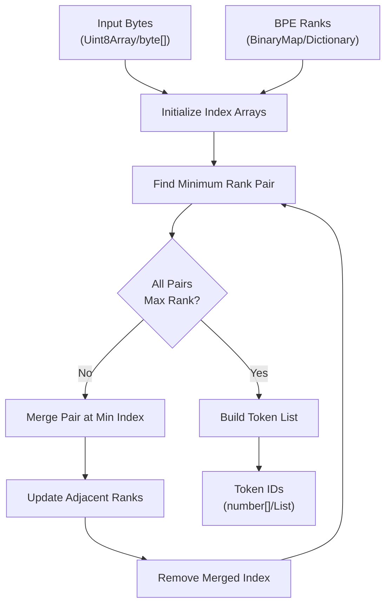
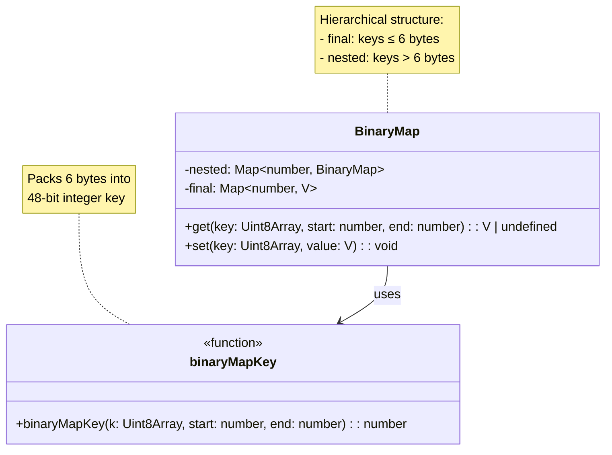
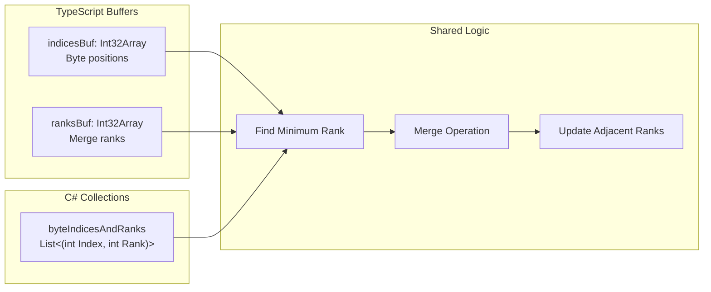
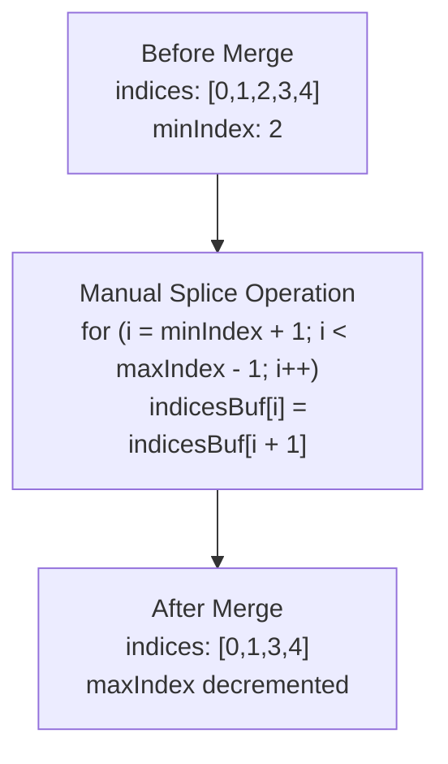
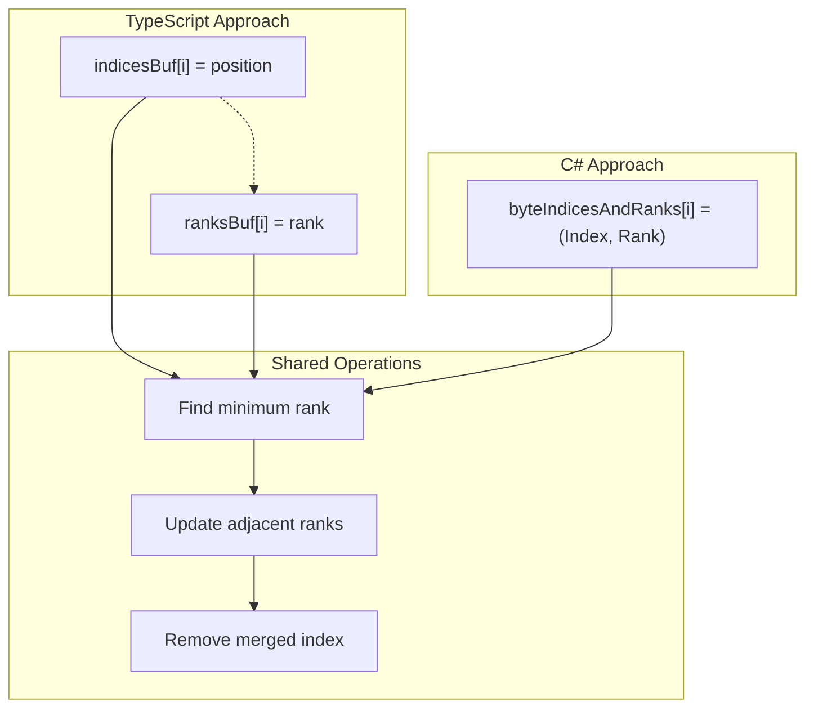
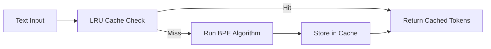

<!-- source: DeepWiki mcp.deepwiki.com · repo microsoft/Tokenizer · page 7.1 BPE Algorithm Deep Dive · fetched 2026-10-26 -->

# BPE Algorithm Deep Dive

<details>
<summary>Relevant source files</summary>

The following files were used as context for generating this wiki page:

- [Tokenizer_C#/TokenizerLib/Utils/BytePairEncoder.cs](Tokenizer_C#/TokenizerLib/Utils/BytePairEncoder.cs)
- [tokenizer_ts/src/bytePairEncode.ts](tokenizer_ts/src/bytePairEncode.ts)
- [tokenizer_ts/src/lru.ts](tokenizer_ts/src/lru.ts)
- [tokenizer_ts/src/textEncoder.ts](tokenizer_ts/src/textEncoder.ts)
- [tokenizer_ts/test/binaryMap.test.ts](tokenizer_ts/test/binaryMap.test.ts)
- [tokenizer_ts/test/lru.test.ts](tokenizer_ts/test/lru.test.ts)

</details>


This document provides a comprehensive technical explanation of the Byte Pair Encoding (BPE) algorithm implementation used in the Microsoft Tokenizer repository. It covers the core data structures, algorithmic approaches, and optimization techniques employed across both TypeScript and C# implementations.

For information about model files and BPE rank data formats, see [Model Files and Formats](#7.2). For general API usage patterns, see [TypeScript Core API](#3.1) and [C# Core API](#4.1).

## Algorithm Overview

The BPE algorithm transforms input bytes into tokens through an iterative merging process. The implementation receives a byte sequence and a set of merge ranks, then repeatedly identifies and merges the byte pair with the lowest rank until no more merges are possible.



Sources: [tokenizer_ts/src/bytePairEncode.ts:75-159](), [Tokenizer_C#/TokenizerLib/Utils/BytePairEncoder.cs:13-76]()

## Core Data Structures

### BinaryMap Implementation

The TypeScript implementation uses a specialized `BinaryMap<V>` class that provides efficient lookups for byte sequences of varying lengths. This data structure addresses the performance bottleneck of looking up arbitrary byte sequences in the ranks dictionary.



The `binaryMapKey` function encodes up to 6 bytes into a single number using bit manipulation:

| Component | Byte Range | Bit Encoding |
|-----------|------------|--------------|
| Lower 24 bits | Bytes 0-2 | `k[0] \| (k[1] << 8) \| (k[2] << 16)` |
| Upper 24 bits | Bytes 3-5 | `k[3] \| (k[4] << 8) \| (k[5] << 16)` |
| Final key | Combined | `lower + (0x1000000 * upper)` |

Sources: [tokenizer_ts/src/bytePairEncode.ts:14-31](), [tokenizer_ts/src/bytePairEncode.ts:33-64]()

### Rank Management System

Both implementations maintain arrays to track byte positions and their corresponding merge ranks:



Sources: [tokenizer_ts/src/bytePairEncode.ts:66-67](), [tokenizer_ts/src/bytePairEncode.ts:86-89](), [Tokenizer_C#/TokenizerLib/Utils/BytePairEncoder.cs:20-24]()

## Algorithm Implementation Details

### Core Merging Loop

The `bytePairEncode` function implements the BPE algorithm through several phases:

```mermaid
sequenceDiagram
    participant Func as "bytePairEncode"
    participant Buf as "Buffer Arrays"
    participant Ranks as "BinaryMap/Dictionary"
    participant Output as "Token List"
    
    Func->>Buf: Initialize indices and ranks arrays
    Func->>Ranks: Compute initial pair ranks
    
    loop Until no more merges
        Func->>Buf: Find minimum rank pair
        alt minRank < MaxRank
            Func->>Buf: Update adjacent pair ranks
            Func->>Buf: Remove merged index
            Func->>Buf: Update tracking arrays
        else
            break
        end
    end
    
    Func->>Ranks: Look up final token IDs
    Func->>Output: Return token sequence
```

The TypeScript implementation uses pre-allocated buffers that resize dynamically:

```typescript
// Buffer management from bytePairEncode.ts:86-89
while (ranksBuf.length < length * 2) {
    indicesBuf = new Int32Array(indicesBuf.length * 2);
    ranksBuf = new Int32Array(ranksBuf.length * 2);
}
```

Sources: [tokenizer_ts/src/bytePairEncode.ts:75-159](), [Tokenizer_C#/TokenizerLib/Utils/BytePairEncoder.cs:25-76]()

### Rank Calculation Function

Both implementations include a nested `getRank` function that computes merge ranks for byte pairs:

| Parameter | TypeScript | C# | Purpose |
|-----------|------------|----|---------| 
| `startIndex` | `number` | `int` | Position in index array |
| `skip` | `number` (default 0) | `int` (default 0) | Indices to skip for adjacent pairs |
| Return | `number` | `int` | Rank value or `MaxRank` |

The function performs bounds checking and rank lookup:
- Validates that the target range exists within current indices
- Extracts byte subsequence using start/end positions  
- Queries the ranks dictionary for the byte sequence
- Returns `Constant.MaxRank` or `int.MaxValue` if not found

Sources: [tokenizer_ts/src/bytePairEncode.ts:109-121](), [Tokenizer_C#/TokenizerLib/Utils/BytePairEncoder.cs:25-36]()

### Index Management and Splicing

The TypeScript implementation optimizes array manipulation through direct index copying rather than using built-in array methods:



Sources: [tokenizer_ts/src/bytePairEncode.ts:129-134]()

## Cross-Language Implementation Comparison

### Data Structure Differences

| Aspect | TypeScript | C# |
|--------|------------|-----|
| Rank Storage | `BinaryMap<number>` | `IReadOnlyDictionary<byte[], int>` |
| Index Tracking | Separate `Int32Array` buffers | Single `List<(int Index, int Rank)>` |
| Memory Management | Pre-allocated, resize on demand | Dynamic list operations |
| Key Optimization | 48-bit integer packing | Built-in dictionary hashing |

### Algorithmic Variations

The C# implementation uses tuple-based tracking while TypeScript maintains parallel arrays:



Sources: [tokenizer_ts/src/bytePairEncode.ts:66-67](), [tokenizer_ts/src/bytePairEncode.ts:98-105](), [Tokenizer_C#/TokenizerLib/Utils/BytePairEncoder.cs:20-24](), [Tokenizer_C#/TokenizerLib/Utils/BytePairEncoder.cs:57-63]()

## Performance Optimizations

### Buffer Pre-allocation

The TypeScript implementation maintains global buffers to avoid repeated allocations:

```typescript
let ranksBuf = new Int32Array(128);
let indicesBuf = new Int32Array(128);
```

These buffers resize exponentially when needed, reducing garbage collection pressure during tokenization.

### LRU Caching Integration

While not directly part of the BPE algorithm, the system integrates with an LRU cache for frequently tokenized strings:



Sources: [tokenizer_ts/src/bytePairEncode.ts:66-89](), [tokenizer_ts/src/lru.ts:13-77]()

### Constant Definitions

The algorithm uses predefined constants to avoid magic numbers and enable compiler optimizations:

| Constant | Value | Purpose |
|----------|-------|---------|
| `BytesPerLevel` | 6 | Maximum bytes per BinaryMap level |
| `MaxRank` | `0x7FFFFFFF` | Sentinel value for invalid ranks |

Sources: [tokenizer_ts/src/bytePairEncode.ts:4-11]()

---

