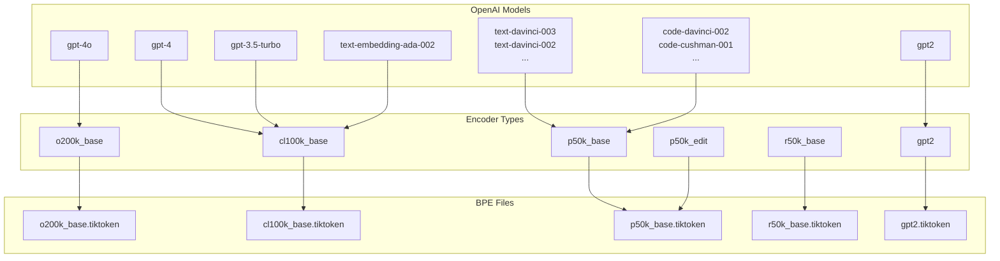
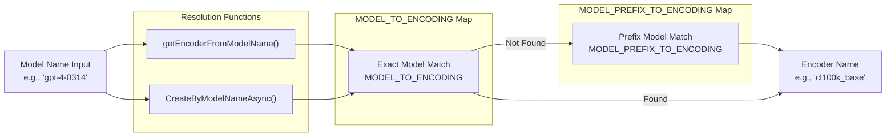
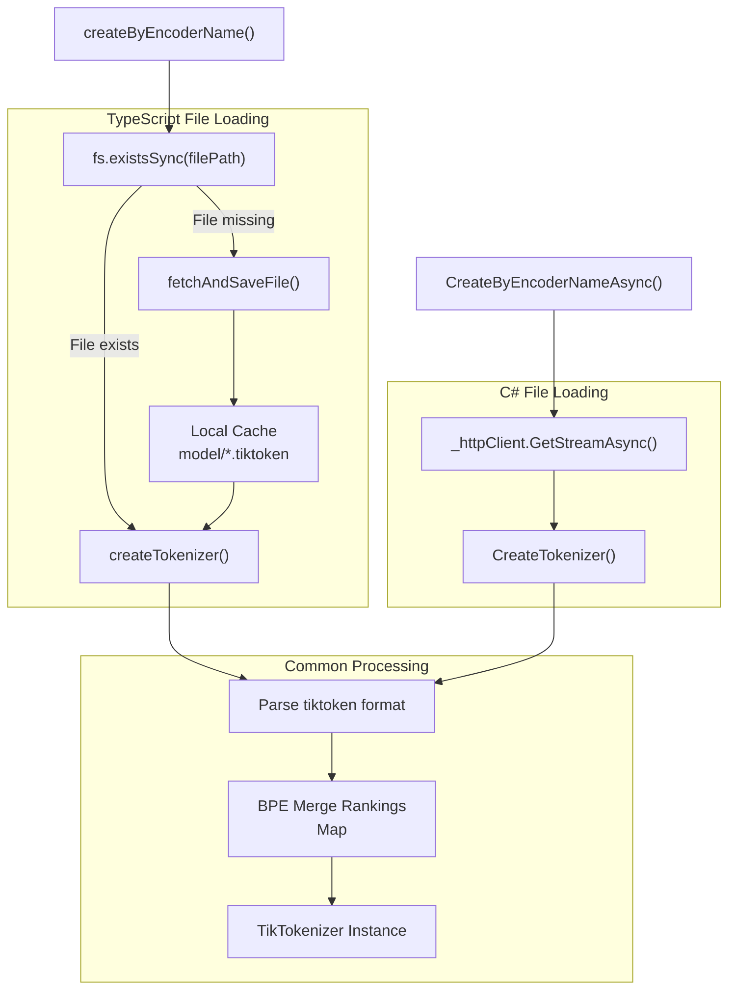
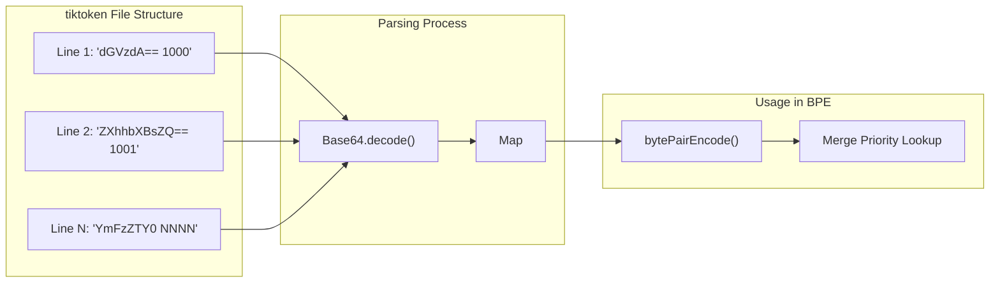
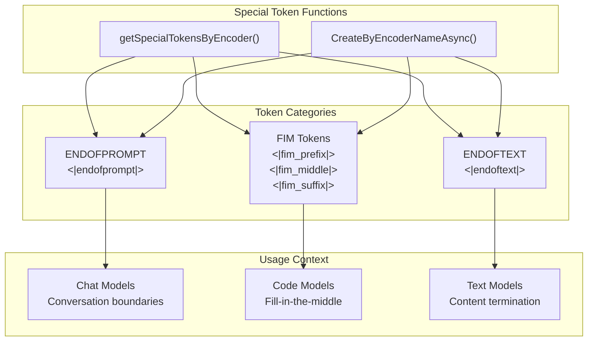
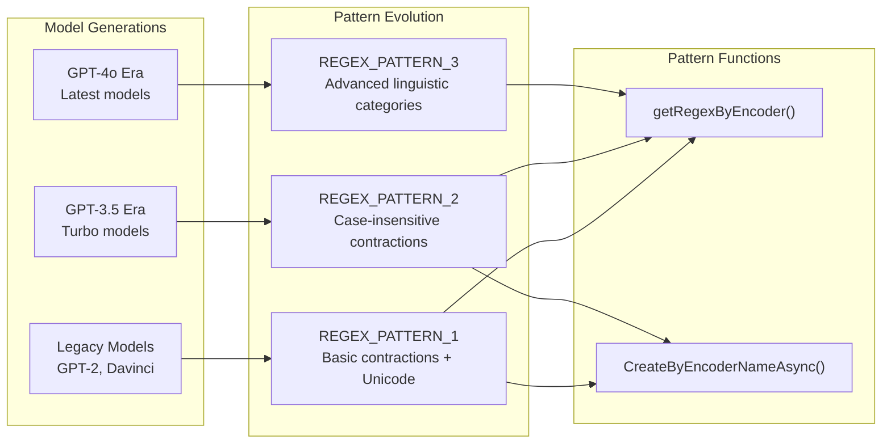

<!-- source: DeepWiki mcp.deepwiki.com · repo microsoft/Tokenizer · page 7.2 Model Files and Formats · fetched 2026-10-26 -->

# Model Files and Formats

<details>
<summary>Relevant source files</summary>

The following files were used as context for generating this wiki page:

- [Tokenizer_C#/TokenizerLib/TokenizerBuilder.cs](Tokenizer_C#/TokenizerLib/TokenizerBuilder.cs)
- [model/gpt2.tiktoken](model/gpt2.tiktoken)
- [tokenizer_ts/src/tokenizerBuilder.ts](tokenizer_ts/src/tokenizerBuilder.ts)

</details>


This document covers the BPE (Byte Pair Encoding) model files and formats used by the Microsoft Tokenizer library. It explains how different OpenAI models map to specific encoders, the structure of `.tiktoken` files, and the loading mechanisms for both TypeScript and C# implementations.

For information about the core BPE algorithm implementation, see [BPE Algorithm Deep Dive](#7.1). For details about the builder patterns and API usage, see [TypeScript Model Support and Builder](#3.3) and [C# Model Support and Builder](#4.3).

## Encoder Types and Model Mappings

The tokenizer supports multiple encoder types, each corresponding to different generations of OpenAI models. Each encoder defines specific BPE merge rules, special tokens, and text splitting patterns.



Sources: [tokenizer_ts/src/tokenizerBuilder.ts:6-55](), [Tokenizer_C#/TokenizerLib/TokenizerBuilder.cs:17-66]()

## Model-to-Encoder Resolution

Both implementations use identical mapping logic to resolve model names to encoder types. The system supports both exact matches and prefix matching for model variants.



Sources: [tokenizer_ts/src/tokenizerBuilder.ts:91-104](), [Tokenizer_C#/TokenizerLib/TokenizerBuilder.cs:82-98]()

## BPE File Locations and Sources

The tokenizer loads BPE merge data from remote URLs. Most files are hosted on Azure Blob Storage, with the GPT-2 model file hosted on GitHub.

| Encoder | File URL | Local Cache |
|---------|----------|-------------|
| `o200k_base` | `https://openaipublic.blob.core.windows.net/encodings/o200k_base.tiktoken` | `model/o200k_base.tiktoken` |
| `cl100k_base` | `https://openaipublic.blob.core.windows.net/encodings/cl100k_base.tiktoken` | `model/cl100k_base.tiktoken` |
| `p50k_base` | `https://openaipublic.blob.core.windows.net/encodings/p50k_base.tiktoken` | `model/p50k_base.tiktoken` |
| `r50k_base` | `https://openaipublic.blob.core.windows.net/encodings/r50k_base.tiktoken` | `model/r50k_base.tiktoken` |
| `gpt2` | `https://raw.githubusercontent.com/microsoft/Tokenizer/main/model/gpt2.tiktoken` | `model/gpt2.tiktoken` |

Sources: [tokenizer_ts/src/tokenizerBuilder.ts:237-260](), [Tokenizer_C#/TokenizerLib/TokenizerBuilder.cs:111-177]()

## File Loading and Caching Mechanisms

The TypeScript implementation includes file caching to avoid repeated downloads, while the C# implementation streams files directly from URLs.



Sources: [tokenizer_ts/src/tokenizerBuilder.ts:269-285](), [Tokenizer_C#/TokenizerLib/TokenizerBuilder.cs:193-213]()

## TikToken File Format

The `.tiktoken` files use a simple base64-encoded format where each line represents one BPE merge rule:

```
base64_encoded_token_bytes rank_number
```

The files are parsed to create mappings from byte sequences to their merge priorities, which drive the BPE algorithm's merge decisions.



Sources: [tokenizer_ts/src/tokenizerBuilder.ts:296-309](), [Tokenizer_C#/TokenizerLib/TokenizerBuilder.cs:210-213]()

## Special Tokens Configuration

Each encoder defines specific special tokens with fixed token IDs. These tokens handle model-specific control sequences and formatting.

| Encoder | Special Tokens | Token IDs |
|---------|----------------|-----------|
| `o200k_base` | `<\|endoftext\|>`, `<\|endofprompt\|>` | 199999, 200018 |
| `cl100k_base` | `<\|endoftext\|>`, `<\|fim_prefix\|>`, `<\|fim_middle\|>`, `<\|fim_suffix\|>`, `<\|endofprompt\|>` | 100257, 100258, 100259, 100260, 100276 |
| `p50k_edit` | `<\|endoftext\|>`, `<\|fim_prefix\|>`, `<\|fim_middle\|>`, `<\|fim_suffix\|>` | 50256, 50281, 50282, 50283 |
| `p50k_base` | `<\|endoftext\|>` | 50256 |
| `r50k_base` | `<\|endoftext\|>` | 50256 |
| `gpt2` | `<\|endoftext\|>` | 50256 |



Sources: [tokenizer_ts/src/tokenizerBuilder.ts:128-175](), [Tokenizer_C#/TokenizerLib/TokenizerBuilder.cs:114-176]()

## Regex Patterns for Text Splitting

Different encoders use specific regex patterns to split input text before applying BPE merges. These patterns evolved with newer model generations to handle more complex text structures.

| Encoder | Pattern Constant | Pattern Description |
|---------|------------------|---------------------|
| `o200k_base` | `REGEX_PATTERN_3` | Advanced Unicode-aware pattern with detailed linguistic categories |
| `cl100k_base` | `REGEX_PATTERN_2` | Enhanced pattern with case-insensitive contractions |
| `p50k_base`, `p50k_edit`, `r50k_base`, `gpt2` | `REGEX_PATTERN_1` | Basic pattern for contractions, letters, numbers, and whitespace |



Sources: [tokenizer_ts/src/tokenizerBuilder.ts:66-89](), [tokenizer_ts/src/tokenizerBuilder.ts:182-203](), [Tokenizer_C#/TokenizerLib/TokenizerBuilder.cs:112-167]()