# Page: Overview

# Overview

<details>
<summary>Relevant source files</summary>

The following files were used as context for generating this wiki page:

- [CONTRIBUTING.md](CONTRIBUTING.md)
- [README.md](README.md)
- [SUPPORT.md](SUPPORT.md)
- [tokenizer_ts/README.md](tokenizer_ts/README.md)

</details>


## Purpose and Scope

This document provides a comprehensive overview of the Microsoft Tokenizer repository, which contains dual-language implementations of Byte Pair Encoding (BPE) tokenization for OpenAI large language models. The repository provides both TypeScript and C# implementations that enable prompt tokenization in Node.js, web browser, and .NET environments before feeding prompts into LLMs.

For detailed implementation specifics, see the [TypeScript Implementation](#3) and [C# Implementation](#4) sections. For quick setup instructions, see [Getting Started](#2). For advanced technical details about the BPE algorithm, see [BPE Algorithm Deep Dive](#7.1).

## Repository Architecture

The Microsoft Tokenizer repository implements a dual-language approach to BPE tokenization, providing equivalent functionality across TypeScript and C# ecosystems. Both implementations are based on the open-sourced Rust implementation from [OpenAI tiktoken](https://github.com/openai/tiktoken).

```mermaid
graph TB
    subgraph REPO["Microsoft Tokenizer Repository"]
        subgraph TS_IMPL["TypeScript Implementation"]
            TS_PKG["@microsoft/tiktokenizer"]
            TS_SRC["tokenizer_ts/"]
        end
        
        subgraph CS_IMPL["C# Implementation"] 
            CS_PKG["Microsoft.DeepDev.TokenizerLib"]
            CS_SRC["Tokenizer_C#/"]
            CS_NOTICE["Migration Notice:<br/>→ Microsoft.ML.Tokenizers"]
        end
        
        subgraph SHARED["Shared Resources"]
            README["README.md"]
            CONTRIB["CONTRIBUTING.md"]
            BPE_MODELS["BPE Model Files<br/>*.tiktoken"]
        end
    end
    
    subgraph EXTERNAL["External Systems"]
        OPENAI_TIKTOKEN["OpenAI tiktoken<br/>(Rust implementation)"]
        OPENAI_MODELS["OpenAI Models<br/>gpt-4, gpt-3.5-turbo, etc."]
        NPM_REG["npm Registry"]
        NUGET_REG["NuGet Registry"]
    end
    
    TS_PKG --> NPM_REG
    CS_PKG --> NUGET_REG
    
    TS_IMPL -.->|"Based on"| OPENAI_TIKTOKEN
    CS_IMPL -.->|"Based on"| OPENAI_TIKTOKEN
    
    TS_PKG --> OPENAI_MODELS
    CS_PKG --> OPENAI_MODELS
    
    CS_NOTICE -.->|"Migrate to"| NUGET_REG
```

**Repository Structure Overview**
Sources: [README.md:1-25](), [tokenizer_ts/README.md:1-8](), [CONTRIBUTING.md:10-26]()

## Core Functionality

Both implementations provide equivalent BPE tokenization capabilities with the following core features:

| Feature | TypeScript API | C# API | Description |
|---------|----------------|--------|-------------|
| Model Creation | `createByModelName()` | `TokenizerBuilder` | Factory pattern for creating tokenizers |
| Text Encoding | `tokenizer.encode()` | `tikTokenizer.Encode()` | Convert text to token IDs |
| Text Decoding | `tokenizer.decode()` | `tikTokenizer.Decode()` | Convert token IDs back to text |
| Trim Operations | `encodeTrimSuffix()`, `encodeTrimPrefix()` | Similar methods | Encode with length constraints |
| Special Tokens | `specialTokens` parameter | Special token handling | Support for model-specific tokens |

The implementations support multiple OpenAI model families including `gpt-4`, `gpt-3.5-turbo`, and other models through configurable BPE rank files.

Sources: [tokenizer_ts/README.md:15-43](), [README.md:3-11]()

## Implementation Architecture

### Core BPE Algorithm Flow

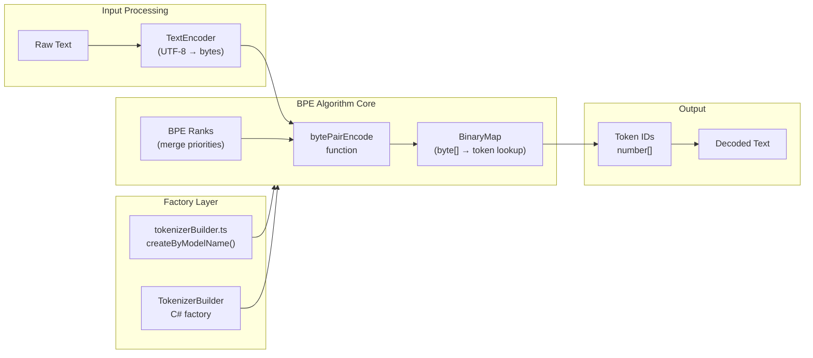

### Language-Specific Components

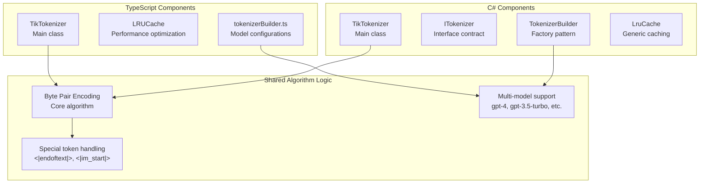

Sources: [README.md:3](), [tokenizer_ts/README.md:45]()

## Key Components and Usage Contexts

### TypeScript Implementation (`@microsoft/tiktokenizer`)

The TypeScript implementation targets Node.js and browser environments, providing:

- **Package**: Distributed via npm as `@microsoft/tiktokenizer`
- **Main API**: `createByModelName()` factory function from `tokenizerBuilder.ts`
- **Core Class**: `TikTokenizer` with methods like `encode()`, `decode()`, `encodeTrimSuffix()`
- **Environment**: Node.js ≥18.0.0 and modern browsers
- **Use Cases**: Web applications, Node.js services, client-side tokenization

Sources: [tokenizer_ts/README.md:8-13](), [tokenizer_ts/README.md:15-26]()

### C# Implementation (`Microsoft.DeepDev.TokenizerLib`)

The C# implementation targets .NET environments with:

- **Package**: Distributed via NuGet as `Microsoft.DeepDev.TokenizerLib`
- **Main API**: `TokenizerBuilder` factory and `ITokenizer` interface
- **Core Class**: `TikTokenizer` implementing `ITokenizer`
- **Framework**: .NET Standard 2.0 compatibility
- **Use Cases**: .NET applications, services, and libraries

**Important Migration Notice**: Users should migrate to `Microsoft.ML.Tokenizers` as this library is being consolidated into the official .NET ML tokenizer library, with improved performance expected alongside .NET 9.0 release.

Sources: [README.md:11-12]()

## Development and Distribution

The repository maintains separate build and distribution pipelines:

| Aspect | TypeScript | C# |
|--------|------------|-----|
| **Build System** | npm scripts | MSBuild (.csproj) |
| **CI/CD** | GitHub Actions | Azure Pipelines |
| **Testing** | `npm run test` | `dotnet test` |
| **Distribution** | npmjs.org | NuGet.org |
| **Code Style** | ESLint + Prettier | Microsoft C# Conventions |

Both implementations follow the same contributing guidelines defined in [CONTRIBUTING.md:1-76]() and maintain equivalent functionality despite different language ecosystems.

Sources: [CONTRIBUTING.md:8-44](), [README.md:14-16]()

---

# Page: Getting Started

# Getting Started

<details>
<summary>Relevant source files</summary>

The following files were used as context for generating this wiki page:

- [README.md](README.md)
- [SUPPORT.md](SUPPORT.md)
- [Tokenizer_C#/TokenizerLib/TokenizerLib.csproj](Tokenizer_C#/TokenizerLib/TokenizerLib.csproj)
- [tokenizer_ts/README.md](tokenizer_ts/README.md)
- [tokenizer_ts/package.json](tokenizer_ts/package.json)

</details>


This document provides a quick start guide for using the Microsoft Tokenizer repository, which offers byte pair encoding (BPE) tokenization for OpenAI large language models in both TypeScript and C#. You'll learn how to install, configure, and perform basic tokenization operations in both environments.

For detailed API documentation, see [TypeScript Implementation](#3) and [C# Implementation](#4). For performance optimization techniques, see [Performance and Benchmarking](#5).

## Overview

The Microsoft Tokenizer repository provides two parallel implementations of OpenAI's tiktoken BPE algorithm:

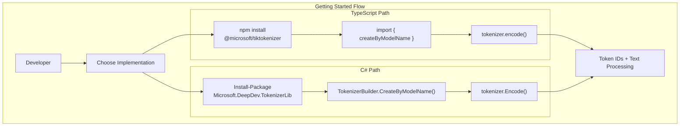

Sources: [README.md:1-25](), [tokenizer_ts/README.md:1-50]()

## TypeScript Quick Start

### Prerequisites

- Node.js 18.0.0 or higher
- npm or yarn package manager

### Installation

Install the npm package:

```bash
npm install @microsoft/tiktokenizer
```

### Basic Usage

```typescript
import { createByModelName } from '@microsoft/tiktokenizer';

// Define special tokens if needed
const IM_START = "<|im_start|>";
const IM_END = "<|im_end|>";
const specialTokens = new Map([
  [IM_START, 100264],
  [IM_END, 100265],
]);

// Create tokenizer and encode text
const main = async () => {
  const tokenizer = await createByModelName("gpt-3.5-turbo", specialTokens);
  const text = "<|im_start|>Hello World<|im_end|>";
  
  // Basic encoding
  const tokens = tokenizer.encode(text, Array.from(specialTokens.keys()));
  console.log("Tokens:", tokens);
  
  // Encoding with suffix trimming
  const trimmed = tokenizer.encodeTrimSuffix(text, 3, Array.from(specialTokens.keys()));
  console.log("Trimmed tokens:", trimmed.tokenIds);
  console.log("Trimmed text:", trimmed.text);
};

main();
```

Sources: [tokenizer_ts/README.md:15-43](), [tokenizer_ts/package.json:18-21]()

## C# Quick Start

> **Important Migration Notice**: Users of `Microsoft.DeepDev.TokenizerLib` should migrate to `Microsoft.ML.Tokenizers`, which will be the central tokenizer library for .NET going forward with improved performance.

### Prerequisites

- .NET Standard 2.0 or higher
- NuGet package manager

### Installation

Install the NuGet package:

```bash
Install-Package Microsoft.DeepDev.TokenizerLib
```

Or via .NET CLI:

```bash
dotnet add package Microsoft.DeepDev.TokenizerLib
```

### Basic Usage

```csharp
using Microsoft.DeepDev.TokenizerLib;

// Create tokenizer for specific model
var tokenizer = await TokenizerBuilder.CreateByModelNameAsync("gpt-3.5-turbo");

// Encode text to tokens
string text = "Hello World";
var tokens = tokenizer.Encode(text, Array.Empty<string>());
Console.WriteLine($"Tokens: [{string.Join(", ", tokens)}]");

// Decode tokens back to text
var decodedText = tokenizer.Decode(tokens);
Console.WriteLine($"Decoded: {decodedText}");
```

Sources: [README.md:9-13](), [Tokenizer_C#/TokenizerLib/TokenizerLib.csproj:4-28]()

## Core Concepts

Understanding these key components will help you work effectively with both implementations:

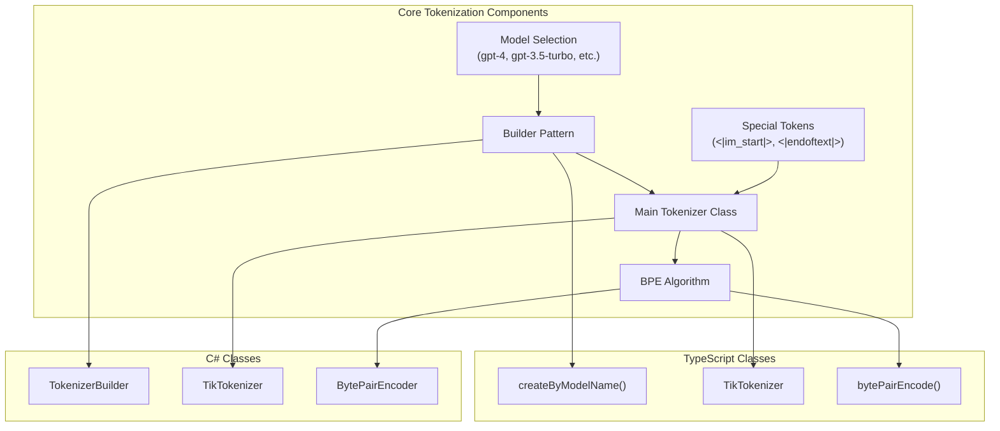

### Model Support

Both implementations support the same OpenAI models:

| Model | Description | Typical Use Case |
|-------|-------------|------------------|
| `gpt-4` | GPT-4 base model | Advanced reasoning tasks |
| `gpt-3.5-turbo` | ChatGPT model | Conversational AI |
| `text-davinci-003` | Legacy completion model | Text completion |
| `text-embedding-ada-002` | Embedding model | Semantic search |

### Special Tokens

Special tokens are model-specific markers that have special meaning:

- `<|endoftext|>` - End of document marker
- `<|im_start|>` - Start of message (chat models)
- `<|im_end|>` - End of message (chat models)
- `<|fim_prefix|>` - Fill-in-middle prefix

Sources: [tokenizer_ts/README.md:21-26](), [tokenizer_ts/README.md:44-45]()

## Common Operations

### Encoding Text

Both implementations provide similar encoding methods:

| Operation | TypeScript | C# | Purpose |
|-----------|------------|----|---------| 
| Basic encoding | `encode(text, allowedSpecial)` | `Encode(text, allowedSpecial)` | Convert text to token IDs |
| Trim suffix | `encodeTrimSuffix(text, maxTokens, allowedSpecial)` | N/A | Encode with suffix trimming |
| Trim prefix | `encodeTrimPrefix(text, maxTokens, allowedSpecial)` | N/A | Encode with prefix trimming |

### Decoding Tokens

Convert token IDs back to readable text:

- **TypeScript**: `decode(tokens)`
- **C#**: `Decode(tokens)`

Sources: [tokenizer_ts/README.md:32-39]()

## Performance Considerations

For production usage:

1. **Pre-download BPE files**: Avoid downloading model files on-the-fly by caching them locally
2. **Reuse tokenizer instances**: Create tokenizers once and reuse them across requests
3. **Handle large texts**: Use trimming methods for texts exceeding token limits

For detailed performance optimization strategies, see [Performance and Benchmarking](#5).

## Next Steps

- **TypeScript developers**: See [TypeScript Implementation](#3) for comprehensive API documentation
- **C# developers**: See [C# Implementation](#4) for detailed .NET integration
- **Advanced usage**: Explore [Advanced Topics](#7) for BPE algorithm internals
- **Contributing**: Follow [Development and Contributing](#6) guidelines

Sources: [README.md:1-25](), [tokenizer_ts/README.md:47-49]()

---

# Page: TypeScript Implementation

# TypeScript Implementation

<details>
<summary>Relevant source files</summary>

The following files were used as context for generating this wiki page:

- [tokenizer_ts/package.json](tokenizer_ts/package.json)
- [tokenizer_ts/src/tikTokenizer.ts](tokenizer_ts/src/tikTokenizer.ts)
- [tokenizer_ts/src/tokenizerBuilder.ts](tokenizer_ts/src/tokenizerBuilder.ts)

</details>


This document covers the TypeScript implementation of the Microsoft Tokenizer library, distributed as the `@microsoft/tiktokenizer` npm package. This implementation provides Byte Pair Encoding (BPE) tokenization for OpenAI large language models in Node.js and browser environments.

The TypeScript implementation focuses on performance optimization through caching and efficient data structures, while maintaining compatibility with OpenAI's tiktoken library. For information about the C# implementation, see [C# Implementation](#4). For performance analysis and benchmarking, see [Performance and Benchmarking](#5).

## Package Overview

The `@microsoft/tiktokenizer` package is distributed via npm and provides a complete TypeScript implementation of BPE tokenization. The package supports Node.js environments version 18.0.0 and higher, with browser compatibility through deferred module loading.

| Property | Value |
|----------|-------|
| Package Name | `@microsoft/tiktokenizer` |
| Current Version | 1.0.10 |
| License | MIT |
| Node.js Requirement | ≥18.0.0 |
| Main Entry Point | `dist/index.js` |

Sources: [tokenizer_ts/package.json:1-41]()

## Core Architecture

The TypeScript implementation follows a layered architecture with clear separation between tokenization logic, model configuration, and performance optimization components.

### System Component Diagram

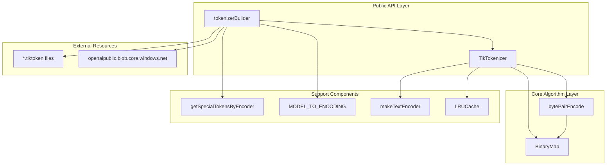

Sources: [tokenizer_ts/src/tikTokenizer.ts:1-495](), [tokenizer_ts/src/tokenizerBuilder.ts:1-310]()

## TikTokenizer Class

The `TikTokenizer` class is the primary interface for tokenization operations. It encapsulates the BPE algorithm, manages special tokens, and provides caching for performance optimization.

### Core Methods and Properties

```mermaid
graph LR
    subgraph "TikTokenizer Class"
        constructor["constructor()"]
        encode["encode()"]
        decode["decode()"]
        encodeTrimSuffix["encodeTrimSuffix()"]
        encodeTrimPrefix["encodeTrimPrefix()"]
        cache["cache: ILRUCache"]
    end
    
    subgraph "Internal Components"
        encoder["encoder: BinaryMap<number>"]
        decoder["decoder: Map<number, Uint8Array>"]
        regex["regex: RegExp"]
        specialTokensEncoder["specialTokensEncoder: ReadonlyMap<string, number>"]
        textEncoder["textEncoder: TextEncoder"]
        textDecoder["textDecoder: TextDecoder"]
    end
    
    constructor --> encoder
    constructor --> decoder
    constructor --> regex
    constructor --> specialTokensEncoder
    
    encode --> encoder
    encode --> cache
    decode --> decoder
    
    encodeTrimSuffix --> encode
    encodeTrimPrefix --> encode
```

### Constructor Parameters

The `TikTokenizer` constructor accepts the following parameters:

| Parameter | Type | Description |
|-----------|------|-------------|
| `tikTokenBpeFileOrDict` | `string \| Map<Uint8Array, number>` | BPE rank file path or parsed dictionary |
| `specialTokensEncoder` | `ReadonlyMap<string, number>` | Special tokens mapping |
| `regexPattern` | `string` | Regex pattern for text splitting |
| `cacheSize` | `number` | LRU cache size (default: 8192) |

Sources: [tokenizer_ts/src/tikTokenizer.ts:80-89]()

### Encoding Methods

The class provides three main encoding methods:

- **`encode(text: string, allowedSpecial?: ReadonlyArray<string>): number[]`** - Standard encoding with optional special token allowlist
- **`encodeTrimSuffix(text: string, maxTokenCount: number, allowedSpecial: ReadonlyArray<string>)`** - Encoding with suffix trimming to fit token limit
- **`encodeTrimPrefix(text: string, maxTokenCount: number, allowedSpecial?: ReadonlyArray<string>)`** - Encoding with prefix trimming to fit token limit

Sources: [tokenizer_ts/src/tikTokenizer.ts:152-181](), [tokenizer_ts/src/tikTokenizer.ts:300-361](), [tokenizer_ts/src/tikTokenizer.ts:370-468]()

## Model Support and Builder Pattern

The `tokenizerBuilder` module provides factory functions for creating tokenizers configured for specific OpenAI models. It manages model-to-encoding mappings and automatically downloads required BPE files.

### Model Configuration System

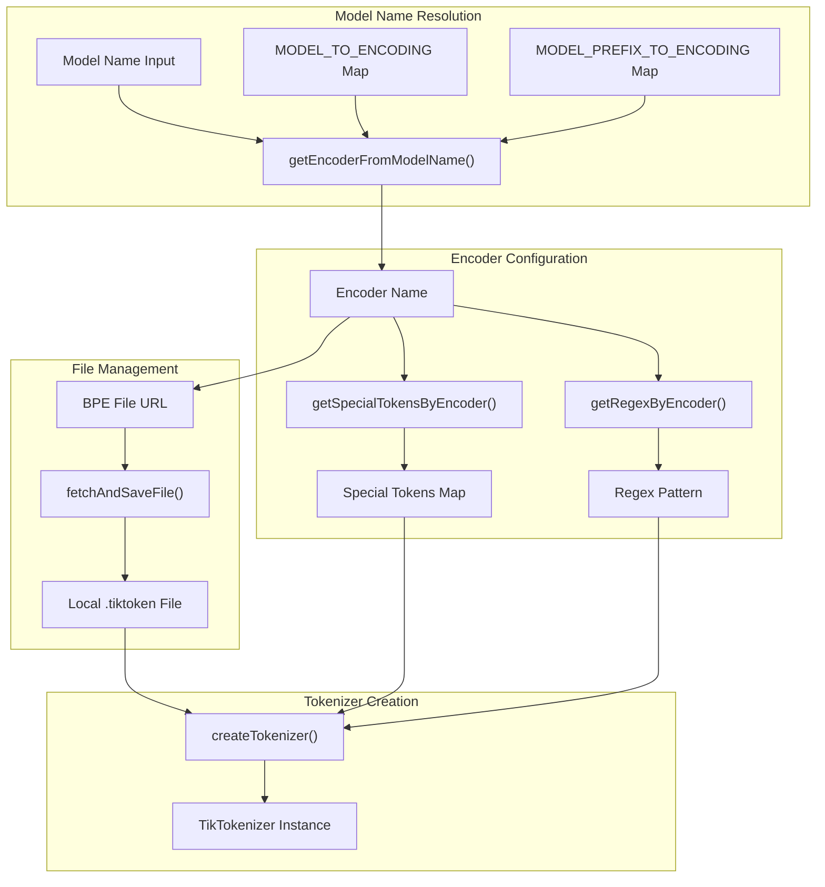

### Supported Models and Encodings

The implementation supports the following model categories and their corresponding encodings:

| Model Category | Example Models | Encoding | Regex Pattern |
|----------------|----------------|----------|---------------|
| GPT-4o | `gpt-4o`, `gpt-4o-2024-05-13` | `o200k_base` | `REGEX_PATTERN_3` |
| GPT-4 | `gpt-4`, `gpt-4-0314` | `cl100k_base` | `REGEX_PATTERN_2` |
| GPT-3.5 Turbo | `gpt-3.5-turbo`, `gpt-35-turbo` | `cl100k_base` | `REGEX_PATTERN_2` |
| Text Models | `text-davinci-003`, `text-davinci-002` | `p50k_base` | `REGEX_PATTERN_1` |
| Code Models | `code-davinci-002`, `davinci-codex` | `p50k_base` | `REGEX_PATTERN_1` |
| Legacy Models | `davinci`, `curie`, `babbage`, `ada` | `r50k_base` | `REGEX_PATTERN_1` |

Sources: [tokenizer_ts/src/tokenizerBuilder.ts:14-55](), [tokenizer_ts/src/tokenizerBuilder.ts:6-12]()

### Special Tokens by Encoding

Different encodings support different sets of special tokens:

| Encoding | Special Tokens | Token IDs |
|----------|----------------|-----------|
| `o200k_base` | `<\|endoftext\|>`, `<\|endofprompt\|>` | 199999, 200018 |
| `cl100k_base` | `<\|endoftext\|>`, `<\|fim_prefix\|>`, `<\|fim_middle\|>`, `<\|fim_suffix\|>`, `<\|endofprompt\|>` | 100257, 100258, 100259, 100260, 100276 |
| `p50k_edit` | `<\|endoftext\|>`, `<\|fim_prefix\|>`, `<\|fim_middle\|>`, `<\|fim_suffix\|>` | 50256, 50281, 50282, 50283 |
| Default | `<\|endoftext\|>` | 50256 |

Sources: [tokenizer_ts/src/tokenizerBuilder.ts:128-160]()

## Factory Functions

The builder module provides two main factory functions:

### `createByModelName(modelName: string, extraSpecialTokens?: ReadonlyMap<string, number>): Promise<TikTokenizer>`

Creates a tokenizer instance from an OpenAI model name. Automatically resolves the appropriate encoding and downloads required files.

### `createByEncoderName(encoderName: string, extraSpecialTokens?: ReadonlyMap<string, number>): Promise<TikTokenizer>`

Creates a tokenizer instance from an encoding name directly. Provides more granular control over the tokenizer configuration.

Sources: [tokenizer_ts/src/tokenizerBuilder.ts:210-218](), [tokenizer_ts/src/tokenizerBuilder.ts:226-286]()

## BPE Algorithm Implementation

The core BPE algorithm is implemented through the `bytePairEncode` function and `BinaryMap` class, which provide efficient byte-level tokenization with optimized lookups.

### Data Flow Architecture

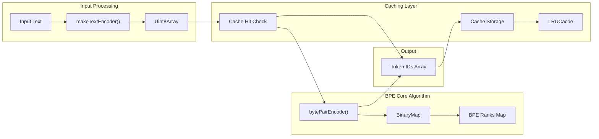

The algorithm follows these key steps:
1. Text input is converted to UTF-8 bytes using `makeTextEncoder()`
2. Cache is checked for previously computed results
3. On cache miss, `bytePairEncode()` processes the byte array using `BinaryMap` for efficient lookups
4. Results are cached for future use

Sources: [tokenizer_ts/src/tikTokenizer.ts:4-6](), [tokenizer_ts/src/tikTokenizer.ts:192-223]()

## Performance Optimization

The TypeScript implementation includes several performance optimizations:

### LRU Caching
- **Cache Size**: Default 8192 entries, configurable per tokenizer instance
- **Cache Key**: Raw text pieces from regex splitting
- **Cache Value**: Pre-computed token ID arrays
- **Implementation**: Custom `LRUCache` class with `ILRUCache` interface

### Efficient Data Structures
- **`BinaryMap<T>`**: Optimized byte array to value mapping
- **`ReadonlyMap<K, V>`**: Immutable mappings for model configurations
- **`Uint8Array`**: Native byte array handling for UTF-8 encoding

### Regex Optimization
Three different regex patterns are used based on model requirements:
- **`REGEX_PATTERN_1`**: Legacy pattern for older models
- **`REGEX_PATTERN_2`**: Pattern for GPT-3.5-turbo and GPT-4
- **`REGEX_PATTERN_3`**: Advanced pattern for GPT-4o with improved Unicode handling

Sources: [tokenizer_ts/src/tikTokenizer.ts:69](), [tokenizer_ts/src/tokenizerBuilder.ts:66-89]()

## Build and Distribution

The TypeScript implementation uses a standard Node.js build pipeline with TypeScript compilation and npm distribution.

### Build Configuration
- **TypeScript Compiler**: Configured via `tsconfig.json`
- **Build Command**: `tsc -p ./tsconfig.json`
- **Output Directory**: `dist/`
- **Entry Point**: `dist/index.js`

### Development Dependencies
The package includes comprehensive development tooling:
- **Testing**: Mocha with TypeScript support via ts-node
- **Linting**: ESLint with TypeScript parser and Prettier integration
- **Type Checking**: TypeScript definitions for Node.js and Mocha

### NPM Scripts
| Script | Command | Purpose |
|--------|---------|---------|
| `build` | `tsc -p ./tsconfig.json` | Compile TypeScript to JavaScript |
| `test` | `mocha -u tdd --require ts-node/register test/**/*.ts` | Run test suite |
| `watch` | `tsc -p ./tsconfig.json --watch` | Watch mode compilation |
| `eslint` | `eslint src --ext ts` | Lint TypeScript files |
| `format` | `prettier --write "./**/*.{ts,tsx}"` | Format code |

Sources: [tokenizer_ts/package.json:22-40]()

---

# Page: Core API

# Core API

<details>
<summary>Relevant source files</summary>

The following files were used as context for generating this wiki page:

- [tokenizer_ts/src/tikTokenizer.ts](tokenizer_ts/src/tikTokenizer.ts)
- [tokenizer_ts/test/tikTokenizer.test.ts](tokenizer_ts/test/tikTokenizer.test.ts)

</details>


This document covers the primary public API of the TypeScript tokenizer implementation, specifically the `TikTokenizer` class and its core methods for encoding and decoding text. This page focuses on the main user-facing interface and usage patterns.

For information about the BPE algorithm implementation details, see [BPE Algorithm Implementation](#3.2). For tokenizer creation and model configuration, see [Model Support and Builder](#3.3).

## TikTokenizer Class Overview

The `TikTokenizer` class is the main entry point for tokenization operations in the TypeScript implementation. It provides methods for encoding text to token IDs and decoding token IDs back to text, with support for special tokens and performance optimizations.

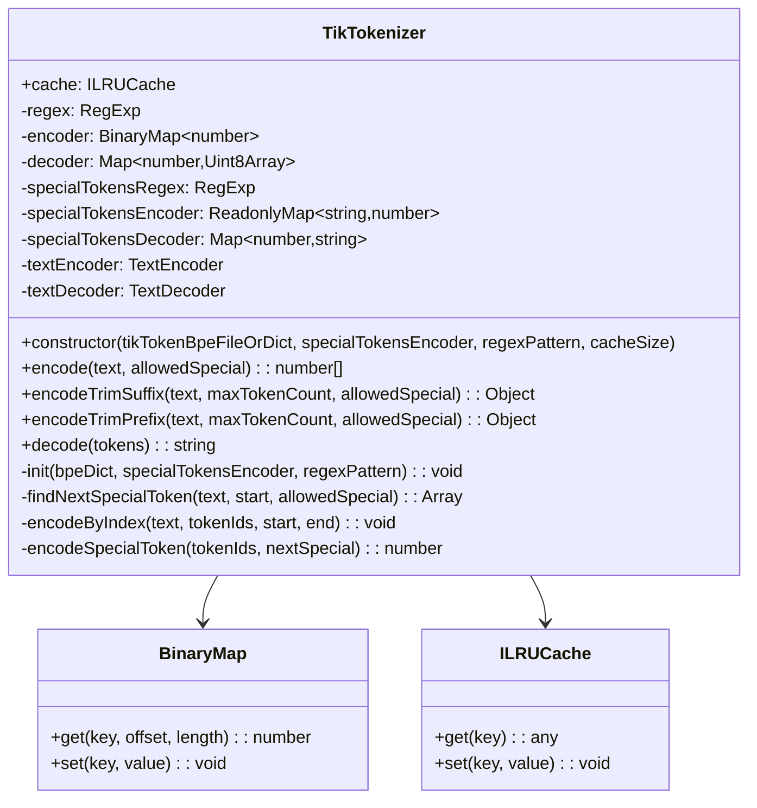

Sources: [tokenizer_ts/src/tikTokenizer.ts:60-494]()

## Constructor and Initialization

The `TikTokenizer` constructor accepts BPE ranking data, special token mappings, regex patterns for text splitting, and cache configuration.

| Parameter | Type | Description |
|-----------|------|-------------|
| `tikTokenBpeFileOrDict` | `string \| Map<Uint8Array, number>` | File path to BPE ranks file or pre-parsed BPE dictionary |
| `specialTokensEncoder` | `ReadonlyMap<string, number>` | Mapping of special token strings to token IDs |
| `regexPattern` | `string` | Regular expression pattern for text segmentation |
| `cacheSize` | `number` | LRU cache size (default: 8192) |

The constructor initializes internal data structures including the BPE encoder, decoder mappings, and special token handling components.

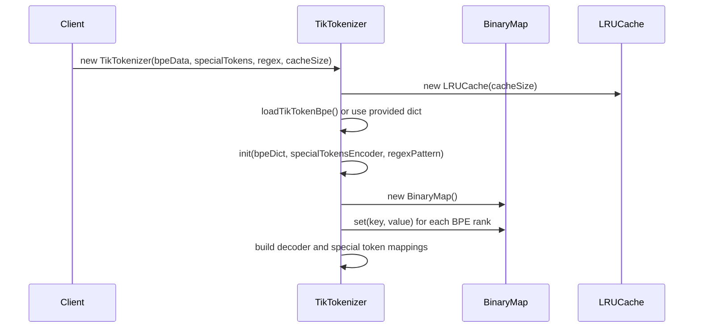

Sources: [tokenizer_ts/src/tikTokenizer.ts:80-89](), [tokenizer_ts/src/tikTokenizer.ts:91-121]()

## Primary Encoding Method

The `encode()` method converts input text into an array of token IDs, with optional support for special tokens.

### Method Signature
```typescript
public encode(text: string, allowedSpecial?: ReadonlyArray<string>): number[]
```

### Parameters
- `text`: Input string to tokenize
- `allowedSpecial`: Optional array of special token strings that should be preserved during encoding

### Encoding Process Flow

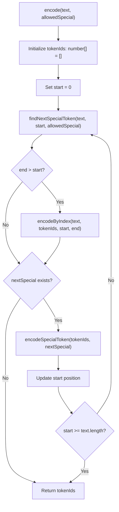

The encoding process handles both regular text segments and special tokens, using regex-based text segmentation and BPE encoding for regular text portions.

Sources: [tokenizer_ts/src/tikTokenizer.ts:152-181](), [tokenizer_ts/src/tikTokenizer.ts:192-223]()

## Decoding Method

The `decode()` method converts an array of token IDs back into readable text.

### Method Signature
```typescript
public decode(tokens: number[]): string
```

### Decoding Process

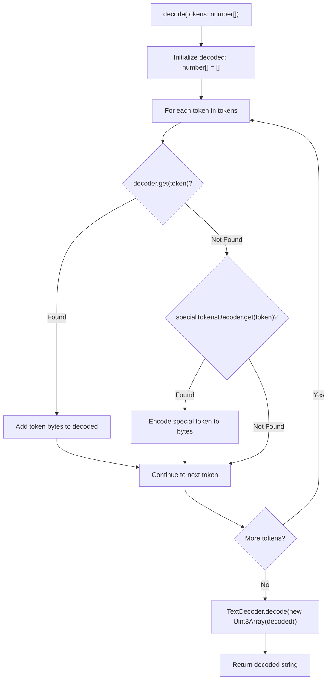

Sources: [tokenizer_ts/src/tikTokenizer.ts:475-493]()

## Advanced Encoding Methods

The `TikTokenizer` provides two specialized encoding methods for handling token count limits through text trimming.

### encodeTrimSuffix Method

Encodes text while trimming from the end when the token count exceeds the specified maximum.

```typescript
public encodeTrimSuffix(
    text: string, 
    maxTokenCount: number, 
    allowedSpecial: ReadonlyArray<string>
): { tokenIds: number[]; text: string }
```

Returns both the token IDs and the actual text that was encoded after trimming.

### encodeTrimPrefix Method

Encodes text while trimming from the beginning when the token count exceeds the specified maximum.

```typescript
public encodeTrimPrefix(
    text: string, 
    maxTokenCount: number, 
    allowedSpecial?: ReadonlyArray<string>
): { tokenIds: number[]; text: string }
```

Both methods maintain token boundaries and handle special tokens appropriately during the trimming process.

Sources: [tokenizer_ts/src/tikTokenizer.ts:300-361](), [tokenizer_ts/src/tikTokenizer.ts:370-468]()

## Caching System

The `TikTokenizer` uses an LRU cache to optimize performance by storing previously encoded text segments.

| Property | Type | Description |
|----------|------|-------------|
| `cache` | `ILRUCache` | Public readonly access to the LRU cache instance |

The cache stores mappings from text pieces to their corresponding token arrays, significantly improving performance for repeated or similar text segments.

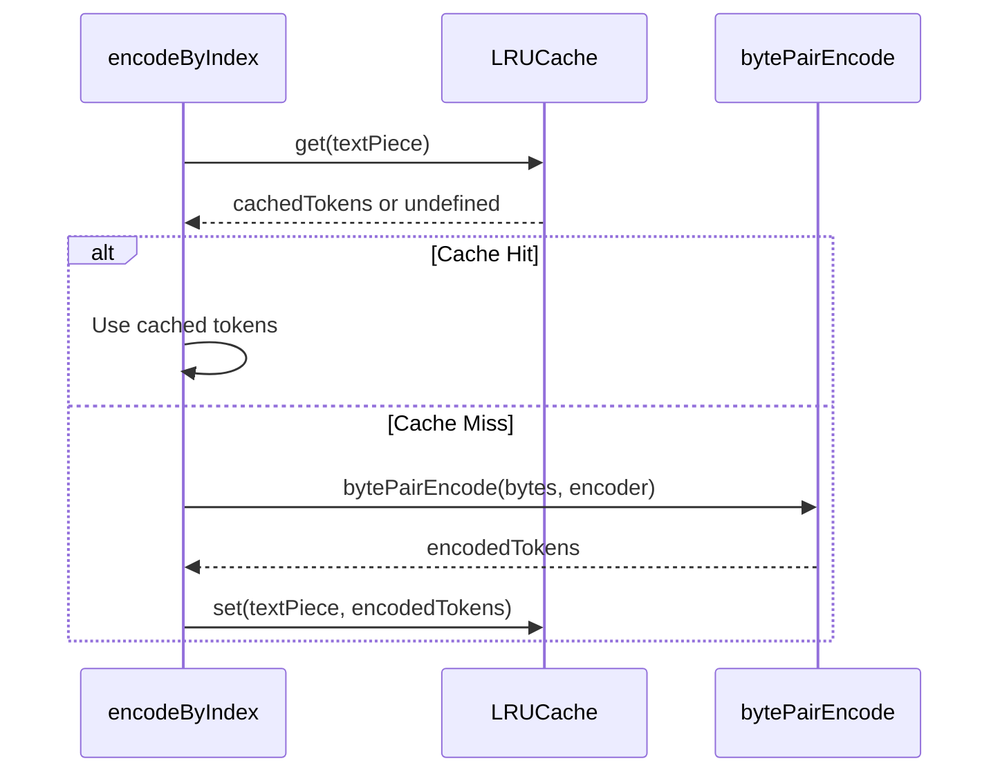

Sources: [tokenizer_ts/src/tikTokenizer.ts:69](), [tokenizer_ts/src/tikTokenizer.ts:202-221]()

## Usage Examples from Tests

The test suite demonstrates typical usage patterns:

```typescript
// Basic encoding/decoding
const tokenizer = await createByModelName("gpt-3.5-turbo", specialTokens);
const tokens = tokenizer.encode("Hello World!");
const decoded = tokenizer.decode(tokens);

// Special token handling
const textWithSpecial = "<|im_start|>Hello World<|im_end|>";
const tokens = tokenizer.encode(textWithSpecial, ["<|im_start|>", "<|im_end|>"]);

// Trimming operations
const result = tokenizer.encodeTrimSuffix(text, 100, allowedSpecial);
const { tokenIds, text: trimmedText } = result;
```

Sources: [tokenizer_ts/test/tikTokenizer.test.ts:16-230]()

---

# Page: BPE Algorithm Implementation

# BPE Algorithm Implementation

<details>
<summary>Relevant source files</summary>

The following files were used as context for generating this wiki page:

- [tokenizer_ts/src/bytePairEncode.ts](tokenizer_ts/src/bytePairEncode.ts)
- [tokenizer_ts/src/lru.ts](tokenizer_ts/src/lru.ts)
- [tokenizer_ts/src/textEncoder.ts](tokenizer_ts/src/textEncoder.ts)
- [tokenizer_ts/test/binaryMap.test.ts](tokenizer_ts/test/binaryMap.test.ts)
- [tokenizer_ts/test/lru.test.ts](tokenizer_ts/test/lru.test.ts)

</details>


This document covers the TypeScript implementation of the Byte Pair Encoding (BPE) algorithm and its supporting data structures within the `@microsoft/tiktokenizer` package. The BPE algorithm is the core tokenization mechanism that iteratively merges the most frequent byte pairs based on learned merge rules.

For information about the C# BPE implementation, see [4.2](#4.2). For details about model loading and builder patterns, see [3.3](#3.3).

## Core Algorithm Overview

The BPE algorithm implementation consists of three primary components that work together to efficiently tokenize text:

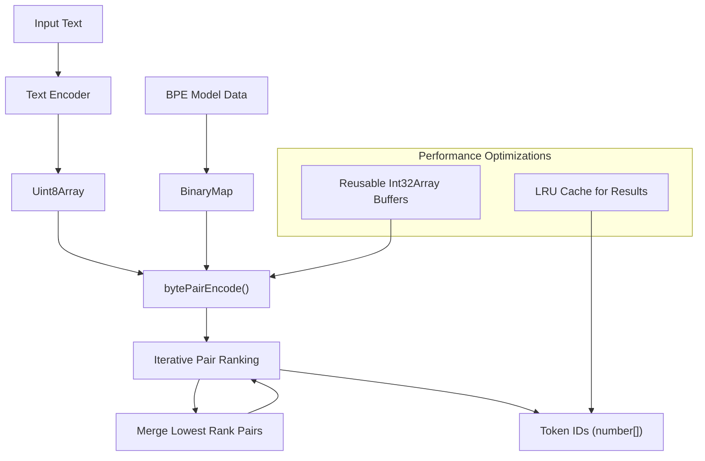

**Core BPE Algorithm Process**
Sources: [tokenizer_ts/src/bytePairEncode.ts:75-159]()

The `bytePairEncode` function implements the standard BPE merging process:

1. **Initialization**: Sets up reusable buffers (`ranksBuf`, `indicesBuf`) and finds the initial minimum rank pair
2. **Iterative Merging**: Repeatedly finds the lowest-ranked byte pair and merges it
3. **Rank Updates**: Updates ranks for affected adjacent pairs after each merge
4. **Output Generation**: Converts the final merged segments into token IDs

## BinaryMap Data Structure

The `BinaryMap<V>` class provides efficient storage and retrieval of byte sequences to values (typically rank numbers). It uses a hierarchical approach to handle variable-length byte sequences:

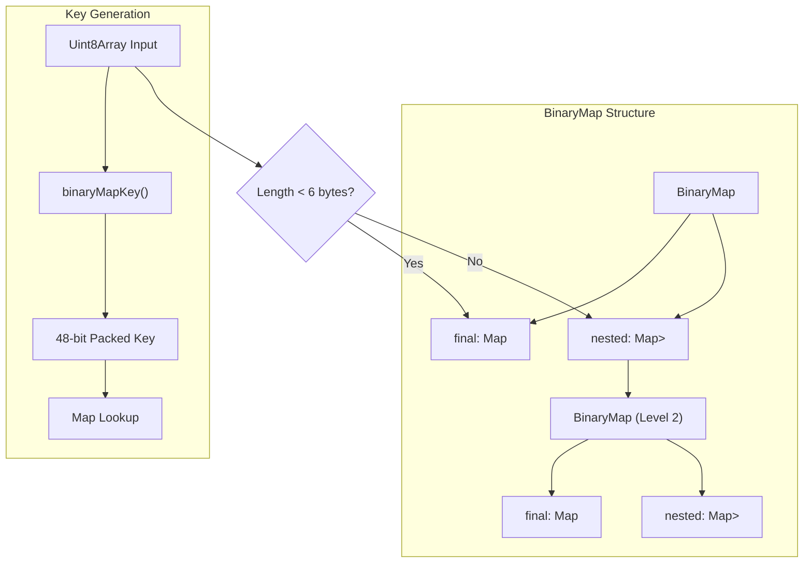

**BinaryMap Key Encoding**
Sources: [tokenizer_ts/src/bytePairEncode.ts:14-31]()

The `binaryMapKey` function packs up to 6 bytes into a single 48-bit number for efficient map lookups:

| Byte Position | Bit Range | Purpose |
|---------------|-----------|---------|
| 0-2 | 0-23 | Lower 24 bits |
| 3-5 | 24-47 | Upper 24 bits |

The key generation uses bitwise operations and masking to handle variable-length sequences efficiently, supporting the hierarchical storage model.

## Algorithm Implementation Details

### Buffer Management and Performance

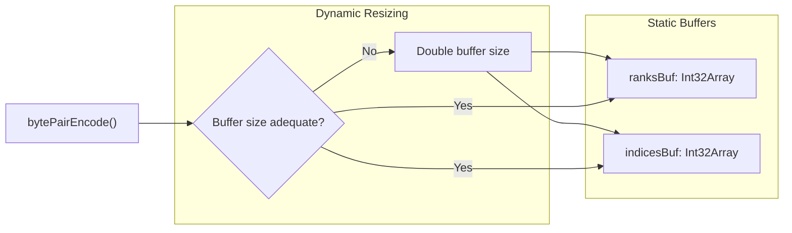

**Buffer Reuse Strategy**
Sources: [tokenizer_ts/src/bytePairEncode.ts:66-67](), [tokenizer_ts/src/bytePairEncode.ts:86-89]()

The implementation uses module-level static buffers (`ranksBuf`, `indicesBuf`) that grow as needed but are reused across tokenization calls. This avoids repeated memory allocation for better performance.

### Rank Calculation and Merging

The core merging loop follows this process:

1. **Find Minimum Rank**: Scan all adjacent pairs to find the lowest rank
2. **Update Adjacent Ranks**: Recalculate ranks for pairs affected by the merge
3. **Remove Merged Index**: Splice out the merged byte from the index array
4. **Repeat**: Continue until no more valid merges exist

Sources: [tokenizer_ts/src/bytePairEncode.ts:91-106](), [tokenizer_ts/src/bytePairEncode.ts:123-146]()

### Helper Functions

The `getRank` nested function handles rank lookups with bounds checking and skip logic for non-contiguous byte sequences:

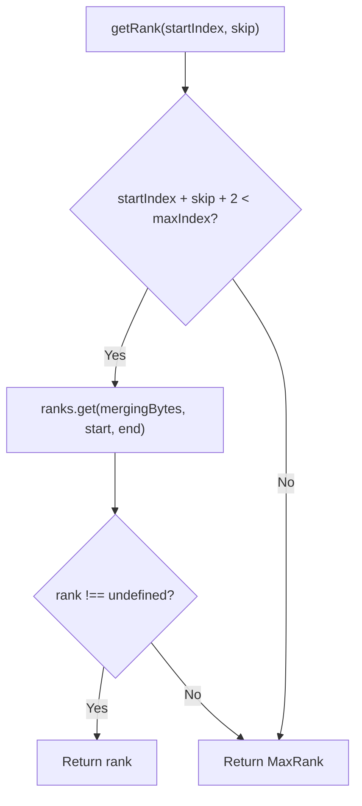

Sources: [tokenizer_ts/src/bytePairEncode.ts:109-121]()

## Supporting Components

### LRU Cache Integration

While not directly part of the BPE algorithm, the `LRUCache` class provides performance optimization by caching tokenization results:

| Component | Purpose | Key Features |
|-----------|---------|--------------|
| `LRUCache<T>` | Result caching | O(1) operations, configurable size |
| `ILRUCache` | Interface contract | Standardized cache operations |

Sources: [tokenizer_ts/src/lru.ts:13-77]()

### Text Encoding Support

The text encoding abstraction provides cross-platform UTF-8 encoding:

| Implementation | Environment | Optimization |
|----------------|-------------|--------------|
| `NodeTextEncoder` | Node.js | Reusable Buffer allocation |
| `UniversalTextEncoder` | Browser/Universal | Standard TextEncoder API |

Sources: [tokenizer_ts/src/textEncoder.ts:22-56]()

## Constants and Configuration

The algorithm uses several important constants:

| Constant | Value | Purpose |
|----------|-------|---------|
| `BytesPerLevel` | 6 | Bytes per BinaryMap level |
| `MaxRank` | 0x7FFFFFFF | Maximum rank value (2^31 - 1) |

Sources: [tokenizer_ts/src/bytePairEncode.ts:4-11]()

These constants ensure the algorithm operates within safe integer bounds while maximizing the efficiency of the hierarchical data structure.

---

# Page: Model Support and Builder

# Model Support and Builder

<details>
<summary>Relevant source files</summary>

The following files were used as context for generating this wiki page:

- [model/gpt2.tiktoken](model/gpt2.tiktoken)
- [tokenizer_ts/src/tokenizerBuilder.ts](tokenizer_ts/src/tokenizerBuilder.ts)

</details>


## Purpose and Scope

This page documents the TypeScript tokenizer builder system, which provides a factory interface for creating `TikTokenizer` instances configured for specific OpenAI models. The builder handles model-to-encoder mappings, special token configurations, regex patterns, and automatic downloading of BPE model files from remote sources.

For information about the core tokenizer API, see [Core API](#3.1). For details about the underlying BPE algorithm implementation, see [BPE Algorithm Implementation](#3.2).

## Model to Encoder Mapping System

The tokenizer builder maintains comprehensive mappings between OpenAI model names and their corresponding encoders through two primary data structures:

### Direct Model Mappings

The `MODEL_TO_ENCODING` map provides exact model name to encoder mappings for supported models:

| Model Category | Models | Encoder |
|----------------|--------|---------|
| Chat Models | `gpt-4o`, `gpt-4`, `gpt-3.5-turbo` | `o200k_base`, `cl100k_base`, `cl100k_base` |
| Text Models | `text-davinci-003`, `text-davinci-002`, `text-davinci-001` | `p50k_base`, `p50k_base`, `r50k_base` |
| Code Models | `code-davinci-002`, `davinci-codex`, `cushman-codex` | `p50k_base`, `p50k_base`, `p50k_base` |
| Embedding Models | `text-embedding-ada-002` | `cl100k_base` |
| Legacy Models | `davinci`, `curie`, `babbage`, `ada` | `r50k_base` |

### Prefix-Based Model Matching

The `MODEL_PREFIX_TO_ENCODING` map handles versioned models and Azure deployment names:

| Prefix Pattern | Encoder | Example Matches |
|----------------|---------|-----------------|
| `gpt-4o-` | `o200k_base` | `gpt-4o-2024-05-13` |
| `gpt-4-` | `cl100k_base` | `gpt-4-0314`, `gpt-4-32k` |
| `gpt-3.5-turbo-` | `cl100k_base` | `gpt-3.5-turbo-0301` |
| `gpt-35-turbo-` | `cl100k_base` | Azure deployment names |

### Model Name Resolution Flow

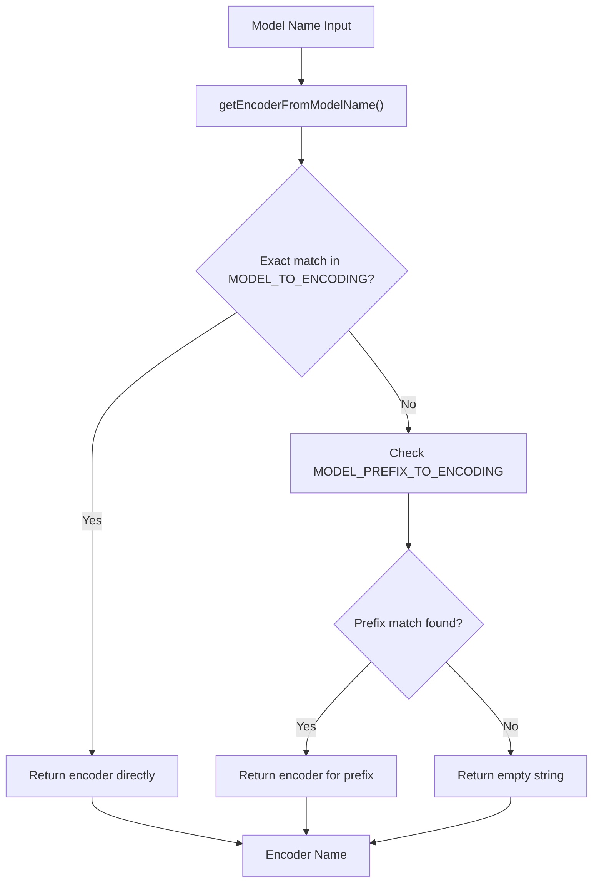

**Sources:** [tokenizer_ts/src/tokenizerBuilder.ts:91-104]()

## Special Token Management

The builder system manages special tokens that are model-specific and used for various purposes like marking text boundaries and enabling features like fill-in-the-middle (FIM) functionality.

### Special Token Types

| Token | Purpose | Models |
|-------|---------|--------|
| `<\|endoftext\|>` | Text boundary marker | All models |
| `<\|fim_prefix\|>` | Fill-in-the-middle prefix | Code models |
| `<\|fim_middle\|>` | Fill-in-the-middle middle | Code models |
| `<\|fim_suffix\|>` | Fill-in-the-middle suffix | Code models |
| `<\|endofprompt\|>` | Prompt boundary marker | Chat models |

### Encoder-Specific Token Configurations

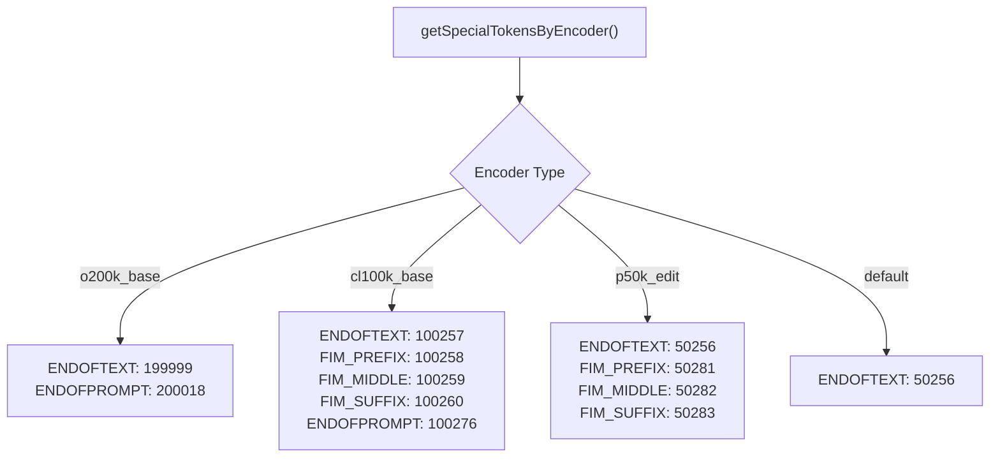

The `getSpecialTokensByEncoder` function returns encoder-specific special token mappings, while `getSpecialTokensByModel` provides a convenience wrapper that resolves the model name to encoder first.

**Sources:** [tokenizer_ts/src/tokenizerBuilder.ts:57-175]()

## Regex Pattern Management

Different encoders use different regex patterns for text preprocessing before tokenization. The system maintains three distinct patterns:

### Pattern Definitions

| Pattern | Usage | Encoder |
|---------|-------|---------|
| `REGEX_PATTERN_1` | Legacy models | `r50k_base`, `p50k_base`, `gpt2` |
| `REGEX_PATTERN_2` | Modern chat models | `cl100k_base` |
| `REGEX_PATTERN_3` | Latest models | `o200k_base` |

### Pattern Resolution

```mermaid
flowchart TD
    A["getRegexByEncoder()"] --> B{"Encoder Name"}
    B -->|"o200k_base"| C["REGEX_PATTERN_3<br/>(Complex Unicode patterns)"]
    B -->|"cl100k_base"| D["REGEX_PATTERN_2<br/>(Enhanced contractions)"]
    B -->|"default"| E["REGEX_PATTERN_1<br/>(Basic patterns)"]
    
    F["getRegexByModel()"] --> G["getEncoderFromModelName()"]
    G --> A
```

The regex patterns become progressively more sophisticated, with `REGEX_PATTERN_3` handling complex Unicode categories and various case combinations for contractions.

**Sources:** [tokenizer_ts/src/tokenizerBuilder.ts:66-89](), [tokenizer_ts/src/tokenizerBuilder.ts:182-203]()

## Tokenizer Factory Functions

The builder provides multiple factory functions for creating tokenizer instances with different levels of abstraction:

### Factory Function Hierarchy

```mermaid
flowchart TD
    A["createByModelName()"] --> B["createByEncoderName()"]
    B --> C["Model File Download"]
    C --> D["createTokenizer()"]
    D --> E["new TikTokenizer()"]
    
    F["User API"] --> A
    F --> B
    F --> D
    
    G["Model Name"] --> A
    H["Encoder Name"] --> B
    I["File Path + Config"] --> D
```

### Primary Factory Functions

#### `createByModelName()`
Highest-level factory that takes a model name and optional extra special tokens:

```typescript
createByModelName(modelName: string, extraSpecialTokens?: ReadonlyMap<string, number>)
```

#### `createByEncoderName()`
Mid-level factory that works with encoder names and handles file downloading:

```typescript
createByEncoderName(encoderName: string, extraSpecialTokens?: ReadonlyMap<string, number>)
```

#### `createTokenizer()`
Low-level factory for direct tokenizer creation with all parameters:

```typescript
createTokenizer(
  tikTokenBpeFileOrDict: string | Map<Uint8Array, number>,
  specialTokensEncoder: ReadonlyMap<string, number>,
  regexPattern: string,
  cacheSize: number = 8192
)
```

**Sources:** [tokenizer_ts/src/tokenizerBuilder.ts:210-309]()

## Model File Management

The builder automatically downloads and caches BPE model files from remote sources when they are not locally available.

### File Source Mapping

| Encoder | Source URL |
|---------|------------|
| `o200k_base` | `https://openaipublic.blob.core.windows.net/encodings/o200k_base.tiktoken` |
| `cl100k_base` | `https://openaipublic.blob.core.windows.net/encodings/cl100k_base.tiktoken` |
| `p50k_base` | `https://openaipublic.blob.core.windows.net/encodings/p50k_base.tiktoken` |
| `r50k_base` | `https://openaipublic.blob.core.windows.net/encodings/r50k_base.tiktoken` |
| `gpt2` | `https://raw.githubusercontent.com/microsoft/Tokenizer/main/model/gpt2.tiktoken` |

### File Download and Caching Flow

```mermaid
flowchart TD
    A["createByEncoderName()"] --> B["Determine file path"]
    B --> C{"File exists locally?"}
    C -->|Yes| D["Use cached file"]
    C -->|No| E["fetchAndSaveFile()"]
    E --> F["Download from URL"]
    F --> G["Save to local cache"]
    G --> D
    D --> H["createTokenizer()"]
    
    I["../model/ directory"] --> B
    J["Node.js fs module"] --> E
    K["fetch() API"] --> F
```

The system creates a `model/` directory relative to the source file location and downloads files on-demand. Files are cached permanently after the first download.

**Sources:** [tokenizer_ts/src/tokenizerBuilder.ts:106-121](), [tokenizer_ts/src/tokenizerBuilder.ts:269-285]()

## Complete Builder Architecture

The following diagram shows the complete flow from model name to tokenizer instance:

```mermaid
flowchart TD
    subgraph "Input Layer"
        A["Model Name<br/>(e.g., 'gpt-4')"]
        B["Extra Special Tokens<br/>(Optional)"]
    end
    
    subgraph "Resolution Layer"
        C["getEncoderFromModelName()"]
        D["MODEL_TO_ENCODING"]
        E["MODEL_PREFIX_TO_ENCODING"]
    end
    
    subgraph "Configuration Layer"
        F["getSpecialTokensByEncoder()"]
        G["getRegexByEncoder()"]
        H["Encoder-specific URLs"]
    end
    
    subgraph "File Management Layer"
        I["Local file check"]
        J["fetchAndSaveFile()"]
        K["File caching"]
    end
    
    subgraph "Creation Layer"
        L["createTokenizer()"]
        M["new TikTokenizer()"]
    end
    
    A --> C
    B --> F
    C --> D
    C --> E
    C --> F
    C --> G
    C --> H
    
    F --> L
    G --> L
    H --> I
    I --> J
    J --> K
    K --> L
    
    L --> M
```

This architecture provides a clean separation between model identification, configuration resolution, file management, and tokenizer instantiation, making it easy to support new models and encoders.

**Sources:** [tokenizer_ts/src/tokenizerBuilder.ts:1-310]()

---

# Page: Build and Distribution

# Build and Distribution

<details>
<summary>Relevant source files</summary>

The following files were used as context for generating this wiki page:

- [.github/workflows/npm-publish-github-packages.yml](.github/workflows/npm-publish-github-packages.yml)
- [.github/workflows/tokenizer-ts-pr-build.yml](.github/workflows/tokenizer-ts-pr-build.yml)
- [.github/workflows/tokenizer-ts-release.yml](.github/workflows/tokenizer-ts-release.yml)
- [tokenizer_ts/.npmignore](tokenizer_ts/.npmignore)
- [tokenizer_ts/package-lock.json](tokenizer_ts/package-lock.json)
- [tokenizer_ts/package.json](tokenizer_ts/package.json)

</details>


This document covers the TypeScript implementation's build process, package configuration, and distribution workflows for the `@microsoft/tiktokenizer` npm package. It details how the TypeScript source code is compiled, packaged, and distributed through automated CI/CD pipelines.

For information about the C# build and distribution process, see [Build and Distribution](#4.4). For details about the core TypeScript API implementation, see [Core API](#3.1).

## Package Configuration

The TypeScript tokenizer is configured as an npm package through [tokenizer_ts/package.json:1-41](). The package is published under the scoped name `@microsoft/tiktokenizer` with the MIT license.

| Configuration | Value | Purpose |
|---------------|-------|---------|
| Package Name | `@microsoft/tiktokenizer` | Scoped npm package identifier |
| Version | `1.0.10` | Current release version |
| Main Entry | `dist/index.js` | Compiled JavaScript entry point |
| Node Version | `>=18.0.0` | Minimum Node.js runtime requirement |
| License | MIT | Open source license |

The package defines several npm scripts for development and build automation:

| Script | Command | Purpose |
|--------|---------|---------|
| `build` | `tsc -p ./tsconfig.json` | TypeScript compilation |
| `test` | `mocha -u tdd --require ts-node/register test/**/*.ts` | Test execution |
| `watch` | `tsc -p ./tsconfig.json --watch` | Development mode compilation |
| `eslint` | `eslint src --ext ts` | Code linting |
| `format` | `prettier --write "./**/*.{ts,tsx}"` | Code formatting |

**Sources:** [tokenizer_ts/package.json:1-41]()

## Build Process

The build process transforms TypeScript source code into distributable JavaScript through a standardized compilation pipeline.

### TypeScript Compilation Pipeline

```mermaid
graph TD
    subgraph "Source Files"
        SRC["tokenizer_ts/src/<br/>TypeScript Sources"]
        TSCONFIG["tsconfig.json<br/>Compiler Configuration"]
    end
    
    subgraph "Build Process"
        TSC["tsc compiler<br/>npm run build"]
        LINT["eslint<br/>Code Linting"]
        FORMAT["prettier<br/>Code Formatting"]
    end
    
    subgraph "Output"
        DIST["tokenizer_ts/dist/<br/>Compiled JavaScript"]
        INDEX["dist/index.js<br/>Main Entry Point"]
    end
    
    subgraph "Quality Gates"
        TESTS["mocha test runner<br/>npm run test"]
        PACK["npm pack<br/>Package Validation"]
    end
    
    SRC --> TSC
    TSCONFIG --> TSC
    TSC --> DIST
    DIST --> INDEX
    
    SRC --> LINT
    SRC --> FORMAT
    DIST --> TESTS
    TESTS --> PACK
    
    style TSC fill:#f9f9f9
    style TESTS fill:#f9f9f9
```

The compilation process uses the TypeScript compiler (`tsc`) with project-specific configuration to generate JavaScript output in the `dist/` directory. The main entry point becomes `dist/index.js` as specified in [tokenizer_ts/package.json:21]().

**Sources:** [tokenizer_ts/package.json:34-40]()

## Distribution Channels

The `@microsoft/tiktokenizer` package is distributed through multiple npm registries with different access patterns and use cases.

### Registry Distribution Architecture

```mermaid
graph TB
    subgraph "Build Artifacts"
        DIST_JS["dist/index.js<br/>Main Entry Point"]
        PKG_JSON["package.json<br/>Package Metadata"]
        PKG_LOCK["package-lock.json<br/>Dependency Lock"]
    end
    
    subgraph "Packaging"
        NPM_PACK["npm pack<br/>*.tgz generation"]
        NPMIGNORE[".npmignore<br/>File Exclusions"]
    end
    
    subgraph "Distribution Targets"
        NPMJS["registry.npmjs.org<br/>Public Registry"]
        GH_PKG["npm.pkg.github.com<br/>GitHub Packages"]
    end
    
    subgraph "Access Patterns"
        PUB_ACCESS["--access public<br/>Public Installation"]
        SCOPE_ACCESS["@microsoft scope<br/>Scoped Package"]
    end
    
    DIST_JS --> NPM_PACK
    PKG_JSON --> NPM_PACK
    PKG_LOCK --> NPM_PACK
    NPMIGNORE --> NPM_PACK
    
    NPM_PACK --> NPMJS
    NPM_PACK --> GH_PKG
    
    NPMJS --> PUB_ACCESS
    GH_PKG --> SCOPE_ACCESS
    
    style NPM_PACK fill:#f9f9f9
    style NPMJS fill:#e8f5e8
    style GH_PKG fill:#e1f5fe
```

### Package Exclusions

The [tokenizer_ts/.npmignore:1-13]() file defines which files are excluded from the published package:

- Development files: `.vscode`, `tsconfig.json`, `.eslintrc.js`
- Source code: `/src` (only compiled `/dist` is included)
- Test files: `test`, `dist/test/*`
- Build artifacts: `*.tgz`, `*.map`
- Model files: `*.tiktoken`
- Performance tools: `/perf/*`

**Sources:** [tokenizer_ts/.npmignore:1-13](), [.github/workflows/tokenizer-ts-release.yml:19-20](), [.github/workflows/npm-publish-github-packages.yml:19-20]()

## CI/CD Workflows

The project implements automated build and deployment through GitHub Actions workflows that handle different stages of the software lifecycle.

### Workflow Architecture

```mermaid
graph TD
    subgraph "Trigger Events"
        PR["Pull Request<br/>branches: main"]
        MANUAL["workflow_dispatch<br/>Manual Release"]
    end
    
    subgraph "PR Build Workflow"
        PR_BUILD["tokenizer-ts-pr-build.yml"]
        PR_STEPS["npm ci → build → test → pack"]
        PR_ARTIFACT["Upload *.tgz artifact"]
    end
    
    subgraph "Release Workflows"
        NPM_RELEASE["tokenizer-ts-release.yml<br/>npmjs.org"]
        GH_RELEASE["npm-publish-github-packages.yml<br/>GitHub Packages"]
        REL_STEPS["npm ci → build → test → publish"]
    end
    
    subgraph "Runtime Environment"
        UBUNTU["ubuntu-latest"]
        NODE18["Node.js 18"]        
        NPM_TOKEN["secrets.NPM_TOKEN"]
        GH_TOKEN["secrets.GITHUB_TOKEN"]
    end
    
    PR --> PR_BUILD
    PR_BUILD --> PR_STEPS
    PR_STEPS --> PR_ARTIFACT
    
    MANUAL --> NPM_RELEASE
    MANUAL --> GH_RELEASE
    NPM_RELEASE --> REL_STEPS
    GH_RELEASE --> REL_STEPS
    
    PR_BUILD --> UBUNTU
    NPM_RELEASE --> UBUNTU
    GH_RELEASE --> UBUNTU
    
    UBUNTU --> NODE18
    NPM_RELEASE --> NPM_TOKEN
    GH_RELEASE --> GH_TOKEN
    
    style PR_BUILD fill:#fff3e0
    style NPM_RELEASE fill:#e8f5e8  
    style GH_RELEASE fill:#e1f5fe
```

### Workflow Execution Details

All workflows share a common execution pattern but differ in their final deployment step:

**Common Steps:**
1. `actions/checkout@v4` - Repository checkout
2. `actions/setup-node@v4` - Node.js 18 setup with registry configuration
3. `npm ci` - Clean dependency installation
4. `npm run build` - TypeScript compilation
5. `npm run test` - Test suite execution

**Deployment Variations:**
- **PR Build:** `npm pack` + artifact upload (validation only)
- **NPM Release:** `npm publish --access public` to npmjs.org
- **GitHub Packages:** `npm publish --access public` to npm.pkg.github.com

**Sources:** [.github/workflows/tokenizer-ts-pr-build.yml:1-31](), [.github/workflows/tokenizer-ts-release.yml:1-32](), [.github/workflows/npm-publish-github-packages.yml:1-32]()

## Packaging and Artifacts

The packaging process creates distributable artifacts through npm's packaging system, with specific handling for different deployment scenarios.

### Artifact Generation Process

```mermaid
graph LR
    subgraph "Source Structure"
        TS_SRC["tokenizer_ts/src/<br/>TypeScript source"]
        PKG_META["package.json<br/>Metadata"]
        IGNORE[".npmignore<br/>Exclusion rules"]
    end
    
    subgraph "Build Output"
        DIST_DIR["tokenizer_ts/dist/<br/>Compiled JS"]
        INDEX_JS["dist/index.js<br/>Entry point"]
    end
    
    subgraph "Packaging Commands"
        NPM_PACK_CMD["npm pack<br/>PR validation"]
        NPM_PUB_CMD["npm publish<br/>Release deployment"]
    end
    
    subgraph "Generated Artifacts"
        TGZ_FILE["*.tgz<br/>Package archive"]
        UPLOAD_ART["GitHub Actions<br/>artifact upload"]
    end
    
    TS_SRC --> DIST_DIR
    DIST_DIR --> INDEX_JS
    PKG_META --> NPM_PACK_CMD
    INDEX_JS --> NPM_PACK_CMD
    IGNORE --> NPM_PACK_CMD
    
    NPM_PACK_CMD --> TGZ_FILE
    TGZ_FILE --> UPLOAD_ART
    
    PKG_META --> NPM_PUB_CMD
    INDEX_JS --> NPM_PUB_CMD
    
    style NPM_PACK_CMD fill:#f9f9f9
    style NPM_PUB_CMD fill:#e8f5e8
    style TGZ_FILE fill:#fff3e0
```

The packaging process ensures that only production-ready files are included in the distributed package. The `.npmignore` configuration excludes development artifacts while preserving the compiled JavaScript and essential metadata files.

All workflows include artifact upload through `actions/upload-artifact@v4`, storing the generated `*.tgz` files as `npm-package` artifacts for build verification and deployment auditing.

**Sources:** [.github/workflows/tokenizer-ts-pr-build.yml:27-30](), [.github/workflows/tokenizer-ts-release.yml:28-31](), [tokenizer_ts/package.json:21]()

---

# Page: Testing

# Testing

<details>
<summary>Relevant source files</summary>

The following files were used as context for generating this wiki page:

- [tokenizer_ts/test/testdata/tokens_gpt_4o.json](tokenizer_ts/test/testdata/tokens_gpt_4o.json)
- [tokenizer_ts/test/tikTokenizer.test.ts](tokenizer_ts/test/tikTokenizer.test.ts)
- [tokenizer_ts/test/tikTokenizerGpt4o.test.ts](tokenizer_ts/test/tikTokenizerGpt4o.test.ts)

</details>


This page documents the testing approach and test suite for the TypeScript implementation of the Microsoft Tokenizer. The testing focuses on validating the `TikTokenizer` class functionality, model-specific behavior, and integration with various OpenAI models.

For information about the C# testing implementation, see [C# Testing](#4.5). For performance benchmarking and measurement, see [Performance and Benchmarking](#5).

## Test Framework and Structure

The TypeScript implementation uses the Mocha testing framework with Node.js assertions for comprehensive validation of tokenization functionality.

```mermaid
graph TB
    subgraph "Test Architecture"
        TestRunner["Mocha Test Runner"]
        MainSuite["TikTokenizer Test Suite"]
        Gpt4oSuite["TikTokenizer gpt-4o Test Suite"]
        
        subgraph "Test Utilities"
            CreateByModel["createByModelName()"]
            TikTokenizer["TikTokenizer class"]
            SpecialTokens["Special Token Maps"]
        end
        
        subgraph "Test Data"
            LibRs["lib.rs.txt"]
            TokensGpt35["tokens_gpt_3.5_turbo.json"]
            TokensGpt4o["tokens_gpt_4o.json"]
        end
    end
    
    TestRunner --> MainSuite
    TestRunner --> Gpt4oSuite
    
    MainSuite --> CreateByModel
    Gpt4oSuite --> CreateByModel
    CreateByModel --> TikTokenizer
    
    MainSuite --> SpecialTokens
    Gpt4oSuite --> SpecialTokens
    
    MainSuite --> LibRs
    MainSuite --> TokensGpt35
    Gpt4oSuite --> LibRs
    Gpt4oSuite --> TokensGpt4o
```

Sources: [tokenizer_ts/test/tikTokenizer.test.ts:1-231](), [tokenizer_ts/test/tikTokenizerGpt4o.test.ts:1-40]()

### Test Suite Configuration

Each test suite follows a consistent pattern using Mocha's `suite` and `before` hooks:

```mermaid
graph LR
    subgraph "Test Setup Flow"
        Suite["suite() declaration"]
        Before["before() hook"]
        CreateTokenizer["createByModelName()"]
        TokenizerInstance["TikTokenizer instance"]
        Tests["Individual tests"]
    end
    
    Suite --> Before
    Before --> CreateTokenizer
    CreateTokenizer --> TokenizerInstance
    TokenizerInstance --> Tests
```

The main test suite initializes with `gpt-3.5-turbo` model and custom special tokens:
- `<|im_start|>` mapped to token ID `100264`
- `<|im_end|>` mapped to token ID `100265` 

The GPT-4o test suite uses different special tokens:
- `<|endoftext|>` mapped to token ID `199999`
- `<|endofprompt|>` mapped to token ID `200018`

Sources: [tokenizer_ts/test/tikTokenizer.test.ts:9-20](), [tokenizer_ts/test/tikTokenizerGpt4o.test.ts:9-20]()

## Core Functionality Tests

The test suite validates fundamental tokenization operations through systematic unit tests.

```mermaid
graph TB
    subgraph "Core Test Categories"
        BasicTests["Basic Encoding/Decoding"]
        SpecialTokenTests["Special Token Handling"]
        TrimTests["Trim Operations"]
        IntegrationTests["Source Code Integration"]
    end
    
    subgraph "Basic Test Cases"
        EmptyString["encode('')"]
        SingleChar["encode('!')"]
        HelloWorld["encode('Hello World!')"]
    end
    
    subgraph "Special Token Cases"
        WithSpecial["encode with special tokens"]
        Unicode["encode with unicode + special"]
    end
    
    subgraph "Trim Operations"
        TrimSuffix["encodeTrimSuffix()"]
        TrimPrefix["encodeTrimPrefix()"]
    end
    
    BasicTests --> EmptyString
    BasicTests --> SingleChar
    BasicTests --> HelloWorld
    
    SpecialTokenTests --> WithSpecial
    SpecialTokenTests --> Unicode
    
    TrimTests --> TrimSuffix
    TrimTests --> TrimPrefix
```

Sources: [tokenizer_ts/test/tikTokenizer.test.ts:22-139]()

### Basic Encoding Validation

The tests verify correct token ID generation and bidirectional encoding/decoding:

- Empty string produces empty token array `[]`
- Single exclamation mark `"!"` produces token `[0]`
- `"Hello World!"` produces tokens `[9906, 4435, 0]`

Each test validates both encoding and decoding operations to ensure perfect round-trip fidelity.

Sources: [tokenizer_ts/test/tikTokenizer.test.ts:22-41]()

### Special Token Processing

Special token tests validate proper handling of model-specific control tokens within text content:

```mermaid
graph LR
    subgraph "Special Token Test Flow"
        InputText["Input text with special tokens"]
        SpecialTokenMap["ReadonlyMap<string, number>"]
        Encode["tokenizer.encode()"]
        TokenArray["Token ID array"]
        Decode["tokenizer.decode()"]
        OutputText["Reconstructed text"]
    end
    
    InputText --> Encode
    SpecialTokenMap --> Encode
    Encode --> TokenArray
    TokenArray --> Decode
    Decode --> OutputText
```

Test cases include:
- `"<|im_start|>Hello World<|im_end|>"` → `[100264, 9906, 4435, 100265]`
- Special tokens with Unicode characters
- Various positioning of special tokens within text

Sources: [tokenizer_ts/test/tikTokenizer.test.ts:43-62]()

### Trim Operations Testing

The `encodeTrimSuffix` and `encodeTrimPrefix` methods are tested with multiple scenarios to validate token-level text truncation:

```mermaid
graph TB
    subgraph "Trim Test Scenarios"
        TrimSuffixTests["encodeTrimSuffix Tests"]
        TrimPrefixTests["encodeTrimPrefix Tests"]
        
        subgraph "Test Parameters"
            MaxTokens["Maximum token count"]
            SpecialTokens["Special token handling"]
            TextReconstruction["Text reconstruction validation"]
        end
        
        subgraph "Validation Points"
            TokenCount["Token array length"]
            TokenContent["Token ID accuracy"]
            TextAccuracy["Reconstructed text accuracy"]
        end
    end
    
    TrimSuffixTests --> MaxTokens
    TrimPrefixTests --> MaxTokens
    MaxTokens --> TokenCount
    SpecialTokens --> TokenContent
    TextReconstruction --> TextAccuracy
```

Sources: [tokenizer_ts/test/tikTokenizer.test.ts:64-214]()

## Test Data and Fixtures

The test suite uses carefully curated test data to validate tokenization accuracy against expected outputs.

```mermaid
graph LR
    subgraph "Test Data Structure"
        TestData["test/testdata/"]
        SourceFile["lib.rs.txt"]
        Gpt35Tokens["tokens_gpt_3.5_turbo.json"]
        Gpt4oTokens["tokens_gpt_4o.json"]
    end
    
    subgraph "Data Usage"
        ReadSource["fs.readFileSync()"]
        ReadTokens["fs.readFile()"]
        TokenArray["JSON.parse() → number[]"]
        Validation["assert.deepStrictEqual()"]
    end
    
    TestData --> SourceFile
    TestData --> Gpt35Tokens  
    TestData --> Gpt4oTokens
    
    SourceFile --> ReadSource
    Gpt35Tokens --> ReadTokens
    Gpt4oTokens --> ReadTokens
    ReadTokens --> TokenArray
    TokenArray --> Validation
```

### Source Code Tokenization Tests

Large-scale integration tests validate tokenizer performance on real source code:

- `lib.rs.txt`: Rust source code file used as test input
- GPT-3.5-turbo produces 5584 tokens for the test file
- GPT-4o produces 5609 tokens for the same file

The tests verify:
1. Token count matches expected values
2. Token arrays match pre-computed reference data
3. Decoded output perfectly reconstructs original source

Sources: [tokenizer_ts/test/tikTokenizer.test.ts:216-229](), [tokenizer_ts/test/tikTokenizerGpt4o.test.ts:22-38](), [tokenizer_ts/test/testdata/tokens_gpt_4o.json:1]()

## Model-Specific Test Validation

Different models require distinct validation approaches due to varying tokenization behaviors and special token sets.

```mermaid
graph TB
    subgraph "Model Test Matrix"
        Gpt35Tests["GPT-3.5-turbo Tests"]
        Gpt4oTests["GPT-4o Tests"]
        
        subgraph "Model-Specific Elements"
            Gpt35Specials["im_start/im_end tokens"]
            Gpt4oSpecials["endoftext/endofprompt tokens"]
            Gpt35Encoding["5584 token output"]
            Gpt4oEncoding["5609 token output"]
        end
        
        subgraph "Common Validation"
            SourceInput["lib.rs.txt input"]
            RoundTrip["Encode/decode fidelity"]
            TokenAccuracy["Reference data comparison"]
        end
    end
    
    Gpt35Tests --> Gpt35Specials
    Gpt35Tests --> Gpt35Encoding
    Gpt4oTests --> Gpt4oSpecials
    Gpt4oTests --> Gpt4oEncoding
    
    Gpt35Tests --> SourceInput
    Gpt4oTests --> SourceInput
    SourceInput --> RoundTrip
    RoundTrip --> TokenAccuracy
```

### Reference Data Validation

Each model test suite compares tokenization output against JSON reference files containing pre-computed token arrays. This approach ensures:

- Consistent tokenization behavior across code changes
- Detection of regression in tokenization accuracy
- Validation of model-specific tokenization differences

The reference data files contain token ID arrays that serve as the ground truth for tokenization validation.

Sources: [tokenizer_ts/test/tikTokenizer.test.ts:220-228](), [tokenizer_ts/test/tikTokenizerGpt4o.test.ts:26-37]()

## Test Execution and Assertions

The testing framework employs comprehensive assertion strategies to validate tokenizer behavior across multiple dimensions.

```mermaid
graph LR
    subgraph "Assertion Types"
        DeepEqual["assert.deepStrictEqual()"]
        StrictEqual["assert.strictEqual()"]
        NullCheck["assert.strictEqual(err, null)"]
    end
    
    subgraph "Validation Targets"
        TokenArrays["Token ID arrays"]
        TextOutput["Decoded text output"]
        ErrorHandling["File operation errors"]
    end
    
    DeepEqual --> TokenArrays
    StrictEqual --> TextOutput
    NullCheck --> ErrorHandling
```

### Asynchronous Test Handling

File-based tests use asynchronous patterns with callback-based assertions:

- `fs.readFile()` for loading reference data
- `done()` callback for test completion signaling
- Error-first callback pattern for file operation validation

This approach ensures proper handling of I/O operations within the test execution flow while maintaining test isolation and reliability.

Sources: [tokenizer_ts/test/tikTokenizer.test.ts:220-229](), [tokenizer_ts/test/tikTokenizerGpt4o.test.ts:26-38]()

---

# Page: C# Implementation

# C# Implementation

<details>
<summary>Relevant source files</summary>

The following files were used as context for generating this wiki page:

- [Tokenizer_C#/TokenizerLib/TikTokenizer.cs](Tokenizer_C#/TokenizerLib/TikTokenizer.cs)
- [Tokenizer_C#/TokenizerLib/TokenizerBuilder.cs](Tokenizer_C#/TokenizerLib/TokenizerBuilder.cs)
- [Tokenizer_C#/TokenizerLib/TokenizerLib.csproj](Tokenizer_C#/TokenizerLib/TokenizerLib.csproj)

</details>


This document covers the **Microsoft.DeepDev.TokenizerLib** NuGet package, which provides C# implementation of Byte Pair Encoding (BPE) tokenization for OpenAI large language models. The implementation targets .NET Standard 2.0 and offers a complete API for encoding and decoding text using various OpenAI model configurations.

For information about the TypeScript implementation, see [TypeScript Implementation](#3). For details about the underlying BPE algorithm across both implementations, see [BPE Algorithm Deep Dive](#7.1). For build and packaging specifics, see [Build and Distribution](#4.4).

## Package Architecture

The C# implementation follows a factory pattern with clear separation between tokenizer creation, core tokenization logic, and model configuration management.

### Core Class Structure

```mermaid
classDiagram
    class ITokenizer {
        <<interface>>
        +Encode(string, bool) List~int~
        +Encode(string, IReadOnlyCollection~string~) List~int~
        +EncodeTrimSuffix(string, int, bool) (List~int~, string)
        +EncodeTrimPrefix(string, int, bool) (List~int~, string)
        +Decode(int[]) string
    }
    
    class TokenizerBuilder {
        <<static>>
        +CreateByModelNameAsync(string, IReadOnlyDictionary~string,int~) Task~ITokenizer~
        +CreateByEncoderNameAsync(string, IReadOnlyDictionary~string,int~) Task~ITokenizer~
        +CreateTokenizer(Stream, IReadOnlyDictionary~string,int~, string, int) ITokenizer
        -MODEL_TO_ENCODING Dictionary~string,string~
        -MODEL_PREFIX_TO_ENCODING Dictionary~string,string~
    }
    
    class TikTokenizer {
        -SpecialTokensEncoder IReadOnlyDictionary~string,int~
        -Encoder IReadOnlyDictionary~byte[],int~
        -Decoder IReadOnlyDictionary~int,byte[]~
        -Regex Regex
        -Cache LruCache~string,int[]~
        +Encode(string, bool) List~int~
        +Decode(int[]) string
        -LoadTikTokenBpe(Stream) Dictionary~byte[],int~
        -BytePairEncode(byte[], IReadOnlyDictionary~byte[],int~) List~int~
    }
    
    class LruCache~K,V~ {
        +Lookup(K, out V) bool
        +Add(K, V) void
        +Count int
    }
    
    class BytePairEncoder {
        <<static>>
        +BytePairEncode(byte[], IReadOnlyDictionary~byte[],int~) List~int~
    }
    
    ITokenizer <|.. TikTokenizer
    TokenizerBuilder ..> TikTokenizer : creates
    TikTokenizer *-- LruCache~string,int[]~
    TikTokenizer ..> BytePairEncoder : uses
```

Sources: [Tokenizer_C#/TokenizerLib/TikTokenizer.cs:20-605](), [Tokenizer_C#/TokenizerLib/TokenizerBuilder.cs:14-214]()

### Component Interaction Flow

```mermaid
sequenceDiagram
    participant Client
    participant TokenizerBuilder
    participant HttpClient
    participant TikTokenizer
    participant BytePairEncoder
    participant LruCache
    
    Client->>TokenizerBuilder: CreateByModelNameAsync("gpt-4")
    TokenizerBuilder->>TokenizerBuilder: MODEL_TO_ENCODING lookup
    TokenizerBuilder->>HttpClient: GetStreamAsync(tiktoken_url)
    HttpClient-->>TokenizerBuilder: BPE file stream
    TokenizerBuilder->>TikTokenizer: new TikTokenizer(stream, specialTokens, pattern)
    TikTokenizer->>TikTokenizer: LoadTikTokenBpe(stream)
    TikTokenizer-->>TokenizerBuilder: ITokenizer instance
    TokenizerBuilder-->>Client: ITokenizer
    
    Client->>TikTokenizer: Encode("Hello world")
    TikTokenizer->>LruCache: Lookup("Hello")
    alt Cache Miss
        TikTokenizer->>BytePairEncoder: BytePairEncode(bytes, encoder)
        BytePairEncoder-->>TikTokenizer: token_ids
        TikTokenizer->>LruCache: Add("Hello", token_ids)
    end
    TikTokenizer-->>Client: List<int> tokens
```

Sources: [Tokenizer_C#/TokenizerLib/TokenizerBuilder.cs:82-98](), [Tokenizer_C#/TokenizerLib/TikTokenizer.cs:250-274]()

## TokenizerBuilder Factory

The `TokenizerBuilder` class serves as the primary entry point for creating tokenizer instances. It provides static factory methods that handle model-to-encoder mapping and remote BPE file retrieval.

### Model Configuration Mapping

The builder maintains two key dictionaries for model resolution:

- `MODEL_TO_ENCODING`: Direct model name to encoder mapping
- `MODEL_PREFIX_TO_ENCODING`: Prefix-based matching for model families

```mermaid
graph TD
    subgraph "Model Resolution"
        ModelName["Model Name Input"]
        DirectLookup["MODEL_TO_ENCODING Lookup"]
        PrefixLookup["MODEL_PREFIX_TO_ENCODING Lookup"]
        EncoderName["Encoder Name Result"]
    end
    
    subgraph "Supported Encoders"
        cl100k["cl100k_base<br/>gpt-4, gpt-3.5-turbo"]
        p50k["p50k_base<br/>text-davinci-003, code-davinci-002"]
        p50k_edit["p50k_edit<br/>text-davinci-edit-001"]
        r50k["r50k_base<br/>text-davinci-001, ada"]
        gpt2_enc["gpt2<br/>gpt2 model"]
    end
    
    ModelName --> DirectLookup
    DirectLookup --> EncoderName
    DirectLookup -.->|"Not Found"| PrefixLookup
    PrefixLookup --> EncoderName
    
    EncoderName --> cl100k
    EncoderName --> p50k
    EncoderName --> p50k_edit
    EncoderName --> r50k
    EncoderName --> gpt2_enc
```

Sources: [Tokenizer_C#/TokenizerLib/TokenizerBuilder.cs:17-66](), [Tokenizer_C#/TokenizerLib/TokenizerBuilder.cs:84-96]()

### Factory Methods

| Method | Purpose | Parameters |
|--------|---------|------------|
| `CreateByModelNameAsync` | Create tokenizer from OpenAI model name | `modelName`, `extraSpecialTokens` |
| `CreateByEncoderNameAsync` | Create tokenizer from encoder name | `encoderName`, `extraSpecialTokens` |
| `CreateTokenizer` | Create tokenizer from embedded stream | `tikTokenBpeFileStream`, `specialTokensEncoder`, `pattern`, `cacheSize` |

The async methods download BPE rank files from remote URLs, while the synchronous method accepts a pre-loaded stream for embedded scenarios.

Sources: [Tokenizer_C#/TokenizerLib/TokenizerBuilder.cs:82-98](), [Tokenizer_C#/TokenizerLib/TokenizerBuilder.cs:107-184](), [Tokenizer_C#/TokenizerLib/TokenizerBuilder.cs:210-213]()

## TikTokenizer Core Implementation

The `TikTokenizer` class implements the `ITokenizer` interface and provides the main tokenization functionality using Byte Pair Encoding.

### Internal Data Structures

The tokenizer maintains several key data structures for efficient encoding and decoding:

```mermaid
graph TB
    subgraph "Core Data Structures"
        Encoder["Encoder<br/>IReadOnlyDictionary&lt;byte[], int&gt;<br/>Maps byte sequences to token IDs"]
        Decoder["Decoder<br/>IReadOnlyDictionary&lt;int, byte[]&gt;<br/>Maps token IDs to byte sequences"]
        SpecialTokensEncoder["SpecialTokensEncoder<br/>IReadOnlyDictionary&lt;string, int&gt;<br/>Maps special tokens to IDs"]
        SpecialTokensDecoder["SpecialTokensDecoder<br/>IReadOnlyDictionary&lt;int, string&gt;<br/>Maps IDs to special tokens"]
    end
    
    subgraph "Processing Components"
        Regex["Regex<br/>Text splitting pattern"]
        SpecialTokensRegex["SpecialTokensRegex<br/>Special token matching"]
        Cache["LruCache&lt;string, int[]&gt;<br/>Performance optimization"]
    end
    
    subgraph "BPE File Input"
        BPEFile["*.tiktoken file<br/>Base64 token rank"]
    end
    
    BPEFile --> Encoder
    Encoder --> Decoder
    SpecialTokensEncoder --> SpecialTokensDecoder
    Cache -.->|"Caches results from"| Encoder
```

Sources: [Tokenizer_C#/TokenizerLib/TikTokenizer.cs:23-29](), [Tokenizer_C#/TokenizerLib/TikTokenizer.cs:74-91]()

### Encoding Process

The encoding process handles both regular text and special tokens through a multi-stage pipeline:

```mermaid
flowchart TD
    Input["Input Text"]
    SpecialCheck{"Contains Special Tokens?"}
    RegexSplit["Regex.Matches()<br/>Split text into pieces"]
    CacheCheck{"Cache Lookup<br/>LruCache.Lookup()"}
    DirectEncode["Direct Encoder Lookup<br/>Encoder.TryGetValue()"]
    BPEEncode["BytePairEncoder.BytePairEncode()<br/>Recursive BPE algorithm"]
    CacheStore["Cache.Add()<br/>Store result"]
    TokenIds["List&lt;int&gt; Token IDs"]
    
    Input --> SpecialCheck
    SpecialCheck -->|Yes| SpecialFlow["EncodeInternal()<br/>Handle special tokens"]
    SpecialCheck -->|No| RegexSplit
    SpecialFlow --> RegexSplit
    RegexSplit --> CacheCheck
    CacheCheck -->|Hit| TokenIds
    CacheCheck -->|Miss| DirectEncode
    DirectEncode -->|Found| TokenIds
    DirectEncode -->|Not Found| BPEEncode
    BPEEncode --> CacheStore
    CacheStore --> TokenIds
```

Sources: [Tokenizer_C#/TokenizerLib/TikTokenizer.cs:250-274](), [Tokenizer_C#/TokenizerLib/TikTokenizer.cs:141-170]()

### Advanced Encoding Features

The `TikTokenizer` provides specialized encoding methods for token count constraints:

- `EncodeTrimSuffix`: Encodes text up to a maximum token count, truncating from the end
- `EncodeTrimPrefix`: Encodes text up to a maximum token count, truncating from the beginning

These methods are essential for applications that need to fit text within model context windows.

Sources: [Tokenizer_C#/TokenizerLib/TikTokenizer.cs:402-435](), [Tokenizer_C#/TokenizerLib/TikTokenizer.cs:546-579]()

## BPE File Loading and Processing

The tokenizer loads BPE rank data from `.tiktoken` files, which contain Base64-encoded byte sequences paired with integer ranks.

### File Format Processing

```mermaid
flowchart LR
    subgraph "BPE File Format"
        Line1["dGhlIDwvZGl2Pg== 0"]
        Line2["Lg== 1"]
        Line3["</s> 2"]
    end
    
    subgraph "Parsing Process"
        Split["line.Split(' ')"]
        Base64Decode["Convert.FromBase64String()"]
        RankParse["int.TryParse()"]
    end
    
    subgraph "Result Dictionary"
        ByteArray1["byte[] {116,104,101...}"]
        ByteArray2["byte[] {46}"]
        Rank0["Rank: 0"]
        Rank1["Rank: 1"]
    end
    
    Line1 --> Split
    Line2 --> Split
    Split --> Base64Decode
    Split --> RankParse
    Base64Decode --> ByteArray1
    Base64Decode --> ByteArray2
    RankParse --> Rank0
    RankParse --> Rank1
```

Sources: [Tokenizer_C#/TokenizerLib/TikTokenizer.cs:99-139]()

## Special Token Handling

Special tokens like `<|endoftext|>`, `<|fim_prefix|>`, `<|fim_middle|>`, `<|fim_suffix|>`, and `<|endofprompt|>` receive dedicated handling with predefined token IDs that vary by encoder type.

### Special Token Configuration by Encoder

| Encoder | `<|endoftext|>` | `<|fim_prefix|>` | `<|fim_middle|>` | `<|fim_suffix|>` | `<|endofprompt|>` |
|---------|-----------------|------------------|------------------|------------------|-------------------|
| `cl100k_base` | 100257 | 100258 | 100259 | 100260 | 100276 |
| `p50k_base` | 50256 | - | - | - | - |
| `p50k_edit` | 50256 | 50281 | 50282 | 50283 | - |
| `r50k_base` | 50256 | - | - | - | - |
| `gpt2` | 50256 | - | - | - | - |

Sources: [Tokenizer_C#/TokenizerLib/TokenizerBuilder.cs:68-72](), [Tokenizer_C#/TokenizerLib/TokenizerBuilder.cs:114-177]()

## Performance Optimizations

The implementation includes several performance optimizations:

### LRU Cache

The `LruCache<string, int[]>` caches encoding results for frequently used text pieces, with a default size of 4096 entries. Cache performance can be monitored through the `NumOfCacheEntries` property.

### Regex Compilation

Text-splitting regex patterns are compiled once during initialization with `RegexOptions.Compiled` for better performance during repeated tokenization operations.

### Memory Efficiency

The implementation uses `IReadOnlyDictionary` interfaces and `byte[]` keys with custom `ByteArrayComparer` for efficient memory usage and lookup performance.

Sources: [Tokenizer_C#/TokenizerLib/TikTokenizer.cs:34-38](), [Tokenizer_C#/TokenizerLib/TikTokenizer.cs:77-78](), [Tokenizer_C#/TokenizerLib/TikTokenizer.cs:101]()

## Project Configuration and Distribution

The library targets .NET Standard 2.0 for broad compatibility and is configured for NuGet distribution with strong-name signing and Microsoft code signing through MicroBuild.

### Project Properties

- **Target Framework**: `netstandard2.0`
- **Package ID**: `Microsoft.DeepDev.TokenizerLib`
- **Assembly Version**: Defined in project file
- **Strong Name Signing**: Enabled with public key
- **Code Signing**: Microsoft Authenticode through MicroBuild

Sources: [Tokenizer_C#/TokenizerLib/TokenizerLib.csproj:3-23](), [Tokenizer_C#/TokenizerLib/TokenizerLib.csproj:38-50]()

---

# Page: Core API

# Core API

<details>
<summary>Relevant source files</summary>

The following files were used as context for generating this wiki page:

- [Tokenizer_C#/Tokenizer/Program.cs](Tokenizer_C#/Tokenizer/Program.cs)
- [Tokenizer_C#/TokenizerLib/ITokenizer.cs](Tokenizer_C#/TokenizerLib/ITokenizer.cs)
- [Tokenizer_C#/TokenizerLib/TikTokenizer.cs](Tokenizer_C#/TokenizerLib/TikTokenizer.cs)

</details>


This document covers the main API classes, interfaces, and methods of the C# tokenizer implementation. It focuses on the `TikTokenizer` class and `ITokenizer` interface that provide the primary tokenization functionality for applications using the Microsoft.DeepDev.TokenizerLib NuGet package.

For information about the underlying BPE algorithm implementation, see [BPE Algorithm Implementation](#4.2). For model configuration and factory patterns, see [Model Support and Builder](#4.3).

## Core Classes and Interface Structure

The C# tokenizer API is built around a clean contract-based design with the `ITokenizer` interface defining the public API and `TikTokenizer` class providing the concrete implementation.

### API Architecture Diagram

```mermaid
classDiagram
    class ITokenizer {
        <<interface>>
        +Encode(string text, IReadOnlyCollection~string~ allowedSpecial) List~int~
        +Encode(string text, bool applySpecialTokens) List~int~
        +EncodeTrimSuffix(string text, IReadOnlyCollection~string~ allowedSpecial, int maxTokenCount) (List~int~, string)
        +EncodeTrimSuffix(string text, int maxTokenCount, bool applySpecialTokens) (List~int~, string)
        +EncodeTrimPrefix(string text, IReadOnlyCollection~string~ allowedSpecial, int maxTokenCount) (List~int~, string)
        +EncodeTrimPrefix(string text, int maxTokenCount, bool applySpecialTokens) (List~int~, string)
        +Decode(int[] tokens) string
    }
    
    class TikTokenizer {
        -IReadOnlyDictionary~string,int~ SpecialTokensEncoder
        -IReadOnlyCollection~string~ SpecialTokens
        -Regex Regex
        -IReadOnlyDictionary~byte[],int~ Encoder
        -IReadOnlyDictionary~int,byte[]~ Decoder
        -Regex SpecialTokensRegex
        -IReadOnlyDictionary~int,string~ SpecialTokensDecoder
        -LruCache~string,int[]~ Cache
        +int DefaultCacheSize
        +int NumOfCacheEntries
        +TikTokenizer(IReadOnlyDictionary~byte[],int~ encoder, IReadOnlyDictionary~string,int~ specialTokensEncoder, string pattern, int cacheSize)
        +TikTokenizer(Stream tikTokenBpe FileStream, IReadOnlyDictionary~string,int~ specialTokensEncoder, string pattern, int cacheSize)
    }
    
    class LruCache~T,U~ {
        +int Count
        +bool Lookup(T key, out U value)
        +void Add(T key, U value)
    }
    
    TikTokenizer ..|> ITokenizer
    TikTokenizer --> LruCache~T,U~ : "uses"
```

**Sources:** [Tokenizer_C#/TokenizerLib/TikTokenizer.cs:20-52](), [Tokenizer_C#/TokenizerLib/ITokenizer.cs:7-47]()

## Constructor Patterns

The `TikTokenizer` class provides two constructor overloads for different initialization scenarios:

| Constructor | Purpose | Key Parameters |
|-------------|---------|----------------|
| Dictionary-based | Direct initialization with pre-loaded encoder mappings | `encoder`, `specialTokensEncoder`, `pattern` |
| Stream-based | Load encoder from BPE file stream | `tikTokenBpeFileStream`, `specialTokensEncoder`, `pattern` |

### Constructor Usage Flow

```mermaid
flowchart TD
    Start[/"Application Start"/] --> Choice{"Encoder Source?"}
    
    Choice -->|"Pre-loaded Dictionary"| DictConst["TikTokenizer(IReadOnlyDictionary&lt;byte[], int&gt; encoder, ...)"]
    Choice -->|"BPE File Stream"| StreamConst["TikTokenizer(Stream tikTokenBpeFileStream, ...)"]
    
    DictConst --> Init["Init(encoder, specialTokensEncoder, pattern)"]
    StreamConst --> LoadBpe["LoadTikTokenBpe(tikTokenBpeFileStream)"] 
    LoadBpe --> Init
    
    Init --> BuildDecoders["Build Decoder dictionaries"]
    BuildDecoders --> ValidateEncoders["Validate Encoder/Decoder sizes match"]
    ValidateEncoders --> CacheInit["Initialize LruCache with cacheSize"]
    CacheInit --> Ready[/"TikTokenizer Ready"/]
```

**Sources:** [Tokenizer_C#/TokenizerLib/TikTokenizer.cs:48-65](), [Tokenizer_C#/TokenizerLib/TikTokenizer.cs:74-91](), [Tokenizer_C#/TokenizerLib/TikTokenizer.cs:99-139]()

## Core Encoding Methods

The tokenizer provides several encoding methods with different capabilities for special token handling and text trimming:

### Method Overview Table

| Method | Special Tokens | Text Trimming | Return Type |
|--------|---------------|---------------|-------------|
| `Encode(string, IReadOnlyCollection<string>)` | Custom allowed set | None | `List<int>` |
| `Encode(string, bool)` | Constructor-defined | None | `List<int>` |
| `EncodeTrimSuffix(string, IReadOnlyCollection<string>, int)` | Custom allowed set | Suffix trimming | `(List<int>, string)` |
| `EncodeTrimSuffix(string, int, bool)` | Constructor-defined | Suffix trimming | `(List<int>, string)` |
| `EncodeTrimPrefix(string, IReadOnlyCollection<string>, int)` | Custom allowed set | Prefix trimming | `(List<int>, string)` |
| `EncodeTrimPrefix(string, int, bool)` | Constructor-defined | Prefix trimming | `(List<int>, string)` |

### Encoding Process Flow

```mermaid
flowchart TD
    InputText[/"Input Text"/] --> SpecialCheck{"Special Tokens Enabled?"}
    
    SpecialCheck -->|"Yes"| SpecialFlow["EncodeInternal with special token processing"]
    SpecialCheck -->|"No"| RegularFlow["Direct encoding without special tokens"]
    
    SpecialFlow --> FindSpecial["FindNextSpecialToken(text, allowedSpecial, start)"]
    FindSpecial --> HasSpecial{"Special Token Found?"}
    
    HasSpecial -->|"Yes"| EncodeBeforeSpecial["Encode(text, tokenIds, start, specialIndex)"]
    HasSpecial -->|"No"| EncodeRemaining["Encode(text, tokenIds, start, textLength)"]
    
    EncodeBeforeSpecial --> AddSpecialToken["EncodeSpecialToken(tokenIds, nextSpecial)"]
    AddSpecialToken --> FindSpecial
    
    RegularFlow --> DirectEncode["Encode(text, tokenIds, 0, textLength)"]
    EncodeRemaining --> TokenIds[/"List&lt;int&gt; TokenIds"/]
    DirectEncode --> TokenIds
```

**Sources:** [Tokenizer_C#/TokenizerLib/TikTokenizer.cs:178-207](), [Tokenizer_C#/TokenizerLib/TikTokenizer.cs:141-170](), [Tokenizer_C#/TokenizerLib/TikTokenizer.cs:250-274]()

## Text Processing and Caching

The core text processing leverages an LRU cache for performance optimization and uses regex-based text chunking before BPE encoding:

### Text Processing Pipeline

```mermaid
flowchart LR
    TextInput[/"Text Input"/] --> RegexMatch["Regex.Matches(text[start..end])"]
    RegexMatch --> CacheCheck["Cache.Lookup(match.Value)"]
    
    CacheCheck -->|"Hit"| CacheHit["tokenIds.AddRange(cachedTokens)"]
    CacheCheck -->|"Miss"| CacheMiss["UTF8 encode + BPE processing"]
    
    CacheMiss --> BpeCheck{"Direct encoder lookup?"}
    BpeCheck -->|"Found"| DirectToken["tokenIds.Add(token)"]
    BpeCheck -->|"Not Found"| BpeEncode["BytePairEncoder.BytePairEncode(bytes, Encoder)"]
    
    BpeEncode --> CacheStore["Cache.Add(match.Value, encodedTokens)"]
    CacheStore --> AddTokens["tokenIds.AddRange(encodedTokens)"]
    
    CacheHit --> NextMatch["Next regex match"]
    DirectToken --> NextMatch
    AddTokens --> NextMatch
    NextMatch --> Complete[/"Encoding Complete"/]
```

**Sources:** [Tokenizer_C#/TokenizerLib/TikTokenizer.cs:250-274](), [Tokenizer_C#/TokenizerLib/TikTokenizer.cs:34-38]()

## Trimming Operations

The tokenizer supports both prefix and suffix trimming to limit output to a maximum token count:

### Trim Suffix Implementation

The `EncodeTrimSuffix` methods encode text while tracking token count and stop when the limit is reached:

```mermaid
flowchart TD
    Start[/"EncodeTrimSuffix(text, maxTokenCount)"/] --> InitVars["tokenCount = 0, encodeLength = 0"]
    InitVars --> ProcessMatch["For each regex match"]
    
    ProcessMatch --> CheckCache["Cache lookup"]
    CheckCache --> CountTokens["tokenCount += tokens.Length"]
    CountTokens --> CheckLimit{"tokenCount <= maxTokenCount?"}
    
    CheckLimit -->|"Yes"| AddTokens["Add tokens, update encodeLength"]
    CheckLimit -->|"No"| StopEncoding["Break encoding loop"]
    
    AddTokens --> NextMatch["Next match"]
    NextMatch --> ProcessMatch
    StopEncoding --> ReturnResult[/"(tokenIds, text[..encodeLength])"/]
```

**Sources:** [Tokenizer_C#/TokenizerLib/TikTokenizer.cs:288-342](), [Tokenizer_C#/TokenizerLib/TikTokenizer.cs:420-435]()

### Trim Prefix Implementation

The `EncodeTrimPrefix` methods encode the entire text first, then remove tokens from the beginning:

```mermaid
flowchart TD
    Start[/"EncodeTrimPrefix(text, maxTokenCount)"/] --> FullEncode["Encode entire text"]
    FullEncode --> BuildMap["Build tokenCountMap: SortedDictionary&lt;int, int&gt;"]
    
    BuildMap --> CheckTotal{"totalTokens <= maxTokenCount?"}
    CheckTotal -->|"Yes"| ReturnAll[/"Return (tokenIds, text)"/]
    CheckTotal -->|"No"| CalcPrefix["prefixTokenCount = totalTokens - maxTokenCount"]
    
    CalcPrefix --> FindCutoff["Find cutoff point in tokenCountMap"]
    FindCutoff --> TrimTokens["tokenIds.Skip(actualPrefixTokenCount)"]
    TrimTokens --> TrimText["text[actualPrefixStrLength..]"]
    TrimText --> ReturnTrimmed[/"Return (trimmedTokenIds, trimmedText)"/]
```

**Sources:** [Tokenizer_C#/TokenizerLib/TikTokenizer.cs:479-500](), [Tokenizer_C#/TokenizerLib/TikTokenizer.cs:562-579]()

## Decoding Operations

The `Decode` method converts token IDs back to text by looking up byte sequences and handling special tokens:

### Decoding Process

```mermaid
flowchart LR
    TokenArray[/"int[] tokens"/] --> ProcessToken["For each token ID"]
    ProcessToken --> CheckDecoder{"In Decoder?"}
    
    CheckDecoder -->|"Yes"| GetBytes["Get byte[] from Decoder"]
    CheckDecoder -->|"No"| CheckSpecial{"In SpecialTokensDecoder?"}
    
    CheckSpecial -->|"Yes"| GetSpecialBytes["UTF8.GetBytes(specialTokenValue)"]
    CheckSpecial -->|"No"| EmptyBytes["byte[] {}"]
    
    GetBytes --> AddToDecoded["decoded.AddRange(tokenBytes)"]
    GetSpecialBytes --> AddToDecoded
    EmptyBytes --> AddToDecoded
    
    AddToDecoded --> NextToken["Next token"]
    NextToken --> AllProcessed{"All tokens processed?"}
    AllProcessed -->|"No"| ProcessToken
    AllProcessed -->|"Yes"| UTF8Decode["UTF8.GetString(decoded.ToArray())"]
    UTF8Decode --> DecodedText[/"Decoded string"/]
```

**Sources:** [Tokenizer_C#/TokenizerLib/TikTokenizer.cs:586-604]()

## Usage Example

The console application demonstrates typical API usage patterns:

```csharp
// From Program.cs
var tokenizer = await TokenizerBuilder.CreateByModelNameAsync(args[0]);
var encoded = tokenizer.Encode(args[1], new List<string>());
var decoded = tokenizer.Decode(encoded.ToArray());
```

**Sources:** [Tokenizer_C#/Tokenizer/Program.cs:18-27]()

---

# Page: BPE Algorithm Implementation

# BPE Algorithm Implementation

<details>
<summary>Relevant source files</summary>

The following files were used as context for generating this wiki page:

- [Tokenizer_C#/TokenizerLib/Utils/BytePairEncoder.cs](Tokenizer_C#/TokenizerLib/Utils/BytePairEncoder.cs)
- [Tokenizer_C#/TokenizerLib/Utils/LRUCache.cs](Tokenizer_C#/TokenizerLib/Utils/LRUCache.cs)

</details>


This document covers the C# implementation of the Byte Pair Encoding (BPE) algorithm and its supporting utilities in the Microsoft.DeepDev.TokenizerLib package. The implementation consists of core algorithm logic for performing BPE merges and performance optimization utilities including caching mechanisms.

For the overall C# API and tokenizer interface, see [Core API](#4.1). For model configuration and initialization, see [Model Support and Builder](#4.3).

## Core Algorithm Overview

The C# BPE implementation centers around the `BytePairEncoder` class, which provides the core tokenization algorithm. The implementation processes input bytes through iterative merging based on pre-trained BPE ranks, with performance optimization provided by the `LruCache` utility class.

```mermaid
graph TD
    Input["byte[] mergingBytes"] --> Validation["Single byte check"]
    Validation --> |"Length == 1"| DirectReturn["Return List<int> with single token"]
    Validation --> |"Length > 1"| Initialize["Initialize byteIndicesAndRanks"]
    
    Initialize --> ComputeRanks["Compute initial ranks for all adjacent pairs"]
    ComputeRanks --> MainLoop["Main merging loop"]
    
    MainLoop --> FindMin["Find minimum rank pair"]
    FindMin --> |"minRank != int.MaxValue"| PerformMerge["Perform merge and update ranks"]
    FindMin --> |"minRank == int.MaxValue"| Complete["Algorithm complete"]
    
    PerformMerge --> UpdateNeighbors["Update neighbor ranks"]
    UpdateNeighbors --> RemoveIndex["Remove merged index"]
    RemoveIndex --> MainLoop
    
    Complete --> BuildOutput["Build final token list"]
    BuildOutput --> Output["List<int> tokens"]
    
    subgraph "Supporting Data Structures"
        Ranks["IReadOnlyDictionary<byte[], int> ranks"]
        IndexList["List<(int Index, int Rank)> byteIndicesAndRanks"]
        GetRankFunc["GetRank() nested function"]
    end
    
    Ranks --> ComputeRanks
    Ranks --> GetRankFunc
    IndexList --> FindMin
    GetRankFunc --> ComputeRanks
```

**Core BPE Algorithm Flow**

Sources: [Tokenizer_C#/TokenizerLib/Utils/BytePairEncoder.cs:13-76]()

## BytePairEncoder Implementation

The `BytePairEncoder` class implements the BPE algorithm through a single static method `BytePairEncode`. The implementation uses an efficient approach that tracks merge positions through index management rather than repeatedly copying byte arrays.

### Algorithm Data Structures

The core algorithm maintains the following key data structures:

| Data Structure | Type | Purpose |
|---|---|---|
| `byteIndicesAndRanks` | `List<(int Index, int Rank)>` | Tracks positions and merge priorities |
| `ranks` | `IReadOnlyDictionary<byte[], int>` | BPE merge priority lookup table |
| `GetRank` | Local function | Efficiently computes merge ranks for byte slices |

### Implementation Details

The algorithm operates in several phases:

1. **Initialization Phase**: Creates index tracking structure with positions for each byte plus end sentinel
2. **Rank Computation Phase**: Calculates initial merge ranks for all adjacent byte pairs  
3. **Iterative Merging Phase**: Repeatedly finds and performs the highest-priority merge
4. **Output Generation Phase**: Converts final index structure to token list

```mermaid
flowchart TD
    Start["BytePairEncode(byte[] mergingBytes, IReadOnlyDictionary<byte[], int> ranks)"] --> CheckLength{"mergingBytes.Length == 1?"}
    
    CheckLength --> |"Yes"| ReturnSingle["return new List<int> { ranks[mergingBytes] }"]
    CheckLength --> |"No"| InitIndices["Initialize byteIndicesAndRanks with indices 0..Length+1"]
    
    InitIndices --> InitRanks["Initialize all ranks to int.MaxValue"]
    InitRanks --> ComputeInitial["Compute initial ranks for i in 0..Count-2"]
    
    ComputeInitial --> WhileLoop{"byteIndicesAndRanks.Count > 1?"}
    WhileLoop --> |"No"| BuildOutput["Build output tokens from final indices"]
    WhileLoop --> |"Yes"| FindMinRank["Find minimum rank index"]
    
    FindMinRank --> CheckMinRank{"minRank != int.MaxValue?"}
    CheckMinRank --> |"No"| WhileLoop
    CheckMinRank --> |"Yes"| UpdateCurrent["Update current position rank"]
    
    UpdateCurrent --> CheckPrevious{"j > 0?"}
    CheckPrevious --> |"Yes"| UpdatePrevious["Update previous position rank"]
    CheckPrevious --> |"No"| RemoveNext["Remove j+1 from list"]
    UpdatePrevious --> RemoveNext
    
    RemoveNext --> WhileLoop
    BuildOutput --> ReturnTokens["return List<int> outList"]
    
    subgraph "GetRank Function"
        GetRankStart["GetRank(startIndex, skip=0)"] --> CheckBounds{"startIndex + skip + 2 < Count?"}
        CheckBounds --> |"No"| ReturnMax["return int.MaxValue"]
        CheckBounds --> |"Yes"| ExtractSlice["Extract byte slice"]
        ExtractSlice --> LookupRank["ranks.TryGetValue(slice, out rank)"]
        LookupRank --> |"Found"| ReturnRank["return rank"]
        LookupRank --> |"Not found"| ReturnMax
    end
```

**Detailed BPE Algorithm Implementation Flow**

Sources: [Tokenizer_C#/TokenizerLib/Utils/BytePairEncoder.cs:13-76]()

## LRUCache Utility

The `LruCache<TKey, TValue>` class provides thread-safe caching functionality to optimize tokenization performance. The cache implements a Least Recently Used eviction policy with configurable size limits.

### LRUCache Architecture

```mermaid
graph TB
    subgraph "LruCache<TKey, TValue>"
        CacheDict["Dictionary<TKey, LinkedListNode<CacheItem>>"]
        LruList["LinkedList<CacheItem>"]
        LockObj["object _lockObject"]
        CacheSize["int _cacheSize"]
    end
    
    subgraph "CacheItem Structure"
        CacheItemKey["TKey Key (readonly)"]
        CacheItemValue["TValue Value"]
    end
    
    subgraph "Public Methods"
        Lookup["Lookup(TKey key, out TValue value)"]
        Add["Add(TKey key, TValue value)"]
        Replace["Replace(TKey key, TValue value, out TValue oldValue)"]
        Clear["Clear()"]
        Count["Count property"]
    end
    
    subgraph "Internal Operations"
        EvictIfNeeded["EvictIfNeeded()"]
        OnEviction["OnEviction(TValue evictedValue)"]
        ReplaceInternal["ReplaceInternal()"]
    end
    
    CacheDict --> CacheItemKey
    LruList --> CacheItemValue
    
    Lookup --> LockObj
    Add --> Replace
    Replace --> ReplaceInternal
    ReplaceInternal --> EvictIfNeeded
    EvictIfNeeded --> OnEviction
    
    LockObj --> CacheDict
    LockObj --> LruList
```

**LRUCache Internal Structure and Operations**

### Cache Operations

The LRU cache supports the following primary operations:

| Method | Description | Thread Safety |
|---|---|---|
| `Lookup` | Retrieves value and updates access order | Thread-safe with lock |
| `Add` | Adds new key-value pair | Thread-safe with lock |
| `Replace` | Updates existing or adds new entry | Thread-safe with lock |
| `Clear` | Removes all cached entries | Thread-safe with lock |

The cache maintains access order using a combination of `Dictionary` for O(1) lookups and `LinkedList` for O(1) LRU ordering updates.

Sources: [Tokenizer_C#/TokenizerLib/Utils/LRUCache.cs:7-137]()

## Algorithm Performance Characteristics

The BPE implementation exhibits the following performance characteristics:

### Time Complexity
- **Initialization**: O(n) where n is input byte length
- **Rank computation**: O(n × m) where m is average merge pattern length  
- **Merging iterations**: O(n²) worst case for pathological inputs
- **Overall**: O(n²) worst case, O(n log n) typical case

### Space Complexity
- **Index tracking**: O(n) for `byteIndicesAndRanks` list
- **Rank dictionary**: O(k) where k is vocabulary size
- **Output tokens**: O(t) where t is final token count

### Optimization Features
- **LRU caching**: Default 4096-entry cache for repeated tokenization patterns
- **Index management**: Avoids byte array copying during merges
- **Efficient rank lookup**: Dictionary-based O(1) merge priority resolution

```mermaid
graph LR
    subgraph "Performance Optimizations"
        IndexMgmt["Index Management<br/>Avoids array copying"]
        LRUCaching["LRU Caching<br/>4096 default entries"]
        DictLookup["Dictionary Lookup<br/>O(1) rank resolution"]
    end
    
    subgraph "Time Complexity"
        InitPhase["Initialization: O(n)"]
        RankPhase["Rank Computation: O(n×m)"]
        MergePhase["Merging: O(n²) worst case"]
    end
    
    subgraph "Space Usage"
        IndexSpace["Index List: O(n)"]
        RankSpace["Rank Dict: O(k)"]
        OutputSpace["Output: O(t)"]
    end
    
    IndexMgmt --> InitPhase
    LRUCaching --> MergePhase
    DictLookup --> RankPhase
```

**BPE Algorithm Performance Profile**

Sources: [Tokenizer_C#/TokenizerLib/Utils/BytePairEncoder.cs:13-76](), [Tokenizer_C#/TokenizerLib/Utils/LRUCache.cs:32-41]()

---

# Page: Model Support and Builder

# Model Support and Builder

<details>
<summary>Relevant source files</summary>

The following files were used as context for generating this wiki page:

- [Tokenizer_C#/TokenizerLib/TokenizerBuilder.cs](Tokenizer_C#/TokenizerLib/TokenizerBuilder.cs)
- [model/gpt2.tiktoken](model/gpt2.tiktoken)

</details>


This document covers the C# `TokenizerBuilder` factory class and its model support capabilities. The `TokenizerBuilder` serves as the primary entry point for creating tokenizer instances by abstracting the complexity of mapping OpenAI model names to their corresponding BPE encodings and configurations.

For information about the core tokenizer API usage, see [Core API](#4.1). For details about the underlying BPE algorithm implementation, see [BPE Algorithm Implementation](#4.2).

## TokenizerBuilder Overview

The `TokenizerBuilder` class provides a factory pattern implementation for creating `ITokenizer` instances. It handles the mapping between OpenAI model names and their corresponding BPE encodings, manages special tokens, and downloads or processes BPE model files.

```mermaid
graph TD
    ModelName["Model Name<br/>(e.g., 'gpt-4')"] --> Builder["TokenizerBuilder"]
    Builder --> Mapping["Model-to-Encoding<br/>Mapping Logic"]
    Mapping --> EncoderName["Encoder Name<br/>(e.g., 'cl100k_base')"]
    EncoderName --> Config["Encoding Configuration"]
    Config --> RegexPattern["Regex Pattern"]
    Config --> BPEFile["BPE File URL"]
    Config --> SpecialTokens["Special Tokens"]
    RegexPattern --> Tokenizer["TikTokenizer Instance"]
    BPEFile --> Tokenizer
    SpecialTokens --> Tokenizer
```

Sources: [Tokenizer_C#/TokenizerLib/TokenizerBuilder.cs:14-214]()

## Model-to-Encoding Mappings

The `TokenizerBuilder` maintains two key mapping dictionaries to resolve model names to their corresponding BPE encodings:

### Direct Model Mappings

The `MODEL_TO_ENCODING` dictionary provides exact matches for specific model names:

| Model Category | Model Names | Encoding |
|---|---|---|
| Chat Models | `gpt-4`, `gpt-3.5-turbo` | `cl100k_base` |
| Text Models | `text-davinci-003`, `text-davinci-002` | `p50k_base` |
| Legacy Text Models | `text-davinci-001`, `davinci`, `curie`, `babbage`, `ada` | `r50k_base` |
| Code Models | `code-davinci-002`, `davinci-codex`, `cushman-codex` | `p50k_base` |
| Edit Models | `text-davinci-edit-001`, `code-davinci-edit-001` | `p50k_edit` |
| Embedding Models | `text-embedding-ada-002` | `cl100k_base` |
| Open Source | `gpt2` | `gpt2` |

### Prefix-Based Mappings

The `MODEL_PREFIX_TO_ENCODING` dictionary handles model variants with version suffixes:

```mermaid
graph LR
    GPT4Variants["gpt-4-*<br/>(gpt-4-0314, gpt-4-32k)"] --> CL100K["cl100k_base"]
    GPT35Variants["gpt-3.5-turbo-*<br/>(gpt-3.5-turbo-0301)"] --> CL100K
```

Sources: [Tokenizer_C#/TokenizerLib/TokenizerBuilder.cs:17-66]()

## Supported Encodings

The `TokenizerBuilder` supports five distinct BPE encodings, each with specific configurations:

### cl100k_base Encoding

Used by modern ChatGPT models (GPT-4, GPT-3.5-turbo):
- **Regex Pattern**: Complex pattern supporting contractions and Unicode characters
- **Special Tokens**: `<|endoftext|>`, `<|fim_prefix|>`, `<|fim_middle|>`, `<|fim_suffix|>`, `<|endofprompt|>`
- **BPE File**: `https://openaipublic.blob.core.windows.net/encodings/cl100k_base.tiktoken`

### p50k_base Encoding

Used by text-davinci and code models:
- **Regex Pattern**: Standard pattern for text and code tokenization
- **Special Tokens**: `<|endoftext|>`
- **BPE File**: `https://openaipublic.blob.core.windows.net/encodings/p50k_base.tiktoken`

### p50k_edit Encoding

Used by edit models with additional FIM (Fill-in-Middle) tokens:
- **Regex Pattern**: Same as p50k_base
- **Special Tokens**: `<|endoftext|>`, `<|fim_prefix|>`, `<|fim_middle|>`, `<|fim_suffix|>`
- **BPE File**: Same as p50k_base

### r50k_base Encoding

Used by legacy models:
- **Regex Pattern**: Basic pattern for older text models
- **Special Tokens**: `<|endoftext|>`
- **BPE File**: `https://openaipublic.blob.core.windows.net/encodings/r50k_base.tiktoken`

### gpt2 Encoding

Used for GPT-2 compatibility:
- **Regex Pattern**: GPT-2 compatible pattern
- **Special Tokens**: `<|endoftext|>`
- **BPE File**: `https://raw.githubusercontent.com/microsoft/Tokenizer/main/model/gpt2.tiktoken`

Sources: [Tokenizer_C#/TokenizerLib/TokenizerBuilder.cs:107-182]()

## Factory Methods

The `TokenizerBuilder` provides three primary factory methods for creating tokenizer instances:

```mermaid
graph TD
    CreateByModelName["CreateByModelNameAsync(string modelName)"] --> ModelLookup["Model Name Lookup"]
    ModelLookup --> PrefixCheck["Prefix Matching Check"]
    PrefixCheck --> EncoderResolution["Encoder Name Resolution"]
    
    CreateByEncoderName["CreateByEncoderNameAsync(string encoderName)"] --> EncoderSwitch["Encoder Switch Statement"]
    
    CreateTokenizer["CreateTokenizer(Stream stream)"] --> DirectCreation["Direct TikTokenizer Creation"]
    
    EncoderResolution --> EncoderSwitch
    EncoderSwitch --> ConfigSetup["Configuration Setup"]
    ConfigSetup --> HttpDownload["HTTP BPE File Download"]
    HttpDownload --> DirectCreation
```

### CreateByModelNameAsync

Resolves model names to encoders using the mapping dictionaries:

1. Attempts exact match in `MODEL_TO_ENCODING`
2. Falls back to prefix matching in `MODEL_PREFIX_TO_ENCODING`
3. Delegates to `CreateByEncoderNameAsync`

### CreateByEncoderNameAsync

Creates tokenizers based on encoder names:

1. Uses switch statement to handle supported encodings
2. Configures regex patterns, BPE file URLs, and special tokens
3. Downloads BPE files via HTTP
4. Merges extra special tokens if provided

### CreateTokenizer

Creates tokenizers from BPE file streams directly:

1. Accepts pre-loaded BPE file streams
2. Bypasses HTTP download for embedded scenarios
3. Supports custom cache sizes

Sources: [Tokenizer_C#/TokenizerLib/TokenizerBuilder.cs:82-214]()

## Special Token Handling

Special tokens are encoding-specific markers with predefined token IDs:

### Common Special Tokens

| Token | Purpose | cl100k_base | p50k_* | r50k_base |
|---|---|---|---|---|
| `<|endoftext|>` | Text termination | 100257 | 50256 | 50256 |
| `<|fim_prefix|>` | Fill-in-Middle prefix | 100258 | 50281 (edit only) | N/A |
| `<|fim_middle|>` | Fill-in-Middle middle | 100259 | 50282 (edit only) | N/A |
| `<|fim_suffix|>` | Fill-in-Middle suffix | 100260 | 50283 (edit only) | N/A |
| `<|endofprompt|>` | Prompt termination | 100276 | N/A | N/A |

### Extra Special Tokens

Both factory methods accept an optional `extraSpecialTokens` parameter for custom special tokens:

```mermaid
graph LR
    BuiltinTokens["Built-in Special Tokens"] --> Merge["Dictionary Merge"]
    ExtraTokens["Extra Special Tokens<br/>(optional parameter)"] --> Merge
    Merge --> FinalTokens["Final Special Tokens Dictionary"]
    FinalTokens --> TokenizerCreation["TikTokenizer Creation"]
```

Sources: [Tokenizer_C#/TokenizerLib/TokenizerBuilder.cs:68-73](), [Tokenizer_C#/TokenizerLib/TokenizerBuilder.cs:121-125](), [Tokenizer_C#/TokenizerLib/TokenizerBuilder.cs:133-137]()

## BPE File Management

The `TokenizerBuilder` handles BPE model file acquisition through two mechanisms:

### HTTP Download Mechanism

- Uses static `HttpClient` instance for downloading `.tiktoken` files
- Downloads from OpenAI's public blob storage or GitHub repositories
- Streams data directly to tokenizer creation without local caching

### Stream-Based Creation

- Supports embedded BPE files through `CreateTokenizer(Stream, ...)` method
- Enables offline scenarios where BPE files are bundled with applications
- Allows custom BPE file sources beyond HTTP URLs

```mermaid
graph TD
    URLSource["BPE File URL"] --> HttpClient["Static HttpClient"]
    HttpClient --> StreamDownload["GetStreamAsync()"]
    
    EmbeddedFile["Embedded BPE File"] --> LocalStream["Stream Instance"]
    
    StreamDownload --> CreateTokenizer["CreateTokenizer(stream, ...)"]
    LocalStream --> CreateTokenizer
    
    CreateTokenizer --> TikTokenizer["TikTokenizer Constructor"]
```

Sources: [Tokenizer_C#/TokenizerLib/TokenizerBuilder.cs:74-74](), [Tokenizer_C#/TokenizerLib/TokenizerBuilder.cs:193-199](), [Tokenizer_C#/TokenizerLib/TokenizerBuilder.cs:210-213]()

---

# Page: Build and Distribution

# Build and Distribution

<details>
<summary>Relevant source files</summary>

The following files were used as context for generating this wiki page:

- [Tokenizer_C#/TokenizerLib/TokenizerLib.csproj](Tokenizer_C#/TokenizerLib/TokenizerLib.csproj)
- [Tokenizer_C#/build/azure-pipelines-pr.yml](Tokenizer_C#/build/azure-pipelines-pr.yml)
- [Tokenizer_C#/build/azure-pipelines-release.yml](Tokenizer_C#/build/azure-pipelines-release.yml)

</details>


This document covers the build and distribution system for the Microsoft.DeepDev.TokenizerLib C# implementation. It details the MSBuild project configuration, Azure Pipelines CI/CD workflows, NuGet packaging process, and code signing infrastructure used to produce and distribute the tokenizer library.

For information about the TypeScript build and distribution process, see [TypeScript Build and Distribution](#3.4). For details about CI/CD pipeline architecture across both implementations, see [CI/CD Pipelines](#6.1).

## Project Configuration

The C# tokenizer library is built using MSBuild with configuration defined in [Tokenizer_C#/TokenizerLib/TokenizerLib.csproj:1-65](). The project targets .NET Standard 2.0 to ensure broad compatibility across .NET Framework, .NET Core, and .NET 5+ applications.

### Package Metadata and Versioning

The project is configured to generate NuGet packages automatically on build through the `GeneratePackageOnBuild` property. Key package metadata includes:

| Property | Value |
|----------|-------|
| Assembly Name | `Microsoft.DeepDev.TokenizerLib` |
| Target Framework | `netstandard2.0` |
| Version | `1.3.3` |
| Authors | Microsoft |
| Package ID | Microsoft.DeepDev.TokenizerLib |

The version number is maintained through the `AssemblyVersion` property [Tokenizer_C#/TokenizerLib/TokenizerLib.csproj:11-13]() and automatically applied to both the assembly and NuGet package.

### Strong Name Signing Configuration

The library implements strong name signing for assembly verification and tamper protection:

```mermaid
graph TD
    subgraph "Strong Name Signing Process"
        SNK["public.snk"] --> DELAY["DelaySign=True"]
        PUB_KEY["PublicKey"] --> TOKEN["PublicKeyToken<br/>31BF3856AD364E35"]
        DELAY --> MICROBUILD["MicroBuildSigningPlugin"]
        MICROBUILD --> SIGNED["Signed Assembly<br/>Microsoft.DeepDev.TokenizerLib.dll"]
    end
    
    subgraph "Signing Configuration"
        AUTH["Authenticode=Microsoft400"]
        STRONG["StrongName=StrongName"]
    end
    
    AUTH --> SIGNED
    STRONG --> SIGNED
```

Sources: [Tokenizer_C#/TokenizerLib/TokenizerLib.csproj:17-21](), [Tokenizer_C#/TokenizerLib/TokenizerLib.csproj:46-50]()

## Build Process Architecture

The build system follows a multi-stage process involving compilation, testing, packaging, and signing:

```mermaid
graph LR
    subgraph "Build Stages"
        RESTORE["NuGet Restore<br/>NuGetCommand@2"] --> BUILD["MSBuild Compilation<br/>VSBuild@1"]
        BUILD --> TEST["Unit Testing<br/>VSTest@2"]
        TEST --> PACK["NuGet Packaging<br/>GeneratePackageOnBuild"]
        PACK --> SIGN["Code Signing<br/>MicroBuildSigningPlugin"]
        SIGN --> PUBLISH["Artifact Publishing<br/>PublishPipelineArtifact@1"]
    end
    
    subgraph "Configuration Files"
        CSPROJ["TokenizerLib.csproj"]
        NUGET_CONFIG["NuGet.config"]
        SNK_FILE["public.snk"]
    end
    
    CSPROJ --> BUILD
    NUGET_CONFIG --> RESTORE
    SNK_FILE --> SIGN
```

Sources: [Tokenizer_C#/build/azure-pipelines-pr.yml:27-70](), [Tokenizer_C#/build/azure-pipelines-release.yml:37-98]()

## CI/CD Pipeline Configuration

The C# implementation uses Azure Pipelines with two distinct workflow configurations targeting different scenarios.

### Pull Request Pipeline

The PR pipeline [Tokenizer_C#/build/azure-pipelines-pr.yml:1-70]() executes on pull requests targeting the main branch and provides validation without distribution:

| Stage | Task | Purpose |
|-------|------|---------|
| Restore | `NuGetToolInstaller@1`, `NuGetCommand@2` | Dependency resolution |
| Build | `VSBuild@1` | Compilation in Release configuration |
| Test | `VSTest@2` | Unit test execution with coverage |
| Artifact | `PublishPipelineArtifact@1` | Build output preservation |

The pipeline uses the `VSEngSS-MicroBuild2022-1ES` agent pool and includes path filtering to trigger only on changes within the `Tokenizer_C#` directory.

### Release Pipeline

The release pipeline [Tokenizer_C#/build/azure-pipelines-release.yml:1-98]() extends the PR pipeline with code signing and NuGet distribution:

```mermaid
graph TD
    subgraph "Release Pipeline Stages"
        TRIGGER["main branch trigger"] --> SIGNING["MicroBuildSigningPlugin@4<br/>SignType parameter"]
        SIGNING --> BUILD_STAGE["Build + Test<br/>(same as PR)"]
        BUILD_STAGE --> NUGET_PUSH["NuGetCommand@2<br/>push command"]
        NUGET_PUSH --> CLEANUP["MicroBuildCleanup@1"]
    end
    
    subgraph "Configuration"
        SIGN_PARAM["SignType: Real|Test"]
        FEED_CREDS["publishFeedCredentials: Tokenizer"]
        PACKAGES["packagesToPush: *.nupkg"]
    end
    
    SIGN_PARAM --> SIGNING
    FEED_CREDS --> NUGET_PUSH
    PACKAGES --> NUGET_PUSH
```

Sources: [Tokenizer_C#/build/azure-pipelines-release.yml:22-28](), [Tokenizer_C#/build/azure-pipelines-release.yml:89-95]()

## Distribution and Packaging

### NuGet Package Structure

The library is distributed as a NuGet package with the following structure:

| Component | Location | Purpose |
|-----------|----------|---------|
| Main Assembly | `lib/netstandard2.0/Microsoft.DeepDev.TokenizerLib.dll` | Core library |
| Symbols | `lib/netstandard2.0/Microsoft.DeepDev.TokenizerLib.pdb` | Debug symbols |
| Metadata | Package root | README.md, LICENSE |

The package includes both the compiled assembly and PDB files through the `IncludePDBsInPackage` target [Tokenizer_C#/TokenizerLib/TokenizerLib.csproj:32-36]().

### MicroBuild Integration

The project integrates with Microsoft's MicroBuild system for enterprise-grade build and signing capabilities:

- **MicroBuild.Core**: Referenced as a development dependency [Tokenizer_C#/TokenizerLib/TokenizerLib.csproj:39-43]()
- **Signing Configuration**: Authenticode and strong name signing via `FilesToSign` [Tokenizer_C#/TokenizerLib/TokenizerLib.csproj:46-50]()
- **Feed Integration**: Custom NuGet feed access for internal dependencies

### Package Publication

The release pipeline publishes packages to NuGet.org using configured service connections:

```mermaid
graph LR
    subgraph "Publication Flow"
        BUILD_ARTIFACTS["Build Artifacts<br/>*.nupkg files"] --> NUGET_TASK["NuGetCommand@2<br/>push command"]
        NUGET_TASK --> NUGET_ORG["NuGet.org<br/>Microsoft.DeepDev.TokenizerLib"]
    end
    
    subgraph "Authentication"
        SERVICE_CONN["publishFeedCredentials<br/>Tokenizer"]
        EXTERNAL_FEED["nuGetFeedType: external"]
    end
    
    SERVICE_CONN --> NUGET_TASK
    EXTERNAL_FEED --> NUGET_TASK
```

Sources: [Tokenizer_C#/build/azure-pipelines-release.yml:89-95]()

---

# Page: Testing

# Testing

<details>
<summary>Relevant source files</summary>

The following files were used as context for generating this wiki page:

- [Tokenizer_C#/TokenizerTest/TikTokenizerUnitTest.cs](Tokenizer_C#/TokenizerTest/TikTokenizerUnitTest.cs)
- [Tokenizer_C#/TokenizerTest/TokenizerTest.csproj](Tokenizer_C#/TokenizerTest/TokenizerTest.csproj)
- [Tokenizer_C#/TokenizerTest/testData/tokens_gpt2.json](Tokenizer_C#/TokenizerTest/testData/tokens_gpt2.json)
- [Tokenizer_C#/TokenizerTest/testData/tokens_p50k_base.json](Tokenizer_C#/TokenizerTest/testData/tokens_p50k_base.json)
- [Tokenizer_C#/TokenizerTest/testData/tokens_p50k_edit.json](Tokenizer_C#/TokenizerTest/testData/tokens_p50k_edit.json)
- [Tokenizer_C#/TokenizerTest/testData/tokens_r50k_base.json](Tokenizer_C#/TokenizerTest/testData/tokens_r50k_base.json)

</details>


This section documents the C# testing framework and validation approaches for the Microsoft.DeepDev.TokenizerLib NuGet package. The testing suite ensures correctness of tokenization, decoding, special token handling, and model-specific behaviors across all supported OpenAI tokenizer encodings.

For information about the TypeScript testing implementation, see [3.5](#3.5). For details about the C# core API being tested, see [4.1](#4.1).

## Test Architecture Overview

The C# testing infrastructure uses MSTest framework to validate tokenizer functionality across multiple model configurations and edge cases.

```mermaid
graph TB
    subgraph "Test Project Structure"
        TestClass["TikTokenizerUnitTest"]
        TestProject["TokenizerTest.csproj"]
        TestData["testData/ folder"]
    end
    
    subgraph "Test Dependencies"
        MSTest["MSTest Framework"]
        Newtonsoft["Newtonsoft.Json"]
        TokenizerLib["TokenizerLib project"]
    end
    
    subgraph "Test Data Files"
        LibRs["lib.rs.txt"]
        TokensJson["tokens.json"]
        TokensGpt2["tokens_gpt2.json"]
        TokensP50k["tokens_p50k_base.json"]
        TokensP50kEdit["tokens_p50k_edit.json"]
        TokensR50k["tokens_r50k_base.json"]
    end
    
    TestClass --> MSTest
    TestClass --> Newtonsoft
    TestClass --> TokenizerLib
    TestClass --> TestData
    TestData --> LibRs
    TestData --> TokensJson
    TestData --> TokensGpt2
    TestData --> TokensP50k
    TestData --> TokensP50kEdit
    TestData --> TokensR50k
```

**Sources:** [Tokenizer_C#/TokenizerTest/TokenizerTest.csproj:1-46](), [Tokenizer_C#/TokenizerTest/TikTokenizerUnitTest.cs:1-20]()

## Test Class Structure

The `TikTokenizerUnitTest` class serves as the primary test harness, maintaining multiple tokenizer instances for comprehensive cross-model validation.

```mermaid
graph LR
    subgraph "TikTokenizerUnitTest Class"
        TestInit["TestInitialize()"]
        
        subgraph "Tokenizer Instances"
            MainTokenizer["Tokenizer (gpt-4)"]
            Gpt2["Tokenizer_gpt2"]
            P50kBase["Tokenizer_p50k_base"]
            R50kBase["Tokenizer_r50k_base"]
            P50kEdit["Tokenizer_p50k_edit"]
        end
        
        subgraph "Special Tokens"
            ImStart["IM_START: <|im_start|>"]
            ImEnd["IM_END: <|im_end|>"]
            SpecialDict["SpecialTokens Dictionary"]
        end
    end
    
    subgraph "TokenizerBuilder Factory"
        CreateByModel["CreateByModelNameAsync()"]
        CreateByEncoder["CreateByEncoderNameAsync()"]
    end
    
    TestInit --> CreateByModel
    TestInit --> CreateByEncoder
    CreateByModel --> MainTokenizer
    CreateByEncoder --> Gpt2
    CreateByEncoder --> P50kBase
    CreateByEncoder --> R50kBase
    CreateByEncoder --> P50kEdit
    
    ImStart --> SpecialDict
    ImEnd --> SpecialDict
    SpecialDict --> MainTokenizer
```

**Sources:** [Tokenizer_C#/TokenizerTest/TikTokenizerUnitTest.cs:29-37](), [Tokenizer_C#/TokenizerTest/TikTokenizerUnitTest.cs:21-27]()

## Core Test Categories

### Basic Encoding and Decoding Tests

The test suite validates fundamental encode/decode operations through a series of progressive test cases:

| Test Method | Purpose | Input Text | Expected Tokens |
|-------------|---------|------------|-----------------|
| `TestEncode0` | Basic encoding | "Hello World" | [9906, 4435] |
| `TestEncode1` | Special tokens | "<\|im_start\|>Hello World<\|im_end\|>" | [100264, 9906, 4435, 100265] |
| `TestEncode2` | Large file | lib.rs.txt content | 5584 tokens |
| `TestEncode3` | Mixed special/regular | "<\|im_start\|>Hello<\|im_end\|> World" | [100264, 9906, 100265, 4435] |
| `TestEncode4` | Empty string | "" | [] |
| `TestEncode5` | Unicode characters | "<\|im_start\|>Hello ⭐ World<\|im_end\|>" | [100264, 9906, 2928, 99834, 4435, 100265] |

**Sources:** [Tokenizer_C#/TokenizerTest/TikTokenizerUnitTest.cs:39-126]()

### Trim Operation Tests

The testing framework validates text trimming operations that respect token boundaries:

```mermaid
graph TD
    subgraph "Trim Operations"
        TrimSuffix["EncodeTrimSuffix()"]
        TrimPrefix["EncodeTrimPrefix()"]
    end
    
    subgraph "Test Scenarios"
        ExactBoundary["Exact token boundary"]
        PartialToken["Partial token boundary"]
        SpecialTokens["Special token handling"]
    end
    
    subgraph "Return Values"
        TokenIds["TokenIds list"]
        TrimmedText["Trimmed text"]
        OriginalText["Original text preservation"]
    end
    
    TrimSuffix --> ExactBoundary
    TrimSuffix --> PartialToken
    TrimSuffix --> SpecialTokens
    
    TrimPrefix --> ExactBoundary
    TrimPrefix --> PartialToken
    TrimPrefix --> SpecialTokens
    
    ExactBoundary --> TokenIds
    PartialToken --> TrimmedText
    SpecialTokens --> OriginalText
```

**Sources:** [Tokenizer_C#/TokenizerTest/TikTokenizerUnitTest.cs:128-225]()

### Model-Specific Validation Tests

Each supported tokenizer model undergoes comprehensive validation against reference datasets:

```mermaid
graph LR
    subgraph "Model Test Methods"
        TestGpt2["TestEncodeGpt2()"]
        TestP50kBase["TestEncodeP50kbase()"]
        TestP50kEdit["TestEncodeP50kedit()"]
        TestR50kBase["TestEncodeR50kbase()"]
    end
    
    subgraph "Reference Data"
        LibRsFile["lib.rs.txt (11,378 chars)"]
        Gpt2Expected["tokens_gpt2.json (11,378 tokens)"]
        P50kExpected["tokens_p50k_base.json (7,230 tokens)"]
        P50kEditExpected["tokens_p50k_edit.json (7,230 tokens)"]
        R50kExpected["tokens_r50k_base.json (11,378 tokens)"]
    end
    
    subgraph "Validation Process"
        TokenByToken["Token-by-token comparison"]
        CountValidation["Token count verification"]
        RoundTrip["Encode/decode round-trip"]
    end
    
    TestGpt2 --> LibRsFile
    TestP50kBase --> LibRsFile
    TestP50kEdit --> LibRsFile
    TestR50kBase --> LibRsFile
    
    TestGpt2 --> Gpt2Expected
    TestP50kBase --> P50kExpected
    TestP50kEdit --> P50kEditExpected
    TestR50kBase --> R50kExpected
    
    TestGpt2 --> TokenByToken
    TestGpt2 --> CountValidation
    TestGpt2 --> RoundTrip
```

**Sources:** [Tokenizer_C#/TokenizerTest/TikTokenizerUnitTest.cs:227-305]()

## Test Data Management

The test infrastructure relies on structured test data files that provide reference tokenization outputs for validation:

| File | Purpose | Content |
|------|---------|---------|
| `lib.rs.txt` | Source text | Rust source code for tokenization |
| `tokens.json` | GPT-4 reference | Expected tokens for gpt-4 model |
| `tokens_gpt2.json` | GPT-2 reference | Expected tokens for gpt2 model |
| `tokens_p50k_base.json` | P50K base reference | Expected tokens for p50k_base model |
| `tokens_p50k_edit.json` | P50K edit reference | Expected tokens for p50k_edit model |
| `tokens_r50k_base.json` | R50K reference | Expected tokens for r50k_base model |

**Sources:** [Tokenizer_C#/TokenizerTest/TokenizerTest.csproj:25-44]()

## Test Execution Flow

```mermaid
sequenceDiagram
    participant TestRunner as "MSTest Runner"
    participant TestClass as "TikTokenizerUnitTest"
    participant Builder as "TokenizerBuilder"
    participant Tokenizer as "ITokenizer"
    participant TestData as "Test Data Files"
    
    TestRunner->>TestClass: Execute TestInitialize()
    TestClass->>Builder: CreateByModelNameAsync("gpt-4")
    Builder-->>TestClass: ITokenizer instance
    TestClass->>Builder: CreateByEncoderNameAsync("gpt2")
    Builder-->>TestClass: Additional tokenizers
    
    TestRunner->>TestClass: Execute test method
    TestClass->>TestData: Load test input/expected output
    TestClass->>Tokenizer: Encode(text, specialTokens)
    Tokenizer-->>TestClass: Token array
    TestClass->>TestClass: Assert.AreEqual(expected, actual)
    TestClass->>Tokenizer: Decode(tokens)
    Tokenizer-->>TestClass: Decoded text
    TestClass->>TestClass: Assert.AreEqual(originalText, decoded)
```

**Sources:** [Tokenizer_C#/TokenizerTest/TikTokenizerUnitTest.cs:29-37](), [Tokenizer_C#/TokenizerTest/TikTokenizerUnitTest.cs:69-86]()

## Assertion Patterns

The test suite employs consistent assertion patterns to validate tokenizer behavior:

```csharp
// Token count validation
Assert.AreEqual(expectedCount, encoded.Count);

// Token-by-token comparison
for (int i = 0; i < encoded.Count; i++)
{
    Assert.AreEqual(expected[i], encoded[i]);
}

// Round-trip validation
var decoded = Tokenizer.Decode(encoded.ToArray());
Assert.AreEqual(originalText, decoded);
```

**Sources:** [Tokenizer_C#/TokenizerTest/TikTokenizerUnitTest.cs:44-48](), [Tokenizer_C#/TokenizerTest/TikTokenizerUnitTest.cs:79-86]()

## Special Token Testing

Special token handling receives dedicated validation to ensure proper encoding/decoding behavior:

```mermaid
graph TB
    subgraph "Special Token Constants"
        ImStartConst["IM_START = '<|im_start|>'"]
        ImEndConst["IM_END = '<|im_end|>'"]
        TokenDict["SpecialTokens Dictionary"]
    end
    
    subgraph "Special Token Tests"
        WithSpecial["Tests with special tokens enabled"]
        WithoutSpecial["Tests with special tokens disabled"]
        MixedContent["Mixed special/regular content"]
    end
    
    subgraph "Expected Behaviors"
        TokenMapping["Token ID mapping (100264, 100265)"]
        TextPreservation["Text preservation in round-trip"]
        BoundaryHandling["Boundary handling in trim operations"]
    end
    
    ImStartConst --> TokenDict
    ImEndConst --> TokenDict
    TokenDict --> WithSpecial
    
    WithSpecial --> TokenMapping
    WithoutSpecial --> TextPreservation
    MixedContent --> BoundaryHandling
```

**Sources:** [Tokenizer_C#/TokenizerTest/TikTokenizerUnitTest.cs:21-27](), [Tokenizer_C#/TokenizerTest/TikTokenizerUnitTest.cs:55-64]()

---

# Page: Performance and Benchmarking

# Performance and Benchmarking

<details>
<summary>Relevant source files</summary>

The following files were used as context for generating this wiki page:

- [tokenizer_ts/perf/.gitignore](tokenizer_ts/perf/.gitignore)
- [tokenizer_ts/perf/benchmark-folder.js](tokenizer_ts/perf/benchmark-folder.js)
- [tokenizer_ts/perf/notebook.ipynb](tokenizer_ts/perf/notebook.ipynb)

</details>


This document covers the performance measurement tools, benchmarking methodologies, and optimization techniques used in the Microsoft Tokenizer repository. It focuses on the automated performance testing infrastructure and analysis workflows for both TypeScript and C# implementations.

For information about the core BPE algorithm implementation details, see [BPE Algorithm Deep Dive](#7.1). For general development and testing practices, see [Development and Contributing](#6).

## Performance Testing Architecture

The performance testing system is designed around automated benchmarking tools that measure tokenization speed and efficiency across different implementations and configurations.

```mermaid
graph TB
    subgraph "Performance Testing System"
        BenchScript["benchmark-folder.js<br/>Core benchmarking script"]
        Notebook["notebook.ipynb<br/>Analysis & visualization"]
        Corpus["VS Code Repository<br/>Test corpus"]
        
        subgraph "Tokenizer Implementations"
            BaselinePkg["@microsoft/tiktokenizer<br/>Released package"]
            UpdatedImpl["Local implementation<br/>Development version"]
        end
        
        subgraph "Output & Analysis"
            Profile["profile.cpuprofile<br/>CPU profiling data"]
            Metrics["Performance metrics<br/>JSON output"]
            Charts["Performance charts<br/>Matplotlib visualization"]
        end
    end
    
    subgraph "Node.js Runtime"
        Inspector["inspector.Session<br/>CPU profiling"]
        PerfAPI["performance.now()<br/>Timing measurements"]
    end
    
    BenchScript --> Corpus
    BenchScript --> BaselinePkg
    BenchScript --> UpdatedImpl
    BenchScript --> Inspector
    BenchScript --> PerfAPI
    BenchScript --> Profile
    BenchScript --> Metrics
    
    Notebook --> Metrics
    Notebook --> Charts
    
    style BenchScript fill:#e1f5fe
    style Notebook fill:#f3e5f5
    style Profile fill:#fff3e0
```

**Performance Testing Architecture**

The system uses a Node.js-based benchmarking script that measures tokenization performance across different file types and implementations. The Jupyter notebook provides analysis and visualization capabilities for comparing performance metrics.

Sources: [tokenizer_ts/perf/benchmark-folder.js:1-66](), [tokenizer_ts/perf/notebook.ipynb:1-210]()

## Benchmarking Methodology

The benchmarking process follows a systematic approach to ensure reliable and repeatable measurements:

```mermaid
graph TD
    Start["Benchmark Execution Start"]
    LoadCorpus["Load test corpus<br/>readAllFilesInFolder()"]
    InitTokenizer["Initialize tokenizer<br/>createByEncoderName()"]
    StartProfiling["Start CPU profiling<br/>Profiler.start"]
    
    subgraph "Measurement Loop"
        CycleStart["Record cycle start time<br/>performance.now()"]
        TokenizeFiles["Tokenize all files<br/>encode() or encodeTrimSuffix()"]
        CycleEnd["Record cycle end time<br/>performance.now()"]
        CheckCriteria{"Min time (10s) OR<br/>Min cycles (5) met?"}
    end
    
    StopProfiling["Stop CPU profiling<br/>Profiler.stop"]
    SaveProfile["Save CPU profile<br/>profile.cpuprofile"]
    OutputMetrics["Output JSON metrics<br/>{totalSize, cycles}"]
    
    Start --> LoadCorpus
    LoadCorpus --> InitTokenizer
    InitTokenizer --> StartProfiling
    StartProfiling --> CycleStart
    CycleStart --> TokenizeFiles
    TokenizeFiles --> CycleEnd
    CycleEnd --> CheckCriteria
    CheckCriteria -->|No| CycleStart
    CheckCriteria -->|Yes| StopProfiling
    StopProfiling --> SaveProfile
    SaveProfile --> OutputMetrics
    
    style CycleStart fill:#e8f5e8
    style TokenizeFiles fill:#e1f5fe
    style CheckCriteria fill:#fff3e0
```

**Benchmarking Execution Flow**

The benchmark runs multiple cycles to ensure statistical reliability, with minimum thresholds of 10 seconds total runtime or 5 measurement cycles.

Sources: [tokenizer_ts/perf/benchmark-folder.js:29-65]()

### Key Measurement Parameters

| Parameter | Value | Purpose |
|-----------|--------|---------|
| `minTime` | 10,000ms | Minimum total benchmark duration |
| `minCycles` | 5 | Minimum number of measurement cycles |
| File Extensions | `.ts`, `.js`, `.py` | Supported file types for corpus |
| Methods | `encode`, `encodeTrimSuffix` | Tokenization operations to benchmark |

Sources: [tokenizer_ts/perf/benchmark-folder.js:8-11]()

## TypeScript Implementation Benchmarks

The TypeScript performance testing focuses on comparing the published npm package against development versions to track performance improvements.

### Benchmark Script Usage

The core benchmarking script accepts the following parameters:

```bash
node benchmark-folder.js <encoderName> <folderPath> <method> <modulePath>
```

**Parameters:**
- `encoderName`: BPE encoder type (e.g., `cl100k_base`)
- `folderPath`: Path to test corpus directory
- `method`: Tokenization method (`encode` or `encodeTrimSuffix`)
- `modulePath`: Path to tokenizer module to test

Sources: [tokenizer_ts/perf/benchmark-folder.js:6-7]()

### Performance Analysis Workflow

The Jupyter notebook provides comprehensive analysis capabilities:

```mermaid
graph LR
    subgraph "Analysis Workflow"
        RunBaseline["run_benchmark()<br/>@microsoft/tiktokenizer"]
        RunUpdated["run_benchmark()<br/>../"]
        CalcMetrics["Calculate metrics<br/>Speed, reduction %"]
        Visualize["Generate charts<br/>Matplotlib plots"]
    end
    
    subgraph "Metrics Calculated"
        Speed["Tokenization Speed<br/>MB/s"]
        Cycles["Execution time<br/>milliseconds"]
        Size["Corpus size<br/>bytes"]
    end
    
    RunBaseline --> CalcMetrics
    RunUpdated --> CalcMetrics
    CalcMetrics --> Speed
    CalcMetrics --> Cycles
    CalcMetrics --> Size
    CalcMetrics --> Visualize
    
    style CalcMetrics fill:#e1f5fe
    style Visualize fill:#f3e5f5
```

**Performance Analysis Process**

The notebook compares baseline and updated implementations, calculating throughput metrics and generating comparative visualizations.

Sources: [tokenizer_ts/perf/notebook.ipynb:28-33](), [tokenizer_ts/perf/notebook.ipynb:160-186]()

## Test Corpus and Data

### VS Code Repository Corpus

The performance testing uses the VS Code repository as a standardized test corpus, providing a realistic dataset of TypeScript, JavaScript, and Python files.

**Corpus Characteristics:**
- **File Types**: `.ts`, `.js`, `.py` files
- **Size**: Variable (calculated dynamically)
- **Location**: `../../../vscode` relative path
- **Processing**: Recursive directory traversal

Sources: [tokenizer_ts/perf/notebook.ipynb:24-27](), [tokenizer_ts/perf/benchmark-folder.js:11-27]()

### File Processing Pipeline

```mermaid
graph TD
    VSCodeRepo["VS Code Repository<br/>../../../vscode"]
    ReadDir["fs.readdir()<br/>withFileTypes: true"]
    FilterFiles["Filter by extension<br/>.ts, .js, .py"]
    ReadContent["fs.readFile()<br/>UTF-8 encoding"]
    FlattenArray["Array.flat()<br/>Combine all content"]
    
    VSCodeRepo --> ReadDir
    ReadDir --> FilterFiles
    FilterFiles --> ReadContent
    ReadContent --> FlattenArray
    
    style VSCodeRepo fill:#fff3e0
    style FilterFiles fill:#e8f5e8
    style FlattenArray fill:#e1f5fe
```

**File Processing Pipeline**

The system recursively processes the VS Code repository, filtering for relevant file types and loading content for tokenization benchmarks.

Sources: [tokenizer_ts/perf/benchmark-folder.js:13-27]()

## Performance Analysis Tools

### CPU Profiling Integration

The benchmarking system includes integrated CPU profiling using Node.js Inspector API:

**Profiling Features:**
- **Session Management**: `inspector.Session` for profiling control
- **Profile Generation**: Automatic `.cpuprofile` file creation
- **Integration**: Built into benchmark execution cycle

```javascript
// Profiling workflow from benchmark-folder.js
const session = new inspector.Session();
await post('Profiler.enable');
await post('Profiler.start');
// ... benchmark execution ...
const data = await post('Profiler.stop');
await fs.writeFile('profile.cpuprofile', JSON.stringify(data.profile));
```

Sources: [tokenizer_ts/perf/benchmark-folder.js:38-42](), [tokenizer_ts/perf/benchmark-folder.js:61-62]()

### Performance Metrics Calculation

The analysis notebook calculates key performance indicators:

| Metric | Formula | Purpose |
|--------|---------|---------|
| Average Time | `sum(cycles) / len(cycles) / 1000` | Mean execution time in seconds |
| Corpus Size | `totalSize / (1024 * 1024)` | Test data size in MB |
| Throughput | `total_size_MB / avg_time_seconds` | Tokenization speed in MB/s |
| Performance Gain | `100 * (1 - baseline_speed / updated_speed)` | Improvement percentage |

Sources: [tokenizer_ts/perf/notebook.ipynb:163-172](), [tokenizer_ts/perf/notebook.ipynb:182-185]()

## C# Implementation Performance

While the primary benchmarking infrastructure is built for TypeScript, the repository also includes C# performance testing capabilities referenced in the overall architecture.

**C# Performance Components:**
- **Console Application**: Demo and testing program
- **Performance Benchmarks**: C# specific measurement tools
- **Unit Tests**: Validation and performance regression testing

For detailed information about C# implementation benchmarking, see [C# Implementation](#4).

Sources: Architecture overview from repository structure analysis

## Optimization Techniques

### Performance Monitoring Workflow

```mermaid
graph TB
    subgraph "Continuous Performance Monitoring"
        PRBuild["PR Build Validation"]
        BaselineMeasure["Baseline Performance<br/>Measurement"]
        UpdatedMeasure["Updated Code<br/>Performance"]
        Compare["Performance Comparison<br/>Analysis"]
        
        subgraph "Decision Points"
            Regression{"Performance<br/>Regression?"}
            Improvement{"Significant<br/>Improvement?"}
        end
        
        subgraph "Actions"
            Investigate["Investigate regression<br/>CPU profile analysis"]
            Document["Document improvement<br/>Update benchmarks"]
            Approve["Approve changes"]
        end
    end
    
    PRBuild --> BaselineMeasure
    PRBuild --> UpdatedMeasure
    BaselineMeasure --> Compare
    UpdatedMeasure --> Compare
    Compare --> Regression
    Compare --> Improvement
    
    Regression -->|Yes| Investigate
    Regression -->|No| Improvement
    Improvement -->|Yes| Document
    Improvement -->|No| Approve
    
    style Compare fill:#e1f5fe
    style Regression fill:#ffebee
    style Improvement fill:#e8f5e8
```

**Performance Optimization Workflow**

The system enables continuous performance monitoring through automated benchmarking, helping identify regressions and validate optimizations.

Sources: [tokenizer_ts/perf/notebook.ipynb:40-42](), [tokenizer_ts/perf/notebook.ipynb:89-91]()

### Benchmarking Best Practices

**Measurement Reliability:**
- Multiple measurement cycles for statistical validity
- Minimum runtime thresholds to account for variance
- CPU profiling for detailed performance analysis
- Consistent test corpus across measurements

**Analysis Methodology:**
- Baseline vs. updated comparisons
- Throughput measurement in MB/s
- Visual representation of performance trends
- Regression detection and investigation

Sources: [tokenizer_ts/perf/benchmark-folder.js:8-9](), [tokenizer_ts/perf/notebook.ipynb:9-10]()

---

# Page: Development and Contributing

# Development and Contributing

<details>
<summary>Relevant source files</summary>

The following files were used as context for generating this wiki page:

- [.gitattributes](.gitattributes)
- [.gitignore](.gitignore)
- [CONTRIBUTING.md](CONTRIBUTING.md)
- [Tokenizer_C#/.editorconfig](Tokenizer_C#/.editorconfig)
- [Tokenizer_C#/Tokenizer/Properties/launchSettings.json](Tokenizer_C#/Tokenizer/Properties/launchSettings.json)
- [Tokenizer_C#/TokenizerLib/Utils/Properties/launchSettings.json](Tokenizer_C#/TokenizerLib/Utils/Properties/launchSettings.json)

</details>


This document provides comprehensive guidance for developers who want to contribute to the Microsoft Tokenizer repository. It covers development environment setup, build processes, testing procedures, coding standards, and contribution workflows for both the TypeScript and C# implementations.

For detailed information about the automated CI/CD pipelines, see [CI/CD Pipelines](#6.1).

## Development Environment Setup

The Microsoft Tokenizer repository supports dual-language development with both TypeScript and C# implementations. Each implementation has its own development requirements and workflows.

### Prerequisites

**For TypeScript Development:**
- Node.js ≥18.0.0
- npm package manager
- Development environment in `tokenizer_ts/` directory

**For C# Development:**
- .NET SDK supporting .NET Standard 2.0
- Development environment in `Tokenizer_C#/` directory
- Visual Studio or compatible IDE (optional)

### Repository Structure

```mermaid
graph TB
    subgraph "Repository Root"
        CONTRIB["CONTRIBUTING.md"]
        GITIGNORE[".gitignore"]
        GITATTR[".gitattributes"]
    end
    
    subgraph "TypeScript Implementation"
        TS_DIR["tokenizer_ts/"]
        TS_PKG["package.json"]
        TS_SRC["src/"]
        TS_DIST["dist/"]
        TS_TEST["test/"]
    end
    
    subgraph "C# Implementation"
        CS_DIR["Tokenizer_C#/"]
        CS_SLN["Tokenizer.sln"]
        CS_LIB["TokenizerLib/"]
        CS_CONSOLE["Tokenizer/"]
        CS_TEST["UnitTests/"]
        EDITOR_CONFIG[".editorconfig"]
    end
    
    CONTRIB --> TS_DIR
    CONTRIB --> CS_DIR
    GITIGNORE --> TS_DIST
    GITIGNORE --> CS_LIB
    
    TS_DIR --> TS_PKG
    TS_DIR --> TS_SRC
    TS_DIR --> TS_TEST
    
    CS_DIR --> CS_SLN
    CS_DIR --> CS_LIB
    CS_DIR --> CS_CONSOLE
    CS_DIR --> EDITOR_CONFIG
```

**Development Environment Architecture**

Sources: [CONTRIBUTING.md:1-77](), [.gitignore:1-358](), [.gitattributes:1-6]()

## Building the Projects

### TypeScript Build Process

The TypeScript implementation uses npm for package management and build automation:

```bash
cd tokenizer_ts
npm install
npm run build
npm pack
```

The build process compiles TypeScript source code and generates distribution files in the `dist/` directory.

### C# Build Process

The C# implementation uses the .NET CLI and MSBuild:

```bash
cd Tokenizer_C#
dotnet build Tokenizer.sln
```

This builds all projects in the solution including the main library, console application, and unit tests.

```mermaid
graph LR
    subgraph "TypeScript Build Flow"
        TS_INSTALL["npm install"]
        TS_BUILD["npm run build"]
        TS_PACK["npm pack"]
        TS_INSTALL --> TS_BUILD
        TS_BUILD --> TS_PACK
    end
    
    subgraph "C# Build Flow"
        CS_RESTORE["dotnet restore"]
        CS_BUILD["dotnet build"]
        CS_RESTORE --> CS_BUILD
    end
    
    subgraph "Build Outputs"
        TS_DIST["dist/ directory"]
        TS_TGZ["*.tgz package"]
        CS_BIN["bin/ directories"]
        CS_OBJ["obj/ directories"]
    end
    
    TS_BUILD --> TS_DIST
    TS_PACK --> TS_TGZ
    CS_BUILD --> CS_BIN
    CS_BUILD --> CS_OBJ
```

**Build Process Flow**

Sources: [CONTRIBUTING.md:10-26]()

## Testing

### TypeScript Testing

Execute the TypeScript test suite using npm:

```bash
cd tokenizer_ts
npm run test
```

### C# Testing

Run the C# unit tests using the .NET CLI:

```bash
cd Tokenizer_C#
dotnet test
```

The C# implementation includes comprehensive unit tests that validate tokenization functionality across different models and scenarios.

| Implementation | Test Command | Test Directory | Test Framework |
|---|---|---|---|
| TypeScript | `npm run test` | `tokenizer_ts/test/` | npm test runner |
| C# | `dotnet test` | `Tokenizer_C#/UnitTests/` | MSTest/xUnit |

Sources: [CONTRIBUTING.md:28-44]()

## Coding Standards and Style

### C# Coding Conventions

The project adheres to Microsoft's C# Coding Conventions as specified in the `.editorconfig` file. Key standards include:

- **Indentation**: 4 spaces, no tabs
- **Line endings**: CRLF (`\r\n`)
- **Modifier order**: `public`, `private`, `protected`, `internal`, `static`, `extern`, `new`, `virtual`, `abstract`, `sealed`, `override`, `readonly`, `unsafe`, `volatile`, `async`
- **Braces**: Always use braces for code blocks
- **Naming**: Use PascalCase for public members, camelCase for private fields

### TypeScript Style Guidelines

For TypeScript development, use the provided formatting and linting tools:

```bash
cd tokenizer_ts
npm run format
npm run eslint
```

These commands ensure consistent code formatting and adherence to project-specific linting rules.

```mermaid
graph TB
    subgraph "C# Style Enforcement"
        EDITOR_CONFIG[".editorconfig"]
        CS_CONVENTIONS["Microsoft C# Conventions"]
        EDITOR_CONFIG --> CS_CONVENTIONS
    end
    
    subgraph "TypeScript Style Enforcement"
        NPM_FORMAT["npm run format"]
        NPM_ESLINT["npm run eslint"]
        TS_RULES["Project ESLint Rules"]
        NPM_FORMAT --> TS_RULES
        NPM_ESLINT --> TS_RULES
    end
    
    subgraph "Style Standards"
        INDENTATION["4-space indentation"]
        BRACES["Consistent brace placement"]
        NAMING["PascalCase/camelCase naming"]
        LINE_ENDINGS["CRLF line endings"]
    end
    
    CS_CONVENTIONS --> INDENTATION
    CS_CONVENTIONS --> BRACES
    CS_CONVENTIONS --> NAMING
    CS_CONVENTIONS --> LINE_ENDINGS
    
    TS_RULES --> INDENTATION
    TS_RULES --> BRACES
    TS_RULES --> NAMING
```

**Coding Standards Architecture**

Sources: [CONTRIBUTING.md:46-59](), [Tokenizer_C#/.editorconfig:1-149]()

## Contributing Workflow

### Development Process

1. **Fork and Branch**: Create a fork of the repository and create a feature branch
2. **Development**: Implement changes following coding standards
3. **Testing**: Run appropriate test suites for your changes
4. **Pull Request**: Submit a pull request with clear description

### Pull Request Requirements

Before submitting a pull request, ensure:

- All tests pass for relevant implementations
- Code follows established style guidelines
- Build process completes successfully
- Changes are well-documented

### Development Configuration

The repository includes launch settings for debugging:

| Configuration File | Purpose | Location |
|---|---|---|
| `launchSettings.json` | Console app debugging | `Tokenizer_C#/Tokenizer/Properties/` |
| `launchSettings.json` | Utils debugging | `Tokenizer_C#/TokenizerLib/Utils/Properties/` |

These configurations set up default command-line arguments for debugging scenarios.

Sources: [CONTRIBUTING.md:4-6](), [Tokenizer_C#/Tokenizer/Properties/launchSettings.json:1-8](), [Tokenizer_C#/TokenizerLib/Utils/Properties/launchSettings.json:1-8]()

## Issue Reporting

For bug reports, feature requests, or other issues, use the GitHub Issues system:

1. **Search Existing Issues**: Check if the issue has already been reported
2. **Create New Issue**: Provide detailed description including:
   - Steps to reproduce (for bugs)
   - Expected vs. actual behavior
   - Environment details (OS, .NET version, Node.js version)
   - Code samples when applicable

3. **Use Appropriate Labels**: Apply relevant labels to categorize the issue

Sources: [CONTRIBUTING.md:61-63]()

## Contributor License Agreement

### Microsoft CLA Requirement

All contributions require agreement to a Contributor License Agreement (CLA). The process is automated:

1. **First-time Contributors**: CLA bot will prompt you to sign the agreement
2. **Automated Verification**: The bot checks CLA status on each pull request
3. **One-time Process**: CLA signature applies across all Microsoft repositories

### Code of Conduct

The project follows the Microsoft Open Source Code of Conduct. Contributors are expected to:

- Be respectful and inclusive
- Focus on constructive feedback
- Report inappropriate behavior to `opencode@microsoft.com`

```mermaid
graph TB
    subgraph "Contribution Process"
        FORK["Fork Repository"]
        BRANCH["Create Feature Branch"]
        DEVELOP["Implement Changes"]
        TEST["Run Tests"]
        PR["Submit Pull Request"]
        
        FORK --> BRANCH
        BRANCH --> DEVELOP
        DEVELOP --> TEST
        TEST --> PR
    end
    
    subgraph "Automated Checks"
        CLA_BOT["CLA Bot Verification"]
        BUILD_CHECK["Build Validation"]
        TEST_CHECK["Test Execution"]
        
        PR --> CLA_BOT
        PR --> BUILD_CHECK
        PR --> TEST_CHECK
    end
    
    subgraph "Requirements"
        CLA_SIGNED["CLA Signed"]
        TESTS_PASS["Tests Pass"]
        BUILD_SUCCESS["Build Success"]
        CODE_STANDARDS["Code Standards Met"]
        
        CLA_BOT --> CLA_SIGNED
        BUILD_CHECK --> BUILD_SUCCESS
        TEST_CHECK --> TESTS_PASS
        DEVELOP --> CODE_STANDARDS
    end
```

**Contribution Workflow**

Sources: [CONTRIBUTING.md:65-76]()

---

# Page: CI/CD Pipelines

# CI/CD Pipelines

<details>
<summary>Relevant source files</summary>

The following files were used as context for generating this wiki page:

- [.github/workflows/npm-publish-github-packages.yml](.github/workflows/npm-publish-github-packages.yml)
- [.github/workflows/tokenizer-ts-pr-build.yml](.github/workflows/tokenizer-ts-pr-build.yml)
- [.github/workflows/tokenizer-ts-release.yml](.github/workflows/tokenizer-ts-release.yml)
- [Tokenizer_C#/build/azure-pipelines-pr.yml](Tokenizer_C#/build/azure-pipelines-pr.yml)
- [Tokenizer_C#/build/azure-pipelines-release.yml](Tokenizer_C#/build/azure-pipelines-release.yml)

</details>


This document covers the automated build, test, and deployment pipelines that support both the TypeScript and C# implementations of the Microsoft Tokenizer. The CI/CD infrastructure ensures code quality, automated testing, and reliable package distribution to npm and NuGet registries.

For information about the build and distribution processes specific to each implementation, see [TypeScript Build and Distribution](#3.4) and [C# Build and Distribution](#4.4). For testing methodologies, see [TypeScript Testing](#3.5) and [C# Testing](#4.5).

## Pipeline Architecture Overview

The repository employs a dual CI/CD strategy with different platforms optimized for each implementation:

```mermaid
graph TB
    subgraph "Source Control"
        REPO["microsoft/Tokenizer Repository"]
        PR["Pull Requests"]
        MAIN["main branch"]
    end
    
    subgraph "TypeScript Pipelines (GitHub Actions)"
        TS_PR["tokenizer-ts-pr-build.yml"]
        TS_NPM["tokenizer-ts-release.yml"] 
        TS_GH["npm-publish-github-packages.yml"]
    end
    
    subgraph "C# Pipelines (Azure Pipelines)"
        CS_PR["azure-pipelines-pr.yml"]
        CS_REL["azure-pipelines-release.yml"]
    end
    
    subgraph "Distribution Targets"
        NPMJS["npmjs.org Registry"]
        GHPKG["GitHub Packages"]
        NUGET["NuGet.org"]
    end
    
    PR --> TS_PR
    PR --> CS_PR
    MAIN --> TS_NPM
    MAIN --> TS_GH
    MAIN --> CS_REL
    
    TS_NPM --> NPMJS
    TS_GH --> GHPKG
    CS_REL --> NUGET
```

**Sources:** [.github/workflows/tokenizer-ts-pr-build.yml](), [.github/workflows/tokenizer-ts-release.yml](), [.github/workflows/npm-publish-github-packages.yml](), [Tokenizer_C#/build/azure-pipelines-pr.yml](), [Tokenizer_C#/build/azure-pipelines-release.yml]()

## TypeScript CI/CD (GitHub Actions)

The TypeScript implementation uses GitHub Actions with three primary workflows located in the `.github/workflows/` directory:

### Pull Request Validation

The `tokenizer-ts-pr-build.yml` workflow validates every pull request targeting the main branch:

```mermaid
graph LR
    subgraph "PR Trigger"
        PR_EVENT["Pull Request to main"]
    end
    
    subgraph "Build Steps"
        CHECKOUT["actions/checkout@v4"]
        NODE_SETUP["actions/setup-node@v4<br/>Node.js 18"]
        NPM_CI["npm ci"]
        BUILD["npm run build"]
        TEST["npm run test"]
        PACK["npm pack"]
    end
    
    subgraph "Artifacts"
        UPLOAD["actions/upload-artifact@v4<br/>npm-package/*.tgz"]
    end
    
    PR_EVENT --> CHECKOUT
    CHECKOUT --> NODE_SETUP
    NODE_SETUP --> NPM_CI
    NPM_CI --> BUILD
    BUILD --> TEST
    TEST --> PACK
    PACK --> UPLOAD
```

The workflow uses the working directory `tokenizer_ts` and configures Node.js with GitHub Packages registry access using the `GITHUB_TOKEN` secret.

**Sources:** [.github/workflows/tokenizer-ts-pr-build.yml:1-31]()

### Production Release to npm

The `tokenizer-ts-release.yml` workflow publishes the `@microsoft/tiktokenizer` package to the public npm registry:

| Workflow Attribute | Value |
|-------------------|-------|
| Trigger | `workflow_dispatch` (manual) |
| Runner | `ubuntu-latest` |
| Registry | `https://registry.npmjs.org` |
| Scope | `@microsoft` |
| Access | `public` |

The workflow requires the `NPM_TOKEN` secret for authentication and performs the complete build-test-publish cycle before uploading the generated `.tgz` artifact.

**Sources:** [.github/workflows/tokenizer-ts-release.yml:1-32]()

### GitHub Packages Release

The `npm-publish-github-packages.yml` workflow publishes to GitHub's internal package registry using identical build steps but targeting `https://npm.pkg.github.com` with `GITHUB_TOKEN` authentication.

**Sources:** [.github/workflows/npm-publish-github-packages.yml:1-32]()

## C# CI/CD (Azure Pipelines)

The C# implementation uses Azure Pipelines with YAML definitions in the `Tokenizer_C#/build/` directory, leveraging Microsoft's internal build infrastructure:

### Pull Request Validation Pipeline

The `azure-pipelines-pr.yml` pipeline validates C# changes on pull requests:

```mermaid
graph TB
    subgraph "Trigger Configuration"
        PR_TRIGGER["PR branches: main<br/>paths: Tokenizer_C#"]
    end
    
    subgraph "Build Agent"
        POOL["VSEngSS-MicroBuild2022-1ES<br/>demands: msbuild, visualstudio, vstest"]
    end
    
    subgraph "Build Steps"
        NUGET_TOOL["NuGetToolInstaller@1"]
        NUGET_RESTORE["NuGetCommand@2<br/>restoreSolution"]
        VSBUILD["VSBuild@1<br/>Release/Any CPU"]
        VSTEST["VSTest@2<br/>**/*Test.dll"]
    end
    
    subgraph "Artifacts"
        ART_TOK["PublishPipelineArtifact@1<br/>Tokenizer"]
        ART_LIB["PublishPipelineArtifact@1<br/>TokenizerLib"] 
        ART_PERF["PublishPipelineArtifact@1<br/>PerfBenchmark"]
        CLEANUP["MicroBuildCleanup@1"]
    end
    
    PR_TRIGGER --> POOL
    POOL --> NUGET_TOOL
    NUGET_TOOL --> NUGET_RESTORE
    NUGET_RESTORE --> VSBUILD
    VSBUILD --> VSTEST
    VSTEST --> ART_TOK
    ART_TOK --> ART_LIB
    ART_LIB --> ART_PERF
    ART_PERF --> CLEANUP
```

The pipeline includes comprehensive testing with code coverage, parallel test execution, and diagnostics enabled. It publishes artifacts for all three major C# projects: `Tokenizer`, `TokenizerLib`, and `PerfBenchmark`.

**Sources:** [Tokenizer_C#/build/azure-pipelines-pr.yml:1-70]()

### Production Release Pipeline

The `azure-pipelines-release.yml` pipeline handles production releases with additional security measures:

| Pipeline Feature | Configuration |
|------------------|---------------|
| Trigger | `main` branch changes in `Tokenizer_C#` |
| Signing | `MicroBuildSigningPlugin@4` with configurable `SignType` |
| Package Push | `NuGetCommand@2` to external feed |
| Credentials | `publishFeedCredentials: Tokenizer` |

The release pipeline includes the same build and test steps as the PR pipeline but adds code signing via MicroBuild tooling and automatic NuGet package publishing.

**Sources:** [Tokenizer_C#/build/azure-pipelines-release.yml:1-98]()

## Security and Authentication

The CI/CD pipelines implement several security measures:

### TypeScript Security Model

```mermaid
graph LR
    subgraph "GitHub Actions Security"
        PERMS["permissions:<br/>contents: read<br/>packages: write"]
        NPM_SECRET["NPM_TOKEN secret"]
        GH_TOKEN["GITHUB_TOKEN automatic"]
    end
    
    subgraph "Registry Authentication"
        NPM_AUTH["npmjs.org<br/>NODE_AUTH_TOKEN"]
        GH_AUTH["GitHub Packages<br/>GITHUB_TOKEN"]
    end
    
    PERMS --> NPM_AUTH
    PERMS --> GH_AUTH
    NPM_SECRET --> NPM_AUTH
    GH_TOKEN --> GH_AUTH
```

### C# Security Model

The C# pipelines use Microsoft's internal security infrastructure:

- **MicroBuildSigningPlugin@4**: Provides code signing with configurable `SignType` (Test/Real)
- **VSEngSS-MicroBuild2022-1ES**: Secure build agent pool with enterprise security controls
- **External feed credentials**: Named credential set `Tokenizer` for NuGet.org publishing

**Sources:** [Tokenizer_C#/build/azure-pipelines-release.yml:40-47](), [Tokenizer_C#/build/azure-pipelines-release.yml:89-95]()

## Pipeline Triggers and Path Filtering

Both CI/CD systems implement intelligent triggering to optimize build resources:

| Trigger Type | TypeScript Configuration | C# Configuration |
|-------------|-------------------------|------------------|
| PR Builds | `branches: [main]` | `branches: [main]`, `paths: [Tokenizer_C#]` |
| Release Builds | `workflow_dispatch` (manual) | `branches: [main]`, `paths: [Tokenizer_C#]` |
| Working Directory | `tokenizer_ts` | Full repository with path filtering |

The C# pipelines use path-based filtering to only trigger when files in the `Tokenizer_C#` directory are modified, while TypeScript workflows use a dedicated working directory approach.

**Sources:** [.github/workflows/tokenizer-ts-pr-build.yml:3-9](), [Tokenizer_C#/build/azure-pipelines-pr.yml:6-12](), [Tokenizer_C#/build/azure-pipelines-release.yml:6-12]()

## Artifact Management

Both pipeline systems generate and manage build artifacts for distribution and debugging:

### TypeScript Artifacts
- **npm-package**: Contains `.tgz` files from `npm pack` and `npm publish` operations
- **Upload location**: `tokenizer_ts/*.tgz`

### C# Artifacts  
- **Tokenizer**: Console application binaries from `Tokenizer\bin\Release\`
- **TokenizerLib**: Library binaries from `TokenizerLib\bin\Release\`
- **PerfBenchmark**: Performance testing binaries from `PerfBenchmark\bin\Release\`

**Sources:** [.github/workflows/tokenizer-ts-pr-build.yml:27-30](), [Tokenizer_C#/build/azure-pipelines-pr.yml:54-67]()

---

# Page: Advanced Topics

# Advanced Topics

<details>
<summary>Relevant source files</summary>

The following files were used as context for generating this wiki page:

- [Tokenizer_C#/TokenizerLib/Utils/BytePairEncoder.cs](Tokenizer_C#/TokenizerLib/Utils/BytePairEncoder.cs)
- [tokenizer_ts/src/bytePairEncode.ts](tokenizer_ts/src/bytePairEncode.ts)
- [tokenizer_ts/src/textEncoder.ts](tokenizer_ts/src/textEncoder.ts)
- [tokenizer_ts/test/binaryMap.test.ts](tokenizer_ts/test/binaryMap.test.ts)

</details>


This page covers advanced technical implementation details, performance optimizations, and architectural decisions in the Microsoft Tokenizer repository. It focuses on the internal workings of the BPE algorithm implementations, advanced data structures, and cross-platform considerations that are essential for contributors and developers working with the codebase at a deep level.

For basic usage patterns and getting started information, see [Getting Started](#2). For comprehensive algorithm explanation, see [BPE Algorithm Deep Dive](#7.1). For details about model file formats, see [Model Files and Formats](#7.2).

## Advanced BPE Implementation Architecture

The tokenizer implements a highly optimized Byte Pair Encoding algorithm with several advanced architectural decisions that differentiate it from naive implementations. The core algorithm is implemented in both TypeScript and C#, with platform-specific optimizations.

### TypeScript Implementation Data Flow

```mermaid
graph TD
    Input["Input Text"] --> TextEncoder["ITextEncoder.encode()"]
    TextEncoder --> Uint8Array["Uint8Array bytes"]
    Uint8Array --> BPE["bytePairEncode()"]
    
    subgraph "BPE Core Algorithm"
        BPE --> BinaryMap["BinaryMap<number>"]
        BinaryMap --> RanksLookup["ranks.get(bytes, start, end)"]
        RanksLookup --> RankBuffers["ranksBuf, indicesBuf"]
        RankBuffers --> MinRankSearch["Find minimum rank pair"]
        MinRankSearch --> MergeOperation["Merge byte pairs"]
        MergeOperation --> IterativeLoop["Repeat until no more merges"]
    end
    
    IterativeLoop --> TokenIds["number[] token IDs"]
    
    subgraph "Data Structures"
        BinaryMapNested["BinaryMap.nested: Map<number, BinaryMap>"]
        BinaryMapFinal["BinaryMap.final: Map<number, V>"]
        BufferManagement["Dynamic buffer resizing"]
    end
    
    BinaryMap --> BinaryMapNested
    BinaryMap --> BinaryMapFinal
    RankBuffers --> BufferManagement
```

Sources: [tokenizer_ts/src/bytePairEncode.ts:75-159](), [tokenizer_ts/src/textEncoder.ts:1-57]()

### Advanced Data Structure: BinaryMap Implementation

The `BinaryMap<V>` class implements a sophisticated hierarchical lookup structure optimized for byte sequence keys. This data structure is critical for BPE performance.

```mermaid
graph TD
    subgraph "BinaryMap Architecture"
        KeyInput["Uint8Array key"] --> KeyFunc["binaryMapKey()"]
        KeyFunc --> BitPacking["48-bit key packing"]
        
        subgraph "Key Generation Logic"
            BitPacking --> LowerBits["lower: 24-bit mask"]
            BitPacking --> UpperBits["upper: 24-bit mask"]
            LowerBits --> Combined["lower + (0x1000000 * upper)"]
            UpperBits --> Combined
        end
        
        Combined --> LengthCheck["key.length < BytesPerLevel?"]
        LengthCheck -->|Yes| FinalMap["final: Map<number, V>"]
        LengthCheck -->|No| NestedMap["nested: Map<number, BinaryMap>"]
        
        NestedMap --> Recursion["Recursive lookup with subarray"]
    end
    
    subgraph "Constants"
        BytesPerLevel["BytesPerLevel = 6"]
        MaxRank["MaxRank = 0x7FFFFFFF"]
    end
```

Sources: [tokenizer_ts/src/bytePairEncode.ts:14-64](), [tokenizer_ts/test/binaryMap.test.ts:1-101]()

## Performance Optimizations

### Memory Management and Buffer Reuse

The TypeScript implementation employs several advanced memory management techniques to minimize allocations during the BPE process:

| Optimization | Implementation | Location |
|-------------|---------------|----------|
| Buffer Reuse | Global `ranksBuf` and `indicesBuf` arrays | [tokenizer_ts/src/bytePairEncode.ts:66-67]() |
| Dynamic Sizing | Exponential buffer growth when needed | [tokenizer_ts/src/bytePairEncode.ts:86-89]() |
| In-place Operations | Array splicing without allocations | [tokenizer_ts/src/bytePairEncode.ts:129-134]() |
| Bit Packing | 48-bit keys for efficient map lookups | [tokenizer_ts/src/bytePairEncode.ts:14-31]() |

### Cross-Platform Text Encoding Strategy

The system implements a sophisticated text encoding abstraction to handle platform differences efficiently:

```mermaid
graph LR
    subgraph "Text Encoding Architecture"
        Factory["makeTextEncoder()"] --> BufferCheck["typeof Buffer !== 'undefined'"]
        BufferCheck -->|Node.js| NodeEncoder["NodeTextEncoder"]
        BufferCheck -->|Browser/Other| UniversalEncoder["UniversalTextEncoder"]
        
        subgraph "NodeTextEncoder"
            NodeBuffer["Buffer.alloc(256)"]
            NodeWrite["buffer.write(text, 'utf8')"]
            NodeResize["Dynamic buffer resizing"]
        end
        
        subgraph "UniversalTextEncoder"
            WebAPI["new TextEncoder()"]
            WebEncode["encoder.encode(text)"]
        end
        
        NodeEncoder --> NodeBuffer
        UniversalEncoder --> WebAPI
    end
    
    subgraph "Interface Contract"
        ITextEncoder["ITextEncoder"]
        LengthProperty["length: number"]
        EncodeMethod["encode(text: string): Uint8Array"]
    end
```

Sources: [tokenizer_ts/src/textEncoder.ts:22-56]()

## Algorithm Complexity and Optimization Details

### BPE Algorithm Efficiency Analysis

The `bytePairEncode` function implements several algorithmic optimizations:

- **Rank Lookup Optimization**: Uses `BinaryMap` for O(1) average case lookups instead of linear search
- **Buffer Management**: Pre-allocated buffers with exponential growth to minimize allocations
- **In-place Array Operations**: Custom array splicing logic optimized for Node.js performance
- **Early Termination**: Stops when `minRank === MaxRank` (no more valid merges)

```mermaid
graph TD
    subgraph "BPE Algorithm Flow"
        Initialize["Initialize ranksBuf, indicesBuf"] --> FirstPass["First pass: populate initial ranks"]
        FirstPass --> MainLoop["Main merging loop"]
        
        subgraph "Main Loop Details"
            MainLoop --> FindMin["Find minimum rank pair"]
            FindMin --> UpdateRanks["Update adjacent ranks"]
            UpdateRanks --> SpliceArray["In-place array splice"]
            SpliceArray --> CheckTermination["minRank === MaxRank?"]
            CheckTermination -->|No| FindMin
            CheckTermination -->|Yes| GenerateOutput["Generate final token list"]
        end
        
        GenerateOutput --> TokenArray["Return number[]"]
    end
    
    subgraph "Supporting Functions"
        GetRank["getRank(startIndex, skip)"]
        BinaryMapGet["ranks.get(bytes, start, end)"]
    end
    
    UpdateRanks --> GetRank
    GetRank --> BinaryMapGet
```

Sources: [tokenizer_ts/src/bytePairEncode.ts:75-159]()

## Cross-Language Implementation Comparison

### TypeScript vs C# Architecture Differences

The repository maintains two separate implementations with different optimization strategies:

| Aspect | TypeScript Implementation | C# Implementation |
|--------|--------------------------|-------------------|
| Data Structure | `BinaryMap<V>` with hierarchical lookup | `IReadOnlyDictionary<byte[], int>` |
| Memory Management | Global buffer reuse | List-based with dynamic allocation |
| Array Operations | Custom in-place splicing | `List<T>.RemoveAt()` |
| Performance Focus | Node.js runtime optimization | .NET garbage collection friendly |

```mermaid
graph TB
    subgraph "TypeScript Implementation"
        TSCore["bytePairEncode()"] --> TSBinaryMap["BinaryMap<number>"]
        TSBinaryMap --> TSBuffers["Global ranksBuf, indicesBuf"]
        TSBuffers --> TSOptimized["In-place operations"]
    end
    
    subgraph "C# Implementation"
        CSCore["BytePairEncoder.BytePairEncode()"] --> CSDict["IReadOnlyDictionary<byte[], int>"]
        CSDict --> CSList["List<(int Index, int Rank)>"]
        CSList --> CSManaged[".NET managed operations"]
    end
    
    subgraph "Shared Algorithm Logic"
        CommonBPE["Core BPE Algorithm"]
        RankLookup["Rank-based pair merging"]
        IterativeMerge["Iterative merge process"]
    end
    
    TSCore --> CommonBPE
    CSCore --> CommonBPE
    CommonBPE --> RankLookup
    RankLookup --> IterativeMerge
```

Sources: [tokenizer_ts/src/bytePairEncode.ts:75-159](), [Tokenizer_C#/TokenizerLib/Utils/BytePairEncoder.cs:13-76]()

## Advanced Usage Considerations

### Memory Profile and Performance Characteristics

- **Memory Usage**: The `BinaryMap` structure trades memory for lookup speed, using hierarchical maps for large vocabularies
- **CPU Optimization**: Buffer reuse and in-place operations minimize garbage collection pressure
- **Scalability**: Algorithm complexity is O(n²) in worst case, but optimized for typical BPE vocabulary patterns
- **Platform Adaptation**: Text encoding layer abstracts platform differences while maintaining optimal performance

### Integration Points for Advanced Users

For developers extending or integrating with the tokenizer:

- The `ITextEncoder` interface provides extensibility for custom text encoding strategies
- `BinaryMap<V>` can be reused for other byte sequence lookup scenarios  
- Buffer management patterns from `bytePairEncode` demonstrate efficient TypeScript memory handling
- Cross-platform considerations in `makeTextEncoder()` show best practices for Node.js/browser compatibility

Sources: [tokenizer_ts/src/bytePairEncode.ts:1-160](), [tokenizer_ts/src/textEncoder.ts:1-57](), [Tokenizer_C#/TokenizerLib/Utils/BytePairEncoder.cs:1-79]()

---

# Page: BPE Algorithm Deep Dive

# BPE Algorithm Deep Dive

<details>
<summary>Relevant source files</summary>

The following files were used as context for generating this wiki page:

- [Tokenizer_C#/TokenizerLib/Utils/BytePairEncoder.cs](Tokenizer_C#/TokenizerLib/Utils/BytePairEncoder.cs)
- [tokenizer_ts/src/bytePairEncode.ts](tokenizer_ts/src/bytePairEncode.ts)
- [tokenizer_ts/src/lru.ts](tokenizer_ts/src/lru.ts)
- [tokenizer_ts/src/textEncoder.ts](tokenizer_ts/src/textEncoder.ts)
- [tokenizer_ts/test/binaryMap.test.ts](tokenizer_ts/test/binaryMap.test.ts)
- [tokenizer_ts/test/lru.test.ts](tokenizer_ts/test/lru.test.ts)

</details>


This document provides a comprehensive technical explanation of the Byte Pair Encoding (BPE) algorithm implementation used in the Microsoft Tokenizer repository. It covers the core data structures, algorithmic approaches, and optimization techniques employed across both TypeScript and C# implementations.

For information about model files and BPE rank data formats, see [Model Files and Formats](#7.2). For general API usage patterns, see [TypeScript Core API](#3.1) and [C# Core API](#4.1).

## Algorithm Overview

The BPE algorithm transforms input bytes into tokens through an iterative merging process. The implementation receives a byte sequence and a set of merge ranks, then repeatedly identifies and merges the byte pair with the lowest rank until no more merges are possible.

```mermaid
flowchart TD
    Input["Input Bytes<br/>(Uint8Array/byte[])"]
    Ranks["BPE Ranks<br/>(BinaryMap/Dictionary)"]
    
    Input --> Init["Initialize Index Arrays"]
    Ranks --> Init
    
    Init --> FindMin["Find Minimum Rank Pair"]
    FindMin --> CheckComplete{"All Pairs<br/>Max Rank?"}
    
    CheckComplete -->|No| Merge["Merge Pair at Min Index"]
    Merge --> UpdateRanks["Update Adjacent Ranks"]
    UpdateRanks --> RemoveIndex["Remove Merged Index"]
    RemoveIndex --> FindMin
    
    CheckComplete -->|Yes| BuildOutput["Build Token List"]
    BuildOutput --> Output["Token IDs<br/>(number[]/List<int>)"]
```

Sources: [tokenizer_ts/src/bytePairEncode.ts:75-159](), [Tokenizer_C#/TokenizerLib/Utils/BytePairEncoder.cs:13-76]()

## Core Data Structures

### BinaryMap Implementation

The TypeScript implementation uses a specialized `BinaryMap<V>` class that provides efficient lookups for byte sequences of varying lengths. This data structure addresses the performance bottleneck of looking up arbitrary byte sequences in the ranks dictionary.

```mermaid
classDiagram
    class BinaryMap {
        -nested: Map~number, BinaryMap~
        -final: Map~number, V~
        +get(key: Uint8Array, start: number, end: number): V | undefined
        +set(key: Uint8Array, value: V): void
    }
    
    class binaryMapKey {
        <<function>>
        +binaryMapKey(k: Uint8Array, start: number, end: number): number
    }
    
    BinaryMap --> binaryMapKey : uses
    
    note for BinaryMap "Hierarchical structure:<br/>- final: keys ≤ 6 bytes<br/>- nested: keys > 6 bytes"
    note for binaryMapKey "Packs 6 bytes into<br/>48-bit integer key"
```

The `binaryMapKey` function encodes up to 6 bytes into a single number using bit manipulation:

| Component | Byte Range | Bit Encoding |
|-----------|------------|--------------|
| Lower 24 bits | Bytes 0-2 | `k[0] \| (k[1] << 8) \| (k[2] << 16)` |
| Upper 24 bits | Bytes 3-5 | `k[3] \| (k[4] << 8) \| (k[5] << 16)` |
| Final key | Combined | `lower + (0x1000000 * upper)` |

Sources: [tokenizer_ts/src/bytePairEncode.ts:14-31](), [tokenizer_ts/src/bytePairEncode.ts:33-64]()

### Rank Management System

Both implementations maintain arrays to track byte positions and their corresponding merge ranks:

```mermaid
graph LR
    subgraph "TypeScript Buffers"
        IndicesTS["indicesBuf: Int32Array<br/>Byte positions"]
        RanksTS["ranksBuf: Int32Array<br/>Merge ranks"]
    end
    
    subgraph "C# Collections"
        IndicesCS["byteIndicesAndRanks<br/>List<(int Index, int Rank)>"]
    end
    
    subgraph "Shared Logic"
        MinFind["Find Minimum Rank"]
        Merge["Merge Operation"]
        Update["Update Adjacent Ranks"]
    end
    
    IndicesTS --> MinFind
    RanksTS --> MinFind
    IndicesCS --> MinFind
    
    MinFind --> Merge
    Merge --> Update
```

Sources: [tokenizer_ts/src/bytePairEncode.ts:66-67](), [tokenizer_ts/src/bytePairEncode.ts:86-89](), [Tokenizer_C#/TokenizerLib/Utils/BytePairEncoder.cs:20-24]()

## Algorithm Implementation Details

### Core Merging Loop

The `bytePairEncode` function implements the BPE algorithm through several phases:

```mermaid
sequenceDiagram
    participant Func as "bytePairEncode"
    participant Buf as "Buffer Arrays"
    participant Ranks as "BinaryMap/Dictionary"
    participant Output as "Token List"
    
    Func->>Buf: Initialize indices and ranks arrays
    Func->>Ranks: Compute initial pair ranks
    
    loop Until no more merges
        Func->>Buf: Find minimum rank pair
        alt minRank < MaxRank
            Func->>Buf: Update adjacent pair ranks
            Func->>Buf: Remove merged index
            Func->>Buf: Update tracking arrays
        else
            break
        end
    end
    
    Func->>Ranks: Look up final token IDs
    Func->>Output: Return token sequence
```

The TypeScript implementation uses pre-allocated buffers that resize dynamically:

```typescript
// Buffer management from bytePairEncode.ts:86-89
while (ranksBuf.length < length * 2) {
    indicesBuf = new Int32Array(indicesBuf.length * 2);
    ranksBuf = new Int32Array(ranksBuf.length * 2);
}
```

Sources: [tokenizer_ts/src/bytePairEncode.ts:75-159](), [Tokenizer_C#/TokenizerLib/Utils/BytePairEncoder.cs:25-76]()

### Rank Calculation Function

Both implementations include a nested `getRank` function that computes merge ranks for byte pairs:

| Parameter | TypeScript | C# | Purpose |
|-----------|------------|----|---------| 
| `startIndex` | `number` | `int` | Position in index array |
| `skip` | `number` (default 0) | `int` (default 0) | Indices to skip for adjacent pairs |
| Return | `number` | `int` | Rank value or `MaxRank` |

The function performs bounds checking and rank lookup:
- Validates that the target range exists within current indices
- Extracts byte subsequence using start/end positions  
- Queries the ranks dictionary for the byte sequence
- Returns `Constant.MaxRank` or `int.MaxValue` if not found

Sources: [tokenizer_ts/src/bytePairEncode.ts:109-121](), [Tokenizer_C#/TokenizerLib/Utils/BytePairEncoder.cs:25-36]()

### Index Management and Splicing

The TypeScript implementation optimizes array manipulation through direct index copying rather than using built-in array methods:

```mermaid
graph TD
    Before["Before Merge<br/>indices: [0,1,2,3,4]<br/>minIndex: 2"]
    
    Splice["Manual Splice Operation<br/>for (i = minIndex + 1; i < maxIndex - 1; i++)<br/>    indicesBuf[i] = indicesBuf[i + 1]"]
    
    After["After Merge<br/>indices: [0,1,3,4]<br/>maxIndex decremented"]
    
    Before --> Splice
    Splice --> After
```

Sources: [tokenizer_ts/src/bytePairEncode.ts:129-134]()

## Cross-Language Implementation Comparison

### Data Structure Differences

| Aspect | TypeScript | C# |
|--------|------------|-----|
| Rank Storage | `BinaryMap<number>` | `IReadOnlyDictionary<byte[], int>` |
| Index Tracking | Separate `Int32Array` buffers | Single `List<(int Index, int Rank)>` |
| Memory Management | Pre-allocated, resize on demand | Dynamic list operations |
| Key Optimization | 48-bit integer packing | Built-in dictionary hashing |

### Algorithmic Variations

The C# implementation uses tuple-based tracking while TypeScript maintains parallel arrays:

```mermaid
graph TB
    subgraph "TypeScript Approach"
        TSIndices["indicesBuf[i] = position"]
        TSRanks["ranksBuf[i] = rank"]
        TSIndices -.-> TSRanks
    end
    
    subgraph "C# Approach" 
        CSTuples["byteIndicesAndRanks[i] = (Index, Rank)"]
    end
    
    subgraph "Shared Operations"
        FindMin["Find minimum rank"]
        UpdateAdj["Update adjacent ranks"]
        RemoveIndex["Remove merged index"]
    end
    
    TSIndices --> FindMin
    TSRanks --> FindMin
    CSTuples --> FindMin
    
    FindMin --> UpdateAdj
    UpdateAdj --> RemoveIndex
```

Sources: [tokenizer_ts/src/bytePairEncode.ts:66-67](), [tokenizer_ts/src/bytePairEncode.ts:98-105](), [Tokenizer_C#/TokenizerLib/Utils/BytePairEncoder.cs:20-24](), [Tokenizer_C#/TokenizerLib/Utils/BytePairEncoder.cs:57-63]()

## Performance Optimizations

### Buffer Pre-allocation

The TypeScript implementation maintains global buffers to avoid repeated allocations:

```typescript
let ranksBuf = new Int32Array(128);
let indicesBuf = new Int32Array(128);
```

These buffers resize exponentially when needed, reducing garbage collection pressure during tokenization.

### LRU Caching Integration

While not directly part of the BPE algorithm, the system integrates with an LRU cache for frequently tokenized strings:

```mermaid
graph LR
    Input["Text Input"] --> Cache["LRU Cache Check"]
    Cache -->|Hit| Return["Return Cached Tokens"]
    Cache -->|Miss| BPE["Run BPE Algorithm"]
    BPE --> Store["Store in Cache"]
    Store --> Return
```

Sources: [tokenizer_ts/src/bytePairEncode.ts:66-89](), [tokenizer_ts/src/lru.ts:13-77]()

### Constant Definitions

The algorithm uses predefined constants to avoid magic numbers and enable compiler optimizations:

| Constant | Value | Purpose |
|----------|-------|---------|
| `BytesPerLevel` | 6 | Maximum bytes per BinaryMap level |
| `MaxRank` | `0x7FFFFFFF` | Sentinel value for invalid ranks |

Sources: [tokenizer_ts/src/bytePairEncode.ts:4-11]()

---

# Page: Model Files and Formats

# Model Files and Formats

<details>
<summary>Relevant source files</summary>

The following files were used as context for generating this wiki page:

- [Tokenizer_C#/TokenizerLib/TokenizerBuilder.cs](Tokenizer_C#/TokenizerLib/TokenizerBuilder.cs)
- [model/gpt2.tiktoken](model/gpt2.tiktoken)
- [tokenizer_ts/src/tokenizerBuilder.ts](tokenizer_ts/src/tokenizerBuilder.ts)

</details>


This document covers the BPE (Byte Pair Encoding) model files and formats used by the Microsoft Tokenizer library. It explains how different OpenAI models map to specific encoders, the structure of `.tiktoken` files, and the loading mechanisms for both TypeScript and C# implementations.

For information about the core BPE algorithm implementation, see [BPE Algorithm Deep Dive](#7.1). For details about the builder patterns and API usage, see [TypeScript Model Support and Builder](#3.3) and [C# Model Support and Builder](#4.3).

## Encoder Types and Model Mappings

The tokenizer supports multiple encoder types, each corresponding to different generations of OpenAI models. Each encoder defines specific BPE merge rules, special tokens, and text splitting patterns.

```mermaid
graph TB
    subgraph "OpenAI Models"
        GPT4O["gpt-4o"]
        GPT4["gpt-4"]
        GPT35["gpt-3.5-turbo"]
        TEXT_MODELS["text-davinci-003<br/>text-davinci-002<br/>..."]
        CODE_MODELS["code-davinci-002<br/>code-cushman-001<br/>..."]
        EMBED_MODELS["text-embedding-ada-002"]
        GPT2_MODEL["gpt2"]
    end
    
    subgraph "Encoder Types"
        O200K["o200k_base"]
        CL100K["cl100k_base"]
        P50K["p50k_base"]
        P50K_EDIT["p50k_edit"]
        R50K["r50k_base"]
        GPT2_ENC["gpt2"]
    end
    
    subgraph "BPE Files"
        O200K_FILE["o200k_base.tiktoken"]
        CL100K_FILE["cl100k_base.tiktoken"]
        P50K_FILE["p50k_base.tiktoken"]
        R50K_FILE["r50k_base.tiktoken"]
        GPT2_FILE["gpt2.tiktoken"]
    end
    
    GPT4O --> O200K
    GPT4 --> CL100K
    GPT35 --> CL100K
    TEXT_MODELS --> P50K
    CODE_MODELS --> P50K
    EMBED_MODELS --> CL100K
    GPT2_MODEL --> GPT2_ENC
    
    O200K --> O200K_FILE
    CL100K --> CL100K_FILE
    P50K --> P50K_FILE
    P50K_EDIT --> P50K_FILE
    R50K --> R50K_FILE
    GPT2_ENC --> GPT2_FILE
```

Sources: [tokenizer_ts/src/tokenizerBuilder.ts:6-55](), [Tokenizer_C#/TokenizerLib/TokenizerBuilder.cs:17-66]()

## Model-to-Encoder Resolution

Both implementations use identical mapping logic to resolve model names to encoder types. The system supports both exact matches and prefix matching for model variants.

```mermaid
graph LR
    subgraph "MODEL_TO_ENCODING Map"
        EXACT_MATCH["Exact Model Match<br/>MODEL_TO_ENCODING"]
    end
    
    subgraph "MODEL_PREFIX_TO_ENCODING Map"
        PREFIX_MATCH["Prefix Model Match<br/>MODEL_PREFIX_TO_ENCODING"]
    end
    
    subgraph "Resolution Functions"
        GET_ENCODER_TS["getEncoderFromModelName()"]
        GET_ENCODER_CS["CreateByModelNameAsync()"]
    end
    
    MODEL_INPUT["Model Name Input<br/>e.g., 'gpt-4-0314'"] --> GET_ENCODER_TS
    MODEL_INPUT --> GET_ENCODER_CS
    
    GET_ENCODER_TS --> EXACT_MATCH
    GET_ENCODER_CS --> EXACT_MATCH
    
    EXACT_MATCH -->|"Not Found"| PREFIX_MATCH
    PREFIX_MATCH --> ENCODER_RESULT["Encoder Name<br/>e.g., 'cl100k_base'"]
    EXACT_MATCH -->|"Found"| ENCODER_RESULT
```

Sources: [tokenizer_ts/src/tokenizerBuilder.ts:91-104](), [Tokenizer_C#/TokenizerLib/TokenizerBuilder.cs:82-98]()

## BPE File Locations and Sources

The tokenizer loads BPE merge data from remote URLs. Most files are hosted on Azure Blob Storage, with the GPT-2 model file hosted on GitHub.

| Encoder | File URL | Local Cache |
|---------|----------|-------------|
| `o200k_base` | `https://openaipublic.blob.core.windows.net/encodings/o200k_base.tiktoken` | `model/o200k_base.tiktoken` |
| `cl100k_base` | `https://openaipublic.blob.core.windows.net/encodings/cl100k_base.tiktoken` | `model/cl100k_base.tiktoken` |
| `p50k_base` | `https://openaipublic.blob.core.windows.net/encodings/p50k_base.tiktoken` | `model/p50k_base.tiktoken` |
| `r50k_base` | `https://openaipublic.blob.core.windows.net/encodings/r50k_base.tiktoken` | `model/r50k_base.tiktoken` |
| `gpt2` | `https://raw.githubusercontent.com/microsoft/Tokenizer/main/model/gpt2.tiktoken` | `model/gpt2.tiktoken` |

Sources: [tokenizer_ts/src/tokenizerBuilder.ts:237-260](), [Tokenizer_C#/TokenizerLib/TokenizerBuilder.cs:111-177]()

## File Loading and Caching Mechanisms

The TypeScript implementation includes file caching to avoid repeated downloads, while the C# implementation streams files directly from URLs.

```mermaid
graph TD
    subgraph "TypeScript File Loading"
        TS_CHECK["fs.existsSync(filePath)"]
        TS_DOWNLOAD["fetchAndSaveFile()"]
        TS_CACHE["Local Cache<br/>model/*.tiktoken"]
        TS_CREATE["createTokenizer()"]
    end
    
    subgraph "C# File Loading"
        CS_STREAM["_httpClient.GetStreamAsync()"]
        CS_CREATE["CreateTokenizer()"]
    end
    
    subgraph "Common Processing"
        PARSE_FILE["Parse tiktoken format"]
        BPE_RANKS["BPE Merge Rankings<br/>Map<Uint8Array, number>"]
        TOKENIZER["TikTokenizer Instance"]
    end
    
    REQUEST_TS["createByEncoderName()"] --> TS_CHECK
    TS_CHECK -->|"File exists"| TS_CREATE
    TS_CHECK -->|"File missing"| TS_DOWNLOAD
    TS_DOWNLOAD --> TS_CACHE
    TS_CACHE --> TS_CREATE
    
    REQUEST_CS["CreateByEncoderNameAsync()"] --> CS_STREAM
    CS_STREAM --> CS_CREATE
    
    TS_CREATE --> PARSE_FILE
    CS_CREATE --> PARSE_FILE
    PARSE_FILE --> BPE_RANKS
    BPE_RANKS --> TOKENIZER
```

Sources: [tokenizer_ts/src/tokenizerBuilder.ts:269-285](), [Tokenizer_C#/TokenizerLib/TokenizerBuilder.cs:193-213]()

## TikToken File Format

The `.tiktoken` files use a simple base64-encoded format where each line represents one BPE merge rule:

```
base64_encoded_token_bytes rank_number
```

The files are parsed to create mappings from byte sequences to their merge priorities, which drive the BPE algorithm's merge decisions.

```mermaid
graph LR
    subgraph "tiktoken File Structure"
        LINE1["Line 1: 'dGVzdA== 1000'"]
        LINE2["Line 2: 'ZXhhbXBsZQ== 1001'"]
        LINEN["Line N: 'YmFzZTY0 NNNN'"]
    end
    
    subgraph "Parsing Process"
        DECODE["Base64.decode()"]
        RANK_MAP["Map<Uint8Array, number>"]
    end
    
    subgraph "Usage in BPE"
        BPE_ALGO["bytePairEncode()"]
        MERGE_PRIORITY["Merge Priority Lookup"]
    end
    
    LINE1 --> DECODE
    LINE2 --> DECODE
    LINEN --> DECODE
    
    DECODE --> RANK_MAP
    RANK_MAP --> BPE_ALGO
    BPE_ALGO --> MERGE_PRIORITY
```

Sources: [tokenizer_ts/src/tokenizerBuilder.ts:296-309](), [Tokenizer_C#/TokenizerLib/TokenizerBuilder.cs:210-213]()

## Special Tokens Configuration

Each encoder defines specific special tokens with fixed token IDs. These tokens handle model-specific control sequences and formatting.

| Encoder | Special Tokens | Token IDs |
|---------|----------------|-----------|
| `o200k_base` | `<\|endoftext\|>`, `<\|endofprompt\|>` | 199999, 200018 |
| `cl100k_base` | `<\|endoftext\|>`, `<\|fim_prefix\|>`, `<\|fim_middle\|>`, `<\|fim_suffix\|>`, `<\|endofprompt\|>` | 100257, 100258, 100259, 100260, 100276 |
| `p50k_edit` | `<\|endoftext\|>`, `<\|fim_prefix\|>`, `<\|fim_middle\|>`, `<\|fim_suffix\|>` | 50256, 50281, 50282, 50283 |
| `p50k_base` | `<\|endoftext\|>` | 50256 |
| `r50k_base` | `<\|endoftext\|>` | 50256 |
| `gpt2` | `<\|endoftext\|>` | 50256 |

```mermaid
graph TB
    subgraph "Special Token Functions"
        GET_SPECIAL_TS["getSpecialTokensByEncoder()"]
        GET_SPECIAL_CS["CreateByEncoderNameAsync()"]
    end
    
    subgraph "Token Categories"
        ENDOFTEXT["ENDOFTEXT<br/><|endoftext|>"]
        FIM_TOKENS["FIM Tokens<br/><|fim_prefix|><br/><|fim_middle|><br/><|fim_suffix|>"]
        ENDOFPROMPT["ENDOFPROMPT<br/><|endofprompt|>"]
    end
    
    subgraph "Usage Context"
        CHAT_MODELS["Chat Models<br/>Conversation boundaries"]
        CODE_MODELS["Code Models<br/>Fill-in-the-middle"]
        TEXT_MODELS["Text Models<br/>Content termination"]
    end
    
    GET_SPECIAL_TS --> ENDOFTEXT
    GET_SPECIAL_CS --> ENDOFTEXT
    GET_SPECIAL_TS --> FIM_TOKENS
    GET_SPECIAL_CS --> FIM_TOKENS
    GET_SPECIAL_TS --> ENDOFPROMPT
    GET_SPECIAL_CS --> ENDOFPROMPT
    
    ENDOFTEXT --> TEXT_MODELS
    FIM_TOKENS --> CODE_MODELS
    ENDOFPROMPT --> CHAT_MODELS
```

Sources: [tokenizer_ts/src/tokenizerBuilder.ts:128-175](), [Tokenizer_C#/TokenizerLib/TokenizerBuilder.cs:114-176]()

## Regex Patterns for Text Splitting

Different encoders use specific regex patterns to split input text before applying BPE merges. These patterns evolved with newer model generations to handle more complex text structures.

| Encoder | Pattern Constant | Pattern Description |
|---------|------------------|---------------------|
| `o200k_base` | `REGEX_PATTERN_3` | Advanced Unicode-aware pattern with detailed linguistic categories |
| `cl100k_base` | `REGEX_PATTERN_2` | Enhanced pattern with case-insensitive contractions |
| `p50k_base`, `p50k_edit`, `r50k_base`, `gpt2` | `REGEX_PATTERN_1` | Basic pattern for contractions, letters, numbers, and whitespace |

```mermaid
graph LR
    subgraph "Pattern Evolution"
        PATTERN1["REGEX_PATTERN_1<br/>Basic contractions + Unicode"]
        PATTERN2["REGEX_PATTERN_2<br/>Case-insensitive contractions"]
        PATTERN3["REGEX_PATTERN_3<br/>Advanced linguistic categories"]
    end
    
    subgraph "Pattern Functions"
        GET_REGEX_TS["getRegexByEncoder()"]
        GET_REGEX_CS["CreateByEncoderNameAsync()"]
    end
    
    subgraph "Model Generations"
        LEGACY["Legacy Models<br/>GPT-2, Davinci"]
        GPT35_ERA["GPT-3.5 Era<br/>Turbo models"]
        GPT4O_ERA["GPT-4o Era<br/>Latest models"]
    end
    
    LEGACY --> PATTERN1
    GPT35_ERA --> PATTERN2
    GPT4O_ERA --> PATTERN3
    
    PATTERN1 --> GET_REGEX_TS
    PATTERN2 --> GET_REGEX_TS
    PATTERN3 --> GET_REGEX_TS
    
    PATTERN1 --> GET_REGEX_CS
    PATTERN2 --> GET_REGEX_CS
```

Sources: [tokenizer_ts/src/tokenizerBuilder.ts:66-89](), [tokenizer_ts/src/tokenizerBuilder.ts:182-203](), [Tokenizer_C#/TokenizerLib/TokenizerBuilder.cs:112-167]()