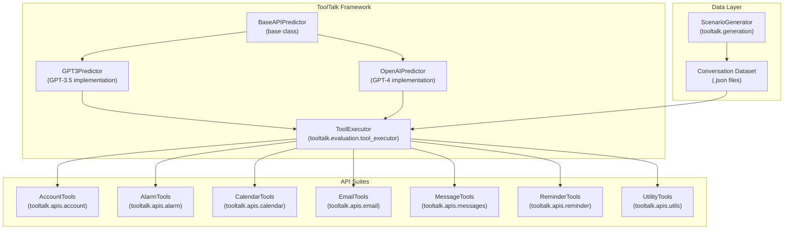
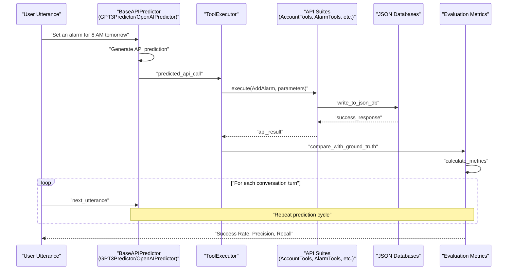

<!-- source: DeepWiki mcp.deepwiki.com · repo microsoft/ToolTalk · page 1 Overview · fetched 2026-10-26 -->

# Overview

<details>
<summary>Relevant source files</summary>

The following files were used as context for generating this wiki page:

- [NOTICE](NOTICE)
- [README.md](README.md)

</details>


## Purpose and Scope

This document introduces the ToolTalk benchmark framework, explaining its purpose as a conversational evaluation system for tool-augmented Large Language Models (LLMs). ToolTalk provides a structured environment for testing how well LLMs can predict and execute API calls within multi-turn conversations.

For detailed information about the core architecture components, see [Core Architecture](#2). For guidance on running evaluations, see [Running Evaluations](#4.1). For extending the system with new APIs, see [Adding New APIs](#5.1).

## What is ToolTalk

ToolTalk is a benchmark framework designed to evaluate tool-augmented LLMs in conversational settings, simulating realistic chatbot interactions where users request actions that require API calls. The system tests an LLM's ability to predict the correct sequence of tool usage after each user utterance in a conversation.

The framework contains a handcrafted dataset of 78 conversations (28 easy, 50 hard) with ground truth annotations for 28 unique tools organized into 7 themed API suites. Each conversation requires multiple correct predictions, making successful evaluation dependent on sustained accuracy across conversation turns.

**Core Components:**



Sources: [README.md:1-84](), [tooltalk/evaluation/tool_executor.py](), [tooltalk/apis/]()

## Evaluation Process

The evaluation process follows a structured sequence where LLMs predict API calls based on conversational context, execute those calls through the `ToolExecutor`, and compare results against ground truth annotations.

**Evaluation Sequence:**



Sources: [README.md:20-22](), [tooltalk/evaluation/tool_executor.py](), [tooltalk/evaluation/evaluate_openai.py]()

## Dataset and Performance Metrics

ToolTalk provides curated conversation datasets with varying difficulty levels and comprehensive evaluation metrics to assess model performance across multiple dimensions.

**Dataset Composition:**

| Category | Count | Description |
|----------|-------|-------------|
| Easy Conversations | 28 | Single-domain interactions with straightforward tool usage |
| Hard Conversations | 50 | Multi-domain interactions requiring complex tool sequences |
| Unique Tools | 28 | Distinct API endpoints across 7 themed suites |
| API Suites | 7 | AccountTools, AlarmTools, CalendarTools, EmailTools, MessageTools, ReminderTools, UtilityTools |

**Benchmark Results:**

| Model | Difficulty | Success Rate | Precision | Recall | Incorrect Action Rate |
|-------|------------|--------------|-----------|--------|-----------------------|
| GPT-3.5 | Easy | 85.7% | 42.4% | 89.3% | 5.0% |
| GPT-4 | Easy | 92.8% | 69.2% | 96.4% | 3.8% |
| GPT-3.5 | Hard | 26.0% | 54.6% | 69.7% | 23.9% |
| GPT-4 | Hard | 50.0% | 74.9% | 79.0% | 25.1% |

Sources: [README.md:17-18](), [README.md:26-31]()

## Quick Start

The framework supports rapid setup for evaluation and extension. The core workflow involves installing dependencies, configuring API keys for model evaluation, and running provided evaluation scripts.

**Installation and Setup:**

```bash
pip install -r requirements.txt
pip install -e ".[dev]"
pytest tests  # Verify installation
```

**Running Evaluations:**

```bash
export OPENAI_API_KEY=<your_key>
bash evaluate_gpt35turbo.sh  # Evaluate GPT-3.5
bash evaluate_gpt4.sh        # Evaluate GPT-4
```

**Custom Model Integration:**

To evaluate new models, create a subclass of `BaseAPIPredictor` following the pattern established by `GPT3Predictor` and `OpenAIPredictor`:

```python
class CustomPredictor(BaseAPIPredictor):
    def predict_api_call(self, conversation_context):
        # Implementation for your model
        pass
```

**Scenario Generation:**

```bash
python -m tooltalk.generation.scenario_generator \
    --prompt src/prompts/scenario_template.md \
    --output_dir output/scenarios
```

Sources: [README.md:35-68](), [README.md:72-73](), [tooltalk/evaluation/tool_executor.py]()

---

