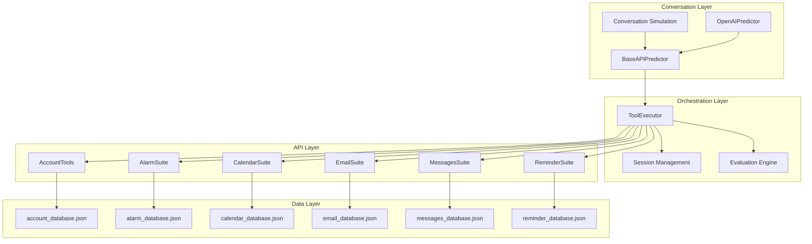
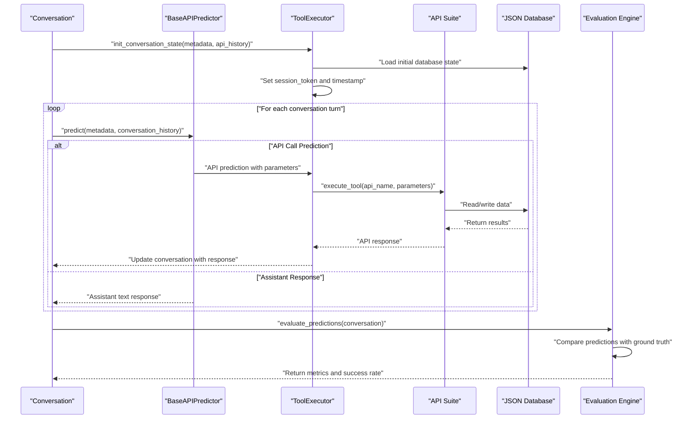
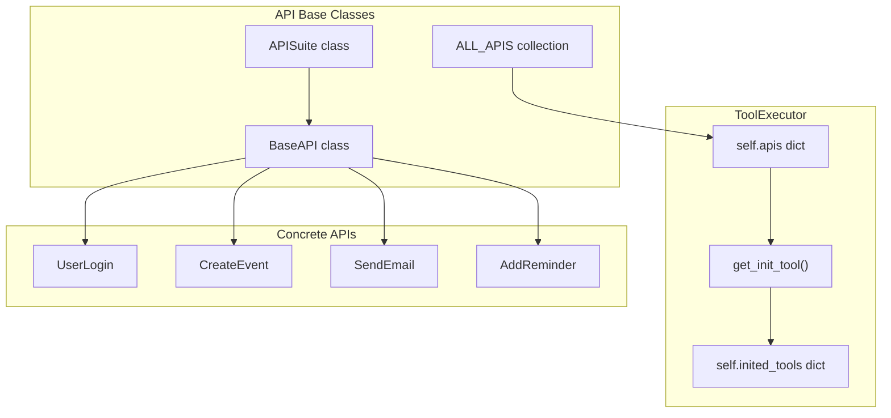

<!-- source: DeepWiki mcp.deepwiki.com · repo microsoft/ToolTalk · page 2 Core Architecture · fetched 2026-10-26 -->

# Core Architecture

Relevant source files

The following files were used as context for generating this wiki page:

- [src/tooltalk/evaluation/__init__.py](src/tooltalk/evaluation/__init__.py)
- [src/tooltalk/evaluation/evaluate_openai.py](src/tooltalk/evaluation/evaluate_openai.py)
- [src/tooltalk/evaluation/tool_executor.py](src/tooltalk/evaluation/tool_executor.py)

This document explains the fundamental architectural components of the ToolTalk benchmark framework and how they work together to enable conversation simulation and tool-augmented LLM evaluation. The architecture provides a layered, plugin-based system for simulating realistic multi-turn conversations with API interactions.

For implementation details of specific components, see [ToolExecutor](#2.1), [API System](#2.2), and [Evaluation Framework](#2.3). For guidance on extending the system, see [Development Guide](#5).

## System Overview

ToolTalk implements a layered architecture with clear separation of concerns. The system orchestrates conversation simulation through the `ToolExecutor` class, which manages API execution, maintains database state, and coordinates between language models and API suites.

### Core Architecture Diagram

**Sources:** [src/tooltalk/evaluation/tool_executor.py:20-334](), [src/tooltalk/evaluation/evaluate_openai.py:27-113]()

## Key Components

### ToolExecutor Class

The `ToolExecutor` serves as the central orchestration component, managing conversation state, API execution, and evaluation metrics. It maintains database connections, handles authentication through session tokens, and provides conversation simulation capabilities.

**Key Responsibilities:**
- Database state management and reset functionality
- API tool initialization and execution 
- Session token management for authentication
- Conversation simulation with prediction functions
- Evaluation metrics calculation and comparison

### BaseAPIPredictor Interface

The `BaseAPIPredictor` abstract class defines the interface for language model integration, enabling support for different LLM providers while maintaining consistent conversation simulation behavior.

**Required Methods:**
- `__init__(function_docs, *args, **kwargs)` - Initialize with API documentation
- `predict(metadata, conversation_history)` - Generate next action prediction

### Database Management

The system uses JSON files as databases, with each API suite managing its own database file. The `ToolExecutor` loads all databases during initialization and provides state reset capabilities for conversation simulation.

**Database Files:**
- `account_database.json` - User accounts and authentication data
- `alarm_database.json` - Alarm and timer data
- `calendar_database.json` - Calendar events and scheduling
- `email_database.json` - Email messages and threads
- `messages_database.json` - Text messages and conversations
- `reminder_database.json` - Reminders and tasks

## Conversation Simulation Flow

The following diagram illustrates how conversations are simulated and evaluated within the ToolTalk framework:

### Conversation Simulation Data Flow

**Sources:** [src/tooltalk/evaluation/tool_executor.py:251-319](), [src/tooltalk/evaluation/tool_executor.py:134-232]()

## Authentication and Session Management

The architecture implements session-based authentication through the `ToolExecutor`. User login state is maintained via session tokens that are automatically managed during conversation simulation.

### Authentication Flow

| Component | Responsibility |
|-----------|----------------|
| `ToolExecutor.session_token` | Maintains current user session |
| `UserLogin` / `RegisterUser` | Creates session tokens |
| `LogoutUser` / `DeleteAccount` | Invalidates session tokens |
| API parameter injection | Automatically adds session tokens to authenticated API calls |

The system enforces single-user sessions and automatically handles login/logout state changes during API execution.

**Sources:** [src/tooltalk/evaluation/tool_executor.py:95-119](), [src/tooltalk/evaluation/tool_executor.py:234-250]()

## Plugin-Based API Architecture

The API system uses a plugin-based design where each API suite operates independently while following consistent interfaces. The `ToolExecutor` dynamically loads and initializes API classes from the `ALL_APIS` collection.

### API Integration Model

**Key Features:**
- Dynamic API loading from `ALL_APIS` collection
- Lazy initialization through `get_init_tool()` method
- Consistent database and authentication parameter injection
- Individual database management per API suite

**Sources:** [src/tooltalk/evaluation/tool_executor.py:45-46](), [src/tooltalk/evaluation/tool_executor.py:61-81]()

## Evaluation and Metrics

The evaluation system compares model predictions against ground truth API calls, calculating precision, recall, and success metrics. The `evaluate_predictions()` method implements sophisticated matching logic that accounts for the sequential nature of conversation flows.

### Evaluation Metrics

| Metric | Calculation | Purpose |
|--------|-------------|---------|
| `precision` | matches / predictions | Accuracy of model predictions |
| `recall` | matches / ground_truths | Coverage of required API calls |  
| `action_precision` | valid_actions / actions | Accuracy of action-type APIs |
| `bad_action_rate` | bad_actions / actions | Rate of harmful incorrect actions |
| `success` | recall == 1.0 && bad_action_rate == 0.0 | Complete conversation success |
| `soft_success` | recall * (1.0 - bad_action_rate) | Weighted success metric |

The evaluation engine uses a deque-based matching algorithm to ensure each ground truth API call can only match one prediction, preventing double-counting while respecting conversation order.

**Sources:** [src/tooltalk/evaluation/tool_executor.py:134-232](), [src/tooltalk/evaluation/evaluate_openai.py:187-218]()

## State Management and Reset

The `ToolExecutor` provides conversation-level state management through database snapshots and tool reinitialization. This enables independent evaluation of multiple conversations without cross-contamination.

**State Management Methods:**
- `reset_executor()` - Restores databases to initial state
- `init_conversation_state()` - Sets up conversation-specific context
- Database file reloading from original JSON files
- Tool instance cache clearing

This architecture ensures reproducible evaluation results and proper isolation between conversation simulations.

**Sources:** [src/tooltalk/evaluation/tool_executor.py:49-60](), [src/tooltalk/evaluation/tool_executor.py:234-250]()

---

