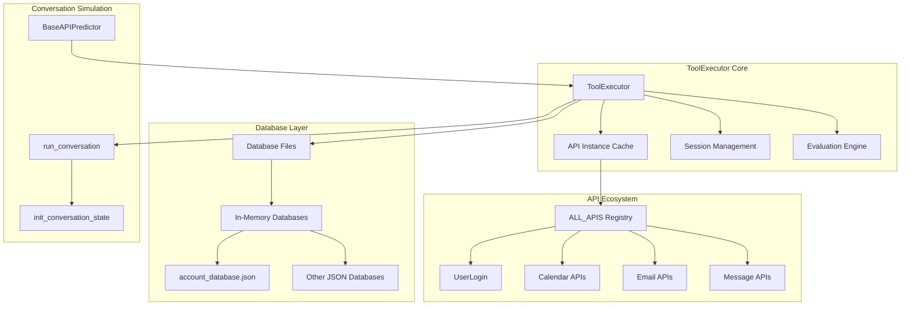
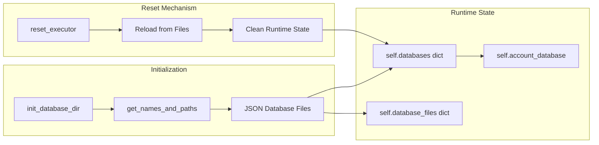
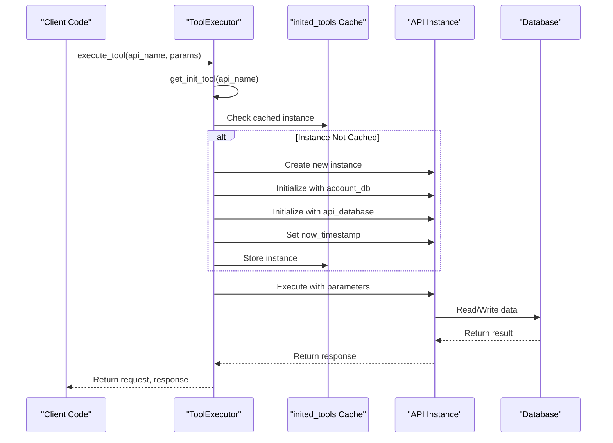
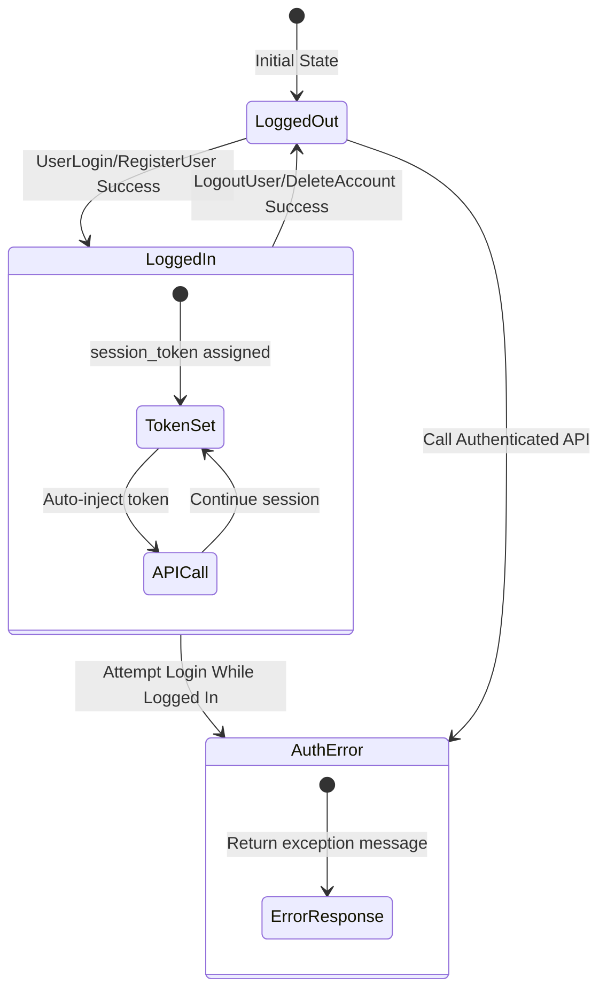
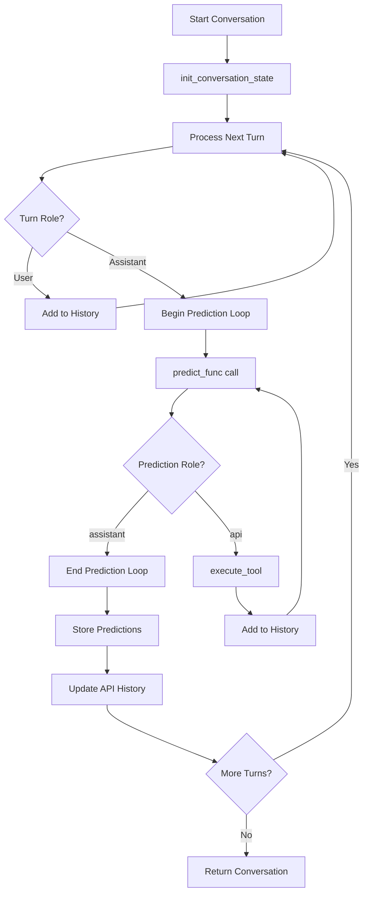
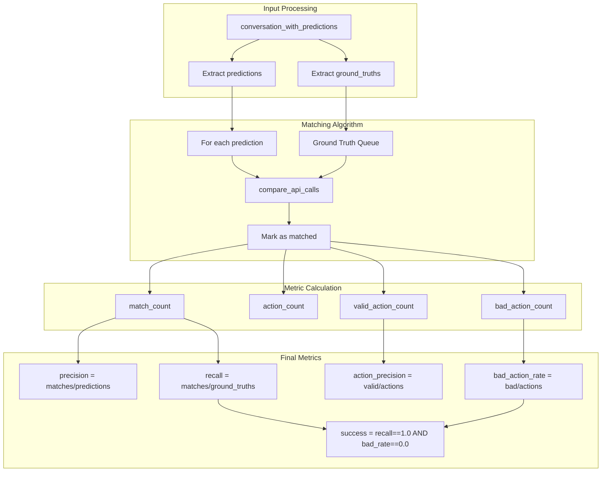
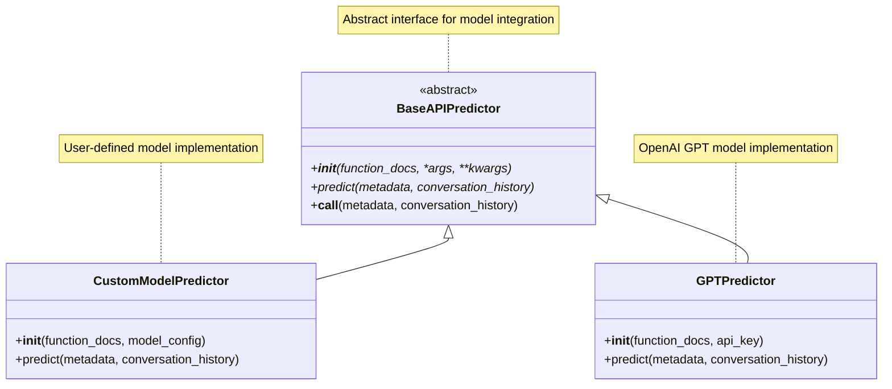

<!-- source: DeepWiki mcp.deepwiki.com · repo microsoft/ToolTalk · page 2.1 ToolExecutor · fetched 2026-10-26 -->

# ToolExecutor

Relevant source files

The following files were used as context for generating this wiki page:

- [src/tooltalk/evaluation/tool_executor.py](src/tooltalk/evaluation/tool_executor.py)

The `ToolExecutor` class serves as the central orchestration layer for executing API calls, managing database state, and simulating conversations in the ToolTalk benchmark framework. It handles authentication, maintains database consistency during conversation simulation, and provides comprehensive evaluation metrics for comparing model predictions against ground truth API calls.

For information about the individual API suites that ToolExecutor manages, see [API System](#2.2). For details on how evaluation metrics are calculated and used, see [Evaluation Framework](#2.3).

## Core Architecture and Responsibilities

The `ToolExecutor` class acts as the primary execution engine that bridges conversation simulation with actual API functionality. It maintains stateful execution environments, handles cross-API session management, and provides evaluation capabilities for measuring model performance.

**ToolExecutor Architecture Overview**

The `ToolExecutor` manages four primary concerns: database state, API instance lifecycle, session-based authentication, and conversation simulation with evaluation metrics.

Sources: [src/tooltalk/evaluation/tool_executor.py:20-48]()

## Database Management System

The `ToolExecutor` implements a JSON-based database system that maintains conversation state and provides data persistence for API operations. Each database corresponds to a specific API suite's data requirements.

**Database State Management Flow**

The database system loads JSON files at initialization and maintains them in memory during conversation simulation. The `reset_executor` method restores original state between conversation runs.

| Database Component | Purpose | File Format |
|-------------------|---------|-------------|
| `self.databases` | In-memory database state | Python dict |
| `self.database_files` | File path mappings | String paths |
| `account_database` | User authentication data | JSON file |

Sources: [src/tooltalk/evaluation/tool_executor.py:36-44](), [src/tooltalk/evaluation/tool_executor.py:49-60]()

## API Instance Management

The `ToolExecutor` maintains a registry of available APIs and creates instances on-demand with proper database and authentication context. API instances are cached to maintain state consistency within conversation turns.

**API Instance Lifecycle Management**

The `get_init_tool` method creates API instances with appropriate database context and timestamp information. Each API class specifies its required database via the `database_name` attribute.

Sources: [src/tooltalk/evaluation/tool_executor.py:61-81](), [src/tooltalk/evaluation/tool_executor.py:45]()

## Authentication and Session Management

The `ToolExecutor` implements a session-based authentication system that manages user login state across API calls. Session tokens are automatically injected into API parameters for authenticated operations.

**Session State Management Flow**

The authentication system maintains a single active session per `ToolExecutor` instance and automatically handles token injection for APIs that require authentication.

| Authentication Component | Purpose | Behavior |
|-------------------------|---------|----------|
| `session_token` | Current user session | Set on login, cleared on logout |
| `requires_auth` | API authentication flag | Auto-inject token if required |
| Login/Register APIs | Session establishment | Create and store session token |
| Logout/Delete APIs | Session termination | Clear stored session token |

Sources: [src/tooltalk/evaluation/tool_executor.py:95-119]()

## Conversation Simulation Engine

The `run_conversation` method provides comprehensive conversation simulation by integrating prediction functions with actual API execution. It maintains conversation history and handles multi-turn interactions with stateful API calls.

**Conversation Simulation Flow**

The simulation engine maintains separate histories for predictions and ground truth, allowing comprehensive evaluation of model behavior against expected API usage patterns.

Sources: [src/tooltalk/evaluation/tool_executor.py:251-319]()

## Evaluation Metrics System

The `evaluate_predictions` method implements a comprehensive evaluation framework that compares model predictions against ground truth API calls, calculating multiple metrics for model performance assessment.

**Evaluation Metrics Calculation Process**

The evaluation system uses a greedy matching algorithm where each prediction can match at most one ground truth API call, and each ground truth can be matched at most once.

| Metric | Formula | Purpose |
|--------|---------|---------|
| `precision` | matches / predictions | Overall prediction accuracy |
| `recall` | matches / ground_truths | Coverage of required API calls |
| `action_precision` | valid_actions / actions | Accuracy of state-changing operations |
| `bad_action_rate` | bad_actions / actions | Rate of incorrect but successful actions |
| `success` | recall == 1.0 AND bad_action_rate == 0.0 | Perfect conversation completion |
| `soft_success` | recall × (1.0 - bad_action_rate) | Weighted success metric |

Sources: [src/tooltalk/evaluation/tool_executor.py:134-232]()

## BaseAPIPredictor Interface

The `BaseAPIPredictor` abstract base class defines the interface for integrating language models with the `ToolExecutor`. Model implementations must provide prediction capabilities that return either API calls or assistant responses.

**BaseAPIPredictor Class Hierarchy**

The predictor interface enables flexible model integration while maintaining consistent interaction patterns with the `ToolExecutor` conversation simulation system.

| Method | Purpose | Return Format |
|--------|---------|---------------|
| `__init__` | Initialize with API documentation | N/A |
| `predict` | Generate next conversation action | `{"role": "api\|assistant", ...}` |
| `__call__` | Convenience wrapper for predict | Same as predict |

Sources: [src/tooltalk/evaluation/tool_executor.py:322-334]()

---

