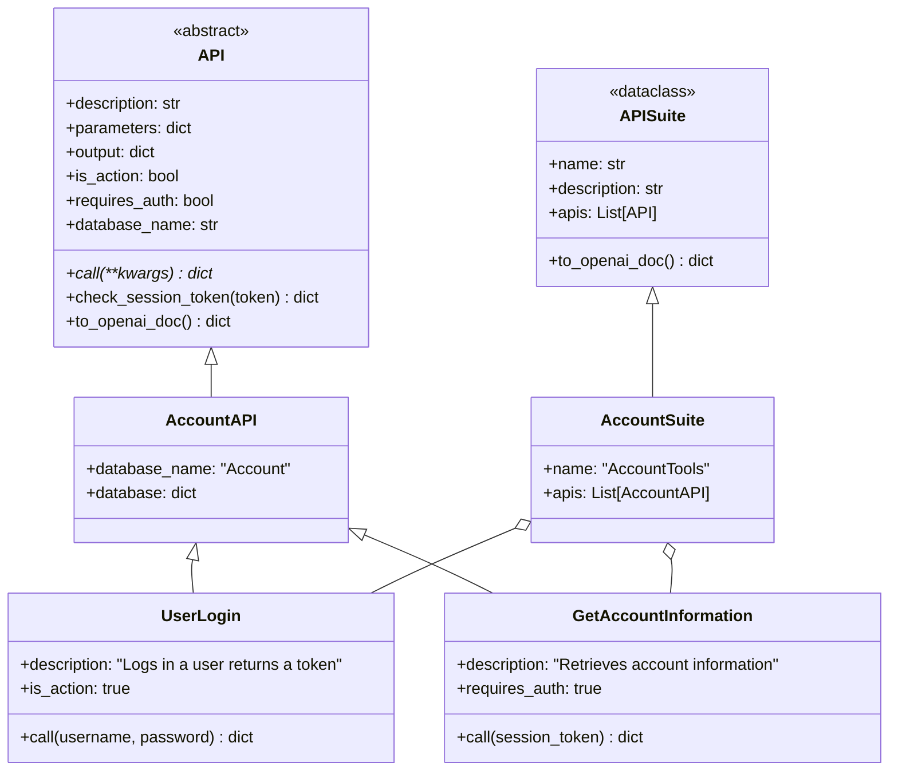
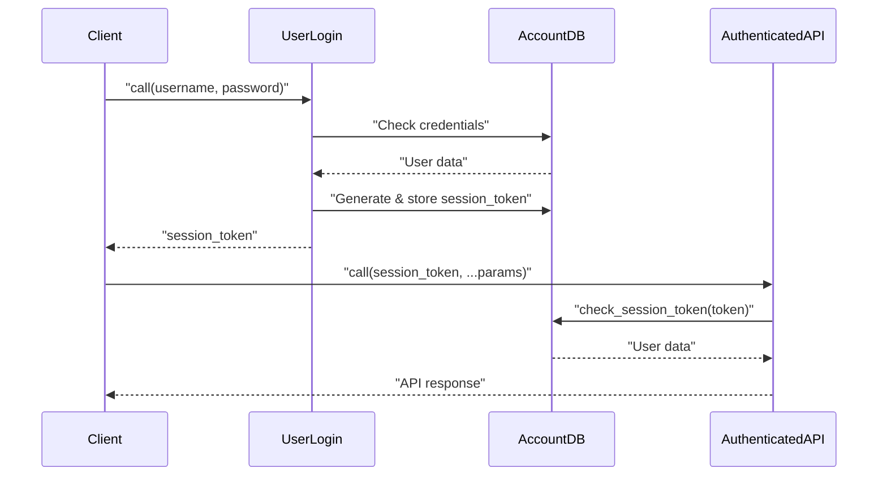
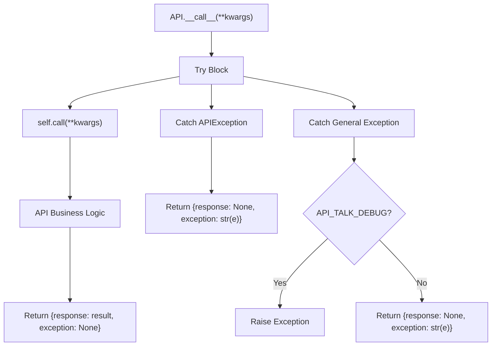

<!-- source: DeepWiki mcp.deepwiki.com · repo microsoft/ToolTalk · page 2.2 API System · fetched 2026-10-26 -->

# API System

<details>
<summary>Relevant source files</summary>

The following files were used as context for generating this wiki page:

- [src/tooltalk/apis/account.py](src/tooltalk/apis/account.py)
- [src/tooltalk/apis/api.py](src/tooltalk/apis/api.py)

</details>


This document explains ToolTalk's plugin-based API architecture, including the base classes that define the API framework, how APIs are organized into functional suites, and the implementation patterns used throughout the system. For information about how the ToolExecutor orchestrates API calls, see [ToolExecutor](#2.1). For details about specific API endpoints, see [API Reference](#3).

## Architecture Overview

ToolTalk's API system follows a hierarchical plugin architecture where individual APIs inherit from a common base class and are grouped into thematic suites. The system provides consistent patterns for authentication, parameter validation, error handling, and database interaction across all API implementations.

### API Class Hierarchy



**Sources:** [src/tooltalk/apis/api.py:15-187](), [src/tooltalk/apis/account.py:26-532]()

### API Suite Organization

The system organizes APIs into functional suites that represent logical groupings of related operations. Each suite contains multiple API classes that share common data models and business logic.

```mermaid
graph TB
    subgraph "APISuite Framework"
        APISuite["APISuite"]
        API["API (Abstract Base)"]
    end
    
    subgraph "Account Management"
        AccountSuite["AccountSuite"]
        UserLogin["UserLogin"]
        RegisterUser["RegisterUser"]
        GetAccountInformation["GetAccountInformation"]
        DeleteAccount["DeleteAccount"]
        QueryUser["QueryUser"]
    end
    
    subgraph "Database Layer"
        AccountDB[("Account Database")]
    end
    
    APISuite <|-- AccountSuite
    API <|-- UserLogin
    API <|-- RegisterUser
    API <|-- GetAccountInformation
    
    AccountSuite --> UserLogin
    AccountSuite --> RegisterUser
    AccountSuite --> GetAccountInformation
    AccountSuite --> DeleteAccount
    AccountSuite --> QueryUser
    
    UserLogin --> AccountDB
    RegisterUser --> AccountDB
    GetAccountInformation --> AccountDB
```

**Sources:** [src/tooltalk/apis/api.py:159-187](), [src/tooltalk/apis/account.py:517-532]()

## Base API Framework

### API Base Class

The `API` class defines the contract that all APIs must implement. It provides common functionality for parameter validation, error handling, and response formatting.

| Property | Type | Purpose |
|----------|------|---------|
| `description` | str | Human-readable description of the API's function |
| `parameters` | dict | Schema defining required and optional parameters |
| `output` | dict | Schema defining the response structure |
| `is_action` | bool | Whether the API modifies system state |
| `requires_auth` | bool | Whether authentication is required |
| `database_name` | str | Name of the primary database used |

The base class provides several key methods:

- `call(**kwargs)` - Abstract method that subclasses must implement [src/tooltalk/apis/api.py:72-73]()
- `__call__(**kwargs)` - Wrapper that handles exceptions and response formatting [src/tooltalk/apis/api.py:75-102]()
- `check_session_token(token)` - Validates session tokens for authenticated APIs [src/tooltalk/apis/api.py:149-156]()
- `to_openai_doc()` - Converts API schema to OpenAI function calling format [src/tooltalk/apis/api.py:127-147]()

### Parameter and Output Schemas

APIs define their interface using structured schemas that specify parameter types, requirements, and descriptions:

```python
parameters = {
    'username': {
        'type': "string",
        'description': 'The username of the user.',
        'required': True,
    },
    'password': {
        'type': "string", 
        'description': 'The password of the user.',
        'required': True,
    },
}
```

**Sources:** [src/tooltalk/apis/api.py:15-125](), [src/tooltalk/apis/account.py:479-490]()

## Authentication System

### Session Token Management

The API system implements session-based authentication where authenticated operations require valid session tokens. The authentication flow follows these patterns:



### Authentication Implementation

APIs that require authentication set `requires_auth = True` and receive `session_token` as their first parameter. The `check_session_token` method validates tokens by searching the account database:

```python
def check_session_token(self, session_token: str) -> dict:
    for username, user_data in self.account_database.items():
        if session_token == user_data['session_token']:
            return user_data
    raise APIException('Invalid session_token.')
```

**Sources:** [src/tooltalk/apis/api.py:149-156](), [src/tooltalk/apis/account.py:477-514](), [src/tooltalk/apis/account.py:128-143]()

## Database Integration

### Database Schema Patterns

Each API suite defines its database schema and access patterns. The Account suite uses the following schema:

| Field | Type | Purpose |
|-------|------|---------|
| `username` | str | Primary key |
| `password` | str | User password |  
| `session_token` | str | Authentication token (null when logged out) |
| `email` | str | User email address |
| `phone` | str | User phone number |
| `name` | str | Display name |

### Database Access Patterns

APIs inherit database references through their constructor and access data through the `self.database` property:

```python
class AccountAPI(API, ABC):
    database_name = ACCOUNT_DB_NAME
    
    def __init__(self, account_database: dict, now_timestamp: str, api_database: dict = None):
        super().__init__(account_database, now_timestamp, api_database)
        self.database = self.account_database
```

**Sources:** [src/tooltalk/apis/account.py:13-37](), [src/tooltalk/apis/account.py:26-37]()

## API Execution Flow

### Call Execution Pipeline

When an API is invoked, execution follows a consistent pipeline that handles parameter validation, business logic execution, and response formatting:



### Error Handling

The system distinguishes between expected business logic errors (`APIException`) and unexpected system errors. All responses follow a consistent format with separate `response` and `exception` fields:

```python
try:
    return {
        "response": self.call(**kwargs),
        "exception": None
    }
except APIException as e:
    return {
        "response": None,
        "exception": str(e)
    }
```

**Sources:** [src/tooltalk/apis/api.py:75-102]()

## Data Formats and Serialization

### OpenAI Function Format

APIs can be automatically converted to OpenAI function calling format for integration with language models:

```python
def to_openai_doc(cls, disable_doc: bool = False) -> dict:
    parameters = dict()
    required = list()
    for name, attributes in cls.parameters.items():
        if attributes["required"]:
            required.append(name)
        # ... parameter processing
    
    return {
        "name": cls.__name__,
        "description": description,
        "parameters": {
            "type": "object", 
            "properties": parameters,
        },
        "required": required,
    }
```

### Suite Documentation Generation

API suites provide methods to generate documentation in multiple formats including docstrings, dictionaries, and OpenAI function schemas for model integration.

**Sources:** [src/tooltalk/apis/api.py:127-147](), [src/tooltalk/apis/api.py:165-186]()

---

