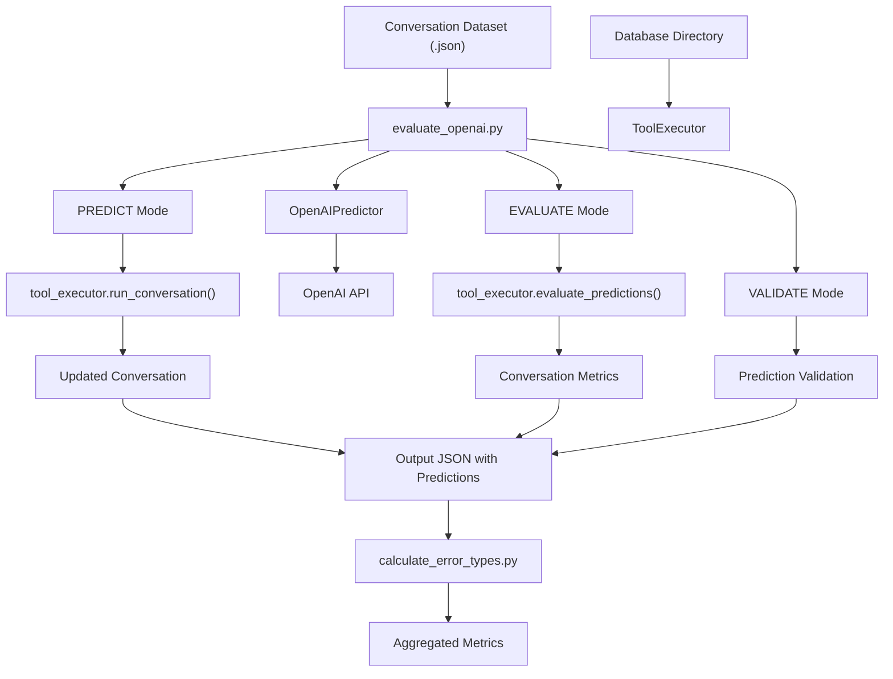
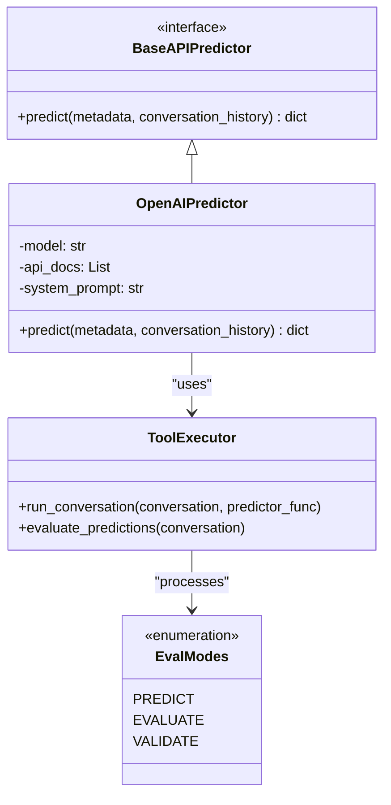
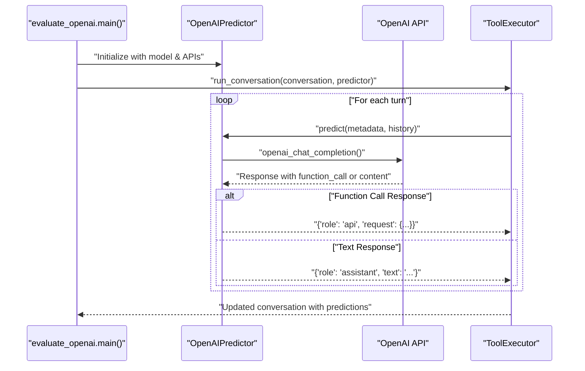
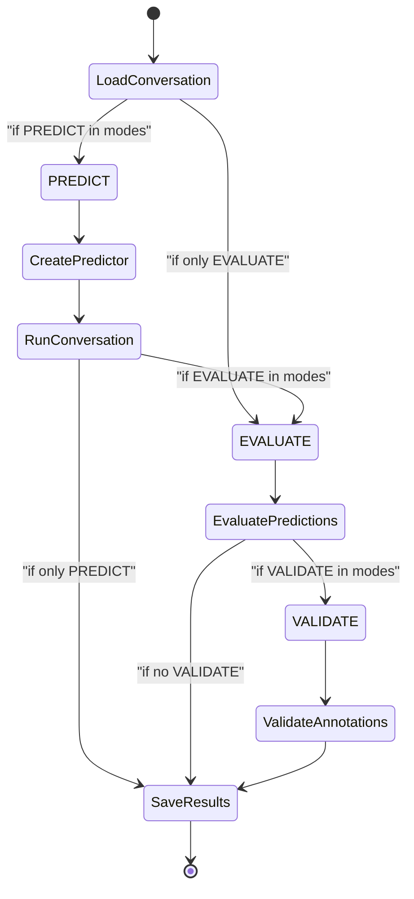
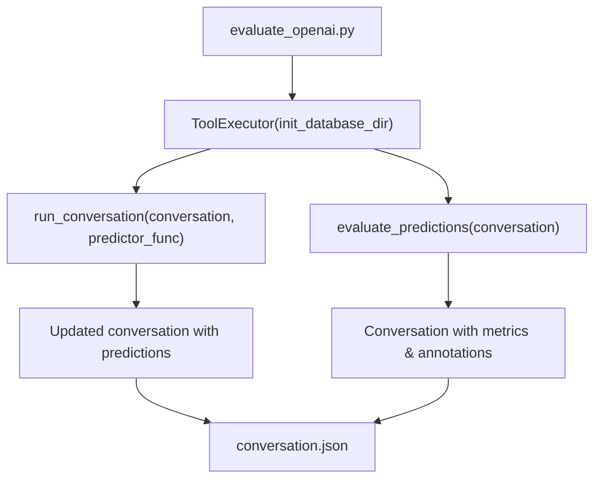

<!-- source: DeepWiki mcp.deepwiki.com · repo microsoft/ToolTalk · page 2.3 Evaluation Framework · fetched 2026-10-26 -->

# Evaluation Framework

<details>
<summary>Relevant source files</summary>

The following files were used as context for generating this wiki page:

- [scripts/evaluate_gpt35turbo.sh](scripts/evaluate_gpt35turbo.sh)
- [scripts/evaluate_gpt4.sh](scripts/evaluate_gpt4.sh)
- [src/tooltalk/evaluation/__init__.py](src/tooltalk/evaluation/__init__.py)
- [src/tooltalk/evaluation/evaluate_openai.py](src/tooltalk/evaluation/evaluate_openai.py)

</details>


## Purpose and Scope

The Evaluation Framework provides the core infrastructure for evaluating tool-augmented language models on conversational scenarios in ToolTalk. This framework handles model prediction, conversation execution, and metric calculation to assess how well models can correctly use APIs in multi-turn conversations.

The framework supports multiple evaluation modes and integrates with the ToolExecutor to simulate realistic conversation flows. For information about the API system being evaluated, see [API System](#2.2). For details on running evaluations, see [Running Evaluations](#4.1).

## Evaluation Pipeline Architecture

The evaluation framework follows a multi-stage pipeline that transforms conversation scenarios into executable evaluations and produces detailed metrics.

**Evaluation Pipeline Flow**



**Code Entity Integration**



Sources: [src/tooltalk/evaluation/evaluate_openai.py:1-222]()

## Model Predictor Interface

The evaluation framework uses a plugin-based architecture through the `BaseAPIPredictor` interface, allowing integration of different language models.

### BaseAPIPredictor Interface

The `BaseAPIPredictor` abstract base class defines the contract for model integration:

| Method | Parameters | Return Type | Purpose |
|--------|------------|-------------|---------|
| `predict()` | `metadata: dict`, `conversation_history: dict` | `dict` | Generate next conversation turn |

### OpenAIPredictor Implementation

The `OpenAIPredictor` class implements the interface for OpenAI models like GPT-3.5 and GPT-4:

**Key Features:**
- **System Prompt**: Includes user metadata (location, timestamp, username) [src/tooltalk/evaluation/evaluate_openai.py:28-31]()
- **Function Calling**: Converts API documentation to OpenAI function format [src/tooltalk/evaluation/evaluate_openai.py:35]()
- **History Management**: Transforms conversation history into OpenAI message format [src/tooltalk/evaluation/evaluate_openai.py:44-71]()
- **Response Processing**: Handles both text responses and function calls [src/tooltalk/evaluation/evaluate_openai.py:88-112]()

**Prediction Workflow:**



Sources: [src/tooltalk/evaluation/evaluate_openai.py:27-113](), [src/tooltalk/evaluation/tool_executor.py]()

## Evaluation Modes and Workflow

The evaluation framework supports three distinct modes controlled by the `EvalModes` enumeration:

### PREDICT Mode
Generates model predictions for conversation turns using the specified predictor:
- Loads conversation scenarios from dataset
- Determines API scope based on `api_mode` parameter (`exact`, `suite`, or `all`)
- Runs conversation simulation through `tool_executor.run_conversation()`
- Stores predictions with OpenAI request/response metadata

### EVALUATE Mode  
Calculates performance metrics by comparing predictions against ground truth:
- Runs `tool_executor.evaluate_predictions()` on conversations with predictions
- Computes precision, recall, action accuracy, and success rates
- Adds `match` and `bad_action` annotations to API predictions
- Aggregates metrics across all conversations

### VALIDATE Mode
Performs integrity checks on evaluation results:
- Ensures all API predictions have required evaluation fields (`match`, `bad_action`)
- Validates data consistency for downstream analysis

**Evaluation Modes Flow:**



Sources: [src/tooltalk/evaluation/evaluate_openai.py:115-118](), [src/tooltalk/evaluation/evaluate_openai.py:167-203]()

## Metrics and Results

The evaluation framework calculates comprehensive metrics to assess model performance across different dimensions:

### Core Metrics

| Metric | Formula | Purpose |
|--------|---------|---------|
| Precision | `matches / predictions` | Accuracy of API calls made |
| Recall | `matches / ground_truths` | Coverage of required API calls |  
| Action Precision | `valid_actions / actions` | Correctness of API parameters |
| Bad Action Rate | `bad_actions / actions` | Rate of invalid API calls |
| Success Rate | `success / num_conversations` | End-to-end conversation success |

### Metric Calculation Process

The framework accumulates metrics using `Counter` objects throughout evaluation:

```python
# From evaluate_openai.py lines 150, 191-192, 209-217
total_metrics = Counter()
total_metrics += conversation["metrics"] 
total_metrics["num_conversations"] += 1

# Final aggregation
metrics = {
    "precision": total_metrics["matches"] / total_metrics["predictions"],
    "recall": total_metrics["matches"] / total_metrics["ground_truths"],
    # ... other metrics
}
```

### Output Structure

Each evaluated conversation produces a JSON file containing:
- Original conversation scenario
- Model predictions with metadata
- Evaluation annotations (`match`, `bad_action` flags)
- Conversation-level metrics
- OpenAI API request/response logs

Sources: [src/tooltalk/evaluation/evaluate_openai.py:150-217]()

## Integration with ToolExecutor

The evaluation framework delegates conversation execution and metric calculation to the `ToolExecutor` class, maintaining separation of concerns:

**ToolExecutor Interface Usage:**



The `ToolExecutor` handles:
- Database initialization and state management
- API execution and response handling  
- Conversation flow control
- Prediction evaluation and metric computation

This design allows the evaluation framework to focus on model integration and result aggregation while delegating the complex conversation simulation logic to the specialized `ToolExecutor` component.

Sources: [src/tooltalk/evaluation/evaluate_openai.py:152](), [src/tooltalk/evaluation/evaluate_openai.py:185](), [src/tooltalk/evaluation/evaluate_openai.py:189]()

---

