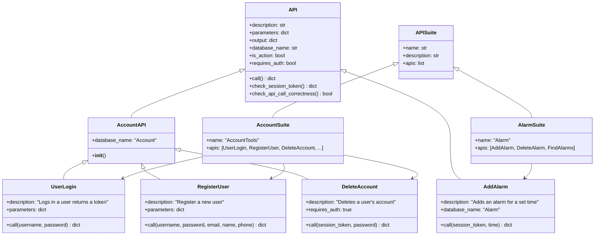
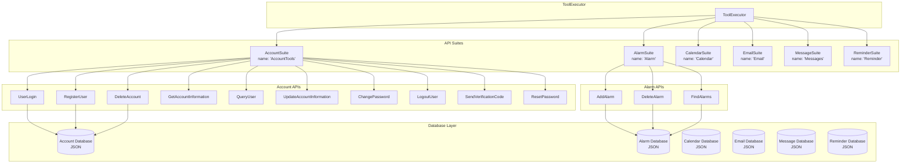
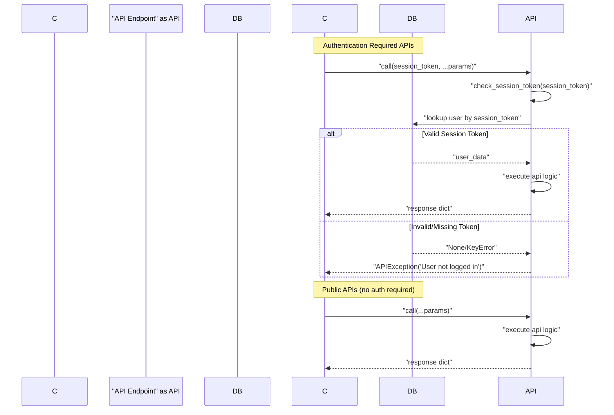

<!-- source: DeepWiki mcp.deepwiki.com · repo microsoft/ToolTalk · page 3 API Reference · fetched 2026-10-26 -->

# API Reference

<details>
<summary>Relevant source files</summary>

The following files were used as context for generating this wiki page:

- [src/tooltalk/apis/account.py](src/tooltalk/apis/account.py)
- [src/tooltalk/apis/alarm.py](src/tooltalk/apis/alarm.py)

</details>


This document provides comprehensive documentation of all available API suites and endpoints in the ToolTalk framework. The API Reference covers the structure, patterns, and specifications for all tool APIs that can be used during conversation simulation and evaluation.

For information about the underlying architecture and how APIs integrate with the ToolExecutor, see [Core Architecture](#2). For detailed implementation guides on creating new APIs, see [Adding New APIs](#5.1).

## API System Architecture

The ToolTalk API system is organized into thematic suites that group related functionality. Each suite contains multiple individual API endpoints that inherit from common base classes and follow standardized patterns.

### API Class Hierarchy



Sources: [src/tooltalk/apis/account.py:1-532](), [src/tooltalk/apis/alarm.py:1-202]()

### API Suite Organization



Sources: [src/tooltalk/apis/account.py:517-532](), [src/tooltalk/apis/alarm.py:194-202]()

## Common API Patterns

All APIs in ToolTalk follow consistent patterns for authentication, database access, parameter validation, and error handling.

### Authentication Flow



Sources: [src/tooltalk/apis/account.py:69-73](), [src/tooltalk/apis/alarm.py:50-59]()

### Database Schema Patterns

| Suite | Database Name | Schema | Key Field |
|-------|---------------|---------|-----------|
| Account | `"Account"` | `{username: {username, password, session_token, email, phone, name}}` | `username` |
| Alarm | `"Alarm"` | `{username: {alarm_id: {alarm_id, time}}}` | `username` → `alarm_id` |
| Calendar | `"Calendar"` | `{username: {event_id: {event_id, title, start_time, end_time, location, attendees}}}` | `username` → `event_id` |
| Email | `"Email"` | `{username: {email_id: {from, to, subject, body, timestamp}}}` | `username` → `email_id` |
| Messages | `"Messages"` | `{username: {message_id: {from, to, message, timestamp}}}` | `username` → `message_id` |
| Reminder | `"Reminder"` | `{username: {reminder_id: {reminder_id, task, due_time, completed}}}` | `username` → `reminder_id` |

Sources: [src/tooltalk/apis/account.py:13-21](), [src/tooltalk/apis/alarm.py:15-22]()

## API Specification Format

Each API endpoint follows a standardized specification format that defines its interface, behavior, and integration points.

### Standard API Properties

```python
class ExampleAPI(API):
    description = "Human-readable description of what the API does"
    parameters = {
        'param_name': {
            'type': "string|number|boolean|object|array",
            'description': "Parameter description",
            'required': True|False
        }
    }
    output = {
        'field_name': {
            'type': "string|number|boolean|object|array", 
            'description': "Output field description"
        }
    }
    database_name = "DatabaseName"  # Which database this API uses
    is_action = True|False         # Whether this API modifies state
    requires_auth = True|False     # Whether authentication is required
```

### Parameter Types and Validation

| Type | Validation | Example |
|------|------------|---------|
| `string` | Format validation via utility functions | Email: `verify_email_format()`, Phone: `verify_phone_format()` |
| `string` (time) | DateTime parsing with specific formats | `%H:%M:%S`, `%Y-%m-%d %H:%M:%S` |
| `string` (ID) | Pattern validation | `alarm_id`: `xxxx-xxxx`, `session_token`: `xxxxxxxx-xxxx-xxxx` |
| `boolean` | Type validation | `completed: true/false` |
| `array` | Item type validation | `attendees: ["email1", "email2"]` |

Sources: [src/tooltalk/apis/account.py:42-55](), [src/tooltalk/apis/alarm.py:26-35]()

## Error Handling and Exceptions

All APIs use the `APIException` class for consistent error reporting. Common error patterns include:

### Authentication Errors
```python
# Session token validation
raise APIException("User not logged in.")
raise APIException("The user is already logged in.")

# Password validation  
raise APIException("The password is incorrect.")
raise APIException("The old password is incorrect.")
```

### Resource Errors
```python
# Resource not found
raise APIException("The username does not exist.")
raise APIException(f"Alarm {alarm_id} not found.")

# Resource conflicts
raise APIException("The username already exists.")
```

### Validation Errors
```python
# Format validation
raise APIException("The email format is invalid.")
raise APIException("The phone number format is invalid.")

# Parameter validation
raise APIException("You need to provide at least one of username and email.")
```

Sources: [src/tooltalk/apis/account.py:71](), [src/tooltalk/apis/account.py:297](), [src/tooltalk/apis/alarm.py:106]()

## API Suite Reference Overview

The following API suites are available in ToolTalk:

| Suite | Page | Description | Key APIs |
|-------|------|-------------|----------|
| AccountTools | [3.1](#3.1) | User account management and authentication | `UserLogin`, `RegisterUser`, `DeleteAccount` |
| Alarm | [3.2](#3.2) | Alarm clock management | `AddAlarm`, `DeleteAlarm`, `FindAlarms` |
| Calendar | [3.2](#3.2) | Calendar event management | `CreateEvent`, `QueryCalendar`, `ModifyEvent` |
| Reminder | [3.2](#3.2) | Task reminder management | `AddReminder`, `GetReminders`, `CompleteReminder` |
| Email | [3.3](#3.3) | Email sending and searching | `SendEmail`, `SearchInbox` |
| Messages | [3.3](#3.3) | Direct messaging | `SendMessage`, `SearchMessages` |
| Utilities | [3.4](#3.4) | Format validation and semantic comparison | `verify_email_format`, `semantic_str_compare` |

Each suite provides a cohesive set of functionality around a specific domain, with consistent authentication, database patterns, and error handling.

Sources: [src/tooltalk/apis/account.py:517-532](), [src/tooltalk/apis/alarm.py:194-202]()

---

