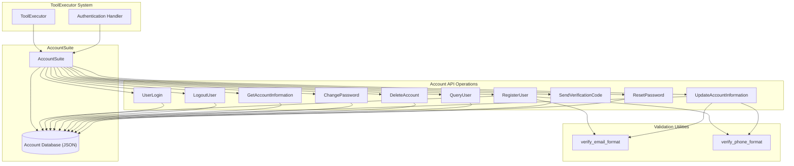
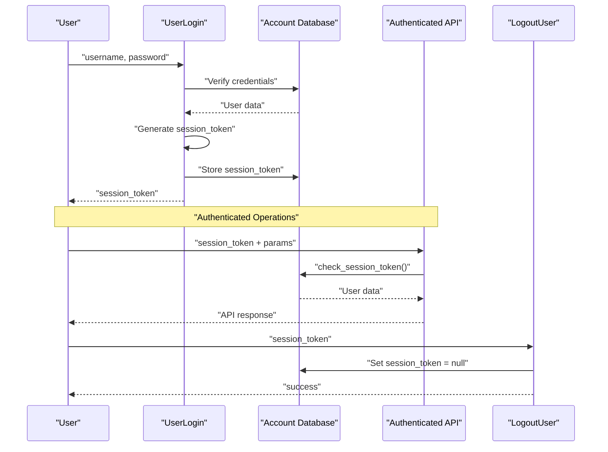
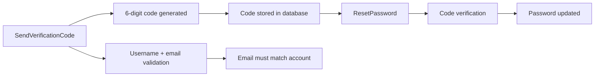
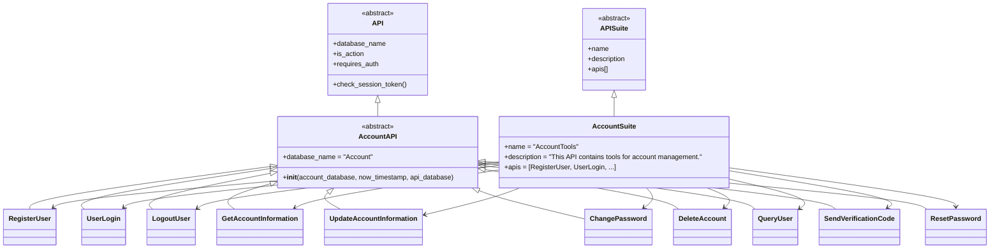

<!-- source: DeepWiki mcp.deepwiki.com · repo microsoft/ToolTalk · page 3.1 Account Management · fetched 2026-10-26 -->

# Account Management

Relevant source files

The following files were used as context for generating this wiki page:

- [src/tooltalk/apis/account.py](src/tooltalk/apis/account.py)

## Purpose and Scope

The Account Management system provides comprehensive user account functionality within the ToolTalk benchmark framework. This system handles user registration, authentication, profile management, and password recovery operations through a session-based authentication mechanism. All account operations are implemented as part of the `AccountSuite` API collection and integrate with the broader ToolExecutor system for conversation simulation and evaluation.

For information about the overall API architecture and how account management fits into the evaluation framework, see [API System](#2.2). For details on running evaluations that utilize account management features, see [Running Evaluations](#4.1).

## System Architecture

The Account Management system is built around the `AccountSuite` class which contains multiple specialized API operations. All operations interact with a shared JSON-based account database and use session tokens for authentication.

### AccountSuite Integration

Sources: [src/tooltalk/apis/account.py:517-531]()

## Database Schema

The account system uses a JSON database with the following schema structure:

| Field | Type | Description |
|-------|------|-------------|
| `username` | string | Primary key, unique identifier |
| `password` | string | User's password (plaintext in simulation) |
| `session_token` | string | Current session token (null when logged out) |
| `email` | string | User's email address |
| `phone` | string | Phone number in xxx-xxx-xxxx format |
| `name` | string | Display name |
| `verification_code` | string | Temporary field for password reset |

Sources: [src/tooltalk/apis/account.py:12-21]()

## Authentication Flow

The account system implements session-based authentication where users receive tokens upon login that must be included in subsequent authenticated requests.

### Session Token Lifecycle

Sources: [src/tooltalk/apis/account.py:477-514](), [src/tooltalk/apis/account.py:146-166]()

## Core API Operations

### User Registration and Authentication

The system provides three primary authentication operations:

#### RegisterUser
- **Purpose**: Creates new user accounts with validation
- **Authentication**: Not required
- **Validation**: Email format, phone format (xxx-xxx-xxxx)
- **Returns**: Session token and user information
- **Implementation**: [src/tooltalk/apis/account.py:242-319]()

#### UserLogin  
- **Purpose**: Authenticates existing users
- **Authentication**: Not required
- **Validation**: Username exists, password matches, user not already logged in
- **Returns**: Session token
- **Implementation**: [src/tooltalk/apis/account.py:477-514]()

#### LogoutUser
- **Purpose**: Invalidates current session
- **Authentication**: Required
- **Action**: Sets session_token to null
- **Implementation**: [src/tooltalk/apis/account.py:146-166]()

### Account Information Management

#### GetAccountInformation
- **Purpose**: Retrieves current user's profile data
- **Authentication**: Required
- **Returns**: Username, email, phone, name
- **Implementation**: [src/tooltalk/apis/account.py:110-143]()

#### UpdateAccountInformation
- **Purpose**: Modifies user profile fields
- **Authentication**: Required
- **Parameters**: Password verification + optional new email/phone/name
- **Validation**: Email format, phone format
- **Implementation**: [src/tooltalk/apis/account.py:409-474]()

#### QueryUser
- **Purpose**: Search for other users by username or email
- **Authentication**: Required
- **Parameters**: Username OR email (at least one required)
- **Returns**: Array of matching user profiles
- **Implementation**: [src/tooltalk/apis/account.py:169-239]()

### Password Management

#### ChangePassword
- **Purpose**: Updates password for authenticated user
- **Authentication**: Required
- **Parameters**: Old password, new password
- **Validation**: Old password verification
- **Implementation**: [src/tooltalk/apis/account.py:39-73]()

#### Password Reset Flow
The system implements a two-step password reset process:

#### SendVerificationCode
- **Purpose**: Initiates password reset by generating verification code
- **Authentication**: Not required
- **Parameters**: Username, email
- **Validation**: Username exists, email matches account
- **Implementation**: [src/tooltalk/apis/account.py:372-406]()

#### ResetPassword
- **Purpose**: Completes password reset using verification code
- **Authentication**: Not required
- **Parameters**: Username, verification code, new password
- **Validation**: Code matches stored value
- **Implementation**: [src/tooltalk/apis/account.py:322-369]()

### Account Deletion

#### DeleteAccount
- **Purpose**: Permanently removes user account
- **Authentication**: Required
- **Parameters**: Password confirmation
- **Action**: Removes user record from database
- **Implementation**: [src/tooltalk/apis/account.py:76-107]()

## API Class Hierarchy

Sources: [src/tooltalk/apis/account.py:26-36](), [src/tooltalk/apis/account.py:517-531]()

## Error Handling

The account system uses `APIException` for standardized error responses. Common error scenarios include:

### Authentication Errors
- Invalid username/password combinations
- Missing or invalid session tokens
- Attempting to login when already logged in

### Validation Errors  
- Invalid email format (handled by `verify_email_format`)
- Invalid phone format (handled by `verify_phone_format`)
- Missing required parameters

### Business Logic Errors
- Username already exists during registration
- Incorrect verification codes during password reset
- Password mismatch during account operations

Sources: [src/tooltalk/apis/account.py:8](), [src/tooltalk/apis/account.py:10]()

## Integration Points

### ToolExecutor Integration
The `AccountSuite` is registered with the `ToolExecutor` system which:
- Manages session token injection for authenticated APIs
- Handles database initialization and state management
- Coordinates account operations within conversation simulations

### Utility Dependencies
The account system depends on validation utilities:
- `verify_email_format`: Validates email address format
- `verify_phone_format`: Validates phone numbers in xxx-xxx-xxxx format

Sources: [src/tooltalk/apis/account.py:10]()

## Database Configuration

The account database is identified by the constant `ACCOUNT_DB_NAME = "Account"` and all `AccountAPI` classes inherit this database configuration. The database is passed to API constructors during initialization and shared across all account operations.

Sources: [src/tooltalk/apis/account.py:23](), [src/tooltalk/apis/account.py:27]()

---

