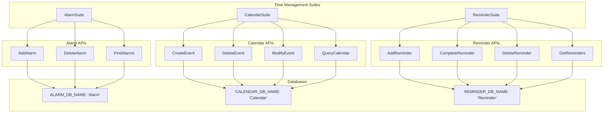
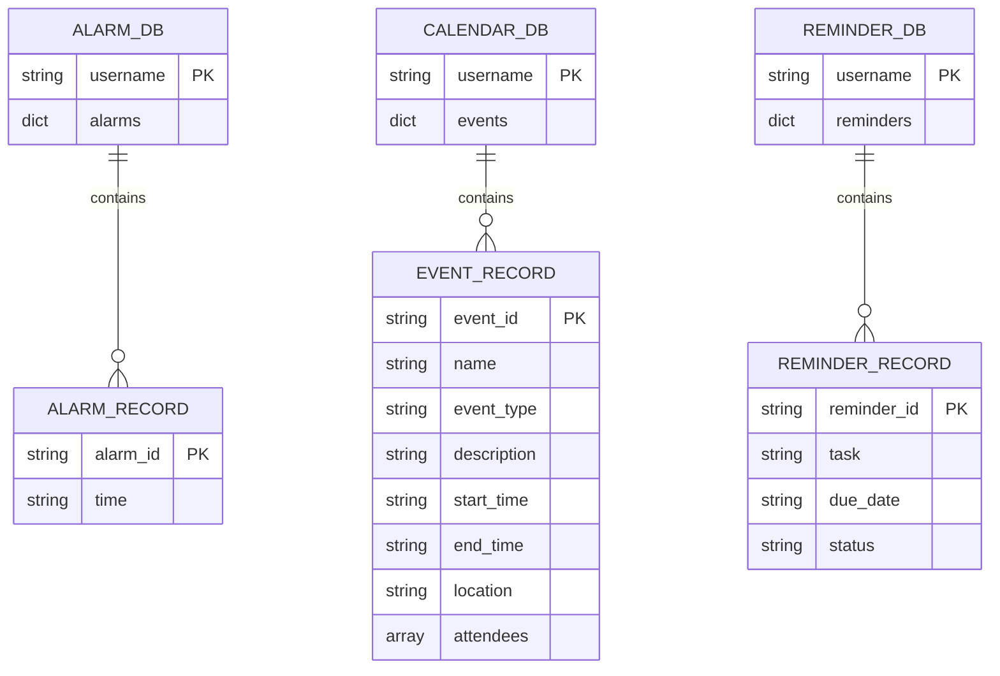
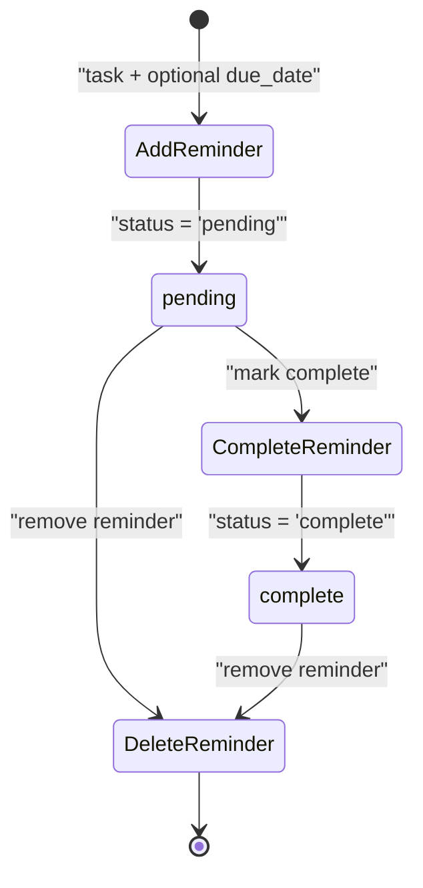
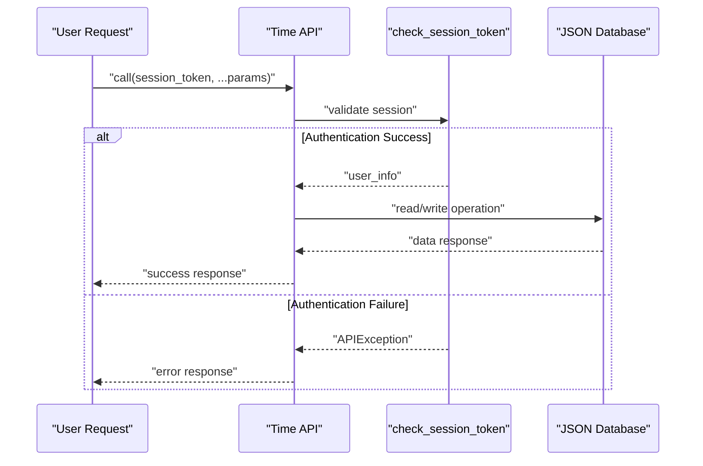
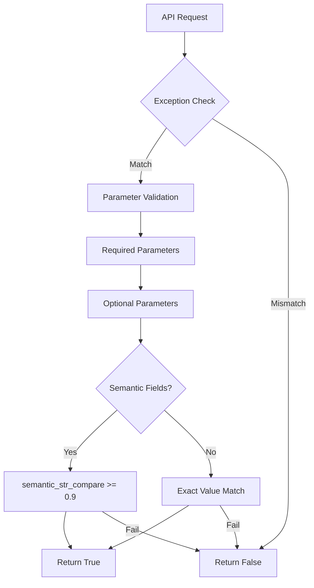

<!-- source: DeepWiki mcp.deepwiki.com · repo microsoft/ToolTalk · page 3.2 Time Management · fetched 2026-10-26 -->

# Time Management

Relevant source files

The following files were used as context for generating this wiki page:

- [src/tooltalk/apis/alarm.py](src/tooltalk/apis/alarm.py)
- [src/tooltalk/apis/calendar.py](src/tooltalk/apis/calendar.py)
- [src/tooltalk/apis/reminder.py](src/tooltalk/apis/reminder.py)

This document covers the time management API suites in the ToolTalk framework, which enable conversational agents to manage alarms, calendar events, and reminders. These APIs provide comprehensive time-based functionality for scheduling, notification, and task management scenarios.

The time management system consists of three primary API suites: `AlarmSuite` for simple time-based alarms, `CalendarSuite` for complex event scheduling with attendees and locations, and `ReminderSuite` for task-based reminders with optional due dates. For general API architecture information, see [API System](#2.2). For evaluation of these APIs, see [Evaluation Framework](#2.3).

## Time Management API Architecture

Sources: [src/tooltalk/apis/alarm.py:194-201](), [src/tooltalk/apis/calendar.py:450-453](), [src/tooltalk/apis/reminder.py:229-237]()

## Database Schema Overview

The time management APIs use three separate JSON databases with distinct data structures:

**Database Schema Architecture**

Sources: [src/tooltalk/apis/alarm.py:12-21](), [src/tooltalk/apis/calendar.py:17-32](), [src/tooltalk/apis/reminder.py:13-21]()

## Alarm Suite

The `AlarmSuite` provides simple time-based alarm functionality with three core operations:

| API Class | Description | Time Format | Action Type |
|-----------|-------------|-------------|-------------|
| `AddAlarm` | Creates a new alarm | `%H:%M:%S` | Action |
| `DeleteAlarm` | Removes an existing alarm | N/A | Action |
| `FindAlarms` | Searches alarms by time range | `%H:%M:%S` | Query |

### Alarm ID Generation
Alarm IDs follow the pattern `xxxx-xxxx` where each `x` represents a hexadecimal digit, generated using [src/tooltalk/apis/alarm.py:54]().

### Time Range Filtering
The `FindAlarms` API supports optional time range filtering through `start_range` and `end_range` parameters, allowing users to query alarms within specific time windows [src/tooltalk/apis/alarm.py:145-173]().

Sources: [src/tooltalk/apis/alarm.py:24-201]()

## Calendar Suite

The `CalendarSuite` manages complex scheduling with full event lifecycle support:

| API Class | Description | Primary Function | Validation |
|-----------|-------------|------------------|------------|
| `CreateEvent` | Creates calendar events | Event scheduling | Time/attendee validation |
| `DeleteEvent` | Removes events | Event deletion | Ownership validation |
| `ModifyEvent` | Updates existing events | Event modification | Consistency validation |
| `QueryCalendar` | Finds events in time range | Event discovery | Time range validation |

### Event Types
Events are categorized into two types defined in `EventTypes`:
- `meeting`: Requires attendees list
- `event`: General purpose events

[src/tooltalk/apis/calendar.py:37-43]()

### Time Format and Validation
All calendar operations use the format `%Y-%m-%d %H:%M:%S` with strict validation:
- Start time must precede end time
- Times must be in the future relative to `now_timestamp`
- Attendee lists automatically include the event creator

Sources: [src/tooltalk/apis/calendar.py:46-453]()

## Reminder Suite

The `ReminderSuite` implements task management with status tracking:

**Reminder Lifecycle Flow**

### Reminder Status Management
- **pending**: Initial status for new reminders
- **complete**: Status after calling `CompleteReminder`
- Completed reminders cannot be completed again [src/tooltalk/apis/reminder.py:132-133]()

### Due Date Handling
Due dates are optional and follow the format `%Y-%m-%d %H:%M:%S`. The `AddReminder.check_api_call_correctness` method validates dates by comparing only the date portion, ignoring time differences [src/tooltalk/apis/reminder.py:92-97]().

Sources: [src/tooltalk/apis/reminder.py:24-237]()

## API Interaction Patterns

**Common Authentication and Error Handling**

### Semantic String Comparison
Several APIs use `semantic_str_compare` for fuzzy matching of text fields with a threshold of 0.9:
- Calendar event names, descriptions, and locations [src/tooltalk/apis/calendar.py:182-185]()
- Reminder task descriptions [src/tooltalk/apis/reminder.py:99]()

### Time Format Standardization

| Suite | Time Format | Usage |
|-------|-------------|-------|
| Alarm | `%H:%M:%S` | Daily recurring alarms |
| Calendar | `%Y-%m-%d %H:%M:%S` | Specific date/time events |
| Reminder | `%Y-%m-%d %H:%M:%S` | Optional due dates |

Sources: [src/tooltalk/apis/alarm.py:49](), [src/tooltalk/apis/calendar.py:131-132](), [src/tooltalk/apis/reminder.py:58]()

## API Correctness Validation

Each time management API implements custom `check_api_call_correctness` methods for evaluation:

**Validation Strategy Summary**

The validation logic prioritizes ground truth requirements, allowing predictions to include additional parameters while ensuring all ground truth parameters are present and correct.

Sources: [src/tooltalk/apis/alarm.py:62-76](), [src/tooltalk/apis/calendar.py:160-190](), [src/tooltalk/apis/reminder.py:71-103]()

---

