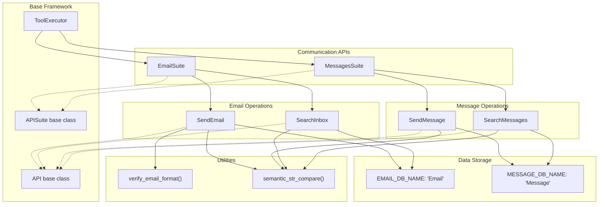
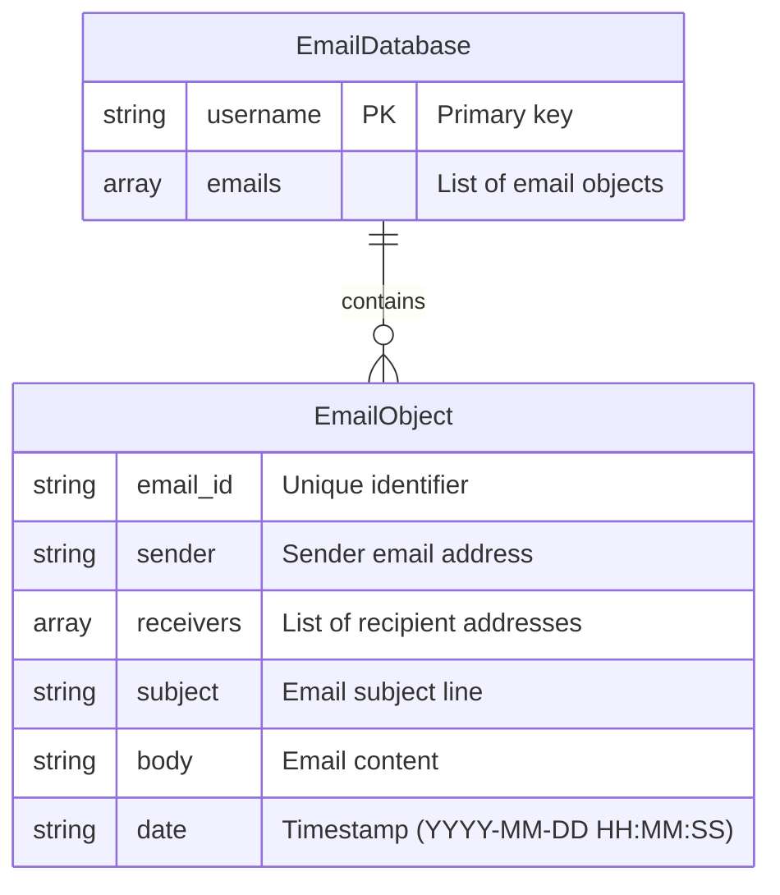
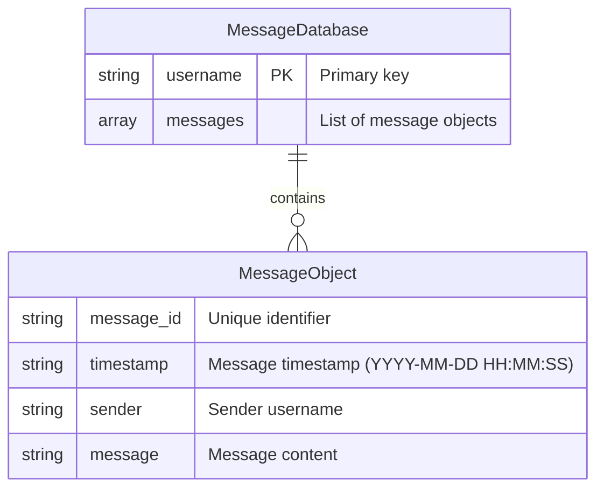
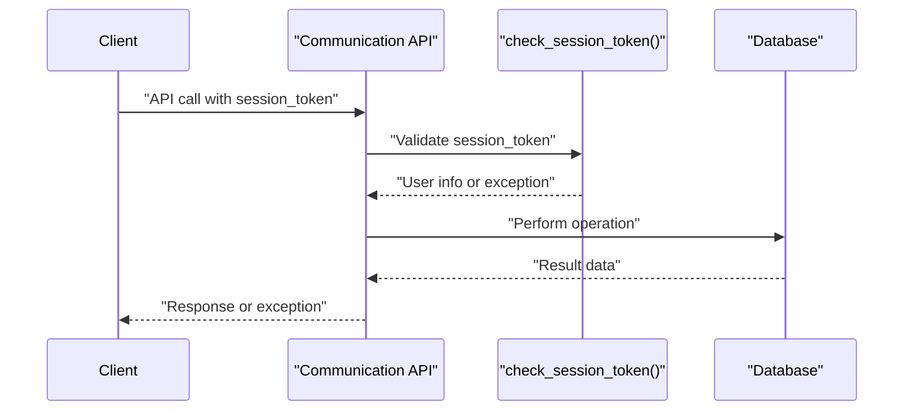
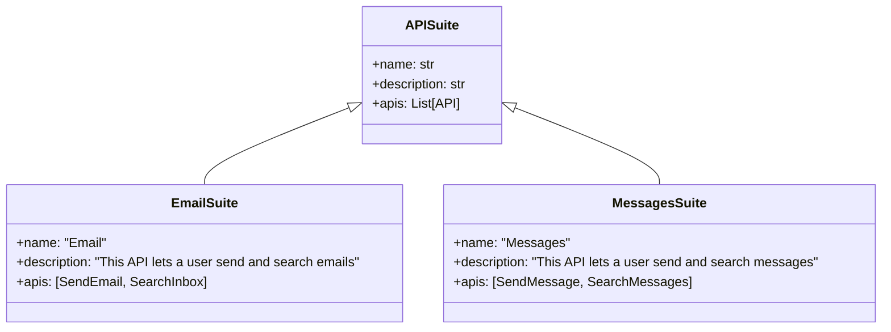

<!-- source: DeepWiki mcp.deepwiki.com · repo microsoft/ToolTalk · page 3.3 Communication · fetched 2026-10-26 -->

# Communication

Relevant source files

The following files were used as context for generating this wiki page:

- [src/tooltalk/apis/email.py](src/tooltalk/apis/email.py)
- [src/tooltalk/apis/message.py](src/tooltalk/apis/message.py)

This page documents the communication API suites in ToolTalk, which provide functionality for sending and searching emails and messages. The communication APIs enable conversational agents to interact with simulated email and messaging systems, supporting both outbound communication and content retrieval through flexible search capabilities.

For account management and authentication, see [Account Management](#3.1). For utility functions used by communication APIs, see [Utilities](#3.4).

## Overview

The ToolTalk communication system consists of two primary API suites that handle different types of communication:

- **EmailSuite**: Manages email sending and inbox searching with support for multiple recipients
- **MessagesSuite**: Handles direct user-to-user messaging with search capabilities

Both suites follow the standard ToolTalk API architecture, requiring authentication and providing both action APIs (for sending) and query APIs (for searching).

### Communication System Architecture

Sources: [src/tooltalk/apis/email.py:1-244](), [src/tooltalk/apis/message.py:1-223]()

## Email Suite

The `EmailSuite` provides comprehensive email functionality through two primary APIs. It manages a simulated email system with support for multiple recipients, subject lines, and rich content searching.

### SendEmail API

The `SendEmail` API enables sending emails to multiple recipients with validation of email addresses.

| Property | Value |
|----------|-------|
| Class | `SendEmail` |
| Description | Sends an email on behalf of a given user |
| Action API | Yes (`is_action = True`) |
| Authentication | Required (`requires_auth = True`) |
| Database | `EMAIL_DB_NAME` |

**Parameters:**
- `to` (array of strings, required): Receiving email addresses
- `subject` (string, required): Email subject line
- `body` (string, required): Email content

**Returns:**
- `email_id` (string): Generated unique identifier for the sent email

The API validates email formats using `verify_email_format()` and generates a unique email ID in the format `{hex2}-{hex4}-{hex8}`.

Sources: [src/tooltalk/apis/email.py:169-213]()

### SearchInbox API

The `SearchInbox` API provides flexible email search with multiple filter options, returning up to 5 most recent matching results.

| Property | Value |
|----------|-------|
| Class | `SearchInbox` |
| Description | Searches for emails matching filters returning 5 most recent results |
| Action API | No (`is_action = False`) |
| Authentication | Required (`requires_auth = True`) |
| Database | `EMAIL_DB_NAME` |

**Parameters:**
- `query` (string, optional): Keywords to search for in subject and body
- `match_type` (string, optional): "any" or "all" keyword matching (default: "any")  
- `sender` (string, optional): Email address of sender to filter by
- `start_date` (string, optional): Starting time filter (format: %Y-%m-%d %H:%M:%S)
- `end_date` (string, optional): End time filter (format: %Y-%m-%d %H:%M:%S)

**Returns:**
- `emails` (array): List of matching email objects with sender, receivers, subject, body, and date

The search algorithm filters emails chronologically, excludes future-dated emails, and supports both "any" and "all" keyword matching modes.

Sources: [src/tooltalk/apis/email.py:28-146]()

### Email Database Schema

Sources: [src/tooltalk/apis/email.py:13-25]()

## Messages Suite

The `MessagesSuite` handles direct user-to-user messaging with username-based addressing and content search capabilities.

### SendMessage API

The `SendMessage` API enables sending messages between users identified by username.

| Property | Value |
|----------|-------|
| Class | `SendMessage` |
| Description | Sends a message to another user |
| Action API | Yes (`is_action = True`) |
| Authentication | Required (`requires_auth = True`) |

**Parameters:**
- `receiver` (string, required): Username of the message recipient
- `message` (string, required): Message content (cannot be empty)

**Returns:**
- `message_id` (string): Generated unique identifier in format `{hex8}-{hex8}`

The API validates that messages are not empty and accepts any receiver username since resolution is handled externally.

Sources: [src/tooltalk/apis/message.py:159-196]()

### SearchMessages API

The `SearchMessages` API provides message search functionality with temporal and content-based filtering.

| Property | Value |
|----------|-------|
| Class | `SearchMessages` |
| Description | Searches messages matching filters returning 5 most recent results |
| Action API | No (`is_action = False`) |
| Authentication | Required (`requires_auth = True`) |
| Database | `MESSAGE_DB_NAME` |

**Parameters:**
- `query` (string, optional): Keywords to search for in message content
- `match_type` (string, optional): "any" or "all" keyword matching (default: "any")
- `sender` (string, optional): Username of sender to filter by
- `start_date` (string, optional): Starting time filter (format: %Y-%m-%d %H:%M:%S)
- `end_date` (string, optional): End time filter (format: %Y-%m-%d %H:%M:%S)

**Returns:**
- `messages` (array): List of matching message objects with message_id, timestamp, sender, and message content

Sources: [src/tooltalk/apis/message.py:27-139]()

### Message Database Schema

Sources: [src/tooltalk/apis/message.py:14-24]()

## Common Patterns

### Authentication Flow

All communication APIs require valid session tokens and follow the standard authentication pattern:

Sources: [src/tooltalk/apis/email.py:101](), [src/tooltalk/apis/message.py:96]()

### Search Filter Logic

Both email and message search APIs implement consistent filtering logic:

1. **Temporal Filtering**: Exclude future-dated items using `self.now_timestamp`
2. **Sender Filtering**: Exact match on sender field
3. **Date Range Filtering**: Support for start_date and end_date bounds
4. **Keyword Filtering**: Case-insensitive keyword matching with "any" or "all" modes
5. **Result Limiting**: Return maximum 5 most recent results, sorted by timestamp

### Correctness Validation

Communication APIs implement semantic validation for content comparison:

- **Email**: Uses `semantic_str_compare()` with thresholds of 0.9 for subjects and 0.8 for body content
- **Messages**: Uses `semantic_str_compare()` with threshold of 0.8 for message content
- **Search Results**: Validates that all ground truth items are present in prediction results

Sources: [src/tooltalk/apis/email.py:216-237](), [src/tooltalk/apis/message.py:198-216]()

### Suite Registration

Both communication suites follow the standard APISuite pattern:

Sources: [src/tooltalk/apis/email.py:240-244](), [src/tooltalk/apis/message.py:219-223]()

---

