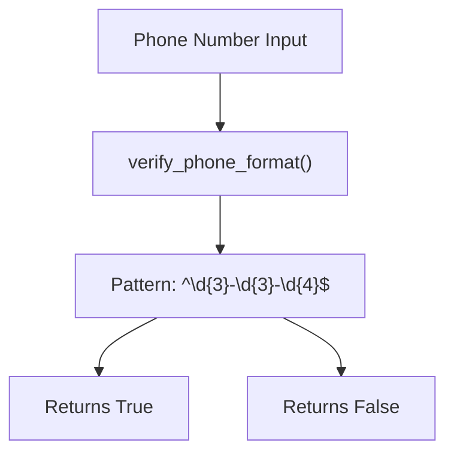
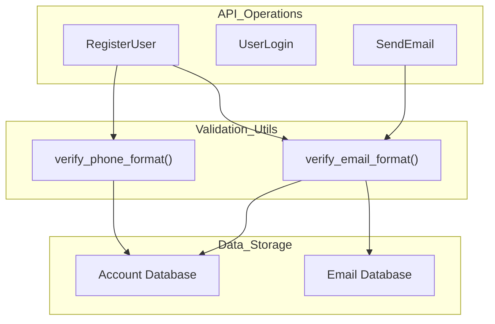
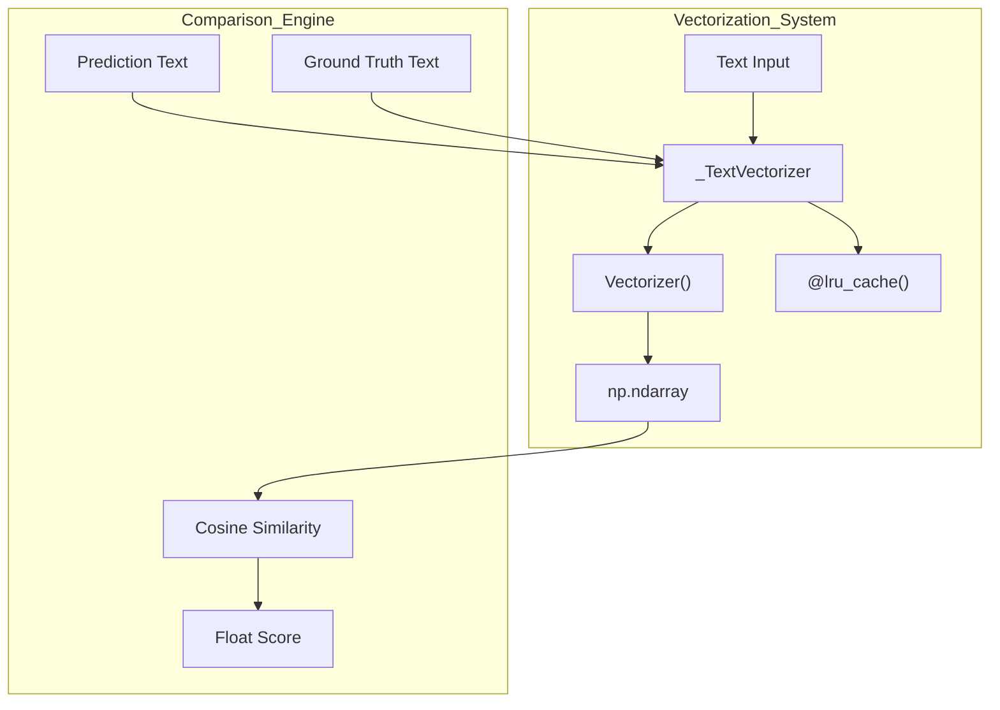
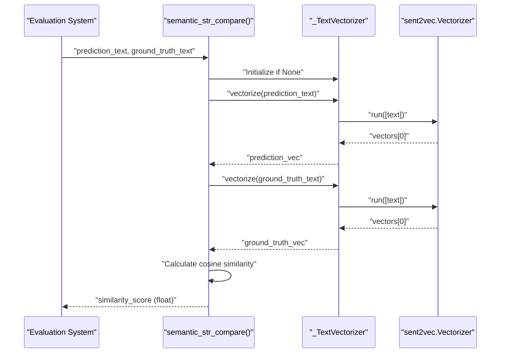
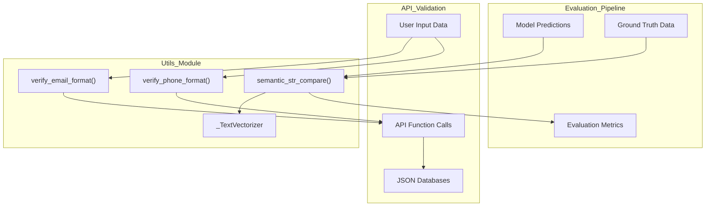

<!-- source: DeepWiki mcp.deepwiki.com · repo microsoft/ToolTalk · page 3.4 Utilities · fetched 2026-10-26 -->

# Utilities

Relevant source files

The following files were used as context for generating this wiki page:

- [src/tooltalk/apis/utils.py](src/tooltalk/apis/utils.py)

The utilities module provides essential helper functions for data validation and semantic text comparison within the ToolTalk framework. These utilities support both API operations and evaluation processes by ensuring data format consistency and enabling sophisticated text similarity measurements.

This page covers format verification utilities and semantic comparison tools. For information about API implementation details, see [API System](#2.2). For evaluation framework details, see [Evaluation Framework](#2.3).

## Overview

The utilities system consists of two main categories of functions:

| Category | Purpose | Key Functions |
|----------|---------|---------------|
| Format Validation | Ensure data meets expected formats | `verify_phone_format`, `verify_email_format` |
| Semantic Comparison | Compare text meanings for evaluation | `semantic_str_compare` |

## Format Validation

### Phone Number Validation

The `verify_phone_format` function validates phone numbers against the standard xxx-xxx-xxxx format using regular expressions.

**Format Validation Flow**

The function uses the regex pattern `^\d{3}-\d{3}-\d{4}$` to match exactly three digits, hyphen, three digits, hyphen, four digits [src/tooltalk/apis/utils.py:14]().

### Email Address Validation

The `verify_email_format` function validates email addresses using a permissive regular expression pattern.

The validation pattern `^[\w\-\d\.]+@[\w\-\d\.]+$` accepts alphanumeric characters, hyphens, and dots before and after the @ symbol [src/tooltalk/apis/utils.py:19]().

**Format Validation Integration**

Sources: [src/tooltalk/apis/utils.py:13-20]()

## Semantic Text Comparison

### Text Vectorization System

The semantic comparison system uses the sent2vec library to convert text into numerical vectors for similarity analysis.

**Text Vectorization Architecture**

### Vectorizer Implementation

The `_TextVectorizer` class wraps the sent2vec `Vectorizer` with LRU caching for performance optimization [src/tooltalk/apis/utils.py:24-37]().

Key implementation details:
- Uses `@lru_cache()` decorator to cache vector calculations
- Clears the vectorizer's internal vectors list after each computation
- Returns numpy arrays representing text embeddings

### Semantic Comparison Function

The `semantic_str_compare` function computes cosine similarity between two text strings using their vector representations.

**Semantic Comparison Process**

The function handles None inputs by returning 0.0 and uses lazy initialization of the global `_vectorize_text` variable [src/tooltalk/apis/utils.py:43-58]().

Sources: [src/tooltalk/apis/utils.py:24-58]()

## Integration with ToolTalk Framework

### Evaluation Integration

The semantic comparison utilities integrate with the evaluation framework to measure the quality of model predictions against ground truth data.

**Utility Integration in ToolTalk**

### Performance Considerations

The utilities module includes several performance optimizations:

| Optimization | Implementation | Purpose |
|--------------|----------------|---------|
| LRU Caching | `@lru_cache()` on `_TextVectorizer.__call__` | Cache vector computations for repeated text |
| Lazy Initialization | Global `_vectorize_text` variable | Initialize sent2vec only when needed |
| Memory Management | Clear `vectorizer.vectors` list | Prevent memory accumulation |

Sources: [src/tooltalk/apis/utils.py:1-59]()

## Usage Patterns

### Format Validation Usage

Format validation functions are typically used within API implementations to ensure data integrity before database operations.

### Semantic Comparison Usage

The semantic comparison function is primarily used during evaluation to measure how closely model-generated text matches expected outputs, providing more nuanced evaluation than exact string matching.

The lazy initialization pattern ensures that the computationally expensive sent2vec model is only loaded when semantic comparison is actually needed during evaluation runs.

Sources: [src/tooltalk/apis/utils.py:39-53]()

---

