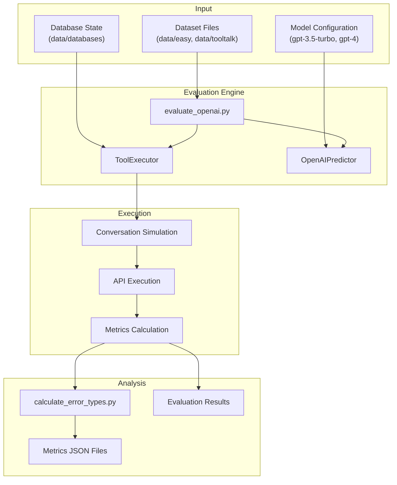
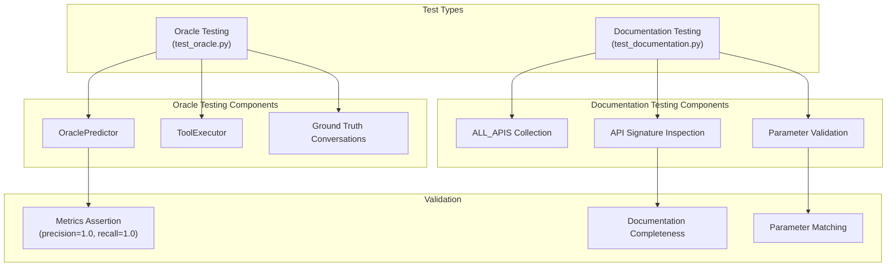
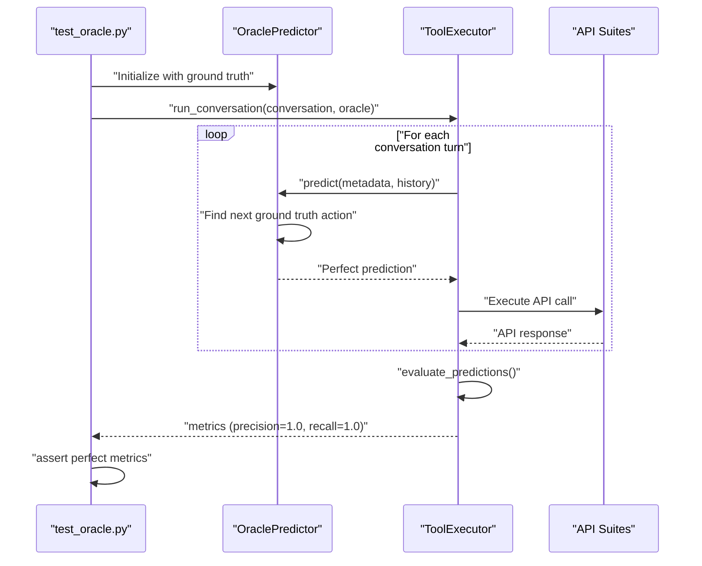

<!-- source: DeepWiki mcp.deepwiki.com · repo microsoft/ToolTalk · page 4 Evaluation and Testing · fetched 2026-10-26 -->

# Evaluation and Testing

Relevant source files

The following files were used as context for generating this wiki page:

- [scripts/evaluate_gpt35turbo.sh](scripts/evaluate_gpt35turbo.sh)
- [scripts/evaluate_gpt4.sh](scripts/evaluate_gpt4.sh)
- [tests/test_documentation.py](tests/test_documentation.py)
- [tests/test_oracle.py](tests/test_oracle.py)

This document provides an overview of ToolTalk's evaluation and testing infrastructure, covering how to assess model performance on conversational tool-use tasks and validate system correctness. The evaluation system measures how well language models can predict and execute API calls in multi-turn conversations, while the testing framework ensures system reliability and API documentation completeness.

For step-by-step instructions on running model evaluations, see [Running Evaluations](#4.1). For details on the testing infrastructure including oracle testing, see [Testing Framework](#4.2).

## Evaluation System Overview

ToolTalk's evaluation system is designed to measure language model performance on conversational tool-use scenarios. The system compares model predictions against ground truth conversations, calculating metrics like precision, recall, and task success rates.

### Core Evaluation Pipeline

**Sources:** [scripts/evaluate_gpt35turbo.sh:1-9](), [scripts/evaluate_gpt4.sh:1-9]()

### Evaluation Scripts

The system provides ready-to-use evaluation scripts for OpenAI models:

| Script | Model | Purpose |
|--------|-------|---------|
| `evaluate_gpt35turbo.sh` | GPT-3.5 Turbo | Evaluate GPT-3.5 on easy and hard datasets |
| `evaluate_gpt4.sh` | GPT-4 | Evaluate GPT-4 on easy and hard datasets |

Each script follows the same pattern:
1. Run evaluation on easy dataset (`data/easy`)
2. Run evaluation on hard dataset (`data/tooltalk`) 
3. Calculate error types and generate metrics for both datasets

**Sources:** [scripts/evaluate_gpt35turbo.sh:1-9](), [scripts/evaluate_gpt4.sh:1-9]()

## Testing Framework Overview

The testing framework ensures system correctness through two main approaches: oracle testing and documentation validation.

### Testing Architecture

**Sources:** [tests/test_oracle.py:1-121](), [tests/test_documentation.py:1-32]()

### Oracle Testing

The `OraclePredictor` class implements perfect prediction by using ground truth conversations. This validates that the `ToolExecutor` can achieve perfect performance when given correct predictions.

Key components:
- **OraclePredictor**: Provides ground truth API calls and responses
- **Conversation state tracking**: Matches conversation history to expected next actions
- **Perfect metrics validation**: Ensures precision and recall equal 1.0

**Sources:** [tests/test_oracle.py:23-77](), [tests/test_oracle.py:104-112]()

### Documentation Testing

The documentation test validates that all APIs in the `ALL_APIS` collection have complete documentation and consistent parameter definitions.

Validation checks:
- API description exists and is non-empty
- All parameters have descriptions, types, and required flags
- Documentation parameters match implementation signatures
- Session tokens are properly handled in parameter matching

**Sources:** [tests/test_documentation.py:12-31]()

## Evaluation Metrics and Error Analysis

The evaluation system calculates several key metrics:

| Metric | Description | Calculation |
|--------|-------------|-------------|
| Precision | Fraction of predicted API calls that are correct | Correct predictions / Total predictions |
| Recall | Fraction of ground truth API calls that were predicted | Correct predictions / Ground truth calls |
| Success | Whether the conversation completed successfully | Boolean based on conversation outcome |

The `calculate_error_types` module provides detailed error analysis by categorizing prediction failures and generating comprehensive metrics reports.

**Sources:** [scripts/evaluate_gpt35turbo.sh:7-8](), [scripts/evaluate_gpt4.sh:7-8]()

## Integration with Core Architecture

The evaluation and testing systems integrate deeply with ToolTalk's core components:

- **ToolExecutor**: Orchestrates prediction, execution, and evaluation cycles
- **BaseAPIPredictor**: Interface for integrating different language models
- **API Suites**: Execute predicted API calls and return responses
- **Database Layer**: Maintains conversation state and API data

For details on these core components, see [Core Architecture](#2) and [ToolExecutor](#2.1).

---

