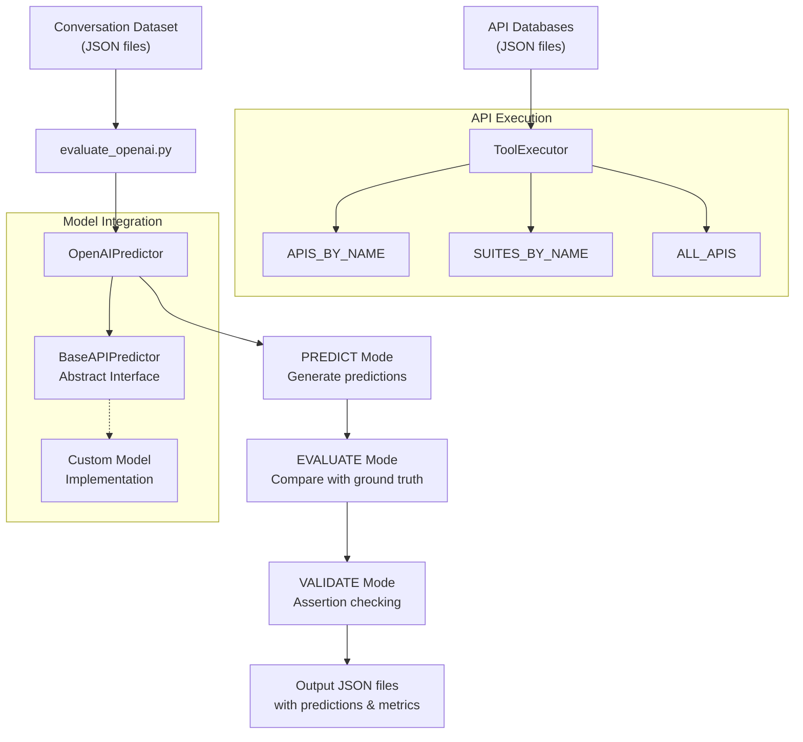
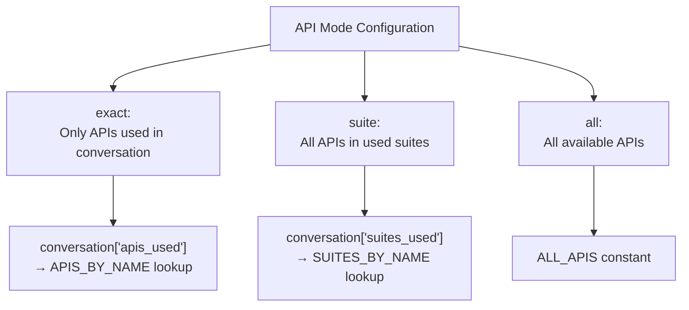
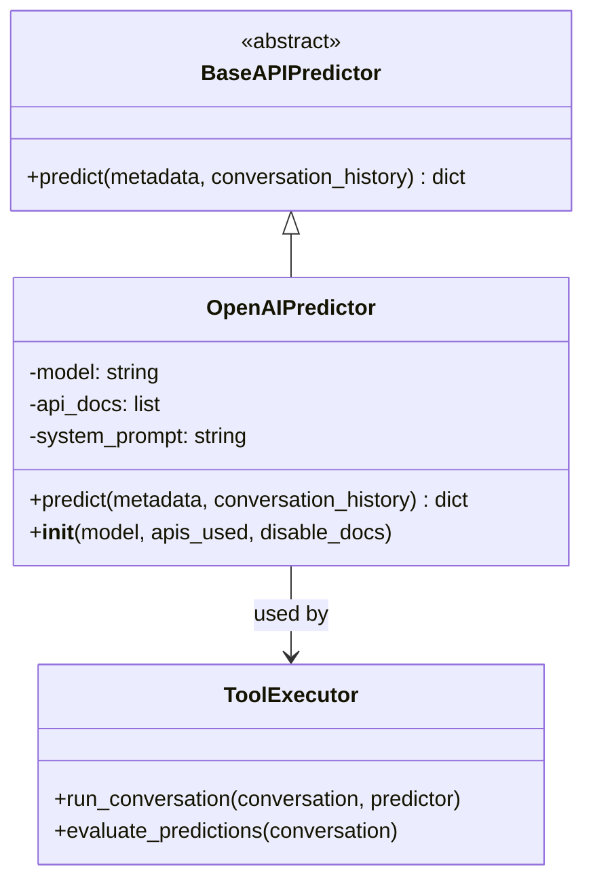

<!-- source: DeepWiki mcp.deepwiki.com · repo microsoft/ToolTalk · page 4.1 Running Evaluations · fetched 2026-10-26 -->

# Running Evaluations

<details>
<summary>Relevant source files</summary>

The following files were used as context for generating this wiki page:

- [scripts/evaluate_gpt35turbo.sh](scripts/evaluate_gpt35turbo.sh)
- [scripts/evaluate_gpt4.sh](scripts/evaluate_gpt4.sh)
- [src/tooltalk/evaluation/__init__.py](src/tooltalk/evaluation/__init__.py)
- [src/tooltalk/evaluation/evaluate_openai.py](src/tooltalk/evaluation/evaluate_openai.py)

</details>


This document covers how to execute model evaluations using the ToolTalk benchmark framework. It provides step-by-step instructions for running evaluations against conversation datasets, configuring evaluation parameters, and interpreting results. 

For information about the underlying evaluation framework architecture, see [Evaluation Framework](#2.3). For details on testing the APIs themselves, see [Testing Framework](#4.2).

## Overview

The ToolTalk evaluation system allows you to evaluate language models on their ability to perform multi-turn conversations with API tool usage. The evaluation process consists of three main phases: prediction generation, execution against ground truth, and metric calculation. The system supports both OpenAI models out-of-the-box and custom model integration through the `BaseAPIPredictor` interface.

Sources: [src/tooltalk/evaluation/evaluate_openai.py:1-221]()

## Evaluation Pipeline Architecture

The evaluation system follows a multi-stage pipeline that processes conversation datasets and generates comprehensive metrics:



Sources: [src/tooltalk/evaluation/evaluate_openai.py:115-118](), [src/tooltalk/evaluation/evaluate_openai.py:27-113]()

## Running Basic Evaluations

### Using Provided Scripts

The simplest way to run evaluations is using the provided shell scripts for GPT-3.5 and GPT-4:

**GPT-4 Evaluation:**
```bash
./scripts/evaluate_gpt4.sh
```

**GPT-3.5 Evaluation:**
```bash
./scripts/evaluate_gpt35turbo.sh
```

These scripts automatically run evaluations on both the easy and hard datasets, then calculate error type metrics.

Sources: [scripts/evaluate_gpt4.sh:1-9](), [scripts/evaluate_gpt35turbo.sh:1-9]()

### Manual Evaluation Command

For more control, you can run the evaluation script directly:

```bash
python -m tooltalk.evaluation.evaluate_openai \
    --dataset data/easy \
    --database data/databases \
    --model gpt-4 \
    --output_dir output/gpt-4/easy
```

Sources: [src/tooltalk/evaluation/evaluate_openai.py:121-136]()

## Configuration Parameters

The evaluation script accepts several configuration parameters that control the evaluation behavior:

| Parameter | Type | Default | Description |
|-----------|------|---------|-------------|
| `--dataset` | string | Required | Path to conversation dataset directory |
| `--database` | string | Required | Path to API database directory |
| `--model` | string | `gpt-4` | OpenAI model identifier |
| `--output_dir` | string | Required | Directory for output files |
| `--api_mode` | choice | `all` | API exposure mode: `exact`, `suite`, or `all` |
| `--reset` | flag | False | Overwrite existing cached results |
| `--disable_documentation` | flag | False | Remove API documentation from model input |
| `--modes` | list | All modes | Evaluation phases to run |

### API Mode Configuration

The `--api_mode` parameter controls which APIs are exposed to the model during evaluation:



Sources: [src/tooltalk/evaluation/evaluate_openai.py:126-127](), [src/tooltalk/evaluation/evaluate_openai.py:169-178]()

## Evaluation Modes

The evaluation process consists of three sequential modes:

### PREDICT Mode
Generates model predictions for each conversation turn using the `OpenAIPredictor` class. The predictor:

1. Formats conversation history into OpenAI chat format
2. Includes relevant API documentation as function definitions
3. Calls the OpenAI API with function calling enabled
4. Parses the response into either API calls or assistant messages

### EVALUATE Mode
Compares generated predictions against ground truth using the `ToolExecutor.evaluate_predictions()` method. Calculates metrics including:

- **Precision**: `matches / predictions`
- **Recall**: `matches / ground_truths` 
- **Action Precision**: `valid_actions / actions`
- **Bad Action Rate**: `bad_actions / actions`
- **Success Rate**: `success / num_conversations`

### VALIDATE Mode
Performs assertion checking to ensure evaluation results contain required fields (`match`, `bad_action`) for all API predictions.

Sources: [src/tooltalk/evaluation/evaluate_openai.py:167-203](), [src/tooltalk/evaluation/evaluate_openai.py:208-218]()

## OpenAI Model Integration

### OpenAIPredictor Implementation

The `OpenAIPredictor` class extends `BaseAPIPredictor` to integrate OpenAI models:



### System Prompt Template

The `OpenAIPredictor` uses a standardized system prompt that includes user context:

```
You are a helpful assistant. Here is some user data:
location: {location}
timestamp: {timestamp}
username (if logged in): {username}
```

Sources: [src/tooltalk/evaluation/evaluate_openai.py:27-43](), [src/tooltalk/evaluation/evaluate_openai.py:28-31]()

## Custom Model Integration

To evaluate custom models, implement the `BaseAPIPredictor` interface:

```python
class CustomModelPredictor(BaseAPIPredictor):
    def predict(self, metadata: dict, conversation_history: dict) -> dict:
        # Return either:
        # {"role": "api", "request": {"api_name": str, "parameters": dict}}
        # or 
        # {"role": "assistant", "text": str}
```

The predictor receives conversation metadata (location, timestamp, username) and full conversation history, then returns the next predicted turn.

Sources: [src/tooltalk/evaluation/tool_executor.py:1-1](), [src/tooltalk/evaluation/evaluate_openai.py:27]()

## Output Format and Results

### Conversation Output Structure

Each evaluated conversation is saved as a JSON file containing:

- **Original conversation data**: Metadata, ground truth turns
- **Predictions**: Model-generated predictions for each turn  
- **Evaluation results**: Match indicators, error classifications
- **Metrics**: Per-conversation success metrics
- **API metadata**: Full OpenAI request/response data

### Metrics Aggregation

The evaluation script aggregates metrics across all conversations and outputs:

```json
{
    "num_conversations": 150,
    "precision": 0.85,
    "recall": 0.78,
    "action_precision": 0.92,
    "bad_action_rate": 0.08,
    "success_rate": 0.73
}
```

Sources: [src/tooltalk/evaluation/evaluate_openai.py:209-217](), [src/tooltalk/evaluation/evaluate_openai.py:150-160]()

## Error Handling and Debugging

### API Key Configuration

The evaluation script supports multiple API key sources:

1. `OPENAI_KEY` environment variable
2. File specified by `--api_key` parameter (default: `openai.key`)

### Caching and Resume

The system automatically caches evaluation results. Use `--reset` to overwrite existing results, or let the system skip already-processed conversations for faster iteration.

### Logging and Debug Information

The script provides detailed logging including:
- Conversation processing status
- Individual conversation success/failure
- Full OpenAI request/response metadata (debug level)
- JSON parsing errors for malformed API arguments

Sources: [src/tooltalk/evaluation/evaluate_openai.py:144-148](), [src/tooltalk/evaluation/evaluate_openai.py:155-161](), [src/tooltalk/evaluation/evaluate_openai.py:94-96]()

---

