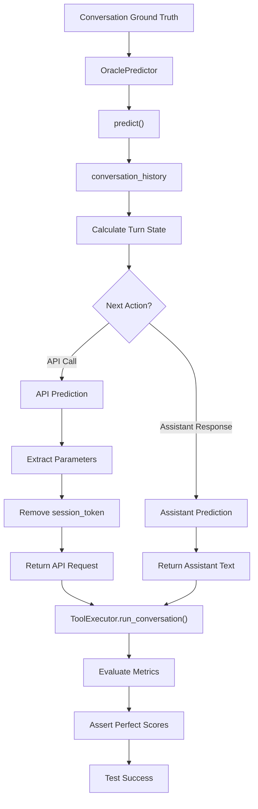
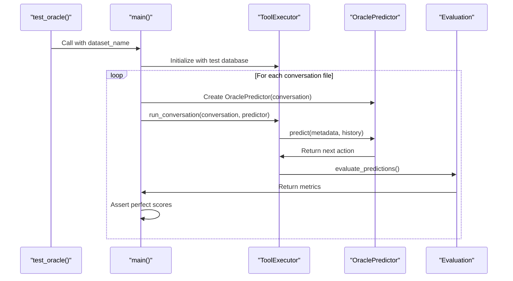
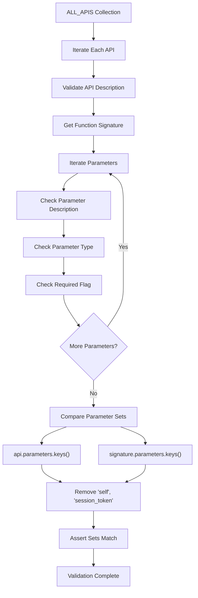
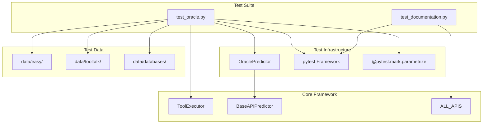

<!-- source: DeepWiki mcp.deepwiki.com · repo microsoft/ToolTalk · page 4.2 Testing Framework · fetched 2026-10-26 -->

# Testing Framework

<details>
<summary>Relevant source files</summary>

The following files were used as context for generating this wiki page:

- [tests/test_documentation.py](tests/test_documentation.py)
- [tests/test_oracle.py](tests/test_oracle.py)

</details>


The ToolTalk testing framework provides automated validation of conversation execution and API documentation completeness. This framework ensures that the benchmark maintains accuracy and consistency through oracle testing and comprehensive documentation validation.

For information about running model evaluations, see [Running Evaluations](#4.1). This section focuses specifically on the internal testing infrastructure used to validate the ToolTalk system itself.

## Oracle Testing System

The oracle testing system validates conversation execution by comparing actual API execution results against ground truth data. The `OraclePredictor` class provides perfect predictions based on ground truth conversations, enabling verification that the `ToolExecutor` produces expected results.

### Oracle Prediction Flow



The `OraclePredictor` class implements the prediction interface by tracking conversation state and returning the next correct action from ground truth data. The key methods include:

- `predict()` - Returns the next prediction based on conversation history position
- State tracking logic that maps conversation history to ground truth turns
- Parameter extraction that removes session tokens for API calls

**Sources:** [tests/test_oracle.py:23-77]()

### Test Execution Process



The testing process loads conversations from specified datasets (`easy`, `tooltalk`) and validates each one produces perfect execution metrics:

- **Precision**: 1.0 (all predicted API calls are correct)
- **Recall**: 1.0 (all required API calls are predicted)  
- **Success**: True (conversation completes successfully)

**Sources:** [tests/test_oracle.py:86-117]()

## Documentation Validation

The documentation validation system ensures all APIs maintain complete and consistent documentation. The `test_missing_documentation` function validates that every API in `ALL_APIS` has proper documentation structure.

### Documentation Requirements

| Validation Check | Requirement | Code Location |
|-----------------|-------------|---------------|
| API Description | Non-empty string | [tests/test_documentation.py:14]() |
| Parameter Description | Non-empty string for each parameter | [tests/test_documentation.py:17-18]() |
| Parameter Type | Non-empty type specification | [tests/test_documentation.py:19-20]() |
| Required Flag | Boolean value for each parameter | [tests/test_documentation.py:21-22]() |
| Signature Match | Documentation parameters match function signature | [tests/test_documentation.py:24-31]() |

### Validation Process



The validation process automatically excludes standard parameters (`self`, `session_token`) that don't require documentation, focusing on user-facing API parameters.

**Sources:** [tests/test_documentation.py:12-31]()

## Test Architecture Integration

### Testing Components Overview



The testing framework leverages pytest for test execution and parametrization. The `OraclePredictor` extends `BaseAPIPredictor` to provide perfect predictions for validation purposes.

**Sources:** [tests/test_oracle.py:23-31](), [tests/test_documentation.py:12-14]()

## Running Tests

### Oracle Testing

Oracle tests validate conversation execution across multiple datasets:

```bash
pytest tests/test_oracle.py::test_oracle
```

The test is parameterized to run against both `easy` and `tooltalk` datasets using `@pytest.mark.parametrize("dataset_name", ["easy", "tooltalk"])`.

### Documentation Testing

Documentation validation runs against all registered APIs:

```bash
pytest tests/test_documentation.py::test_missing_documentation
```

### Test Configuration

The oracle testing system uses specific configuration:

- Debug logging enabled via `os.environ["API_TALK_DEBUG"] = "1"`
- Test database directory: `data/databases/`
- Conversation datasets: `data/easy/` and `data/tooltalk/`
- Progress tracking via `tqdm` for large dataset processing

**Sources:** [tests/test_oracle.py:18-21](), [tests/test_oracle.py:93-98](), [tests/test_oracle.py:114-116]()

---

