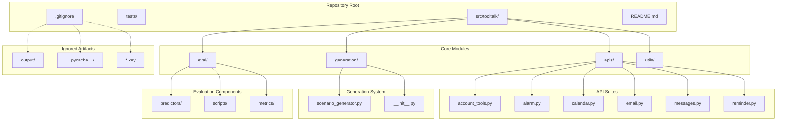
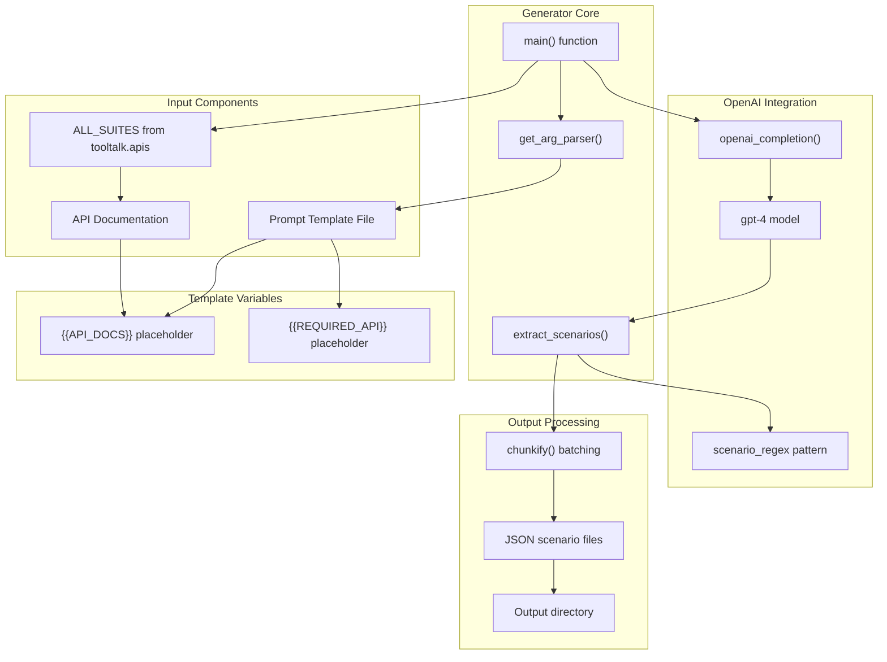
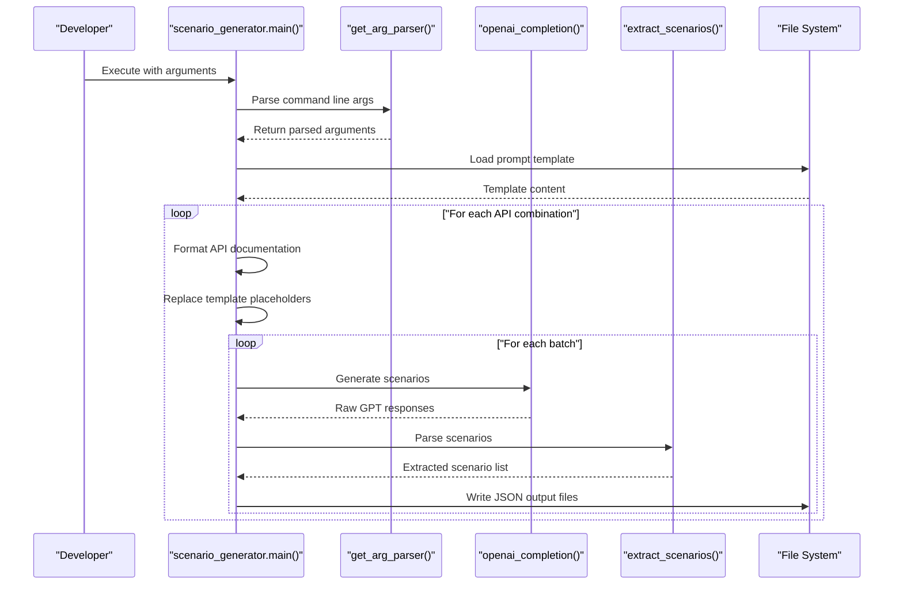

<!-- source: DeepWiki mcp.deepwiki.com · repo microsoft/ToolTalk · page 5 Development Guide · fetched 2026-10-26 -->

# Development Guide

Relevant source files

The following files were used as context for generating this wiki page:

- [.gitignore](.gitignore)
- [images/Evaluation.png](images/Evaluation.png)
- [src/tooltalk/generation/__init__.py](src/tooltalk/generation/__init__.py)
- [src/tooltalk/generation/scenario_generator.py](src/tooltalk/generation/scenario_generator.py)

This document provides comprehensive guidance for developers who want to extend ToolTalk with new APIs, scenarios, or evaluation capabilities. It covers the development environment setup, key architectural components, and extension points for customizing the framework.

For information about using existing APIs, see [API Reference](#3). For running evaluations with the current system, see [Running Evaluations](#4.1). For detailed scenario generation workflows, see [Scenario Generation](#5.2).

## Development Environment Setup

ToolTalk is a Python-based framework that requires several dependencies for development work. The project follows standard Python packaging conventions with source code organized under `src/tooltalk/`.

### Project Structure Overview

The `.gitignore` file excludes development artifacts including API key files (`*.key`), output directories (`output/`), Python cache files (`__pycache__/`), and standard Python distribution files.

**Sources:** [.gitignore:1-167]()

## Core Development Components

### Scenario Generation Architecture

The scenario generation system is built around the `scenario_generator.py` module, which orchestrates the creation of new conversation scenarios using OpenAI's GPT models.

**Sources:** [src/tooltalk/generation/scenario_generator.py:1-138]()

### Key Development Classes and Functions

The scenario generator exposes several key extension points for developers:

| Component | Purpose | Location |
|-----------|---------|----------|
| `main()` | Primary entry point for scenario generation | [src/tooltalk/generation/scenario_generator.py:65-137]() |
| `get_arg_parser()` | Command-line argument configuration | [src/tooltalk/generation/scenario_generator.py:47-61]() |
| `extract_scenarios()` | Parse generated scenarios from GPT responses | [src/tooltalk/generation/scenario_generator.py:30-44]() |
| `API_DOC_KEY` | Template placeholder for API documentation | [src/tooltalk/generation/scenario_generator.py:26]() |
| `REQUIRED_API_KEY` | Template placeholder for required API | [src/tooltalk/generation/scenario_generator.py:27]() |

## Development Workflow

### Scenario Generation Process

**Sources:** [src/tooltalk/generation/scenario_generator.py:65-137]()

## Extension Points for Developers

### Adding Custom Prompt Templates

The scenario generator uses template files with specific placeholder variables that developers can customize:

- `{{API_DOCS}}`: Replaced with formatted API documentation
- `{{REQUIRED_API}}`: Replaced with the specific required API name

Template validation ensures these placeholders exist before processing begins.

**Sources:** [src/tooltalk/generation/scenario_generator.py:73-74]()

### Customizing API Suite Combinations

The generator creates scenarios for all possible combinations of API suites using the `combinations()` function from itertools. Developers can modify this logic to:

- Focus on specific API suite combinations
- Ensure certain APIs are always included
- Implement custom sampling strategies

The current implementation processes all combinations of size `k` from `ALL_SUITES`, where `k` is specified via command-line arguments.

**Sources:** [src/tooltalk/generation/scenario_generator.py:83-99]()

### Extending Output Formats

The current system outputs JSON files with the following structure:
- `prompt`: The complete formatted prompt sent to GPT
- `apis`: Metadata about API suites and required APIs used
- `response`: Raw GPT response text
- `scenarios`: Extracted and parsed scenario list

Developers can extend the `extract_scenarios()` function to support additional output formats or parsing patterns.

**Sources:** [src/tooltalk/generation/scenario_generator.py:119-133]()

### Development Environment Configuration

The project uses several configuration patterns that developers should follow:

| Configuration Type | Implementation | Purpose |
|-------------------|----------------|---------|
| Logging | `logging.basicConfig(level=logging.INFO)` | Development debugging |
| OpenAI Integration | `openai_completion()` utility function | Standardized API calls |
| File Processing | `chunkify()` utility for batching | Memory-efficient processing |
| Error Handling | Try-catch blocks with detailed logging | Robust scenario generation |

**Sources:** [src/tooltalk/generation/scenario_generator.py:23-24](), [src/tooltalk/generation/scenario_generator.py:104-125]()

---

