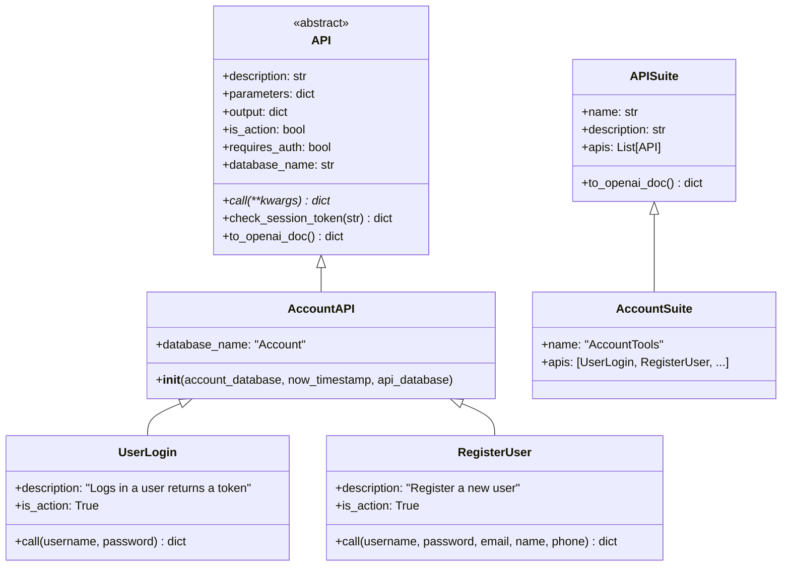
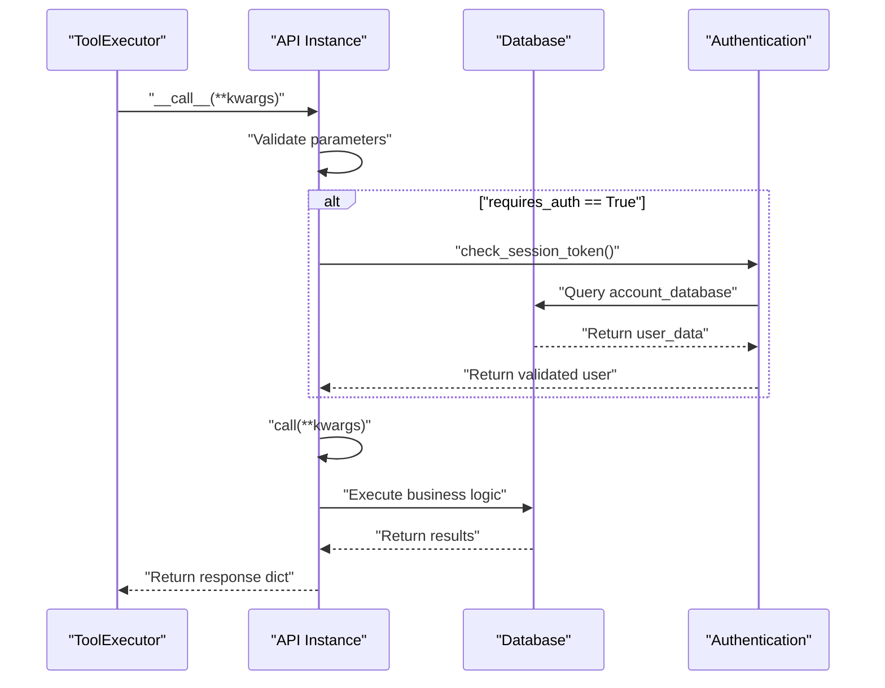
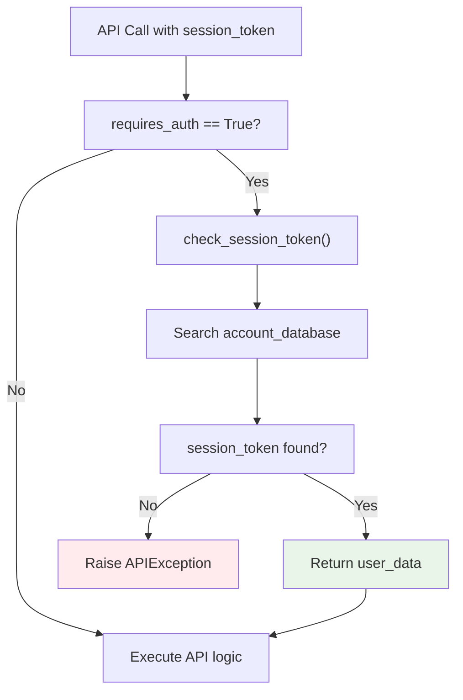

<!-- source: DeepWiki mcp.deepwiki.com · repo microsoft/ToolTalk · page 5.1 Adding New APIs · fetched 2026-10-26 -->

# Adding New APIs

<details>
<summary>Relevant source files</summary>

The following files were used as context for generating this wiki page:

- [src/tooltalk/apis/account.py](src/tooltalk/apis/account.py)
- [src/tooltalk/apis/api.py](src/tooltalk/apis/api.py)

</details>


This document provides a comprehensive guide for developers who want to extend ToolTalk by implementing new API suites. It covers the architectural patterns, base class usage, database integration, authentication handling, and testing procedures required to successfully add new APIs to the ToolTalk framework.

For information about the overall API system architecture, see [API System](#2.2). For details on running tests for your new APIs, see [Testing Framework](#4.2).

## API Architecture Overview

ToolTalk uses a hierarchical API architecture built around two primary base classes: `API` and `APISuite`. Individual APIs inherit from the `API` base class and are grouped into logical suites using the `APISuite` class.

### Core API Class Hierarchy



**Sources:** [src/tooltalk/apis/api.py:15-187](), [src/tooltalk/apis/account.py:26-532]()

### API Execution Flow



**Sources:** [src/tooltalk/apis/api.py:75-102](), [src/tooltalk/apis/api.py:149-157]()

## Creating a New API Class

### Required Class Attributes

Every API class must define specific class attributes that describe its functionality and behavior:

| Attribute | Type | Description | Required |
|-----------|------|-------------|----------|
| `description` | `str` | Human-readable description of the API | Yes |
| `parameters` | `dict` | Parameter schema with types and descriptions | Yes |
| `output` | `dict` | Output schema with types and descriptions | Yes |
| `is_action` | `bool` | Whether the API modifies system state | Yes |
| `requires_auth` | `bool` | Whether authentication is required | No (default: False) |
| `database_name` | `str` | Name of the database to use | No |

### Parameter Schema Format

Parameters must follow this schema structure:

```python
parameters = {
    'parameter_name': {
        'type': "string",  # or "integer", "boolean", "array", "object"
        'description': 'Description of the parameter',
        'required': True   # or False
    }
}
```

### Implementation Template

Here's the basic template for creating a new API class:

```python
class YourAPIName(YourBaseAPI):
    description = 'Description of what this API does'
    parameters = {
        'param1': {
            'type': "string",
            'description': 'Description of param1',
            'required': True
        }
    }
    output = {
        'result': {
            'type': "string", 
            'description': 'Description of return value'
        }
    }
    is_action = True  # or False for read-only APIs
    requires_auth = True  # if authentication needed
    
    def call(self, session_token: str, param1: str) -> dict:
        """
        Implementation of the API logic.
        
        Args:
            session_token: Handled automatically if requires_auth=True
            param1: Your parameter
        """
        if self.requires_auth:
            user_data = self.check_session_token(session_token)
        
        # Your implementation logic here
        return {"result": "success"}
```

**Sources:** [src/tooltalk/apis/account.py:39-74](), [src/tooltalk/apis/api.py:15-21]()

## Database Integration

### Database Access Patterns

ToolTalk APIs interact with JSON-based databases through the `database` attribute. The system supports two database access patterns:

1. **Suite-specific Database**: APIs that inherit from a suite base class (like `AccountAPI`) automatically get access to their suite's database
2. **Custom Database**: APIs can specify a custom `database_name` and access it through `self.api_database`

### Database Schema Design

When designing database schemas, follow these conventions:

```python
# Example database schema documentation
"""
YourAPI database schema:

primary_key: str - unique identifier
field1: str - description of field1
field2: int - description of field2
timestamp: str - creation/modification timestamp
user_id: str - reference to user (if user-specific data)
"""

DATABASE_NAME = "YourAPIDatabase"
```

### Database Operations

Common database operations in ToolTalk APIs:

```python
# Create new record
self.database[primary_key] = {
    "field1": value1,
    "field2": value2,
    "timestamp": self.now_timestamp.strftime("%Y-%m-%d %H:%M:%S")
}

# Read record
if primary_key in self.database:
    record = self.database[primary_key]

# Update record
self.database[primary_key]["field1"] = new_value

# Delete record
del self.database[primary_key]

# Query records
results = [
    record for key, record in self.database.items()
    if record["field1"] == search_value
]
```

**Sources:** [src/tooltalk/apis/account.py:13-23](), [src/tooltalk/apis/account.py:303-319]()

## Authentication Requirements

### Session Token Validation

APIs that require authentication must set `requires_auth = True` and use the inherited `check_session_token()` method:

```python
def call(self, session_token: str, other_params) -> dict:
    user_data = self.check_session_token(session_token)
    username = user_data['username']
    # Continue with authenticated logic
```

The `check_session_token()` method automatically:
- Validates the session token exists in the account database
- Returns the full user record if valid
- Raises `APIException` if invalid or expired

### Authentication Flow



**Sources:** [src/tooltalk/apis/api.py:149-157](), [src/tooltalk/apis/account.py:58-73]()

## Creating API Suites

### APISuite Structure

API suites group related APIs together and provide a unified interface for documentation and discovery:

```python
class YourAPISuite(APISuite):
    name = "YourSuiteName"
    description = "Description of what this suite provides"
    apis = [
        FirstAPI,
        SecondAPI,
        ThirdAPI,
    ]
```

### Suite Base Classes

For APIs that share common database access or functionality, create a suite-specific base class:

```python
class YourSuiteAPI(API, ABC):
    database_name = "YourSuiteDatabase"
    
    def __init__(self, account_database: dict, now_timestamp: str, api_database: dict = None):
        super().__init__(account_database, now_timestamp, api_database)
        self.database = self.api_database  # or specific database access logic
```

**Sources:** [src/tooltalk/apis/account.py:26-37](), [src/tooltalk/apis/account.py:517-532]()

## Implementation Example

### Complete API Implementation

Here's a complete example implementing a simple note-taking API suite:

```python
from .api import API, APISuite
from .exceptions import APIException

NOTE_DB_NAME = "Notes"

class NoteAPI(API, ABC):
    database_name = NOTE_DB_NAME
    
    def __init__(self, account_database: dict, now_timestamp: str, api_database: dict = None):
        super().__init__(account_database, now_timestamp, api_database)
        self.database = self.api_database

class CreateNote(NoteAPI):
    description = 'Creates a new note for the authenticated user'
    parameters = {
        'title': {
            'type': "string",
            'description': 'The title of the note',
            'required': True
        },
        'content': {
            'type': "string", 
            'description': 'The content of the note',
            'required': True
        }
    }
    output = {
        'note_id': {'type': "string", 'description': 'The ID of the created note'},
        'status': {'type': "string", 'description': 'success or failed'}
    }
    is_action = True
    requires_auth = True
    
    def call(self, session_token: str, title: str, content: str) -> dict:
        user_data = self.check_session_token(session_token)
        username = user_data['username']
        
        note_id = f"note_{self.random.randint(1000, 9999)}"
        self.database[note_id] = {
            'id': note_id,
            'title': title,
            'content': content,
            'owner': username,
            'created': self.now_timestamp.strftime("%Y-%m-%d %H:%M:%S")
        }
        
        return {
            'note_id': note_id,
            'status': 'success'
        }

class NoteSuite(APISuite):
    name = "NoteTools"
    description = "APIs for managing user notes"
    apis = [CreateNote]
```

**Sources:** [src/tooltalk/apis/account.py:242-319](), [src/tooltalk/apis/api.py:159-187]()

## Testing New APIs

### Oracle Testing

ToolTalk provides an oracle testing framework that validates API implementations against expected behavior. When adding new APIs, ensure they pass oracle tests by:

1. **Following the API Contract**: Ensure your `call()` method signature matches the declared parameters
2. **Proper Exception Handling**: Use `APIException` for expected business logic errors
3. **Consistent Return Values**: Match the declared output schema exactly

### Integration Testing

Test your APIs within the full ToolTalk ecosystem by:

1. **Adding to ToolExecutor**: Ensure your suite is properly registered
2. **Database State Management**: Verify database operations work correctly
3. **Authentication Flow**: Test both authenticated and unauthenticated scenarios
4. **Error Conditions**: Validate proper error handling and messaging

For comprehensive testing procedures, see [Testing Framework](#4.2).

**Sources:** [src/tooltalk/apis/api.py:44-69](), [src/tooltalk/apis/api.py:85-102]()

---

